# face-blur-lite 详细设计文档

> 版本 v1.4 ｜ 2026-09-24（v1.4=契约 v1.1：终态守卫 + attempt 记账对齐 + DDL 内联 + get_chunk；v1.3=实现校对 + §8 验收指标回填实测值；v1.2=R11-R13 演进就绪 + 全图示 Mermaid 化） ｜ 状态：MVP Task 0-11 已实现（32 测试绿 + 批量冒烟通过），gocp（Task 12）待实施
>
> 图示说明：本文全部图为 Mermaid（GitHub / VSCode 预览原生渲染），含 flowchart（架构/数据流/DAG/路线图）、stateDiagram（状态机×2）、sequenceDiagram（原子 Join / kill-9 恢复）、classDiagram（契约/数据面）。
>
> **一句话定位**：轻量视频人脸脱敏管线——以业界数据处理工作流的形态，把"采集视频 → 人脸全部模糊 → 全新视频"实现为控制面/数据面分离的 scatter-gather 管线；控制面双形态（SQLite 内嵌 / Go 服务），本地单机闭环，零云成本。
>
> 配套文档：实施计划（TDD 任务分解）见 `docs/superpowers/plans/2026-09-23-face-blur-lite-mvp.md`；控制面契约规范见 `docs/control-plane-contract.md`；业界平台映射见 `docs/platform-mapping.md`。

---

## 1. 背景与目标

### 1.1 场景

具身智能数据采集中产出大量视频，其中不可避免出现人脸。要求：输入一段视频（demo 5 分钟，架构支持更长），输出人脸全部模糊的**新视频**，音轨保留。难点：手臂遮挡、长视频、模型以什么格式吃数据、业界主流方案选型、预测人脸下一帧出现的坐标。

### 1.2 需求清单


| #   | 需求                                  | 设计落点                                                                | 章节                  |
| ----- | --------------------------------------- | ------------------------------------------------------------------------- | ----------------------- |
| R1  | 视频进 → 人脸全模糊视频出            | 流式算子内核（解码→检测→跟踪→模糊→编码）                            | §3.1 / §3.2         |
| R2  | 手臂遮挡不漏糊                        | 跟踪器预测外推 + 低分框二轮回收 + max_age 容忍                          | §3.2                 |
| R3  | 长视频                                | 流式 IO 内存 O(1) + scatter-gather 分片并行                             | §3.1 / §3.3         |
| R4  | 模型输入格式                          | ffmpeg rawvideo pipe →`(H,W,3)` BGR uint8 帧 tensor                    | §3.2                 |
| R5  | 主流模型选型                          | YuNet 起步 + Detector 协议抽象，SCRFD 升级位                            | §3.2                 |
| R6  | 预测下一帧人脸坐标                    | 跟踪器恒速运动模型`predict()`                                           | §3.2                 |
| R7  | 工作流形态：控制面/数据面 + 控制面 Go | 契约先行，控制面双形态（SQLite 内嵌 / Go 服务）                         | §2.4 / §3.3 / §3.4 |
| R8  | 业界工作流平台了解                    | 胜算/火山 LAS/百舸工作流两层映射                                        | §6                   |
| R9  | 怎么证明没漏                          | 输出域抽帧复检闸门（阈值分域）                                          | §3.1 / §5           |
| R10 | 一次处理多个视频                      | 批量编排：共享 Worker 池 + 失败隔离                                     | §3.3                 |
| R11 | **大量视频（可大可小）**吞吐          | 库即队列：增量提交、大小混合同池交错、瓶颈在数据面→横向加 Worker       | §7.1                 |
| R12 | **上云容器编排**可轻易迁移            | Worker 独立常驻入口 + gocp 独立服务 + 路径契约配共享文件系统            | §7.2                 |
| R13 | **手写 DAG → 通用 DAG 引擎**直接切换 | 算子全部 CLI 子命令化；原子 Join→fan-in 边；换调度层、算子层 100% 保留 | §7.3                 |
| R14 | **观测出口**（排队/吞吐/失败率）    | `stats` 命令只读旁路：时间戳/attempt 已入库，零 schema 变更；不进 ControlPlane 契约 | §3.3 / §8            |

### 1.3 非目标与迁移承诺（本期不做，但路径已预留）

- **人脸识别/白名单**——脱敏规则是"全部模糊"，只需检测不需识别身份（硬边界，非演进项）
- **实时流式**（RTSP/推流）——离线批处理场景（硬边界，非演进项）
- **上云/容器编排**——首期本地闭环（¥0）；但 Worker 独立常驻入口、gocp 服务化、路径契约已就位，迁移是部署动作而非改造（§7.2 清单）
- **通用 DAG 引擎**——本期手写窄版 DAG；四个算子已全部 CLI 子命令化可被引擎直接当节点模板，切换=换调度层、算子层 100% 保留（§7.3 对照表）

---

## 2. 总体架构

### 2.1 架构图

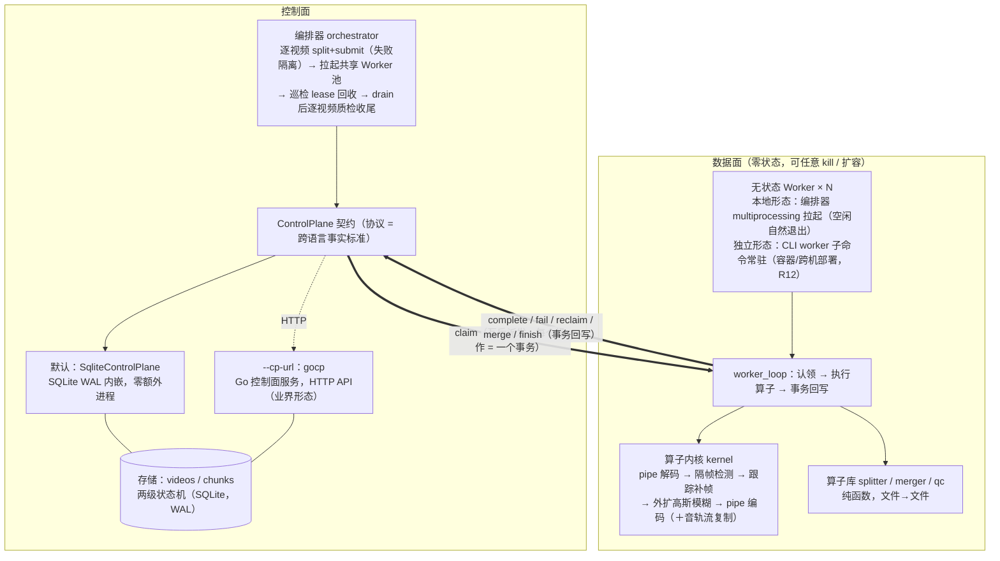

### 2.2 控制面/数据面职责


|          | 控制面                                                                                                                                  | 数据面                                                      |
| ---------- | ----------------------------------------------------------------------------------------------------------------------------------------- | ------------------------------------------------------------- |
| 职责     | 状态机、任务派发、lease 回收、原子 Join、编排                                                                                           | 真正干活：解码、检测、跟踪、模糊、编码、切片、合并、质检    |
| 实现形式 | `control.py` 协议 + `state.py` SQLite 实现 + `remote.py` HTTP 适配 + `gocp/` Go 服务 + `orchestrator.py` 编排器（默认内嵌，非独立服务） | 无状态 Worker 进程（multiprocessing 拉起）+ 纯函数算子      |
| 关键性质 | 所有状态唯一拥有者；事务保证 claim 互斥与 Join 原子性                                                                                   | 零状态、可任意杀/扩——lease 与"最后完成者认领合并"因此成立 |
| 演进形态 | SQLite→Redis（Lua 原子 Join）→平台工作流引擎                                                                                          | 子进程→Docker 任务容器（百舸"任务式"）                     |

### 2.3 技术选型

- **数据面**：Python ≥3.10；`opencv-python`（FaceDetectorYN/YuNet）、`numpy`、`scipy`（匈牙利匹配）、`sqlite3`（标准库）、系统 ffmpeg/ffprobe。依赖白名单硬约束（4 个包）
- **控制面 Go 形态**：Go ≥1.22；stdlib `net/http` + 唯一外部依赖 `modernc.org/sqlite`（纯 Go 无 CGO，`go build` 出静态单二进制）；Python 侧 HTTP 客户端用 stdlib `urllib`，**零新增依赖**

### 2.4 语言与形态 ADR（摘要）

**结论：控制面可以用 Go（业界主流——K8s/Temporal/Argo 控制面皆 Go），本项目以"双形态并存"落地**：


|          | 默认形态                    | Go 形态                                         |
| ---------- | ----------------------------- | ------------------------------------------------- |
| 控制面   | SQLite 内嵌（同进程库调用） | gocp 独立服务（HTTP API）                       |
| 切换     | 无需                        | CLI`--cp-url http://…`                         |
| 额外依赖 | 无                          | Go 工具链 + 1 个纯 Go 包                        |
| 定位     | 最轻本地闭环                | 业界分工复刻：平台控制面 Go + 算法数据面 Python |

两实现**过同一份契约测试**（参数化双跑），行为漂移立刻红灯。生产化触发条件（Worker 上百、控制面长出 API/UI/多租户、多机静态分发）满足时，Go 形态直接升级为常驻服务——demo 到生产的路径是连续的。

### 2.5 代码框架（目录结构，职责即边界）

```
face-blur-lite/
├── README.md                      # 快速开始 + 架构图 + 设计决策
├── pyproject.toml
├── scripts/download_assets.sh     # 模型/测试资产下载（产物 gitignore）
├── docs/
│   ├── superpowers/plans/…        # 实施计划（TDD 任务分解）
│   ├── control-plane-contract.md  # 控制面契约规范（Go 实现依据）
│   ├── design.md                  # 详细设计·四大视图（本文件）
│   └── platform-mapping.md        # 胜算/LAS/百舸对照＋通用引擎
├── src/faceblur_lite/
│   ├── __init__.py
│   ├── ffmpeg_io.py               # [数据面] probe / FFmpegReader / FFmpegWriter
│   ├── detector.py                # [数据面] Detector 协议 + YuNet 实现
│   ├── tracker.py                 # [数据面] mini-SORT：预测/关联/遮挡/低分回收
│   ├── blur.py                    # [数据面] 外扩 + 高斯模糊
│   ├── kernel.py                  # [数据面] 算子内核：视频→脱敏视频 + 报告
│   ├── testmedia.py               # [数据面测试基建] 合成视频（move/occlude）
│   ├── splitter.py                # [数据面] 关键帧流复制切片 + 短视频快路径
│   ├── merger.py                  # [数据面] concat 流复制合并 + 降级重编码
│   ├── qc.py                      # [数据面] 输出域抽帧复检算子
│   ├── control.py                 # [控制面] ControlPlane 协议（跨语言契约）
│   ├── state.py                   # [控制面] SqliteControlPlane：契约的参考实现
│   ├── remote.py                  # [控制面] HttpControlPlane：契约的 HTTP 客户端（对接 gocp）
│   ├── worker.py                  # [数据面] Worker 认领-执行-回写循环
│   ├── orchestrator.py            # [控制面] 编排：split→并行→merge→qc
│   ├── stats.py                   # [观测] 最小出口：排队/处理分位、吞吐、失败率（只读旁路，R14）
│   └── cli.py                     # single/pipeline/worker/split/merge/qc/stats/demo-video/status
├── gocp/                          # [控制面-Go] Go 控制面服务（业界形态）
│   ├── go.mod                     # 唯一外部依赖 modernc.org/sqlite（纯 Go）
│   └── main.go                    # 单文件：HTTP API + SQLite，同 schema 同事务语义
└── tests/
    ├── conftest.py                # 资产 skip 标记 + 共享 session fixture
    └── test_*.py                  # 每模块一个测试文件
```

职责即边界：`[数据面]`/`[控制面]` 注释即平面归属；数据面模块只准 import `control.py` 协议、控制面不含媒体逻辑（跨平面契约见 §3.4）。

---

## 3. 详细设计（四大视图）

### 3.1 数据处理管线设计（数据怎么流）

#### 端到端数据流

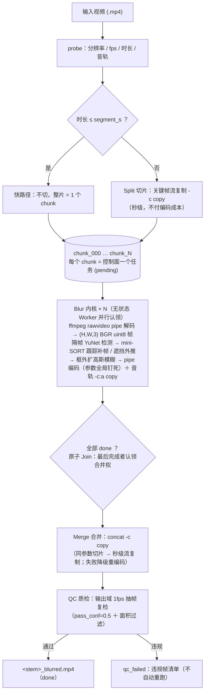

#### 阶段表（唯一付代价的段是 Blur，其余全部流复制/抽样）


| 阶段 | 算子                   | 输入→输出        | 代价语义            | 失败语义                                        |
| ------ | ------------------------ | ------------------- | --------------------- | ------------------------------------------------- |
| 切片 | `splitter.split_video` | 文件→文件列表    | 流复制秒级，零编码  | 提交期失败→该视频 failed（批次隔离，其余继续） |
| 脱敏 | `kernel.process_video` | chunk→脱敏 chunk | **唯一编码+推理段** | attempt≤3 重试，耗尽→视频 failed              |
| 合并 | `merger.merge_chunks`  | 列表→完整视频    | 同参数→流复制秒级  | 降级重编码合并                                  |
| 质检 | `qc.qc_video`          | 输出视频→报告    | 1fps 抽帧，成本可控 | 违规→qc_failed＋违规帧清单                     |

#### 数据边界格式（每个交接面是什么数据）


| 边界                 | 格式                                                                    |
| ---------------------- | ------------------------------------------------------------------------- |
| 输入/输出/chunk 文件 | .mp4（H.264 / yuv420p / crf20 / veryfast / +faststart——参数全局钉死） |
| 解码后帧             | `(H,W,3)` BGR uint8 ndarray（pipe 流式，不落盘）                        |
| 检测输出             | `Det(x1,y1,x2,y2,conf)`，像素坐标原分辨率                               |
| 控制面任务           | `chunks` 表一行（input/output/status/lease/attempt/metrics）            |
| 处理/质检报告        | `KernelReport` / `QCReport`（JSON 可序列化，含人脸时间段 segments）     |

#### 关键设计点

1. **内存 O(1)**：全程 pipe 流式，任意长视频不整载内存（R3 地基）
2. **编码参数全局钉死**是 concat 流复制合并的前提——"合并零成本"是这个决定的回报；音轨 `-c:a copy` 绝不重编；concat 列表条目须写绝对路径（ffmpeg concat demuxer 按列表文件所在目录解析相对条目——2026-09-24 冒烟实测：相对 `--outdir/--workdir` 下合并 ENOENT、视频卡 merging，已修）
3. **阈值分域**：内核检测阈值 det_conf=0.3 作用于**源视频信号域**；质检阈值 pass_conf=0.5 作用于**重编码后的输出域**。两者不可比较不可复用——置信度不跨有损编码域守恒（实测教训：源域 0.10 的框重编码后可涨到 0.75）
4. **多视频批量**：N 个视频的 chunk 进同一队列、共享 Worker 池交错消费——两级并发（大视频多片并行＋多视频交错）由队列模型免费获得，Worker 零感知视频边界

### 3.2 模型选择（用什么、为什么、怎么喂）

#### 选型标准

CPU 可跑（demo 无 GPU）、许可宽松、体积小、对"糊脸"够用——脱敏要 **recall 不要 precision（宁可多糊，代价不对称）**。

#### 候选对比


| 候选                           | 体积     | CPU | 精度                  | 结论                                                      |
| -------------------------------- | ---------- | ----- | ----------------------- | ----------------------------------------------------------- |
| OpenCV YuNet（FaceDetectorYN） | ~1MB     | 快  | 正/侧脸够用，遮挡一般 | ✅ MVP 选定                                               |
| InsightFace SCRFD              | 数 MB 级 | 中  | 遮挡/小脸 recall 更强 | 升级位（协议已留）                                        |
| 云端人脸 API                   | —       | —  | 高                    | ❌ 未脱敏人脸出域违背脱敏初衷（隐私悖论）＋万帧级调用成本 |

**决策**：MVP 用 YuNet，检测藏在 `Detector` 协议后（`detect(frame_bgr) -> list[Det]`）；SCRFD 为声明式升级——换实现类，管线零改动。预处理（缩放/归一化）在检测器内部完成（`setInputSize`），管线只递原始 BGR 帧。

#### 模型输入格式链路（R4：模型吃帧 tensor，不吃视频文件）

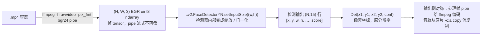

解码归 ffmpeg，检测归 ONNX，中间只有 numpy；输出侧对称——处理帧 pipe 给 ffmpeg 编码，音轨从原片流复制。

#### 跟踪器设计（mini-SORT：R2 遮挡 + R6 下一帧预测）

- **恒速运动模型**：`predict()` 把每个 track 按估计速度外推一帧——**这就是"预测下一帧人脸坐标"**，显式、可单测、可演示
- **匈牙利匹配**（`scipy.optimize.linear_sum_assignment` + IoU 代价）做检测框↔轨迹关联
- **低分框二轮回收**（ByteTrack 思路）：遮挡期置信度塌落时高分一轮未匹配的轨迹用低分框救活，不断链
- **max_age 剪枝**：连续 N 个检测轮无匹配才淘汰——容忍遮挡期预测外推，同时防 ghost 轨迹无限存活
- 速度估计按"距上次检测的帧数 gap"归一，det_every>1 时依然正确

#### 推理成本策略

隔帧检测（det_every=3）＋跟踪补帧 = 推理量降 2/3；**质检复用同款检测器、不同阈值域**——一套模型资产两处用。

### 3.3 工作流的编排（任务怎么组织、调度、容错）

#### DAG 形态

split→blur×N→merge→qc 即所有工作流引擎的 fan-out/fan-in 最小子图：

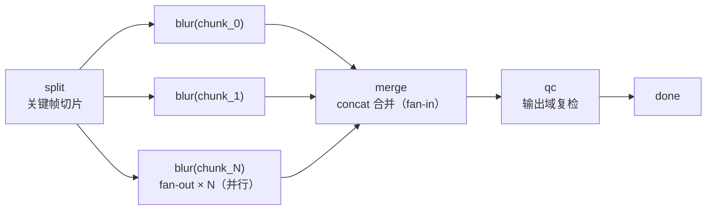

#### 任务模型与状态机

两级任务：`videos` 父表 + `chunks` 子表（一行=一个任务：input/output/status/lease/attempt/metrics/三个时间戳）。

`videos` 状态机：

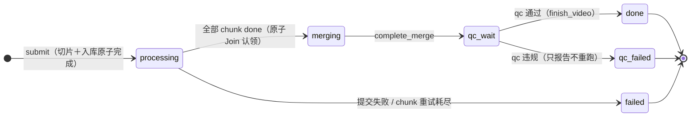

`chunks` 状态机：

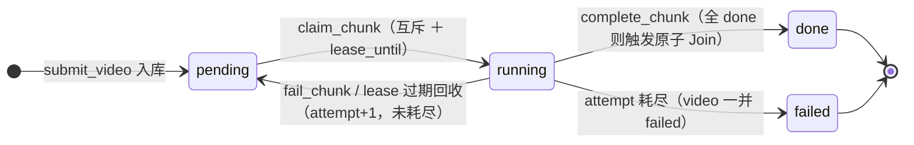

状态只能经控制面操作变更（单写入口）；完整规范见 `docs/control-plane-contract.md`。

#### 调度语义（每个控制面操作 = 一个事务）


| 语义           | 机制                                                                                         | 防什么事故                                 |
| ---------------- | ---------------------------------------------------------------------------------------------- | -------------------------------------------- |
| **claim 互斥** | `BEGIN IMMEDIATE` 事务内"取最早 pending→置 running＋lease_until"                            | 两个 Worker 领同一片                       |
| **原子 Join**  | complete_chunk 事务内置 done 并 COUNT 判全，`UPDATE … WHERE status='processing'` 认领合并权 | 两个 Worker 都以为自己是最后一个→合并两次 |
| **lease 回收** | TTL 过期的 running→pending 重派（attempt+1），耗尽→视频 failed                             | Worker 暴死后任务永远卡 running            |
| **失败隔离**   | 提交期 per-video try/except＋巡检不 fast-fail                                                | 一个坏视频拖死整批                         |

**原子 Join 时序**（并发竞态怎么被关闭）：

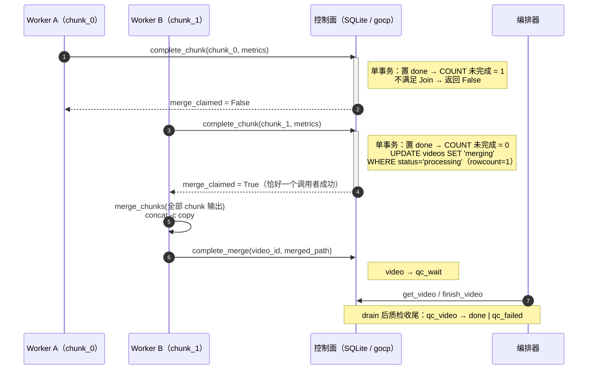

SQLite 事务天然串行化关闭竞态窗口；Go 实现（`_txlock=immediate`）与未来 Redis 实现（Lua 脚本）保持同语义。

#### 执行拓扑（编排器视角）

```
for 每个输入视频（失败隔离：单视频失败记结果，批次继续）:
    split → submit（chunk 任务原子出现）
拉起 N 个无状态 Worker（共享池，消化所有视频的 chunk，空闲自然退出）
while 池活着: reclaim_expired()   # 巡检回收，不 fast-fail
drain 后逐视频: qc_video → done / qc_failed（或报告 failed/stuck）
```

#### 批量多视频（R10）

`run_batch(inputs, outdir, …)`：输出统一命名 `<stem>_blurred.mp4`；共享 Worker 池天然实现两级并发；CLI `pipeline inputs… --outdir`，退出码 0 仅当全部 done。

#### 控制面双形态与契约闸门

- 默认 SQLite 内嵌：编排器直接构造 `SqliteControlPlane`，零额外进程
- `--cp-url`：构造 `HttpControlPlane`（stdlib urllib）连 gocp——Worker/编排器其余代码**零改动**（依赖注入）
- **契约测试参数化双跑**：`tests/test_contract.py` 对 `["sqlite","go"]` 跑同一份场景（互斥/原子 Join/lease/attempt 耗尽/多视频共享队列）——两实现行为一致的闸门
- **观测出口（R14，最小形态）**：`stats` 命令只读旁路直读库文件（排队/处理 P50/P95、吞吐 chunks/min、失败率、重试计数）——时间戳/attempt 已入库，零 schema 变更；**不进 ControlPlane 契约**（观测读不污染任务状态契约）；gocp 模式同样可直读其 SQLite 库（WAL 并发只读）。血缘与时序化（exporter/大盘/告警）留平台期

### 3.4 数据面/控制面算子设计（暴露什么、契约是什么）

#### 算子清单


| 算子                                                                                                         | 平面   | 接口                                             | 性质                                           |
| -------------------------------------------------------------------------------------------------------------- | -------- | -------------------------------------------------- | ------------------------------------------------ |
| `process_video`                                                                                              | 数据面 | `(in, out, params) -> KernelReport`              | 纯函数；参数钉死→确定性；同入同出→幂等       |
| `split_video`                                                                                                | 数据面 | `(in, dir, segment_s) -> [paths]`                | 纯函数、幂等（含短视频快路径）                 |
| `merge_chunks`                                                                                               | 数据面 | `([paths], out) -> path`                         | 纯函数、幂等（含降级重编码路径）               |
| `qc_video`                                                                                                   | 数据面 | `(path, sample_fps, pass_conf) -> QCReport`      | 纯函数、只读                                   |
| `submit_video / claim_chunk / complete_chunk / fail_chunk / reclaim_expired / complete_merge / finish_video` | 控制面 | `ControlPlane` 协议方法                          | 每方法一个事务；任务状态的唯一写入口           |
| `get_chunk`                                                                                                  | 控制面 | `ControlPlane` 协议方法（只读）                  | 观测/契约测试断言；不存在抛 KeyError           |
| `worker_loop`                                                                                                | 数据面 | `(cp: ControlPlane, worker_id, params) -> stats` | 通用执行循环：认领→执行算子→回写；只依赖协议 |

#### 算子与契约类图

**图 A · 控制面契约**（协议是跨语言事实标准；两实现过同一份契约测试；数据面只依赖协议）：

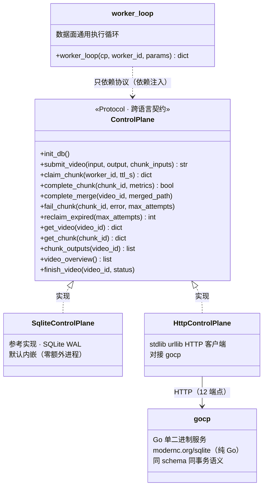

**图 B · 数据面算子/模型**（检测藏协议后、算子全纯函数、质检复用检测器）：

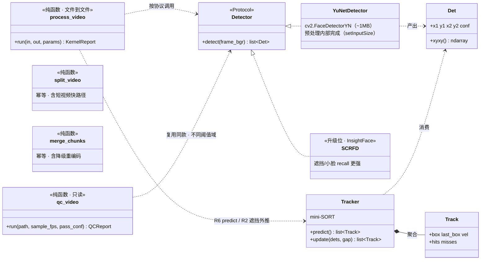

#### 跨平面契约（纪律）

1. **数据面算子 = 文件→文件纯函数**：无全局状态、可重入、失败留半成品无害（幂等重跑覆盖）
2. **控制面"算子" = 状态迁移操作**：所有状态变更唯一入口，事务保证互斥/原子性；不变量（每 chunk 至多一次成功执行、merge 至多认领一次、attempt 单调递增）见契约文档
3. **数据面只 import `control.py` 协议，不 import 任何实现**——换 SQLite / Go / Redis 实现数据面零改动
4. **控制面不得包含任何媒体处理逻辑**——职责单向依赖

#### 扩展性

- **换检测模型**：实现一个 `Detector` 协议类（如 SCRFD），管线零改动
- **加新脱敏算子**（车牌/人体）：实现一个文件→文件纯函数即可接入内核；"任务声明算子＋注册表、Worker 变通用执行器"为演进项（加算子时控制面不动）

---

## 4. 关键设计决策记录（ADR）


| #     | 决策                           | 理由                                                        | 代价                                       |
| ------- | -------------------------------- | ------------------------------------------------------------- | -------------------------------------------- |
| ADR-1 | 控制面/数据面分离              | 状态集中→Worker 可杀可扩；lease 回收与原子 Join 成立的前提 | 跨平面交互必须走契约                       |
| ADR-2 | 控制面双形态（内嵌/Go）        | 最轻路径与业界形态并存；契约测试锁定一致性                  | 双实现维护（测试闸门兜底）                 |
| ADR-3 | 阈值分域（源 0.3 / 输出 0.5）  | 置信度不跨有损编码域守恒（实测教训）                        | 两套阈值分别调参                           |
| ADR-4 | 关键帧流复制切片 + concat 合并 | 只有处理段付编码成本；切片/合并秒级                         | 边界 ±1-2s 落关键帧；编码参数必须全局钉死 |
| ADR-5 | 隔帧检测 + 跟踪补帧            | 推理量降 2/3                                                | 引入跟踪器复杂度；遮挡期依赖外推           |
| ADR-6 | qc_failed 不自动重跑           | 确定性系统原参数重试无效——重试要么升级要么别试            | 需人工/升级闭环（演进项）                  |

---

## 5. 容错设计

### 失败语义矩阵


| 故障                      | 检测点             | 系统行为                                                     |
| --------------------------- | -------------------- | -------------------------------------------------------------- |
| 输入文件不存在/损坏       | 提交期 probe/split | 该视频 failed，**批次继续**（失败隔离）                      |
| Worker 处理中崩溃/被 kill | lease TTL 过期     | reclaim → pending 重派（attempt+1）；耗尽 → 视频 failed    |
| Worker 空转（无任务）     | 队列空             | 空闲 idle_exit_s 后自然退出                                  |
| 合并失败                  | ffmpeg 返回码      | 降级为重编码合并                                             |
| 模型漏检                  | qc 输出域复检      | qc_failed + 违规帧清单（时间戳/置信度/坐标），**不自动重跑** |
| 控制面并发竞争            | —                 | 单事务 claim/Join 语义关闭竞态窗口（契约测试锁定）           |

### kill -9 演示场景（最有说服力的容错演示）

处理中 `kill -9` 一个 Worker：已完成的 chunk 不重跑（状态已 done）；半途 chunk 在 TTL 后被回收重派（attempt+1）；批次最终 done——"断点续跑 + 僵尸回收"一分钟讲清分布式真实问题。

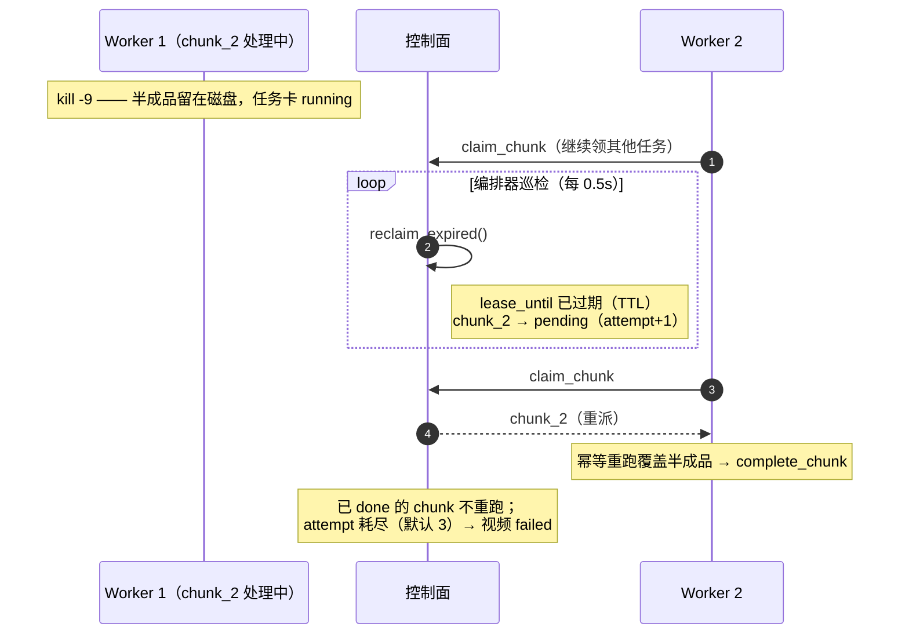

---

## 6. 业界工作流对照

### 两层工作流（2026-09 调研）

- **数据层**：百度胜算（数据智能平台）、火山云 LAS（AI 数据湖服务）——数据怎么被加工
- **算力层**：百度百舸工作流（AIHC DAG 编排 + 任务式作业）——加工任务怎么被调度执行

### 平台映射


| 本项目组件                | 百舸工作流                           | 火山 LAS     | 百度胜算     |
| --------------------------- | -------------------------------------- | -------------- | -------------- |
| face-blur 算子            | 工作流节点/任务                      | 数据处理任务 | 算子能力     |
| split→blur×N→merge→qc | DAG 组件化编排                       | 任务编排     | 数据处理管线 |
| 无状态 Worker + 队列      | 任务式作业                           | 托管调度     | 平台托管     |
| gocp + Python Worker      | 平台控制面（Go）+ 算法容器（Python） | 同左         | 同左         |
| 原子 Join 门控            | DAG 依赖边（平台原生）               | 同左         | 同左         |
| 状态机+重试+lease         | 任务生命周期管理                     | 平台托管     | 平台托管     |
| qc 抽帧复检               | DAG 质检节点                         | 数据质量任务 | 算子         |

### 通用形态审查结论（14 项逐项对照，全文见实施计划 Context 区）

**骨架同构，无缺口级差距**：两级任务+状态机、控制面/数据面分离、Go 控制+Python 算子分工、claim/Join/lease 语义（SQS visibility timeout / Redis Lua 同义）、scatter-gather（MapReduce/MediaConvert 同形态）、无状态+幂等、重试预算、质检闸门——全部与业界通用形态一致。观测出口已以最小 `stats` 命令收口（排队/处理分位、吞吐、失败率，只读旁路）；剩余差距集中在**平台配套**：lease 心跳续约、DLQ、血缘、分层抽样、容器化、算子通用化、观测时序化——全部记为演进项，不进 MVP；这份差距清单正是"轻量 demo → 业界平台"的距离，也是映射文档的价值。

---

## 7. 演进路线（三条迁移路径，R11-R13）

> 共同原则：**迁移时换的是调度层，保留的是算子层**——这是控制面/数据面分离（ADR-1）+ 契约先行（ADR-2）的回报。

### 7.1 大量视频（可大可小）吞吐（R11）

- **库即队列**：`submit_video` 廉价（切片=流复制秒级），千级视频可一次性或分批**增量入库**到同一个 pipeline.db，共享 Worker 池 drain——不需要一次喂完
- **大小混合零特判**：大视频切片并行、小视频快路径单任务，同队列交错消费；小视频开销 ≈ 一个任务
- **扩容方向明确**：吞吐瓶颈在数据面推理（CPU/GPU）→ 横向加 Worker 近线性扩展；控制面是低频事务（QPS 个位数）单实例撑得住——分层让"加机器"只发生在需要的地方
- 已知限制：重复提交不去重（幂等提交键 = input+params hash，记开放细化项 12）

### 7.2 上云容器编排迁移清单（R12）

| 步骤 | 迁移动作 | MVP 已预留 |
|---|---|---|
| 1 | 控制面：gocp 静态单二进制部署到云主机/容器 | ✅ 已是独立 HTTP 服务，跨机就绪 |
| 2 | 数据面：Worker 打镜像，常驻容器 `faceblur-lite worker --cp-url …`，Compose `--scale` / K8s Deployment / 百舸任务式 | ✅ `worker` CLI 子命令 + 常驻模式（`idle_exit_s=0` 永不退出） |
| 3 | 存储：接共享并行文件系统（百舸 PFS / BOS 挂载 / NFS） | ✅ 路径契约：全链路传 POSIX 路径字符串，算子 `open(path)` 零改动 |
| 4 | 模型资产：随镜像分发 | ✅ `FACEBLUR_MODEL` 环境变量已预留 |
| 5 | 编排器退化为提交客户端 | ✅ `run_batch` 只依赖 ControlPlane 协议，`--cp-url` 即切 |

迁移保留/替换：**保留** 算子镜像、契约语义、质检判定、阈值策略；**替换** Worker 拉起方式（multiprocessing→容器编排）；gocp 可保留（自管模式）或由平台调度器替代（全托管模式，见 7.3）。

### 7.3 手写 DAG → 通用 DAG 引擎切换（R13）

| 手写组件 | 通用引擎对应物（Argo/Kubeflow/百舸工作流） | 迁移时 |
|---|---|---|
| split / single / merge / qc 算子 | DAG 节点模板（容器 command） | **保留**：算子已全部 CLI 子命令化，模板原样引用 |
| 原子 Join（最后完成者认领合并） | fan-in 依赖边（引擎原生保证） | **替换**：merge 节点由引擎喂入全部 chunk 输出，`merge_chunks(paths, out)` 签名不变 |
| chunks 队列 + claim 互斥 | 引擎调度器 | 替换（被收编） |
| lease 回收 + attempt 上限 | 引擎任务活性管理 + 重试策略 | 替换（被收编） |
| qc 闸门 + 阈值分域 | DAG 内质检节点 + 节点参数 | **保留**（判定逻辑与策略是资产） |

- **动态 fan-out**：split 节点输出 chunk 清单 → 引擎动态展开 blur×N（Argo `withParam` / 百舸组件化编排）
- **语义对齐**：本项目的 at-least-once + 幂等算子 + attempt 预算，与 DAG 引擎的重试语义一一对应——迁移无语义坑
- 结论：**切换 = 换调度层，算子层与质检/阈值策略 100% 保留**。手写窄版不是浪费——它是"理解工作流引擎在解决什么问题"的证据，且算子层投资全部延续

### 7.4 总路线图

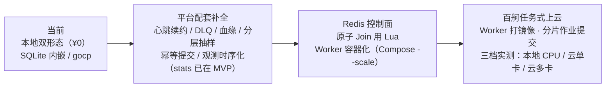

上演化平台后：状态机/队列/Join/lease 全部被平台工作流引擎收编，**保留的是算子内核、质检判定逻辑、阈值与参数策略**——这也是具身数据链路"采集→脱敏（本项目）→入湖→标注→训练"中第一道工序的平台化归宿。

---

## 8. 验收标准与指标

> 2026-09-24 批量冒烟实测回填（Intel i9-9880H 8C16T / ffmpeg 8.1.2 / opencv 5.0；
> 批次 = 5min 遮挡 + 30s 移动 + 90s 遮挡，`pipeline --workers 3 --segment 30`）。

| 维度 | 标准 | 实测结果 |
| ------ | ------ | ---------- |
| 功能 | 批量 3 视频全部 done | ✅ 3/3 done（14 chunks 全 done，retried=0，fail_rate=0） |
| 质量（qc） | qc 全过；时长一致 | ✅ 3/3 通过（抽帧 300/30/90，0 违规）；输出时长与输入一致（300.0/30.0/90.0s）。音轨：本轮为合成视频（无音轨），`-c:a copy` 链路带音轨断言记开放细化项 8（golden set） |
| 并行（加速比） | single 串行 vs pipeline wall 对比 | 5min 单进程 37.9s、三视频串行合计 54.9s（37.9+5.7+11.4） vs 批量 **57.6s**——本机单进程内核已吃满 CPU（user/real≈7.7 核），进程级分片无净加速（≈5% 编排开销）；加速位在单进程线程受限场景（容器 CPU 配额/跨机 Worker 池） |
| 并行（批量摊销） | 短视频几乎免费搭车 | ✅ 一次提交一个共享池，三视频同窗口完成（51.4/55.1/55.7s），小视频以队列交错搭车 |
| 可观测 | stats 输出分位/吞吐/失败率 | ✅ queue p50=19.3s/p95=38.2s；proc p50=10.7s/p95=12.8s；17.35 chunks/min；retried=0（数字同 README"指标输出"节） |
| 容错 | kill -9 恢复；失败隔离 | lease 语义由契约测试锁定（`test_lease_reclaim_and_attempt`：过期→pending 重派 attempt+1，耗尽→video failed）；失败隔离由 `test_batch_failure_isolation` 覆盖；本轮冒烟未做 live kill 演示（TTL=900s 需等满租约） |
| 契约 | `test_contract.py` 全绿 | ✅ SQLite 形态 5/5 绿；Go 参数化双跑为 Task 12 范围 |
| 质量（单测） | 全量绿 | ✅ 32/32（tracker/blur/IO/契约/管线/qc/cli/stats；遮挡场景 E2E 含预测外推覆盖断言） |
