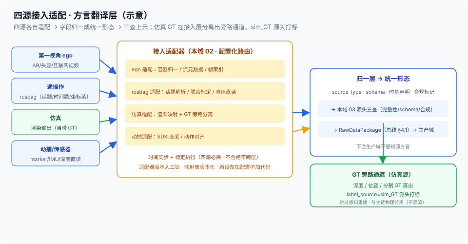

# 02 · 多源接入适配器（四源适配 / 字段归一 / 时间同步与标定 / GT 旁路入口）

> 01-接入域第 2 篇。定位：**把「源数据」变成「统一形态的原始信号」**——四源各自适配、字段归一、时间同步与标定在此层执行、仿真 GT 旁路在此开入口。边界：源/设备登记与能力模型 = [本域 01](01-采集源与设备管理.md)；源头校验与上云 = [本域 03](03-源头校验与上云.md)；算子执行与裁剪 = [生产域](../02-生产域/README.md)（[算子设计-05](../02-生产域/算子设计/算子设计-05-采集源差异矩阵.md) **SSOT**）；涉及管线调度 = [管控域](../03-管控域/README.md)；RawDataPackage schema = [总线 §4.1](../00-总体架构/README.md)（**SSOT**）。

## 核实状态（2026-10-18）

- ✅ 已核实：四源划分与接入形态 = [算子-05 §1](../02-生产域/算子设计/算子设计-05-采集源差异矩阵.md)；「时间同步/标定四源必需」= 算子-05 §2 矩阵第一行；仿真 GT 旁路 = [总线 §5.3](../00-总体架构/README.md) 与 [仿真GT旁路 01](../02-生产域/仿真GT旁路/01-仿真数据生产与三套GT.md)；rosbag 是遥操作载体不是第五类源 = [本域 01 §3](01-采集源与设备管理.md)；CloudRobo 真实/生成配比（20% 真机 / 80% 生成）= 算子-05 核实状态业内参照；三套 GT 用途不可混用 = 总线 §5.3
- ⚠️ 设计通识：四源适配器配置 schema、字段归一映射表、GT 旁路入口实现方式为本平台设计（**字段以实现为准**）
- ❓ 待补：各源适配时延与失败率基线、同步偏差容忍阈值与标定复标周期（沿 [本域 01](01-采集源与设备管理.md) 待标定项）、平台自身的真机/仿真配比策略——待团队标定

## 1. 定位与边界

- **本篇管**：四源**适配器**（各源怎么接进来）、**字段归一**（异构方言 → RawDataPackage 统一形态）、**时间同步与标定的接入侧执行**、**GT 旁路入口**（仿真源 GT 通道分离）
- **不管**：源/设备登记与标定参数管理（本域 01）、三查与上云（本域 03）、算子怎么跑怎么裁剪（生产域，算子-05 SSOT）、管线调度（管控域）
- **一句话**：01 登记「有哪些源、哪些设备」，本篇把它们的原始输出**翻译成平台听得懂的统一信号**——适配器是方言翻译层，翻译错 = 下游全链错

## 2. 核心概念与组件

| 组件 | 职责 | 要点 |
| --- | --- | --- |
| ego 适配器 | 第一视角视频导入与格式归一 | AR/头显/互联网 ego 视频 → 统一视频流 |
| 遥操作适配器 | rosbag 回放解析 | 话题/时间戳/坐标系；真值直读的准备 |
| 仿真适配器 | 仿真器对接 + **GT 旁路入口** | 渲染输出直接映射；GT 通道在此分离 |
| 动捕适配器 | SDK/传感器直采 | marker/IMU 流；动作对齐 |
| 归一层 | 异构字段 → RawDataPackage 统一形态 | 映射表版本化（§4） |
| 同步标定执行器 | 时间对齐 + 联合标定执行 | 算子-05 §2 矩阵第一行的接入侧落地（§5） |

> **与负载均衡/控制面同构**：这套就是**多协议接入网关**——四源适配器 ≈ 协议解码器（HTTP/TCP/gRPC 各自的 listener，进来后都是统一的内部请求表示）；字段归一 ≈ 内部统一数据模型（外部协议方言翻译成平台标准对象）；时间同步 ≈ 全网时钟对齐（NTP/PTP，偏差不修日志时序全乱）；「适配器是配置不是代码」≈ LB 的 listener 按协议+端口配置化，新协议加配置不加内核；GT 旁路 ≈ 控制流与数据流分离通道（管理面流量不混用户面）。被管对象从网络协议换成采集源，接入层的姿势一模一样。

## 3. 四源适配器形态

| 源 | 输入形态 | 适配动作 | 输出 |
| --- | --- | --- | --- |
| **第一视角 ego** | AR/头显/互联网视频（mp4 等容器） | 容器归一（H.264/H.265）、流元数据抽取（fps/分辨率/时长）、帧索引准备 | 统一视频流 + 采集元数据 |
| **遥操作** | **rosbag**（话题/时间戳/坐标系） | 回放解析、话题清单抽取、相机-关节联合标定、真值直读准备（关节流即本体真值） | 相机流 + 关节流 + 真值标记 |
| **仿真** | 仿真器渲染管线输出 | 渲染输出直接映射、**GT 旁路入口**（深度/位姿/分割 GT 直出）、sim_GT 标记 | 图像流 + **GT 旁路通道** |
| **动捕** | 动捕 SDK / 传感器直采 | marker/IMU 流采集、动作对齐（对齐到相机时基） | 动作流 + 对齐记录 |

- **ego 的视频是「裸输入」**：无本体真值，下游靠视觉重建（算子-05 §1 主线）——适配层只做格式与时基，不预判内容
- **遥操作的 rosbag 是标准入参**：话题/时间戳/坐标系齐全是它成为主流载体的原因（本域 01 §3 口径）——适配器解析后关节流直通真值通道，视觉重建可跳过
- **仿真的「输入」本来就是结构化的**：渲染引擎知道一切——适配层的工作是把这份「全知」拆成主图像流与 GT 旁路两条通道（§6）



## 4. 字段归一（方言翻译层）

- **归一目标**：四源异构字段 → RawDataPackage 统一形态（source_type / schema 元数据 / 时基声明 / 合规标记，总线 §4.1）——下游生产域只认统一形态，**不感知源方言**
- **映射表版本化**：源类型 × 设备型号 → 字段映射（设备能力路由，[本域 01 §4](01-采集源与设备管理.md) 登记的传感器集是映射依据）——映射表变更有版本、可回溯（对齐治理 01 变更受控精神）
- **翻译错 = 全链错**：字段映射错误（单位搞错、坐标系搞反、时基张冠李戴）在下游表现为「数据看起来正常但全是错的」——比丢数据更危险，故归一层有专测（映射回归用例）

## 5. 时间同步与标定（接入侧执行）

- **四源必需**（[算子-05 §2](../02-生产域/算子设计/算子设计-05-采集源差异矩阵.md) 矩阵第一行）：多相机对齐、相机-关节对齐、相机-动捕对齐——**同步偏差直接进重建误差**（手部轨迹与关节流错位 = 伪真值污染，本域 01 §5 口径）
- **联合标定**：相机-关节（遥操作）、手眼（本体）——标定参数来自本域 01 的版本化管理，**适配层只执行「用哪版标定处理哪批数据」并随数据记录**（标定版本 + 同步偏差估计写入包元数据）
- **不合格不跨适配层**：同步/标定校验不过的数据停在适配层（转本域 03 拦截路径）——对齐本域 01 红线「时间不同步不跨域」「标定不过不开工」

## 6. GT 旁路入口（具身特色）

```
仿真器输出 ──► 仿真适配器 ──┬──► 主图像流（进常规感知链路者：仅作对照/域差监测用）
                            │
                            └──► GT 旁路通道（label_source = sim_GT，源头打标）
                                  深度 / 位姿 / 分割 GT 直出
                                  跳过感知重建（总线 §5.3）──► 直进数据集线
```

- **在接入层就分离**：GT 不混入感知重建流——混流等于把「考卷答案」混进「学生答卷」，三套 GT 用途不可混用（总线 §5.3：仿真 GT 主力 / 伪 GT 补真实域不做最终结论 / 真实 Hold-out 冻结只做最终结论）
- **sim_GT 标记在源头打**：`label_source=sim_GT` 是本篇打的（下游 [标注体系-02](../02-生产域/标注体系/02-标注质检与来源标记.md) 四分类的入口之一）——源头不打，混入真实标注后不可再分
- **配比是策略不是拍脑袋**：CloudRobo 20% 真机 / 80% 生成 = 业内参照（算子-05 核实状态口径）；本平台真机/仿真配比随场景与域差监测（[治理 04 §7](../04-治理域/04-四层评测体系L1-L4.md)）调定——待团队标定

## 7. 适配器是配置不是代码

- **配置化路由**：源类型 × 设备型号 → 适配器配置（加载哪个映射表、哪个标定版本、哪路解析器）——**新设备加配置不加代码**（10+ 异构硬件的规模要求，本域 01 §4）
- **适配器版本参与三锁**：适配器配置版本随数据记录，进版本三锁（[算子-04](../02-生产域/算子设计/算子设计-04-算子血缘与版本三锁.md)）——同源数据经不同适配器版本产出，是不同血缘——适配层变更是「变更」，要走回归（治理 05 精神）
- **旁路开关也在配置里**：某仿真源是否开 GT 旁路、旁路哪些 GT 模态，按源配置——防「默认全开」把不该旁路的混进去

## 8. 关键字段示意

```yaml
adapter_config:                   # 设计通识（字段以实现为准）
  match: {source_type: teleop, device_model: arm-x2}
  rosbag:  {topics: {camera: /cam/left, joints: /joint_states},
            tf_frames: […], clock: bag_time}
  mapping_table: fieldmap@v7      # 字段归一映射表（版本化）
  calibration_ref: cal-arm-x2@v3  # 用哪版标定（本域 01）
  sync:   {target: camera_clock, max_drift_est: …}   # 阈值待标定
normalized_output:                # 归一层产出（进本域 03 三查）
  raw_stream: {video: …, joints: …, mocap: …}
  gt_bypass?: {label_source: sim_GT, modalities: [depth, pose, segmentation]}
  meta: {source_type, device_ref, time_base, compliance_flags, adapter_version}
```

## 9. 指标与质量门

| 指标 | 含义 | 目标 |
| --- | --- | --- |
| 归一映射覆盖率 | 在产源都有映射表的比例 | 100%（无映射不接入） |
| 字段映射回归通过率 | 映射表变更后回归用例通过 | 100%（翻译错全链错） |
| 时间同步合格率 | 出适配层数据同步达标比例 | 待标定（超阈不跨层） |
| GT 旁路标记率 | 旁路数据带 sim_GT 标记比例 | **100%（漏标不可再分）** |
| 适配器配置化率 | 新设备零代码接入比例 | 趋势 100%（加配置不加代码） |
| 适配失败率 | 各源适配失败比例 | 待标定（按源分档监控） |

## 10. 跨域衔接

- **上游**：[本域 01](01-采集源与设备管理.md)（源/设备登记、标定版本、时基约定、合规源头标记）
- **下游**：[本域 03](03-源头校验与上云.md)（归一输出过三查生成 RawDataPackage）
- **生产域**：[算子-05](../02-生产域/算子设计/算子设计-05-采集源差异矩阵.md)（源类型决定算子裁剪）；[算子-02](../02-生产域/算子设计/算子设计-02-算子接口规范与质量门体系.md)（脱敏前置由合规标记触发）；[算子-04](../02-生产域/算子设计/算子设计-04-算子血缘与版本三锁.md)（适配器版本入三锁）；[仿真GT旁路 01](../02-生产域/仿真GT旁路/01-仿真数据生产与三套GT.md)（旁路数据的下游生产）
- **治理域**：合规标记规则（[治理 07](../04-治理域/07-合规引擎.md)）；血缘起点（[治理 02](../04-治理域/02-血缘制品与版本三锁.md)）；域差监测消费配比信号（[治理 04 §7](../04-治理域/04-四层评测体系L1-L4.md)）
- **资产域**：无直接交互（归一数据经本域 03 上云后落 [资产域 01](../05-资产域/01-湖仓统一存储与多模态布局.md) 原始层）
- **管控域**：本层不涉管线调度（[管控域 README](../03-管控域/README.md) 边界见本域 04 §6）

## 11. 红线与面试话术

**红线**：

1. **字段归一不丢不篡**：方言翻译错了全链错——映射表版本化 + 回归用例，映射变更不过回归不上线
2. **GT 旁路标记在源头打**：sim_GT 漏标混入真实标注后不可再分——旁路通道与主链物理分离
3. **同步/标定不合格不跨适配层**：伪真值污染比缺数据更危险（对齐本域 01 红线）
4. **适配器版本入三锁**：同源不同适配器版本 = 不同血缘——适配变更是变更，走回归
5. **旁路与主链不混流**：GT 不进感知重建流（三套 GT 用途不可混用，总线 §5.3）
6. **新设备加配置不加代码**：异构规模下改内核接设备 = 每次接入都是发布事故

**面试话术（30 秒）**：

> "适配器层我把它定义成方言翻译层：四类源——第一视角、遥操作、仿真、动捕——各自适配。第一视角做视频容器归一和流元数据抽取；遥操作解析 rosbag 的话题、时间戳、坐标系，做相机-关节联合标定，关节流直接走真值通道；仿真是具身特色，渲染输出在接入层就拆成主图像流和 GT 旁路两条通道，深度、位姿、分割直出、跳过感知重建，sim_GT 标记在源头打上，混进去就分不出来了；动捕走 SDK 直采加动作对齐。所有源归一成 RawDataPackage 统一形态，映射表按源类型乘设备型号配置化，新设备加配置不加代码，适配器版本进三锁。时间同步和标定是矩阵里唯一四源必需的行，在接入侧执行，偏差和标定版本随数据走，不合格不跨层。这套就是 XLB 多协议接入网关的搬运：协议解码、统一内部表示、时钟对齐、listener 配置化——被管对象从网络协议换成采集源。"
