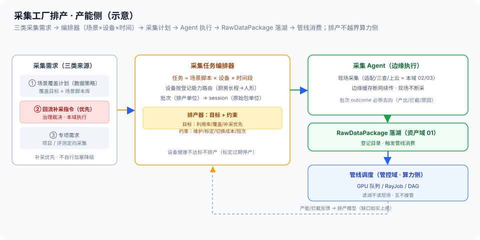

# 04 · 采集工厂与容量排产（异构设备集群 / 任务编排 / 容量排产 / 产能反馈）

> 01-接入域第 4 篇（本域收尾篇）。定位：**真机采集工厂的运营视角**——一批采集任务怎么排、异构设备怎么用满、产出怎么稳定；采集工厂是平台的**产能源头**，排产质量直接决定数据产量与成本。边界：管线算子调度（GPU 队列/作业编排）= [管控域](../03-管控域/README.md)；数据质量门（G0–G6）= [生产域](../02-生产域/README.md)；补采指令来源 = [治理域回流](../04-治理域/README.md)（消费域发现、治理裁决）；采集编排只在本域（设备/批次/产能）。RawDataPackage = [总线 §4.1](../00-总体架构/README.md)（两套调度的衔接制品）。

## 核实状态（2026-10-18）

- ✅ 已核实：智域基石真机采集工厂（万平级工厂、400+ 机器人、10+ 异构硬件）= [总线](../00-总体架构/README.md) 核实状态业内参照原文；「采集侧编排（接入域）vs 管线调度（管控域）」边界 = 总线域职责划分口径；补采优先 = 治理回流指令（[消费域 03](../06-消费域/03-Badcase回流闭环.md) 回流闭环的接入侧落点）
- ⚠️ 设计通识：排产模型（目标函数/约束建模）、采集任务 schema、设备健康判定规则、场景脚本库结构为本平台设计（**字段以实现为准**）
- ❓ 待补：设备利用率目标、单批次时延基线、场景切换成本、排产周期粒度——待团队标定

## 1. 定位与边界

- **本篇管**：真机采集工厂的**运营**——异构设备集群管理（健康/维护窗口）、**采集任务编排**（场景脚本 × 设备 × 时间段 → 采集计划）、**容量排产**（利用率/覆盖/优先级 + 约束）、**产能指标与反馈**
- **不管**：管线作业怎么调度（管控域 Kueue/RayJob）、数据质量怎么把（生产域 G 门）、补采需求怎么产生怎么裁决（治理域/消费域回流）
- **一句话**：前三篇把「源→设备→适配→校验」的通道打通，本篇回答**「产线怎么转」**——采集是产能侧，管线是算力侧，本篇管前者

## 2. 核心概念与组件

| 组件 | 职责 | 要点 |
| --- | --- | --- |
| 设备池管理 | 异构设备集群状态与分组 | 健康度/维护窗口（联动本域 01 登记） |
| 场景脚本库 | 采集任务的「剧本」 | 场景 × 任务类型 × 难度；场景覆盖目标的单位 |
| 采集任务编排器 | 任务 → 采集计划 | 场景脚本 × 设备 × 时间段 → 批次/session |
| 排产器 | 产能分配 | 目标 + 约束求解（§5）；补采优先 |
| 采集 Agent（边缘） | 计划执行 | 现场执行 + 边缘缓存（联动本域 02/03） |
| 产能看板 | 指标与反馈 | 利用率/产出率/覆盖达成（§7） |

> **与负载均衡/控制面同构**：这套就是**资源池运营 + 容量调度**——设备池 ≈ 后端服务器池（异构机型分组管理）；采集任务编排 ≈ 按场景把任务派给合适的实例（设备能力路由，同款一致性哈希思路：场景要求 → 设备能力匹配）；排产器 ≈ 容量规划 + 优先级调度（利用率目标、维护窗口 = 节点下线计划，补采优先 = 故障恢复流量高优）；设备健康不达标不排产 ≈ 健康检查失败摘出转发池；产能看板 ≈ 容量水位监控反哺扩缩容决策。被管对象从服务容量换成采集产能，调度语言完全复用。

## 3. 工厂形态（异构是常态）

- **业内参照**（[总线](../00-总体架构/README.md) 核实状态）：智域基石（上海）真机采集工厂——万平级场地、400+ 机器人、10+ 异构硬件——**异构集群规模化采集已被业内验证可行**
- **多本体多工位多班次**：不同本体（臂/人形/移动底盘）适配不同场景脚本；工位 = 场景环境（厨房/桌面/仓储）；班次 = 时间维度的产能单位——三维叠加决定「什么时间、哪台设备、在哪个工位、跑哪个脚本」
- **设备健康与维护窗口**：设备状态机（本域 01 §4：online/calibrating/offline/retired）+ 维护计划（标定周期联动——标定过期 = 停产复标，红线「标定不过不开工」）；**排产必须避让维护与标定窗口**，健康不达标设备不进排产池

## 4. 采集任务编排（任务 → 计划 → 执行）

```
采集需求（三类来源）
  ① 场景覆盖计划（平台数据策略：覆盖目标 × 场景脚本库）
  ② 治理回流补采指令（badcase 驱动——治理裁决、本域执行）
  ③ 专项需求（项目/评测定向采集）
        │
        ▼
采集任务编排器：任务 = 场景脚本 × 设备（能力匹配）× 时间段
        │  产出
        ▼
采集计划（批次 → session 粒度）──► 采集 Agent（边缘执行）
        │                              │ 现场采集（适配/三查/上云走本域 02/03）
        ▼                              ▼
   排产约束检查（§5）            RawDataPackage 上云落位
```

- **能力匹配**：场景脚本声明设备要求（本体类型/末端/传感器），编排器按 [本域 01 §4](01-采集源与设备管理.md) 登记的设备能力路由——厨房长程任务给人形、桌面精细操作给臂
- **批次与 session**：批次 = 排产与统计单位（同场景同设备的连续采集）；session = 原始包单位（RawDataPackage 的 session_id 来源）——两级粒度对齐下游血缘与目录

## 5. 容量排产（目标 + 约束）

- **排产目标**：设备利用率（用满不空转）、场景覆盖达成率（脚本库覆盖目标）、批次优先级（**补采任务优先**——治理回流指令，缺口数据卡着下游修复与回归）
- **排产约束**：
  - 设备维护窗口 / 标定周期（[本域 01](01-采集源与设备管理.md)：标定过期停产）
  - 场景切换成本（工位重置/道具更换——同场景批量排，减少切换次数）
  - 班次与人力（遥操作员排班是真机源的现实约束）
- **优先级纪律**：补采优先级来自治理指令——**本域不自行加塞、不自行降级**（回流缺口是治理域裁决的修复链路，排产私改优先级 = 干扰回流闭环）；常规任务按覆盖目标与利用率均衡排



## 6. 与管控域的边界（产能侧 vs 算力侧）

| | 采集编排（本域） | 管线调度（[管控域](../03-管控域/README.md)） |
| --- | --- | --- |
| 调度对象 | 设备/工位/班次（产能资源） | 算子作业/GPU 队列（算力资源） |
| 调度单位 | 采集任务/批次 | RayJob/DAG（[管控 02](../03-管控域/02-调度与多租户.md)） |
| 目标函数 | 利用率/覆盖/补采优先 | 吞吐/配额公平/gang 就绪 |
| 衔接点 | **RawDataPackage**（采集产出落湖后触发管线消费） | 同左（管线读湖不读现场） |

- **两套调度互不接管**：采集编排不调度 GPU（不算力侧的队），管线调度不排设备（不指挥现场）——**通过 RawDataPackage 在湖仓落位衔接**：产线管「数据到湖」，管线管「湖里数据怎么算」
- **为什么不能合并**：资源模型不同（设备是独占物理资源、GPU 是共享算力池）、时间尺度不同（采集以小时/班次计、管线以分钟/作业计）——硬揉在一起两边都排不好（同构参照：XLB 不会把机房上架调度和流量调度揉成一个调度器）

## 7. 产能指标与反馈

| 指标 | 含义 | 目标 |
| --- | --- | --- |
| 设备利用率 | 排产时间内有效采集占比 | 待标定（扣除维护/标定窗口） |
| 批次产出率 | 计划批次实际产出比例 | 趋势 100%（未产出带原因） |
| 单批次时延 | 任务下放到 RawDataPackage 落位 | 待标定 |
| 场景覆盖达成率 | 脚本库覆盖目标达成 | 按数据策略周期达成 |
| 补采优先遵守率 | 治理补采指令优先排产比例 | **100%（不自行加塞降级）** |
| 健康违规排产次数 | 不达标设备被排产次数 | **0（健康不达标不排产）** |

- **反馈闭环**：产出率/拦截率（本域 03 归档原因）反哺排产模型——高频拦截的设备/脚本要沉到维护或整改，**产能缺口如实上报**（缺数据就是缺数据，不拿低质产出凑数）

## 8. 关键字段示意

```yaml
capture_plan:                    # 设计通识（字段以实现为准）
  plan_id / window: {shift, date}
  tasks:
    - task: {scene_script: kitchen-pour@v5, priority: backfill | coverage | adhoc}
      demand_ref: governance_ticket-…            # 补采必带治理指令引用
      assign: {device_id, workstation, slot}     # 能力匹配结果
      expect: {sessions: N, episodes_target: …}
  constraints: {maintenance: […], calibration_due: […], switch_budget: …}
  kpi_snapshot: {utilization_est, coverage_est}
batch_record:
  batch_id / sessions: [session_id…]             # 对齐 RawDataPackage session_id
  outcome: {produced: N, intercepted: n, reasons: […]}   # 联动本域 03 拦截归档
```

## 9. 跨域衔接

- **上游**：治理域回流补采指令（[治理 README](../04-治理域/README.md) 裁决、[消费域 03](../06-消费域/03-Badcase回流闭环.md) 发起）；平台数据策略（场景覆盖目标）
- **生产域**：产出经 [本域 03](03-源头校验与上云.md) 落湖后由管线消费；质量门反馈（G 门拦截率高 = 采集侧整改信号，[算子-02 §9](../02-生产域/算子设计/算子设计-02-算子接口规范与质量门体系.md)）
- **治理域**：补采指令与优先级（治理裁决）；设备/批次进血缘（[治理 02](../04-治理域/02-血缘制品与版本三锁.md)）
- **资产域**：RawDataPackage 落位与登记（[资产域 01/02](../05-资产域/01-湖仓统一存储与多模态布局.md)）
- **管控域**：边界协同（§6——产能侧 vs 算力侧，互不接管）

## 10. 红线与速讲话术

**红线**：

1. **补采优先受治理指令约束**：回流补采的优先级是治理域裁决的修复链路——排产不自行加塞、不自行降级（私改 = 干扰回流闭环）
2. **设备健康不达标不排产**：健康/标定不合格的设备进排产池 = 批量制造源头缺陷（对齐本域 01「标定不过不开工」）
3. **排产不越界管线调度**：产能侧不调度 GPU、算力侧不指挥现场——两套调度经 RawDataPackage 衔接，互不接管
4. **产能缺口不隐瞒**：缺数据如实上报排产与数据策略——拿低质产出凑覆盖率是自欺（源头拦截的数据不能算产出）
5. **场景切换成本入约束**：排产忽视切换成本 = 利用率虚高实际产出低——切换预算是排产参数不是事后解释
6. **批次产出必带去向**：每个计划批次有产出/拦截/原因记录——没有 outcome 的批次是黑箱产能

**速讲话术（30 秒）**：

> "采集工厂我按运营视角做：业内智域基石已经验证了万平工厂、四百多台机器人、十几种异构硬件的规模化采集，所以异构是常态不是例外。编排上任务等于场景脚本乘设备乘时间段，设备按登记的能力路由——厨房长程给人形、桌面精细给臂；产出批次到 session 两级粒度，对齐下游血缘和目录。排产是目标加约束：利用率、场景覆盖、批次优先级，约束是维护窗口、标定周期、场景切换成本和遥操作员班次；补采任务优先，但优先级来自治理域回流指令，我不自行加塞。边界上我把采集编排和管线调度分开：采集是产能侧调设备工位班次，管线是算力侧调 GPU 队列，两套调度通过 RawDataPackage 在湖仓落位衔接，互不接管——就像没人会把机房上架调度和流量调度揉成一个调度器。产能指标设备利用率、批次产出率、覆盖达成率反馈排产模型，缺口如实上报。这套就是 XLB 资源池运营和容量调度的搬运：健康摘除、优先级调度、容量水位反哺——被管对象从服务容量换成采集产能。"
