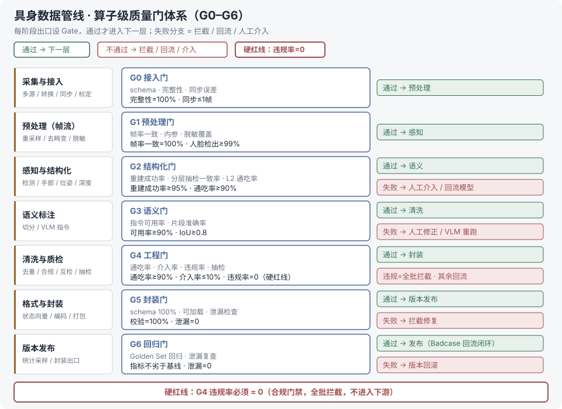

# 具身数据管线算子扩展：接口规范 + 质量门体系

> 算子设计系列第 2 篇。承接 [算子设计-01-业内通用算子全集总览](算子设计-01-业内通用算子全集总览.md)：把"算子清单"升级为"算子契约（§0 八字段模板 + §1–§8 全算子接口表）+ 门禁体系（§9 G0–G6）"。上位纲领 = [具身数据平台总体架构-总线](../../00-总体架构/README.md)（G0–G6 即总线「门禁驱动发布」原则在算子层的落点）。流转图见 §9。

## 核实状态（2026-10-17）

- ✅ 沿用已核口径：
  - HaWoR（CVPR 2025，与 Hamer 构成互检示例）、FoundationPose（RGB-D+CAD / 少样本）、Real-ESRGAN、RetinaFace、ViTPose、MegaSaM、DAv2/MoGe、TAPIR、CLIP、Qwen2.5-VL——模型清单与算子设计-01 §10 及调研笔记全部一致
  - 评测指标本身均为业内标准定义：PA-MPJPE（手部）、ADD(-S)（6DoF）、abs-rel（深度）、ATE（SLAM/相机轨迹）、mAP / mIoU；**表中具体数值是本文给出的默认建议阈值，不是业内硬标准**（已在 §0 说明"阈值可配置"）
- ⚠️ 已修正：
  - §10 示例中 `mano_params: Tensor[T,54]` 与「β10+θ45」自相矛盾（10+45=55）；54 对应的是「腕3+旋转6D+关节45」分解。已改为两种口径并列：`[T,54]`（腕3+6D+关节45）或 `[T,55]`（β10+θ45），按管线约定
  - 「与 Hamer 互检」沿用算子设计-01 §6 口径：Hamer+HaWoR 为示例性写法，主笔记实际互检案例为 MoGe↔DAv2 深度互检
- ⚠️ 审查修订（2026-10-17 第二轮）：
  - ID 体系统一为 `op-{阶段}-{名称}`（原模板含「序号」段，与实际全部 ID 不符）；§3 与 §10 同一算子双 ID（`op-per-hand` / `op-per-hand-recon`）统一为 `op-per-hand`
  - 补齐对照 -01 缺失的算子行：§3 光流估计 `op-per-flow`（RAFT）、§4 场景/物体描述 `op-sem-scene`（VLM）；-01 §6 多阶段 QC 为编排级机制，注明由 §9 门禁承担
  - [模型] 行代表模型标注回填（LAION aesthetics / VLM / Hamer+HaWoR 示例 / 检测-OCR），落实 §0「模型必须标注」
  - 幂等口径：含人工复核的分层抽检 / 合规审核改为「自动部分幂等」；§10「逐位一致」补确定性算法栈前提
  - G2「分层准确率」原为未定义术语，改为「分层抽检一致率」（绑定 §5 分层抽检的复核一致率≥95%）；§0 模板增补可选第 9 字段「依赖」

## 第 0 节 算子规范模板（统一契约）

每个算子必须声明以下 8 个必填字段，缺失即视为未完成定义；另有 1 个可选字段（依赖）：

| 字段 | 说明 | 示例 |
| --- | --- | --- |
| 算子 ID | `op-{阶段}-{名称}`，全局唯一 | `op-per-hand` |
| 类型 | [规则] / [模型]，模型必须标注 | [模型] HaWoR |
| 输入 Schema | 类型 + 必填 + 约束（维度/格式/范围） | 帧流: Video[≥30fps,RGB] |
| 输出 Schema | 同上，含元数据字段 | mano_params: [T,54] + conf |
| 参数 | 可配置项 + 默认值 | model_version=hawoR_cvpr25 |
| 版本 | 语义化版本 x.y.z，变更触发回归 | 1.2.0 |
| 幂等性 | 重跑结果是否一致（模型算子需固定 seed） | 幂等（seed=42） |
| 验收指标 | 通过标准（阈值可配置，本文给出默认建议） | 重建成功率 ≥95% |
| 依赖（可选） | 前置 / 后置算子 ID | 前置 op-per-cam；后接 op-clean-crosseval |

## 第 1 节 采集与接入算子接口

| 算子 | 输入 → 输出 | 关键参数 | 验收指标（默认） | 幂等 |
| --- | --- | --- | --- | --- |
| 多源采集 `op-in-collect` [规则] | 源配置/设备流 → raw_sample + 源元数据 | 源类型、采样率 | 采集成功率≥98%；同步误差≤1帧 | 否（物理采集） |
| 格式转换 `op-in-convert` [规则] | .bag/.db3 → 标准样本 | 目标格式 v2/v3 | 转换成功率≥99%；schema 校验 100% | 幂等 |
| 时间同步 `op-in-sync` [规则] | 多模态流 → 对齐样本+timestamps | 对齐容差 | 对齐误差≤1帧；缺失率<1% | 幂等 |
| 相机标定 `op-in-calib` [规则]/[模型 GeoCalib] | 标定板/单图 → K+畸变系数 | 标定板规格 | 重投影误差<0.5px | 幂等 |
| 完整性校验 `op-in-validate` [规则] | raw_sample → pass/fail+原因 | 校验规则集 | 漏检=0；误检<0.1% | 幂等 |

## 第 2 节 预处理算子接口

| 算子 | 输入 → 输出 | 关键参数 | 验收指标（默认） | 幂等 |
| --- | --- | --- | --- | --- |
| 帧提取/重采样 `op-pre-frames` [规则] | 视频 → 帧流+索引 | 目标 fps、采样策略 | 帧率一致 100%；缺帧<0.5% | 幂等 |
| 去畸变 `op-pre-undistort` [规则] | 帧流+内参 → 校正帧流 | 插值方式 | 直线度残差<1px | 幂等 |
| 裁切/缩放 `op-pre-crop` [规则] | 帧流 → ROI 帧 | ROI 定义 | ROI 命中率≥99% | 幂等 |
| 颜色校正 `op-pre-color` [规则] | 帧流 → 校正帧流 | 目标色温 | 色偏指标在容差内 | 幂等 |
| 去模糊/超分 `op-pre-enhance` [模型 Real-ESRGAN] | 低质帧 → 增强帧 | 模型权重、scale | 主观通过率≥95%（抽检） | 幂等(seed) |
| 美学过滤 `op-pre-aesthetic` [模型 LAION aesthetics 类] | 帧 → 分数+pass/fail | 阈值 | 与人工标注一致率≥90% | 幂等(seed) |
| 脱敏前置 `op-pre-desensitize` [模型 RetinaFace+blur] | 帧 → 模糊帧+遮挡记录 | 检测阈值、模糊核 | 人脸检出≥99%；误伤<0.5% | 幂等(seed) |

## 第 3 节 感知与结构化算子接口

| 算子 | 输入 → 输出 | 关键参数 | 验收指标（默认） | 幂等 |
| --- | --- | --- | --- | --- |
| 目标检测 `op-per-detect` [模型 YOLO] | 帧 → bbox+cls+conf | 模型版本、conf 阈值 | 关键类 mAP≥0.85；漏检<1% | 幂等(seed) |
| 分割 `op-per-seg` [模型 SAM2] | 帧+提示 → mask | 提示策略 | mIoU≥0.9 | 幂等(seed) |
| 手部重建 `op-per-hand` [模型 HaWoR/Hamer] | 帧 → MANO(β,θ)+conf | 手性、模型版本 | 重建成功率≥95%；PA-MPJPE 达标 | 幂等(seed) |
| 人体姿态 `op-per-pose` [模型 ViTPose] | 帧 → 2D/3D 关节点 | 骨架定义 | 关节检出率≥98% | 幂等(seed) |
| 相机位姿 `op-per-cam` [模型 MegaSaM] | 帧流 → pose[T,4,4]+conf | 切段长度 | 重建成功率≥95%；ATE<阈值 | 幂等(seed) |
| 单目深度 `op-per-depth` [模型 DAV2/MoGe] | 帧 → 深度图/点云/法线 | 模型版本 | abs-rel 误差<0.1 | 幂等(seed) |
| 物体 6DoF `op-per-6dof` [模型 FoundationPose] | RGB-D+CAD → 位姿轨 | CAD/少样本模式 | ADD(-S) 达标率≥90% | 幂等(seed) |
| 点跟踪 `op-per-track` [模型 TAPIR] | 帧流+查询点 → 轨迹 | 点密度 | 轨迹跟踪成功率≥90% | 幂等(seed) |
| 光流估计 `op-per-flow` [模型 RAFT] | 相邻帧 → 光流场 | 模型版本 | EPE 达标（相对基线，默认建议） | 幂等(seed) |
| 动作对齐 `op-per-align` [规则] | 关节流 → 标准动作向量 | 动作空间定义 | 映射正确率 100%（确定性） | 幂等 |

## 第 4 节 语义标注算子接口

| 算子 | 输入 → 输出 | 关键参数 | 验收指标（默认） | 幂等 |
| --- | --- | --- | --- | --- |
| 时序同步/重采样 `op-sem-sync` [规则] | 轨迹+视频 → 对齐序列 | 采样频率 | 对齐误差≤1帧 | 幂等 |
| 动作分割 `op-sem-seg` [规则]/[模型] | 腕速曲线 → 片段边界 | 平滑窗、极小值阈值 | 片段 IoU≥0.8；过切率<10% | 幂等（模型变体 seed） |
| 指令生成 `op-sem-instruct` [模型 Qwen2.5-VL] | 片段 → instruction JSON | prompt 模板、温度 | 指令可用率≥90%（抽检） | 幂等(seed) |
| 指令标准化 `op-sem-norm` [模型 VLM] | 指令 → 标准指令 | 术语表 | 术语一致率≥95% | 幂等(seed) |
| 子任务标注 `op-sem-subtask` [模型 VLM] | 长任务 → 子任务列表 | 拆分粒度 | 与专家一致率≥90% | 幂等(seed) |
| 场景/物体描述 `op-sem-scene` [模型 VLM] | 帧/片段 → 场景文本+物体属性 | prompt 模板 | 描述可用率≥90%（抽检） | 幂等(seed) |

## 第 5 节 清洗与质检算子接口

| 算子 | 输入 → 输出 | 关键参数 | 验收指标（默认） | 幂等 |
| --- | --- | --- | --- | --- |
| 视频去重 `op-clean-dedup` [规则] | 样本集 → 去重集+hash 记录 | hash 算法 | 误删率<0.1% | 幂等 |
| 语义去重 `op-clean-sdedup` [模型 CLIP] | 样本集 → 近重复标注 | 相似度阈值 | 近重复检出率≥95%；误删<1% | 幂等(seed) |
| 质量过滤 `op-clean-qual` [规则]/[模型] | 样本 → 质量分+pass/fail | 评分阈值 | 误杀率<1% | 幂等 |
| 内容合规 `op-clean-legal` [模型 NSFW] | 样本 → 违规标记 | 分类阈值 | 违规检出≥99% | 幂等(seed) |
| 异常值过滤 `op-clean-anomaly` [规则] | 样本 → 异常标记 | 阈值规则 | 误杀率<0.1% | 幂等 |
| 双模型互检 `op-clean-crosseval` [模型 Hamer+HaWoR（示例）] | 两模型输出 → 一致/分歧+仲裁 | 分歧上报策略 | 分歧率上报；仲裁准确率≥95% | 幂等(seed) |
| 分层抽检 `op-clean-sample` [规则] | 样本集 → 抽检清单+复核结果 | 分层维度、抽检率 | 覆盖率 100%；复核一致率≥95% | 自动部分幂等（人工复核不可复现） |

注：-01 §6 的「多阶段质量控制（QC）」为编排级机制（规则→模型→人工抽检），由本文 §9 的 G0–G6 门禁体系承担，不设单独算子行。

## 第 6 节 脱敏合规算子接口

| 算子 | 输入 → 输出 | 关键参数 | 验收指标（默认） | 幂等 |
| --- | --- | --- | --- | --- |
| 人脸/车牌模糊 `op-des-blur` [模型]+[规则] | 帧 → 模糊帧+记录 | 模糊范围、类型 | 检出≥99%；误伤<0.5% | 幂等(seed) |
| 隐私检测 `op-des-detect` [模型 检测/OCR] | 帧 → 隐私对象标记 | 对象类别集 | 检出率≥99% | 幂等(seed) |
| 合规审核 `op-des-audit` [模型]+[人工] | 样本 → 终审结论 | 审核流 | 自动预审覆盖率 100% | 自动部分幂等（人工终审不可复现） |

## 第 7 节 格式封装算子接口

| 算子 | 输入 → 输出 | 关键参数 | 验收指标（默认） | 幂等 |
| --- | --- | --- | --- | --- |
| 状态向量提取 `op-fmt-state` [规则] | 轨迹 → state 向量 | 维度定义 | 维度/类型校验 100%；缺失=0 | 幂等 |
| 视频编码 `op-fmt-encode` [规则] | 帧流 → H.264 | 码率、CRF | 编码成功率 100%；码率达标 | 幂等 |
| 数据集封装 `op-fmt-pack` [规则] | 样本 → LeRobot v3 目录 | 目标格式 | schema 校验 100%；可被训练器直接加载 | 幂等 |
| 元数据生成 `op-fmt-meta` [规则] | 样本 → 元数据 JSON | 字段集 | 字段完整率 100% | 幂等 |

## 第 8 节 统计采样算子接口

| 算子 | 输入 → 输出 | 关键参数 | 验收指标（默认） | 幂等 |
| --- | --- | --- | --- | --- |
| 分层采样 `op-stat-sample` [规则] | 样本集 → 分层子集 | 分层维度、比例 | 各层比例误差<5% | 幂等 |
| 类别均衡 `op-stat-balance` [规则] | 子集 → 均衡子集 | 策略（欠/过采样） | 类别比例方差最小化 | 幂等 |
| 覆盖度统计 `op-stat-cov` [规则] | 子集 → 覆盖报告 | 维度定义 | 报告完整 100% | 幂等 |

## 第 9 节 算子级质量门体系

**机制**：每个阶段出口设 Gate（门禁），样本批次**通过 Gate 才进入下一层**；不通过 → 拦截 / 回流 / 人工介入。门禁在算子层强制，不靠约定；每个 Gate 记录通过率日志（可观测）。

| Gate | 位置 | 核心检查项 | 阈值（默认建议） | 失败处理 |
| --- | --- | --- | --- | --- |
| G0 接入门 | 采集出口 | schema、完整性、同步 | 完整性 100%；同步≤1帧 | 拦截 + 重采 |
| G1 预处理门 | 预处理出口 | 帧率一致、内参正确、脱敏覆盖 | 帧率一致 100%；人脸检出≥99% | 重跑 / 降级帧 |
| G2 结构化门 | 感知出口 | 重建成功率、分层抽检一致率、L2 通吃率 | 重建成功率≥95%；通吃率≥90% | 人工介入 / 回流模型 |
| G3 语义门 | 语义出口 | 指令可用率、分割准确率 | 可用率≥90%；片段 IoU≥0.8 | 人工修正 / VLM 重跑 |
| G4 工程门 | 清洗质检出口 | 通吃率、人工介入率、**违规率**、抽检通过 | 通吃率≥90%；介入率≤10%；**违规率=0（硬红线）** | 违规全批拦截 |
| G5 封装门 | 封装出口 | schema 100%、可加载、泄漏检查 | 校验 100%；泄漏=0 | 拦截修复 |
| G6 回归门 | 版本发布 | Golden Set 无倒退、泄漏=0 | 指标不劣于基线；泄漏=0 | 版本回滚 |

**图例口径**（上图一眼读法）：绿 = 通过流入下一层；红 = 失败分支；G4 的违规率=0 为硬红线（区别于可通过回流修复的软门禁）。

**机制要点**：

1. **违规率=0 是硬红线**（G4）——合规问题全批拦截，不进入下游
2. **门禁与回归衔接**：G6 用 Golden Set 做版本回归防倒退；Badcase 回流通过算子 ID 定位到具体算子（血缘）
3. **泄漏防控落点**：G5 检查跨集泄漏（去重/时间切分是否在封装前完成）
4. **可观测**：每个 Gate 的通过率/拦截率/介入率写入监控，驱动算子版本迭代

**门-阶段映射**：§6 脱敏与 §8 统计采样不设专属出口门——脱敏由 G1（脱敏覆盖）+ G4（违规率硬红线）双重兜底；统计采样为封装后的确定性规则步骤，由 G6 版本回归兜底。通吃率在 G2 与 G4 双出现是有意设计：G2 管单算子产出质量，G4 管整批工程交付质量。

## 第 10 节 完整示例算子（模板用法演示）

以手部重建算子为例，展示规范如何完整落地：

| 字段 | 定义 |
| --- | --- |
| 算子 ID | `op-per-hand` v1.2.0（§3 手部重建算子的完整示例） |
| 类型 | [模型] HaWoR（CVPR 2025，双模型互检搭档 Hamer） |
| 输入 Schema | `video_frames: Tensor[T,H,W,3], uint8, RGB, 必填`；`handness_hint: str[L/R/auto], 可选` |
| 输出 Schema | `mano_params: Tensor[T,54]（腕3+旋转6D+关节45）或 Tensor[T,55]（β10+θ45），按管线约定`；`confidence: Tensor[T,1] ∈[0,1]`；`tracklet_id: Tensor[T,1]` |
| 参数 | `model_version=hawor_cvpr25`；`seg_len=256`（长视频切段）；`seed=42`；`device=cuda` |
| 版本 | 1.2.0（1.1.0 修复出视野补全，触发 G2/G6 回归） |
| 幂等性 | 幂等（固定 seed + 确定性算法栈：`torch.use_deterministic_algorithms` + 固定硬件/cuDNN 版本）；满足时重跑逐位一致，未满足则统计意义一致 |
| 验收指标 | 重建成功率≥95%（有效 MANO 帧占比）；PA-MPJPE<论文基线；置信度<0.6 的帧计入人工介入 |
| 依赖 | 前置 `op-per-cam`（相机轨迹回注抬升世界系）；后接 `op-clean-crosseval`（与 Hamer 互检） |
