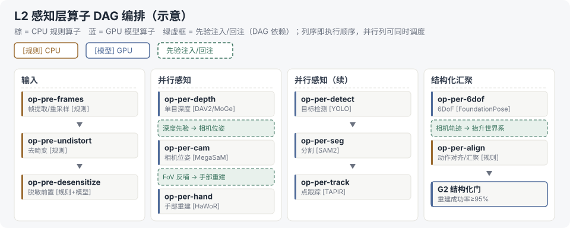

# 算子执行与编排规范

> 算子设计系列第 3 篇。定位：把"算子清单"落到执行框架——承接 [算子设计-01](算子设计-01-业内通用算子全集总览.md) §0 的两类算子（规则/模型）与 [算子设计-02](算子设计-02-算子接口规范与质量门体系.md) 的八字段契约，覆盖：执行框架映射（§1）→ DAG 依赖语义与引擎选型（§2–§3）→ 编排示例（§4）→ 任务生命周期（§5）→ KubeRay 控制面（§6）→ 失败处理与检查点（§7–§8）→ 数据传递与背压（§9）→ 可观测（§10）→ 与系列文档的衔接（§11）。Ray/K8s 口径底稿 = [调研笔记-02](../../92-调研笔记/调研笔记-02-Ray分布式框架调研与管线应用.md)。

## 核实状态（2026-10-17）

- ✅ 已核实 / 口径一致：
  - Ray 五种执行形态（Ray Data map_batches / GPU Actor 池 / RayJob / Ray Serve + RayService CRD / Ray Train）与调研笔记-02、主笔记 RayCluster/RayJob 辨析一致
  - 先验注入三例与主笔记 L2 / EMR 实践（调研笔记-04）口径一致：MoGe 深度先验喂相机位姿、FoV 约束反哺手部重建、相机轨迹抬升世界系
  - KubeRay 三 CRD / autoscaler / 多租户配额与调研笔记-02、[总线](../../00-总体架构/README.md) ③ 管控域口径一致（本文写数据面执行侧，队列/配额/优先级的管控面口径归总线）
- ⚠️ 已修正 / 待核：
  - §1 常驻服务行补注：Ray Serve 是库层 API，K8s 长驻形态对应 **RayService CRD**（与 §6 三 CRD 对齐）
  - 引擎选型对比（§3）为业内通识口径；`ray.dag` API 成熟度（是否仍 experimental）待核
  - §10 SLO 数值（月成功率≥99%、Golden Set 回归 24h）为示例值
  - 原稿节点 ID `op-pre-desense` 已按算子设计-02 审查修订统一为 `op-pre-desensitize`

## 1. 执行框架映射（业内主流：Ray 生态 + K8s）

| 算子类型 | 执行框架 | 资源形态 | 说明 |
| --- | --- | --- | --- |
| 规则算子（确定性、无模型） | Ray Data `map_batches` / Spark UDF | CPU 集群 | 帧级/样本级批量，纯函数式 |
| 模型算子（有状态 GPU 推理） | Ray Cluster + GPU Actor 池 | GPU 池（常驻模型） | 模型加载一次、跨帧/跨段复用 |
| 批量语义作业（VLM 标注等） | RayJob | K8s 一次性作业 | 语义层/清洗层批处理 |
| 常驻质检/评测服务 | Ray Serve（库）/ RayService（CRD） | 水平扩展服务 | 双模型互检、伪 GT 生成 |
| 分布式训练 | Ray Train（DDP/DeepSpeed） | 多节点 GPU | 消费侧 VLA 训练、模型再训练 |

## 2. 算子 DAG 编排：依赖语义（非纯串行）

- **依赖声明**：每个算子在元数据中声明 `upstream`（输入来自哪些算子），编排器据此构建 DAG
- **先验注入与回注**（工业界已落地的典型依赖）：
  - 深度先验 → 相机位姿（如 MoGe 深度作为 MegaSaM 输入）
  - FoV → 手部重建（尺度/视场约束反哺）
  - 相机轨迹 → 手部/物体（相机系抬升世界系）
- **串行 vs DAG 判断**：无跨算子依赖的链路按流水线串行；存在先验环的段必须按 DAG 调度，不能简单排队

## 3. DAG 定义方式与执行引擎选型

- **定义方式**：声明式（YAML/DSL）优于代码内联——支持提交期静态校验（**环检测**：拓扑排序 + 依赖校验，发现环拒绝提交；上游缺失 / schema 不匹配同期拦截）
- **引擎选型对比**（具身数据管线常见）：

| 引擎 | 适合 | 说明 |
| --- | --- | --- |
| Ray DAG / Ray Data 流水线 | 算子级 DAG，同框架内执行 | 与 §1 五种形态同生态，推荐默认 |
| Argo Workflows | K8s 原生 DAG | 适合跨服务/跨集群编排，重 K8s |
| Airflow | 定时/依赖调度 | 偏批处理调度，GPU 算子支持弱 |
| Dagster / Prefect | 数据资产编排 | 血缘/资产感知强，适合数据平台 |

- **结论建议**：算子级用 Ray DAG（低延迟、零拷贝传递，见 §9）；管线级（跨阶段）用 Argo Workflows 兜底（可观测、重试、K8s 原生）

## 4. 编排示例（L2 感知层 DAG）



**图例口径**（上图一眼读法）：列序即执行顺序，中间两列可并行调度；绿虚框是 DAG 依赖的关键——有先验环的段不能退化为串行队列。

**同一张图的声明式表达（PipelineSpec）**——`upstream` 即算子设计-02 §0 的「依赖」字段与本文 §2 的依赖声明，三者同一物；`exec`/`resources` 把 §1 的框架映射落到节点级；调度器按拓扑序执行，无依赖即并发：

```yaml
pipeline: l2-perception
checkpoint: {level: batch, store: oss, at_least_once: true}   # §8 检查点全局默认
nodes:
  - id: op-pre-frames@1.0.0
    exec: ray-data                # 规则算子 → Ray Data map_batches
    resources: {cpu: 32}
    upstream: []                  # 入口：原始帧流
  - id: op-pre-undistort@1.0.0
    exec: ray-data
    resources: {cpu: 16}
    upstream: [op-pre-frames]
  - id: op-pre-desensitize@1.1.0
    exec: ray-data                # 规则+模型混合（检测走 GPU Actor）
    resources: {cpu: 16, gpu: 0.5}
    upstream: [op-pre-undistort]
  - id: op-per-depth@1.3.0
    exec: gpu-actor               # 模型算子 → GPU Actor 池
    resources: {gpu: 1, model: dav2}
    upstream: [op-pre-undistort]
    inject: [depth_prior]         # 先验产出 → 下游 op-per-cam
  - id: op-per-cam@1.1.0
    exec: gpu-actor
    resources: {gpu: 1, model: megasam, seg_len: 256}
    upstream: [op-pre-undistort, op-per-depth]    # 帧流 + 深度先验（尺度锚定）
    inject: [fov_feedback]
  - id: op-per-hand@1.2.0
    exec: gpu-actor
    resources: {gpu: 1, model: hawor_cvpr25}
    upstream: [op-pre-undistort, op-per-cam]      # 帧流 + 轨迹（世界系抬升）
  - id: op-per-detect@2.0.0
    exec: gpu-actor
    resources: {gpu: 1, model: yolov8}
    upstream: [op-pre-desensitize]
  - id: op-per-seg@1.1.0
    exec: gpu-actor
    upstream: [op-per-detect]                     # 检测框作 prompt
  - id: op-per-track@1.0.0
    exec: gpu-actor
    upstream: [op-per-seg]                        # mask/框内选查询点
  - id: op-per-6dof@1.0.0
    exec: gpu-actor
    upstream: [op-pre-undistort, op-per-depth, op-per-cam]   # RGB-D + 轨迹（跨列输入）
  - id: op-per-align@1.0.0
    exec: ray-data
    upstream: [op-per-hand, op-per-track, op-per-6dof]       # 各路输出汇聚
gates:
  - id: G2                        # 质量门 = DAG 检查节点（非算子）
    after: [op-per-align]
    check: {recon_success_rate: ">=0.95", pass_rate: ">=0.90"}
    on_fail: [manual_review, model_rework]        # 红边分支
```

读法四要点：① 感知两列在规格里体现为 `op-per-depth` 与 `op-per-detect` 链各自只依赖输入列——互不引用即可并行；② 跨列边（6dof 吃 depth+cam）在 `upstream` 里显式声明，调度器不会漏等；③ Gate 是条件分支节点而非算子，`on_fail` 即红边（人工介入/回流，与 §7 DLQ 共用通道）；④ `checkpoint` 全局默认批次级 at-least-once（§8），节点可覆盖。

## 5. 任务生命周期与调度语义


**调度语义要点**：

- **队列与优先级**：高优任务（Golden Set 回归、线上 badcase 修复）可插队；队列按算子类型分池（CPU/GPU）
- **超时控制**：每算子设 wall-clock 超时（如 GPU 推理段 ≤4h/样本批），超时进失败分类（§7）
- **取消传播**：DAG 中上游取消 → 下游级联取消（K8s 驱逐语义）
- **幂等恢复**：重试必须基于检查点（§8），不做整段重跑

## 6. KubeRay 控制面细节

| 维度 | 内容 |
| --- | --- |
| 三 CRD | RayCluster（长期池）/ RayJob（一次性作业）/ RayService（常驻服务）——分别对应 §1 表格三种任务形态 |
| Worker 组划分 | head（调度）+ worker（计算）；GPU worker 组按显存/型号分组（A100/L40 等 nodeSelector） |
| autoscaler | 按队列深度扩缩容（min/max workers）；空闲回收；GPU 利用率过低触发缩容 |
| 多租户 | 命名空间隔离 + ResourceQuota（CPU/GPU 配额）；数据平台 / 训练 / 评测分池，互相不挤兑 |
| 优先级抢占 | 高优作业可抢占低优 worker（K8s PriorityClass） |
| 故障自愈 | worker 崩溃自动替换；检查点 + 任务级重试（衔接 §5 状态机） |

> 话术点：**"数据管线控制面 = 任务编排 + 资源调度 + 状态管理 + 版本治理，与 xlb 控制面同构——被管对象从 LB 实例换成 Ray 集群与数据版本。"**

## 7. 失败分类与处理策略

| 类别 | 示例 | 策略 |
| --- | --- | --- |
| 瞬时（可重试） | 网络抖动、GPU OOM 偶发、上游超时 | 退避重试 ≤3 次，从检查点续跑 |
| 结构性（不可重试） | schema 不匹配、参数错误、算子版本缺失 | 立即失败 + 拦截上报，不重试 |
| 资源性 | 配额不足、无可用 GPU、磁盘满 | 排队等待 / 扩容 / 告警人工 |
| 数据性 | 样本损坏、越界值、空帧 | 打标降级（跳过）+ 记入死信队列（DLQ） |

**DLQ + 人工通道**：数据性失败样本进 DLQ（附血缘/失败原因）→ 人工复核 → 回流或废弃；这是 [算子设计-02](算子设计-02-算子接口规范与质量门体系.md) §9「人工介入率」指标的执行层来源。幂等兜底：规则算子天然幂等；模型算子固定 seed 后可安全重跑（-02 §0 幂等字段）。

## 8. 检查点粒度与恢复语义

- **粒度**：样本级（数据性失败跳过）→ 批次级（默认，恢复以批为单位）→ 阶段级（重跑成本高时）
- **介质**：对象存储（跨节点可恢复）优先于本地盘
- **恢复语义**：**at-least-once**（重跑可能重复产出，依赖算子幂等去重兜底）；不做 exactly-once（成本高，数据管线不需要）
- **与血缘衔接**：检查点输出 hash 写入血缘记录（[算子设计-04](算子设计-04-算子血缘与版本三锁.md) `output_hash` 字段），恢复后 hash 一致才可复现

## 9. 数据传递与并发背压

| 传递方式 | 适用 | 说明 |
| --- | --- | --- |
| Ray Object Store（零拷贝） | 帧/轨迹小对象、同段内 | 避免序列化开销 |
| 对象存储（OSS/S3）中间态 | 跨阶段、大批量 | 可断点续跑的基础（衔接 §8） |
| 直传（本地盘） | 单机小批 | 简单但不可恢复 |

**并发与背压**：每算子配置 `batch_size` 与最大 inflight；下游慢 → 上游背压（不无限排队）；吞吐目标驱动 batch 调优（如 GPU 推理 batch=8 时吞吐最优，需实测）。

## 10. 执行层可观测性

| 类别 | 指标 |
| --- | --- |
| 吞吐 | 每算子样本/小时、队列深度、背压次数 |
| 时延 | P50/P95/P99 算子时延 |
| 失败 | 失败率、重试率、各类失败分布（§7 四类） |
| 成本 | GPU 秒/样本、CPU 秒/样本（衔接 [算子设计-06](算子设计-06-算子成本模型.md)） |
| 追踪 | 每条样本血缘 trace（[算子设计-04](算子设计-04-算子血缘与版本三锁.md) `produced_by` 链） |

**告警与 SLO**：吞吐骤降、失败率>5%、队列无限增长、配额耗尽 → 告警；SLO 示例：月管道成功率 ≥99%、Golden Set 回归触发后 24h 内完成。

## 11. 与系列文档的执行层衔接

| 文档 | 执行层落地 |
| --- | --- |
| [02 质量门](算子设计-02-算子接口规范与质量门体系.md) | Gate 作为 DAG 中的检查节点：不过闸 → 分支到拦截/回流/人工（与 §7 DLQ 共用通道） |
| [04 血缘三锁](算子设计-04-算子血缘与版本三锁.md) | 每算子执行完写 `produced_by` 血缘记录（op_version / model_version / input+output hash / 配置快照） |
| [06 成本模型](算子设计-06-算子成本模型.md) | 执行层采集每算子 GPU/CPU 秒，成本入监控（§10） |
| [07 数据分流](算子设计-07-四层数据集分流与防泄漏.md) | `op-stat-sample` 作为 DAG 分流节点，split 标签写入样本血缘；泄漏检查（G5）在封装前执行 |
