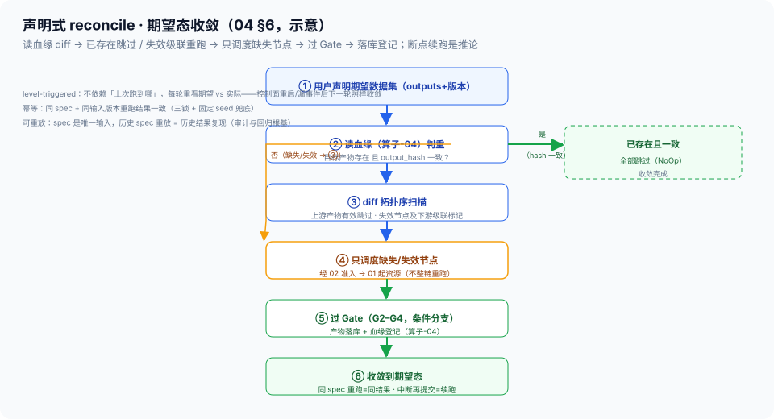

# 04 · PipelineSpec 与编排 DSL（Schema / 静态校验 / 声明式 reconcile / 版本绑定）

> 03-管控域第 4 篇。定位：**控制面平台视角**——用户入口的声明式契约长什么样、提交期怎么把错误拦在跑之前、控制面怎么用 reconcile 把「期望数据集」收敛出来。边界：算子级 DAG 依赖语义、引擎选型与 L2 节点级 YAML = [算子设计-03](../02-生产域/算子设计/算子设计-03-算子执行与编排规范.md) §2–§4（**SSOT，本篇不重抄**）；本篇做**管线级** Schema、DSL 语法、静态校验与 reconcile 深化。声明式原则总纲 = [总线 §1.2/§7](../00-总体架构/README.md)（面分离 + 声明式控制循环）。

## 核实状态（2026-10-17）

- ✅ 已核实：节点级字段语义（`id=operator@version`/`exec`/`resources`/`upstream`/`inject`/`gates`/`checkpoint`）与算子设计-03 §4 示例一致；「环检测拒绝提交」口径沿用算子-03 §3；三锁绑定沿用 [算子设计-04 §1](../02-生产域/算子设计/算子设计-04-算子血缘与版本三锁.md)
- ⚠️ 设计通识：管线级 Schema 顶层字段（`params`/`trigger`/`inputs`/`outputs`/`failure_policy`）、DSL 引用语法（`${params.x}`/`${nodes.y.outputs.z}`）、条件分支与循环为**本平台设计**（字段名以部署版本为准）；Argo Workflows/Dagster 对照为业内通识（K8s 原生 CRD 编排为 ML 团队主流路线，见 §7 业内对照）
- ❓ 待补：循环/子管线复用的表达力边界（是否引入 foreach）——待产品决策；静态校验的实测拦截率、reconcile 跳过率收益——待团队标定

## 1. 定位与边界

- **本篇管**：PipelineSpec 的**完整 Schema**、DSL 语法要点、**提交期静态校验**（能拦的不留到运行期）、**声明式 reconcile**（期望数据集 → 收敛）、版本绑定
- **不管**：算子级怎么写（算子-03 §4 是算子级 SSOT）、作业状态怎么推进（03 篇）、资源怎么准入（02 篇）
- **两层粒度**：本篇的节点是**管线级阶段节点**（可展开为算子级子图）；算子-03 §4 的 L2 YAML 即「展开态」——同一套字段语义，粒度不同

## 2. 核心概念与组件

| 组件 | 职责 | 要点 |
| --- | --- | --- |
| PipelineSpec | 用户的声明式契约 | 声明「要什么数据集、用什么版本跑」——不写「怎么跑」 |
| 校验器 | 提交期静态校验 | 环/引用/类型/版本/资源/Gate 六项（§5）；失败给结构化错误 |
| 编译器 | spec → 执行单元 | 阶段节点展开为算子子图；映射 RayJob/RayCluster + Workload（交 02 准入） |
| reconciler | 期望态收敛 | diff 血缘与产物，只调度缺失/失效节点（§6） |
| 版本注册表 | 三锁查询源 | operator@version / 模型版本 / 数据版本的存在性权威（[算子设计-04](../02-生产域/算子设计/算子设计-04-算子血缘与版本三锁.md)） |

> **与负载均衡控制面同构**：PipelineSpec ≈ 转发表期望态声明（声明式配置下发）；校验器 ≈ 配置合法性检查（下发前拦截）；reconciler ≈ 控制循环收敛（diff 期望与实际，只下发变更）——「配置即期望态、控制面收敛」与 XLB 完全同构。

## 3. 完整 Schema（字段表）

| 字段 | 类型 | 说明 |
| --- | --- | --- |
| `apiVersion` / `kind` / `metadata` | — | K8s 风格元数据；`metadata.version` = **spec 自身版本**（§7） |
| `params[]` | list | 全局参数：`name` + `type` + `default`（带类型的可校验参数面） |
| `trigger` | map | 触发方式：`manual` / `schedule`（cron）/ `event` / `data-arrival`（数据到达触发，接接入域事件） |
| `inputs[]` | list | **数据集版本引用**（数据集为中心）：dataset id + version（禁止裸路径——可追溯性） |
| `outputs[]` | list | **期望产物声明**：目标数据集 + 版本策略——reconcile 的对齐目标（§6） |
| `nodes[]` | list | 节点：`id`（=operator@version）/ `exec`（执行形态映射）/ `resources` / `upstream[]`（显式依赖）/ `params`（含 `inject` 先验注入）/ `retry` / `checkpoint`（覆盖全局默认） |
| `gates[]` | list | 质量门：`id` + `after` + `check`（阈值表达式）+ `on_fail`——**Gate 是条件分支节点，非算子**（算子-03 §4 读法③） |
| `checkpoint` | map | 全局默认：`level`/`store`/`at_least_once`（算子-03 §8 SSOT） |
| `failure_policy` | map | 四类失败的处理策略映射（对齐算子-03 §7：transient→retry_backoff、structural→abort、resource→queue、data→dlq_skip） |

节点字段语义与算子-03 §4 完全同一套（`upstream` 即算子设计-02 §0「依赖」字段），此处只做管线级组装。

## 4. DSL 语法要点

- **节点定义**：`id = operator@version`——算子与版本一起声明，无版本即非法（三锁入口）
- **依赖显式**：`upstream: [node-a, node-b]`——**所有顺序关系必须显式**；无引用即可并行（调度器按拓扑序执行，[算子-03 §4](../02-生产域/算子设计/算子设计-03-算子执行与编排规范.md) 读法①）
- **参数引用**：`${params.x}`（全局参数注入）、`${nodes.y.outputs.z}`（上游产物字段引用）——引用即依赖，被引用节点自动成为隐式上游（校验器显式化）
- **条件分支**：`when` 表达式（如 Gate 失败且策略=修复才走 rework 支路）——分支是图的边，不是代码 if
- **循环 / 子管线**（可选，待产品决策）：`foreach` 展开与子 spec 复用——表达力与可校验性权衡，MVP 不引入
- **三原则**：声明式（无副作用）、upstream 显式（可静态校验）、参数带类型（可类型检查）

## 5. 提交期静态校验（重点）

**原则：提交期能拦的，不留到运行期**——结构性失败前移（算子-03 §7 结构类失败的量大来源就是 spec 错误）。

| # | 校验项 | 方法 | 失败处置（结构化错误） |
| --- | --- | --- | --- |
| 1 | 环检测 | Kahn 拓扑排序，剩余节点即环 | 拒绝提交：「节点 a→b→c 构成环」 |
| 2 | 上游引用存在 | 引用集 diff 节点集 | 「node X 引用不存在的 upstream Y」 |
| 3 | Schema/类型匹配 | 上游输出 schema ⊆ 下游输入 schema（字段/维度） | 「X.outputs.depth [T,H,W] ≠ Y 期望 [H,W]」 |
| 4 | 版本存在 | operator@version / 模型版本查版本注册表（[算子-04 §1](../02-生产域/算子设计/算子设计-04-算子血缘与版本三锁.md) 三锁） | 「op-per-cam@9.9.9 未注册」 |
| 5 | 资源申请可行 | Σ nodes 资源 vs 配额上限（[02 篇](02-调度与多租户.md) ClusterQueue 口径） | 超 borrowingLimit 警告/拒绝 |
| 6 | Gate 引用合法 | `after` ⊆ nodes；`check` 指标在产出节点可采集 | 「G5 引用未定义节点 / 不可采集指标」 |

错误结构统一为 `{node, edge?, check, message}`——报「哪个节点、哪条边、什么问题」，不甩一整个 YAML 解析栈。

## 6. 声明式 reconcile（重点）

```
用户声明期望数据集（PipelineSpec 的 outputs + 版本）
        │
        ▼
① 读血缘（[算子-04](../02-生产域/算子设计/算子设计-04-算子血缘与版本三锁.md)）：
   目标产物是否已存在且 output_hash 一致？
        │
        ├── 已存在且一致 ──► 全部跳过（NoOp，收敛完成）
        │
        └── 缺失/失效 ──► ② diff：拓扑序扫描——上游产物有效则跳过，
                          失效则该节点及下游级联标记重跑
                                │
                                ▼
                ③ 只调度缺失/失效节点（经 02 准入 → 01 起资源）
                                │
                                ▼
                ④ 过 Gate（G2–G4，条件分支）→ 产物落库 + 血缘登记
                                │
                                ▼
                ⑤ 收敛到期望态（同 spec 重跑 = 同结果；中断后再次提交即续跑）
```



- **level-triggered**：reconcile 不依赖「上次跑到哪」的记忆，每轮重看期望 vs 实际——控制面重启/漏事件后下一轮照样收敛（与 [01 篇 §3](01-KubeRay控制面.md) 同范式）
- **幂等**：同 spec + 同输入版本重跑结果一致（三锁 + 固定 seed 兜底，算子-03 §8）
- **可重放**：spec 是唯一输入，历史 spec 重放 = 历史结果复现（审计与回归的根基）
- **断点续跑是 reconcile 的推论**：作业中断后**再次提交同一 spec**，①②自动跳过已完成节点、只补缺失——不需要专门的「续跑模式」

## 7. 版本绑定与声明式 vs 命令式

- **版本绑定**：PipelineSpec 自身版本（`metadata.version`）+ 锁定算子版本（节点 id）+ 数据版本（inputs）+ 模型版本（resources.model）——**一次提交完整锁定三锁**（[算子-04 §1](../02-生产域/算子设计/算子设计-04-算子血缘与版本三锁.md)），保证任何时刻可复现
- **声明式 vs 命令式**（对齐 [总线 §7](../00-总体架构/README.md) ADR）：

| 维度 | 声明式 PipelineSpec | 命令式脚本 |
| --- | --- | --- |
| 静态校验 | 提交期六项全拦（§5） | 只能跑了才知道 |
| 可重放 | spec + 输入版本 → 同结果 | 依赖执行历史与环境 |
| 断点续跑 | reconcile 自动跳过已完成 | 要自己记进度 |
| 可审计 | spec 即意图，版本化留痕 | 意图埋在脚本逻辑里 |
| 控制面收敛 | 期望态对齐，自愈 | 每步命令都要人盯 |

**业内对照（声明式 K8s 编排是 ML 团队主流路线）**：本平台「自研 PipelineSpec CRD + reconciler」不是孤例——**Argo Workflows**（CNCF，K8s 上最流行的工作流引擎）就是同款模式：CRD + controller、每步一个 Pod、声明式收敛、GitOps 交付；K8s 系 ML 团队在数百作业规模后普遍从 Airflow 迁向这类 K8s 原生编排（Airflow 长驻控制面 + 命令式 Python DAG 的伸缩性与 GitOps 短板是迁移主因，对照上表逐项成立）。**Dagster** 则走「软件定义资产」路线，以资产/血缘/分区为编排对象，与资产域血缘叙事同构——三类路线（K8s 原生 CRD / 命令式 DAG / 资产导向）业内并存，本平台取声明式 CRD 路线，与 XLB 控制面叙事一致。

## 8. 精简示例（管线级骨架）

```yaml
apiVersion: dsp.example.com/v1        # 示意（字段名以部署版本为准）
kind: PipelineSpec
metadata: {name: ego-daily-batch, version: 1.4.0}      # spec 自身版本
params:
  - {name: date, type: string, required: true}
  - {name: depth_model, type: "enum[moge,dav2]", default: moge}
  - {name: gate2_threshold, type: float, default: 0.90}
trigger:
  schedule: "0 2 * * *"               # 定时（另支持 manual/event/data-arrival）
inputs:
  - {dataset: raw-ego, version: "${params.date}"}      # 数据集版本引用
outputs:
  - {dataset: structured-ego, version: auto}           # 期望产物 = reconcile 目标
nodes:
  - {id: l1-prep@2.1.0,     exec: ray-data,   upstream: []}
  - {id: l2-perception@1.3.0, exec: gpu-actor, upstream: [l1-prep],
     params: {depth_model: "${params.depth_model}"}}   # 全局参数注入
  - {id: l3-semantic@1.1.0, exec: rayjob,     upstream: [l2-perception]}
  - {id: l4-pack@2.0.0,     exec: rayjob,     upstream: [l3-semantic]}
  - {id: l2-rework@1.0.0,   exec: gpu-actor,  upstream: [l2-perception],
     when: "${gates.G2.result} == fail && ${params.rework} == true"}   # 条件分支
gates:
  - id: G2
    after: [l2-perception]
    check: {pass_rate: ">= ${params.gate2_threshold}"}
    on_fail: [manual_review, model_rework]             # 分支到 l2-rework / 人工
checkpoint: {level: batch, store: oss, at_least_once: true}
failure_policy: {transient: retry_backoff, structural: abort, data: dlq_skip}
```

> 与算子-03 §4 的关系：本例节点是阶段级（`l2-perception` 一个节点 = 算子级一张子图）；`l2-perception` 展开后即算子-03 §4 那份 L2 节点级 YAML——**同构不同粒度，不重复维护**。

## 9. 指标与质量门（L2/L3 落点）

| 指标 | 含义 | 用途 |
| --- | --- | --- |
| 校验拦截率 | 提交期被拦的 spec 占比（按六项分类） | 结构性失败前移的收益度量 |
| spec 编译耗时 | 校验 + 展开为执行单元的耗时 | 入口体验（应秒级） |
| reconcile 跳过率 | 重复提交中被跳过的节点占比 | 断点续跑/增量重跑的实际收益 |
| 收敛时长 | 提交到期望数据集就绪 | 端到端时延预算的入口段 |
| 条件分支触发分布 | Gate 失败分支 / rework 实走次数 | 质量波动的早期信号 |

> 分工：数据面算子指标归 [算子-03 §10](../02-生产域/算子设计/算子设计-03-算子执行与编排规范.md)；本篇采集「**入口契约好不好用、收敛省不省**」。

## 10. 与其他域/文档的衔接

- **上游（同域）**：本篇是管控域入口——校验通过的 spec 编译为作业（Pending，交 [03-任务状态机与容错](03-任务状态机与容错.md)），资源申请交 [02-调度与多租户](02-调度与多租户.md) 准入
- **上游（域外）**：用户入口层（Web/CLI/SDK，总线 §2）；`data-arrival` 触发接接入域事件
- **下游（域外）**：执行落生产域（算子-03 §1 执行框架映射）；Succeeded 产物 + 血缘进治理域（版本晋升、G5/G6）；outputs 即「数据集为中心」的资产域登记目标
- **SSOT 引用**：算子-03 §2–§4（依赖语义/引擎选型/节点级 YAML）、§7–§8（failure_policy/checkpoint）；算子-04 §1–§2（三锁与 output_hash——reconcile 的判重依据）

## 11. 红线与速讲话术

**红线**：

1. **提交期能拦的不留到运行期**：六项校验缺一即放行 = 把结构性失败留给 GPU 时间去发现（烧钱且污染状态机）
2. **upstream 必须显式**：隐式顺序依赖（脚本里的执行顺序）= 不可静态校验、不可并行推断——禁止
3. **spec 不可变**：运行中改 spec = 新版本新实例（对照总线「数据集版本不可变」）；「边跑边改」的 spec 无法重放也无法审计
4. **重放一致性是硬承诺**：同 spec + 同输入版本重跑必须同结果（三锁 + 固定 seed）；做不到的算子不得声明可重放
5. **Gate 是节点不是算子**：质检逻辑不许藏进算子内部（对齐算子-03 §4 读法③）——藏在里面 = 不可见、不可审计、不可分支
6. **spec 只声明「要什么」**：`exec`/`resources` 等执行细节是编译期决定，spec 层面保持稳定——把「怎么跑」写进 spec 的，换个执行引擎就要改用户契约

**速讲话术（30 秒）**：

> "用户入口是一份声明式 PipelineSpec，声明期望数据集和输入输出版本，节点是 operator@version 加显式 upstream，Gate 是图上的条件分支节点。提交期做六项静态校验——拓扑排序查环、上游引用、schema 类型匹配、算子模型版本在注册表里存在、资源申请对配额可行、Gate 引用合法——结构性失败全部前移到提交期拦住，不留到运行期烧 GPU。运行时是声明式 reconcile：读血缘看目标产物存不存在、hash 一不一致，存在的整段跳过，失效的级联重跑，只调度缺失节点——断点续跑不是专门模式，是 reconcile 的自然推论：中断后再次提交同一份 spec，自动跳过已完成的部分。版本上 spec 自身版本加算子、数据、模型三锁，任何时刻可复现可审计。这套和我在 XLB 的控制面完全同构：spec 就是转发表的期望态声明，校验器是配置下发前的合法性检查，reconciler 是控制循环 diff 期望与实际只下发变更——配置即期望态，控制面负责收敛。"
