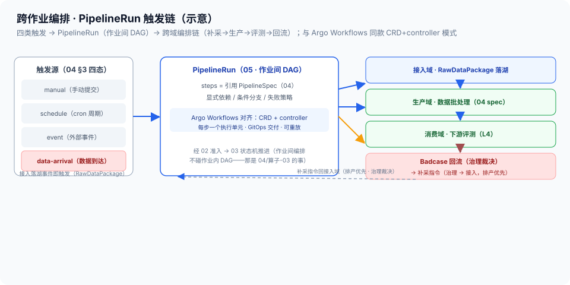

# 05 · 跨作业编排与触发链（PipelineRun / 触发四态 / 跨域编排 / Argo 对齐）

> 03-管控域第 5 篇。定位：**控制面声明层的跨作业视角**——04 篇定义了「一次管线」的声明式契约（作业内 DAG），本篇定义「一组管线的编排」（作业间 DAG）：多个 PipelineSpec 怎么串成链、什么事件触发、跨域（补采→生产→评测→回流）怎么编排。边界：作业内 DAG 与算子级展开 = [04-PipelineSpec与编排DSL](04-PipelineSpec与编排DSL.md)（**SSOT，本篇不重抄**）；资源准入与调度 = [02-调度与多租户](02-调度与多租户.md)；作业状态推进 = [03-任务状态机与容错](03-任务状态机与容错.md)；执行层 DAG 语义 = [算子设计-03](../02-生产域/算子设计/算子设计-03-算子执行与编排规范.md)。本篇是声明式编排的**跨作业层**，不引入第三方编排器（业内同款路线 = Argo Workflows，见 §3/§5 对照）。

## 核实状态（2026-10-19）

- ✅ 已核实：触发四态（manual/schedule/event/data-arrival）= [04 篇 §3](../03-管控域/04-PipelineSpec与编排DSL.md) trigger 字段原文；跨域闭环（Badcase 回流 → 补采优先） = [消费域 03](../06-消费域/03-Badcase回流闭环.md) + [接入域 04](../01-接入域/04-采集工厂与容量排产.md)；Argo Workflows = CNCF 项目、K8s 上最流行的工作流引擎、CRD + controller + 每步一个 Pod + GitOps（官方定位，业内通识）
- ⚠️ 设计通识：PipelineRun Schema（steps 引用 PipelineSpec / 显式依赖 / 条件分支 / 失败策略）、触发源接入方式、跨作业重试语义为本平台设计（**字段以实现为准**）
- ❓ 待补：跨作业编排的超时预算、data-arrival 事件的时延目标、编排失败告警阈值——待团队标定

## 1. 定位与边界

- **本篇管**：**PipelineRun**（跨作业编排的声明制品）、**触发四态**（什么事件启动一组管线）、**跨域编排链**（接入→生产→评测→回流的闭环编排）、**跨作业失败与重试语义**
- **不管**：作业内节点怎么写（04/算子-03）、资源怎么准入（02）、单个作业状态怎么推进（03）
- **一句话**：04 管「一次管线」，本篇管「一串管线」——**作业间 DAG 是编排层的心智模型，跨域闭环是它的主要应用**

## 2. 核心概念与组件

| 组件 | 职责 | 要点 |
| --- | --- | --- |
| PipelineRun | 跨作业声明制品 | steps = 引用 PipelineSpec（版本锁定）+ 显式依赖 + 失败策略 |
| 触发源 | 启动编排的事件 | manual / schedule（cron）/ event / **data-arrival**（§4） |
| 依赖解析器 | 作业间 DAG 构建 | 拓扑排序、环检测、条件分支求值（复用 04 §5 静态校验思路） |
| 编排器（reconciler） | 期望态收敛 | 与 04 §6 同范式：读血缘、diff、只调度缺失/失效 step |
| 跨作业状态 | 编排级生命周期 | Pending → Running → Succeeded / Failed（聚合 step 状态，对接 03） |

> **与负载均衡/控制面同构**：PipelineRun ≈ **配置下发链**（一条变更要依次下发多类配置的编排）；触发四态 ≈ 配置同步的触发条件（配置变更事件/周期对账/人工触发）；跨作业编排器 ≈ 控制面里「编排多个子任务收敛」的控制器；跨域闭环（补采→生产→评测→回流）≈ 故障→补配置→验证→回归的闭环——被管对象从转发面配置换成数据管线，编排语义一字不改。

## 3. 两层编排边界（先说清谁管什么）

| 层 | 声明制品 | 编排粒度 | SSOT |
| --- | --- | --- | --- |
| 作业内 | PipelineSpec | 算子级 DAG（节点=operator@version，可展开为算子子图） | 04 / 算子-03 |
| **作业间（本篇）** | **PipelineRun** | 管线级 DAG（step = 引用 PipelineSpec 版本） | 本篇 |

- **不引入第三方编排器的理由**：跨作业依赖用「PipelineRun 声明 + reconciler 收敛」解决，与 04 同范式——引入 Airflow 类命令式 DAG 等于在声明式控制面里埋一个「命令式执行引擎」，两层心智且破坏可重放/可审计（对照 04 §7 表格）
- **业内同款路线**：Argo Workflows（CNCF）就是「CRD + controller + 每步一个执行单元 + GitOps」模式——K8s 系 ML 团队在数百作业规模后普遍从 Airflow 迁向这类 K8s 原生编排；本篇 DSL 与其同构，语义对齐但保持平台自持（不引依赖）

## 4. 触发四态与跨域编排链

```
触发四态（04 §3 trigger 同口径）
  ├─ manual    手动提交（排障/回放历史 run）
  ├─ schedule  cron 周期（日批/周批数据生产）
  ├─ event     外部事件（评测完成/模型版本发布）
  └─ data-arrival 数据到达（接入域 RawDataPackage 落湖事件）◄─ 主力触发
        │
        ▼
PipelineRun（作业间 DAG）
  └─ 跨域编排链（数据平台的主干闭环）：
     接入落湖（data-arrival）→ 生产批（04 spec）→ 治理门禁 → 评测（消费域 L4）
        → Badcase 回流（治理裁决）→ 补采指令（接入域，排产优先）→ 回到接入落湖
```



- **data-arrival 是主力触发**：RawDataPackage 落湖即启动对应生产批——**数据到湖 = 编排启动**，不需要人等、不需要定时器轮询（事件驱动，对齐接入域「数据到湖触发管线消费」）
- **跨域闭环是编排的主要价值**：补采→生产→评测→回流是数据平台的核心回路——编排器保证「回流指令真的变成补采排产，补采数据真的重新走进生产」，每一环有 run 记录可追（审计留痕）

## 5. PipelineRun 声明（Schema 要点）

```yaml
apiVersion: dsp.example.com/v1        # 示意（字段以部署版本为准）
kind: PipelineRun
metadata: {name: ego-daily-loop, version: 2.0.0}
trigger:
  data-arrival: {on: raw-ego, match: "source=ego & session_day=${date}"}  # 落湖事件触发
  # 亦可 manual / schedule(cron) / event
steps:                                # 作业间 DAG：step = 引用 PipelineSpec 版本
  - {id: produce,    ref: "ego-daily-batch@1.4.0",  upstream: []}
  - {id: evaluate,   ref: "eval-run@0.9.0",          upstream: [produce],
     when: "${produce.outputs.gate_violations} == 0"}               # 条件分支
  - {id: backfill,   ref: "capture-backfill@1.0.0",  upstream: [evaluate],
     when: "${evaluate.outputs.badcase_count} > 0"}                 # 回流→补采
failure_policy:
  upstream_fail: abort_downstream        # 上游失败下游不启
  step_retry: {transient: 3, structural: 0}                          # 对齐 03 四类失败
timeout: {per_step: 2h, overall: 24h}
```

- **step = 引用 PipelineSpec 版本**：run 可重放（锁定 spec 版本 = 锁定一次完整复现），与三锁一致（[算子-04 §1](../02-生产域/算子设计/算子设计-04-算子血缘与版本三锁.md)）
- **条件分支是图的边不是代码 if**：`when` 表达式求值决定走哪条边（Gate 失败→人工/重跑、badcase>0→补采），与 04 §4 DSL 同语法

## 6. 跨作业失败与重试语义

- **上游失败下游不启**：`abort_downstream` 默认——上游 produce 失败时 evaluate/backfill 不会启动（不浪费 GPU）；下游从失败处重启而非整链重跑（配合 09 检查点）
- **四类失败对齐算子-03 §7**：transient（重试 3 次，退避）/ structural（abort，spec 问题不重试）/ resource（排队等待，02 准入）/ data（跳过并记录，DLQ）——编排级失败分类与单作业一致（[03 篇 §6](03-任务状态机与容错.md) 同口径），跨作业只多了「级联」维度
- **run 级幂等**：同 PipelineRun + 同 spec 版本重放 = 同结果；中断后重新提交即续跑（reconcile 推论，与 04 §6 同款）
- **失败必留痕**：每次 run 的 step 级结果（成功/跳过/失败+原因）入审计（横切 02）——「哪一环断了、为什么断」事后必须能回答

## 7. 关键字段示意

```yaml
pipeline_run_record:                # 设计通识（字段以实现为准）
  run_id / spec_ref: {kind: PipelineRun, version: 2.0.0}
  trigger: {type: data-arrival, event_ref: raw_pkg-…, arrived_at}
  steps:
    - {id: produce,   spec: "ego-daily-batch@1.4.0", state: succeeded, duration}
    - {id: evaluate,  spec: "eval-run@0.9.0",         state: skipped,  reason: upstream_failed}
  closure: {badcase_backfill: issued, backfill_ref: capture-backfill-…}  # 闭环完成证据
  audit: {submitted_by, policy_version, log_ref}
```

## 8. 指标与质量门（L2/L3 落点）

| 指标 | 含义 | 用途 |
| --- | --- | --- |
| 触发命中率 | data-arrival 事件正确启动对应 run 比例 | **100%（落湖即编排，漏触发 = 数据静默滞留）** |
| 跨作业成功率 | 整链 run 成功比例 | 端到端数据交付主指标 |
| 上游失败阻断率 | 上游失败时下游未启动比例 | **100%（不浪费 GPU）** |
| 闭环完成率 | 回流→补采→再生产的闭环走完比例 | 数据迭代健康度（治理回流有效性） |
| run 可重放率 | 历史 run 可完整复现比例 | 审计与回归根基 |
| 编排收敛时长 | 触发到整链完成 | 端到端时延预算的编排段 |

## 9. 跨域衔接

- **同域**：[04](04-PipelineSpec与编排DSL.md)（step 引用 spec，SSOT 不重抄）；[02](02-调度与多租户.md)（每个 step 经准入）；[03](03-任务状态机与容错.md)（step 状态聚合为 run 状态）；step 级优先级 / 分池 / 资源池由决策层定——[06](06-优先级抢占与公平性.md) / [07](07-多租户与分池隔离.md) / [08](08-GPU资源池与弹性.md)
- **接入域**：data-arrival 触发源（[接入 03](../01-接入域/03-源头校验与上云.md) 落湖事件）；补采指令落排产（[接入 04](../01-接入域/04-采集工厂与容量排产.md) §5 补采优先）
- **消费/治理域**：评测 step（[消费 02](../06-消费域/02-下游评测执行与L4收益.md)）；Badcase 回流（[消费 03](../06-消费域/03-Badcase回流闭环.md)）；治理裁决（[治理 README](../04-治理域/README.md)）
- **横切**：run 记录入审计（[横切 02](../90-横切/02-安全合规.md)）；编排指标喂可观测（[横切 01](../90-横切/01-可观测性.md)）；跨作业资源花销入计量（[横切 03](../90-横切/03-多租户与计量计费.md)）

## 10. 红线与速讲话术

**红线**：

1. **step 必须锁 spec 版本**：PipelineRun 引用 PipelineSpec 不锁版本 = run 不可重放（三锁红线在跨作业层的延伸）
2. **上游失败下游不启**：abort_downstream 默认——下游照跑 = 为注定失败的数据点卯 GPU
3. **不引入命令式编排器**：Airflow 类命令式 DAG 与声明式控制面两套心智——跨作业编排用 PipelineRun + reconciler（Argo 同款路线），不埋第二个执行引擎
4. **data-arrival 漏触发是事故**：落湖即编排，漏触发 = 数据静默滞留（可观测要有触发监控）
5. **失败必留痕**：每 step 成功/跳过/失败+原因入审计——「哪一环断了」事后必须能回答
6. **跨域闭环不可人工绕过**：回流→补采→再生产的闭环走平台编排——人工手动补跑 = 绕过审计与血缘（同 04 红线 3 精神）

**速讲话术（30 秒）**：

> "跨作业编排我做在声明层第二篇：PipelineRun 是作业间 DAG 的声明制品，每个 step 引用一个锁定版本的 PipelineSpec，条件分支是图上的边不是代码 if。触发四态：手动、cron 周期、外部事件、数据到达——data-arrival 是主力，RawDataPackage 落湖即启动生产批，数据到湖就是编排启动，不靠定时器轮询。主干闭环是补采到生产到评测到回流的跨域链：回流指令变成补采排产，补采数据重新走进生产，每一环有 run 记录可审计。失败语义跨作业只多一个级联维度：上游失败下游不启，四类失败对齐单作业状态机，run 级幂等可重放。为什么不引 Airflow：命令式 DAG 和声明式控制面是两套心智，我们的路线和 Argo Workflows 同构——CRD 加 controller、每步一个执行单元、GitOps 交付，业界几百作业规模后从 Airflow 迁向这条路是共识。这套就是 XLB 配置下发链的搬运：一条变更依次下发多类配置的编排、触发条件、失败级联——被管对象从转发面配置换成数据管线，编排语义一字不改。"
