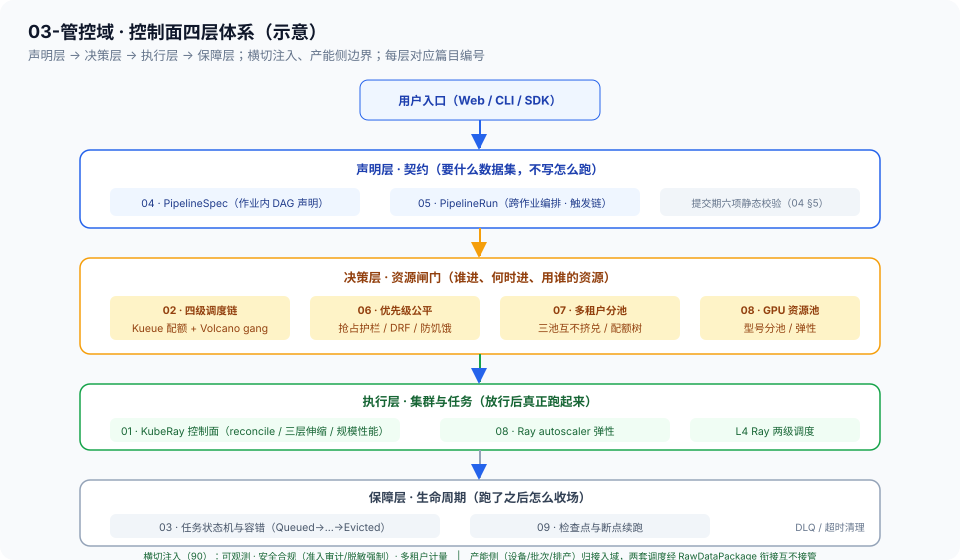

# 03-管控域 · 域分册（控制面）

> 上游域：用户入口（声明式 PipelineSpec）｜ 下游域：[02-生产域](../02-生产域/README.md)（驱动数据面执行）｜ 输入制品：PipelineSpec ｜ 输出制品：作业生命周期状态

## 1. 域职责

任务编排（作业内 DAG / 跨作业 DAG / 重试 / 断点续跑）、调度（队列/配额/优先级/gang scheduling）、状态机与生命周期、资源管理、多租户分池。控制面与数据面严格分离——只通过声明式规格交互（[总线 §1.2](../00-总体架构/README.md)）。

## 2. 控制面设计原则（总纲，贯通全域十篇）

| 原则 | 落点 |
| --- | --- |
| **声明式**：用户声明「要什么」，控制面收敛「怎么达到」 | 04 PipelineSpec / 05 PipelineRun；reconcile 循环（01 §3） |
| **最终一致**：不依赖「上次跑到哪」的记忆，每轮重看期望 vs 实际 | 04 §6 level-triggered；01 §3 同范式 |
| **控制面数据面分离**：控制面只发规格与收状态，不碰数据本身 | 总线 §1.2；调度链 L1–L4 各层不越权 |
| **分层不越权**：准入管该不该跑、调度管何时跑、绑定管落哪个节点、Ray 管任务放置 | 02 §3 四级链；03 状态推进 |
| **乐观并发 + 水平扩展**：大批量作业提交时控制面自身不成为瓶颈 | 01 §8 控制面规模与性能（etcd watch/API 吞吐/无状态分片） |
| **可重放可审计**：spec 即意图，版本化留痕 | 04 §7；审计记录挂血缘（横切 02） |

> 与 XLB 控制面同构：声明式配置下发、控制循环 diff 期望与实际、限流闸门在转发面之前、监测面与控制面分离——本域十篇是同一套控制面语言的具身数据平台实例。

## 3. 控制面四层体系

| 层 | 职责 | 篇目 |
| --- | --- | --- |
| 声明层 | 作业内 DAG 声明 + 跨作业编排与触发 | 04 / 05 |
| 决策层 | 资源闸门：调度链、配额、优先级、多租户、GPU 资源池 | 02 / 06 / 07 / 08 |
| 执行层 | 集群编排与弹性：KubeRay reconcile、伸缩 | 01 / 08 |
| 保障层 | 生命周期：状态机、检查点续跑、DLQ、超时清理 | 03 / 09 |

## 4. 关键组件

KubeRay（RayCluster/RayJob/RayService 三 CRD）、Kueue（配额准入）+ Volcano（gang/放置，两级共存）、状态存储（etcd/元数据库）、任务管理服务（PipelineSpec/PipelineRun reconciler）。

## 5. 域间契约

声明式 PipelineSpec（作业内）→ PipelineRun（跨作业）→ 作业生命周期状态；作业吃数据集、产数据集（数据集为中心原则），跨域只传标准制品。

## 6. 专题文档清单

| 专题 | 状态 |
| --- | --- |
| [01-KubeRay控制面](01-KubeRay控制面.md)（CRD/reconcile/三层伸缩/HA/规模性能） | ✅ 已写 |
| [02-调度与多租户](02-调度与多租户.md)（四级调度链/Kueue+Volcano/配额准入；多租户与优先级见 06/07） | ✅ 已写 |
| [03-任务状态机与容错](03-任务状态机与容错.md)（状态持久化/状态机/四级故障域/DLQ；检查点见 09） | ✅ 已写 |
| [04-PipelineSpec与编排DSL](04-PipelineSpec与编排DSL.md)（Schema/静态校验/声明式 reconcile/版本绑定） | ✅ 已写 |
| [05-跨作业编排与触发链](05-跨作业编排与触发链.md)（PipelineRun/触发四态/跨域编排/Argo 对齐） | ✅ 已写（示例，含图） |
| [06-优先级抢占与公平性](06-优先级抢占与公平性.md)（PriorityClass/抢占护栏/DRF/防饥饿） | ✅ 已写（已审计） |
| [07-多租户与分池隔离](07-多租户与分池隔离.md)（namespace/ResourceQuota/队列树/三池互不挤兑） | ✅ 已写（已审计） |
| [08-GPU资源池与弹性](08-GPU资源池与弹性.md)（ResourceFlavor/型号分池/拓扑/autoscaler/成本感知） | ✅ 已写（已审计） |
| [09-检查点与断点续跑](09-检查点与断点续跑.md)（检查点粒度/恢复流程/at-least-once/幂等） | ✅ 已写（已审计） |

## 7. 关键机制与质量门

本域是 **L2 管线工程指标**（通吃率/人工介入率/端到端成功率）与 **L3 性能成本指标**（GPU 秒/样本/吞吐/队列延迟）的落点域之一；断点续跑 = at-least-once + 检查点 + 幂等重跑。

## 8. 跨域指针

- [算子设计-03 算子执行与编排规范](../02-生产域/算子设计/算子设计-03-算子执行与编排规范.md)：执行框架映射、DAG 依赖与引擎选型、任务生命周期状态机、KubeRay 控制面、失败分类 DLQ、检查点、背压（SSOT 在生产域，本域 01/03 是其控制面视角深化）
- [算子设计-06 算子成本模型](../02-生产域/算子设计/算子设计-06-算子成本模型.md)：GPU 秒/样本口径与省钱策略（L3 指标来源；08 弹性伸缩的成本口径）
- [90-横切](../90-横切/README.md)：准入审计（横切 02）注入 L1、状态事件喂可观测（横切 01）、配额→计量账单（横切 03）
- 工程底稿：[91-工程笔记](../91-工程笔记/) RayCluster/RayJob 调度辨析、[92-调研笔记-02](../92-调研笔记/调研笔记-02-Ray分布式框架调研与管线应用.md) Ray 框架调研
