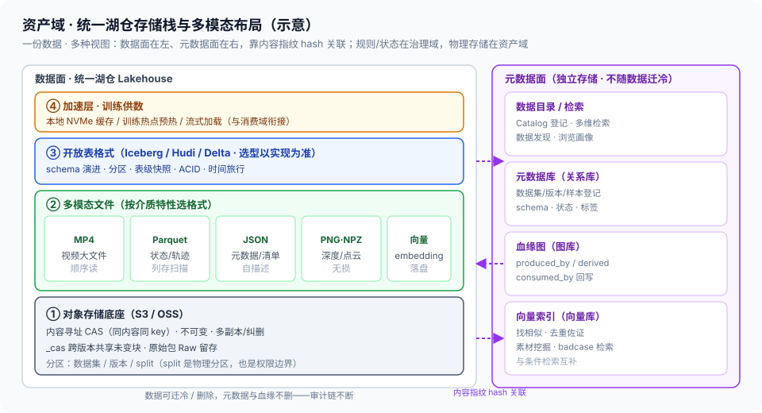

# 01 · 湖仓统一存储与多模态布局（Lakehouse / 对象存储底座 / Parquet·MP4·JSON / 分区规范）

> 05-资产域第 1 篇。定位：**资产域物理存储底座怎么组织**——一套湖仓同时承载原始文件、结构化数据、向量与元数据，多模态文件怎么摆、怎么分区、怎么和不可变版本对齐。边界：六类制品 schema = [总线 §4.1](../00-总体架构/README.md)（**SSOT，本篇不重写**）；版本不可变规则 / 晋升令牌 / 生命周期状态 = [治理 01](../04-治理域/01-版本管理与不可变快照.md)（规则在治理，**本篇只做物理实现**）；成本口径 = [算子设计-06](../02-生产域/算子设计/算子设计-06-算子成本模型.md)；split 分区 = [算子设计-07](../02-生产域/算子设计/算子设计-07-四层数据集分流与防泄漏.md)。

## 核实状态（2026-10-18）

- ✅ 已核实：Lakehouse「对象存储 + 开放表格式（Iceberg/Hudi/Delta）+ 元数据统一」为业内通用范式；阿里云 Agentic Lakehouse（DLF 统一原始文件+元数据+向量，[总线 §3⑤](../00-总体架构/README.md)）；LeRobotDataset 以 `Parquet + H.264 MP4 + JSON 元数据` 封装（生产域 L4 输出，见 [算子-01](../02-生产域/算子设计/算子设计-01-业内通用算子全集总览.md)）
- ⚠️ 设计通识：下方目录分区、CAS 物理布局、路径命名为本平台设计（**以实现为准**）；LeRobotDataset v2 物理结构为其公开形态，**v3 目录细节以官方版本为准**
- ❓ 待补：各模态存储占比与增长、单数据集/版本容量基线、跨域/跨 AZ 复制策略——待团队标定

## 1. 定位与边界

- **本篇管**：物理存储的**统一形态**（湖仓）、**多模态文件布局**（Parquet/MP4/JSON/向量/几何）、**分区与路径规范**、数据与元数据分离
- **不管**：目录检索与向量索引（[02](02-数据集目录与检索.md)）、快照与版本回溯（[03](03-不可变快照与训练样本快照.md)）、冷热分层（[04](04-冷热分层与TTL.md)）、TrainingRelease 导出（[05](05-TrainingRelease装配与导出.md)）
- **一句话**：治理 01 说「版本不可变」，本篇回答「不可变的字节在物理上**摆哪、怎么摆**」

## 2. 核心概念与组件

| 组件 | 职责 | 要点 |
| --- | --- | --- |
| 统一湖仓（Lakehouse） | 一套底座承载原始+结构化+向量+元数据 | 对象存储 + 开放表格式 + 元数据/目录（DLF 式） |
| 对象存储 | 海量、廉价、内容寻址底座 | 不可变、多副本/纠删；天然支持 CAS |
| 开放表格式 | 表级 schema/分区/快照/ACID | Iceberg / Hudi / Delta（**以技术选型为准**） |
| 加速层 | 训练热点缓存、低延迟读 | 本地 NVMe / 缓存集群（[04](04-冷热分层与TTL.md)） |
| 元数据存储 | 结构化元数据 / 索引 | 关系库 + 图库（血缘）+ 向量库（[02](02-数据集目录与检索.md)） |

> **与负载均衡/控制面同构**：湖仓 ≈ 配置/制品仓库——OCI 制品库按内容寻址（digest）、镜像分层、版本 tag 与不可变 digest 双标识，和这里「CAS blob + 版本指针 + 多模态分层」是同一套存储思想。

## 3. 为什么要「统一湖仓」（而不是文件 + 多个库）

- **数据孤岛问题**：原始视频在文件系统、轨迹在关系库、向量在向量库、标注在标注库——同一实体四处拷贝，版本对不齐、血缘断裂
- **统一目标**：**一份数据、多种视图**——原始文件 + 结构化表 + 向量索引 + 元数据指向同一物理资产，由湖仓目录统一登记
- **开放表格式的价值**：schema 演进、分区、**表级快照**、ACID、时间旅行——为 [03 快照](03-不可变快照与训练样本快照.md) 提供开箱支持
- **开源/商用对齐**：对象存储（S3/OSS）+ Iceberg/Hudi 为开源主流；DLF 式统一管理为商用集成形态



> 图 1：统一湖仓存储栈——数据面在左（一份数据、多种视图）、元数据面在右（独立存储、不随数据迁冷），两侧靠内容指纹 hash 关联。

## 4. 多模态存储布局（什么数据用什么格式）

| 模态 | 物理格式 | 选型理由 |
| --- | --- | --- |
| 第一视角视频 | **H.264/H.265 MP4** | 高压缩比、流式读；训练按需解码 |
| state / 结构化轨迹 | **Parquet**（列存） | 向量列高效扫描、压缩、谓词下推 |
| 元数据 / 清单 | **JSON / JSONL** | 可读、自描述、随版本走 |
| 深度图 / 法线 / Mask | PNG / NPZ / 列存 | 深度可无损存图，点云/数组用 NPZ |
| 向量（embedding） | 向量索引 + 原始列 | 检索走向量库，落盘回写 Parquet |
| 原始包 | 源格式 + 不可变副本 | Raw 留存，支撑回溯重处理 |

- **视频与状态分离**：视频走大文件顺序读，状态走向量列扫描——混在一起两者都慢
- **GT 与来源标记随数据**：`label_source`（sim/pseudo/human/model）作为列/元数据落盘（[标注体系-02](../02-生产域/标注体系/02-标注质检与来源标记.md)），仿真 GT 旁路数据同样入库（[仿真旁路 §5](../02-生产域/仿真GT旁路/01-仿真数据生产与三套GT.md)）

## 5. 分区与路径规范（设计通识，以实现为准）

**分区原则：按数据集 → 版本 → split 分层；大文件内容寻址共享**

```
lake/
  datasets/{dataset}/
    v{version}/
      data/   {split}-00000-of-xxxxx.parquet      # 状态/结构化
      videos/chunk-000/{camera}/episode_xxxxxx.mp4
      meta/  info.json / episodes.jsonl / tasks.jsonl / stats.json
    _cas/  ab/cd/abcd…（内容寻址 blob，跨版本共享、去重）
  raw/{source}/{session}/...                      # 原始包（不可变）
  vectors/{dataset}/...                           # 向量索引（02 篇）
```

- **版本分区不可变**：Published 版本目录只读（对齐 [治理 01 §3 内容寻址](../04-治理域/01-版本管理与不可变快照.md)）；新版本新目录，重复块在 `_cas` 共享
- **split 是物理分区，也是权限边界**：train/val/test/golden 分开落盘——为 [05 导出](05-TrainingRelease装配与导出.md) 的 split 隔离与 [06 防泄漏](../04-治理域/06-数据分流与防泄漏.md) 打基础
- **LeRobotDataset 典型结构（v2 公开形态；v3 以官方为准）**：`data/*.parquet` + `videos/**.mp4` + `meta/{info,episodes,tasks,stats}`，封装即上述分区的一种约定

## 6. 数据与元数据分离

- **数据面**：多模态文件在对象存储/湖仓（海量、不可变）
- **元数据面**：数据集/版本/样本登记、schema、**血缘图（图库）**、向量索引在独立元数据服务——数据可迁冷，**元数据/血缘不迁不删**（[治理 02 §5](../04-治理域/02-血缘制品与版本三锁.md)）
- **靠内容指纹关联**：元数据记录文件 hash，与物理 blob 对账——不一致即告警

## 7. 指标与质量门

| 指标 | 含义 | 目标 |
| --- | --- | --- |
| 落盘完整性 | 版本 manifest 物理文件齐备率 | 100%（缺文件版本不可发布，G5） |
| 元数据-文件对账一致率 | 元数据与物理 blob 一致 | 100% |
| 存储冗余/去重率 | CAS 共享、重复块占比 | 趋势优化（降本） |
| 数据可读取率 | 大文件/表可正常打开解码 | 定期巡检，100% |
| 读吞吐（训练供数） | 训练加载实际吞吐 | 不成训练瓶颈（[04 加速层](04-冷热分层与TTL.md)） |

## 8. 跨域衔接

- **上游**：治理域 `DatasetVersion` 晋升令牌触发物理落盘（[治理 01](../04-治理域/01-版本管理与不可变快照.md)）；生产域多模态产物（Parquet/MP4/JSON）
- **下游**：目录检索（[02](02-数据集目录与检索.md)）、快照（[03](03-不可变快照与训练样本快照.md)）、TrainingRelease（[05](05-TrainingRelease装配与导出.md)）
- **同域**：冷热分层（[04](04-冷热分层与TTL.md)）
- **边界**：平台只做存储与供数，不做训练；消费域按 TrainingRelease 取数

## 9. 红线与速讲话术

**红线**：

1. **一套底座，禁止数据孤岛**：原始/结构化/向量/元数据指向同一物理资产，禁止四处拷贝手工对版本
2. **版本目录只读**：Published 数据不可覆盖，修改走新版本——物理可写破坏不可变（对齐治理 01 红线）
3. **数据与元数据分离**：数据可迁冷/删除，血缘与元数据不随数据一起丢
4. **split 物理分区 + 权限隔离**：测试/回归集与训练集物理分离，防泄漏从存储布局开始
5. **视频与状态分格式存**：大文件顺序读、列存扫描，混用双慢
6. **目录/布局即约定**：路径与 schema 走统一规范，禁止各团队自定义目录导致无法检索

**速讲话术（30 秒）**：

> "资产域我用统一湖仓做底座：对象存储加开放表格式，一份数据同时给原始文件、结构化表、向量、元数据四种视图，避免数据孤岛。多模态按介质特性分：视频走 H.264 MP4 大文件顺序读，状态轨迹走 Parquet 列存高效扫描，元数据走 JSON，深度和点云走无损图或数组。分区按数据集、版本、split 三层，发布版本目录只读，重复块用内容寻址的 CAS 跨版本共享；数据与元数据分离，数据可迁冷，血缘图不删。落盘做完整性和元数据对账。这套和我做的制品/配置仓库一个范式：内容寻址 digest 加版本指针、不可变分层、tag 给人读 digest 给机器校验——被管对象从镜像换成多模态数据集，存储逻辑一模一样。"
