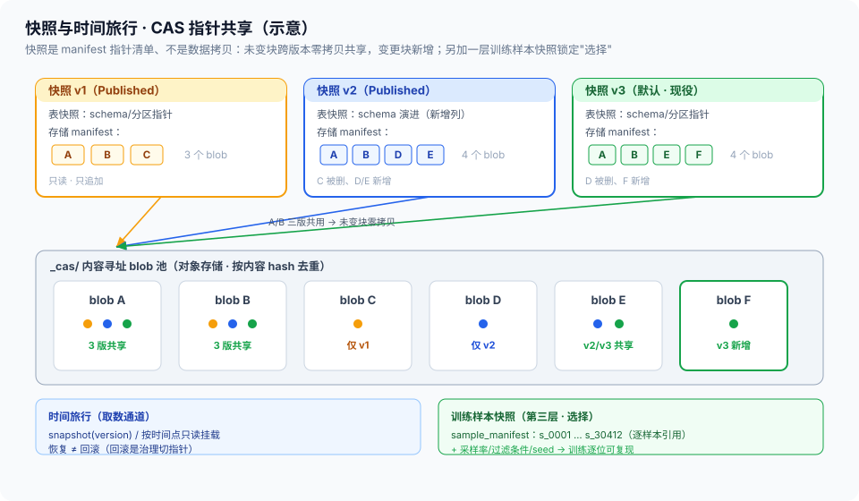

# 03 · 不可变快照与训练样本快照（快照服务 / 时间旅行 / 训练可复现）

> 05-资产域第 3 篇。定位：**资产域怎么把「不可变」落成物理事实**——发布即快照、版本可回溯（时间旅行）、每次训练吃的精确样本集可重放。边界：版本合法性 / 生命周期状态机 / 默认指针与回滚 = [治理 01](../04-治理域/01-版本管理与不可变快照.md)（**规则在治理，本篇只做物理执行**）；CAS blob 与 manifest = [01 §5](01-湖仓统一存储与多模态布局.md)（物理底座）；血缘 consumed_by 回写 = [治理 02](../04-治理域/02-血缘制品与版本三锁.md)；删除与留存的合规决策 = [治理 07](../04-治理域/07-合规引擎.md)；制品定义 = [总线 §4.1](../00-总体架构/README.md)。

## 核实状态（2026-10-18）

- ✅ 已核实：表格式快照（Iceberg/Hudi/Delta 的 snapshot / 时间旅行）为开放表格式原生能力（业内通识）；「发布即快照、CAS 指针清单不重拷未变块」与 [治理 01 §3 内容寻址](../04-治理域/01-版本管理与不可变快照.md) 和 [01 §5 `_cas/`](01-湖仓统一存储与多模态布局.md) 一致；训练样本快照需求（DatasetVersion + split + 采样记录）与 [总线 §4.1 TrainingRelease 关键字段](../00-总体架构/README.md) 及治理 02 consumed_by 口径一致
- ⚠️ 设计通识：快照服务 API、两层快照的分工表述、样本级 manifest 粒度、保留窗口策略、恢复演练机制为本平台设计（**字段以实现为准**）
- ❓ 待补：快照创建/恢复时延基线、样本快照存储开销、保留窗口时长（与 [04 TTL](04-冷热分层与TTL.md) 联动）——待团队标定

## 1. 定位与边界

- **本篇管**：快照的**物理机制**（两层快照怎么拍）、**时间旅行**（按版本/时间点取数）、**训练样本快照**（训练消费的精确样本集重放）、保留与演练
- **不管**：什么是合法版本、默认指针切给谁（治理 01）、快照里的数据怎么被装配导出（[05](05-TrainingRelease装配与导出.md)）、快照何时迁冷删除（[04](04-冷热分层与TTL.md) 执行、治理 07 决策）
- **一句话**：治理 01 宣布「Published 不可变」，本篇让这句话**有物理背书**——宣布不算数，快照在才算数

## 2. 核心概念与组件

| 组件 | 职责 | 要点 |
| --- | --- | --- |
| 快照服务 | 快照创建、登记、恢复的 owner | 治理 01 晋升令牌触发（发布即快照） |
| 表格式快照 | 表级 metadata 指针（snapshot） | Iceberg 等原生：schema/分区演进 + 时间旅行 |
| 存储/对象快照 | blob 级 CAS + manifest 指针清单 | 01 §5 `_cas/`；不重拷未变块 |
| 训练样本快照 | 训练消费的精确样本集记录 | §5 重点；供「同一份数据」重放 |
| 时间旅行 | 按版本 ID / 时间点只读取数 | 恢复 ≠ 回滚（回滚是治理切指针） |

> **与负载均衡/控制面同构**：这套就是**配置/存储快照的移植**——快照 = 只读时间点副本（LB 配置快照、数据库 PITR）；两层快照 ≈ 制品库的 manifest + blob 分层（清单指内容，内容寻址不重拷）；时间旅行 ≈ 按版本 checkout；「快照在、宣布才有效」≈ 配置回滚必须先有可回滚的版本存在。我在 XLB 的每一次可回滚，背后都是这套快照机制。

## 3. 两层快照（发布即快照）

```
治理 01 发布流：G6 + 审批 ──► Published（晋升令牌）
                                    │ 触发
                                    ▼
        ┌─────────────────── 快照服务 ───────────────────┐
        │ ① 表格式快照：记录当前 metadata/snapshot 指针      │
        │    （schema/分区清单——表级「这一版长这样」）        │
        │ ② 存储快照：manifest 指针清单 → CAS blob          │
        │    （每文件 hash——blob 级「字节就这些」）           │
        └───────────────────────────────────────────────┘
              未变更文件 ──指针复用──► 既有 blob（零拷贝）
              新增/变更文件 ──写入──► 新 blob（CAS 去重）
```

- **两层为什么都要**：表格式快照管**结构**（schema 演进、分区布局——「表在第 7 个 snapshot 长这样」）；存储快照管**字节**（对象存储上的多模态大文件不在表格式里——MP4/JSON 靠 manifest + hash 锁定）。只做表快照锁不住视频文件，只做存储快照看不到 schema 演进
- **不重拷**：快照记录的是指针清单（manifest），与 01 §5 CAS 布局天然配合——新版本快照只新增差异 blob 的引用，**快照很便宜，所以敢常拍**
- **只追加**：快照不可修改；「改」= 新快照（对齐治理 01 不可变语义）



## 4. 版本回溯与时间旅行

- **按版本 ID**：`snapshot(v3.1.0)` → manifest → blob 集，只读挂载给消费方（重处理、复盘、复现实验）
- **按时间点**：表格式快照的原生时间旅行（「上周三之前的那版表」）——**用于中间态排查**，正式引用仍必须版本 ID（治理 01 红线 2：精确到版本，禁止浮动指针）
- **恢复 ≠ 回滚**：回滚是治理动作（默认指针切回稳定版，治理 01 §6）；本篇提供的是**取数通道**——把任意快照完整、只读地拿出来
- **与血缘联动**：快照 manifest 即 [治理 02](../04-治理域/02-血缘制品与版本三锁.md) 血缘对账的物理依据（血缘-manifest 对账，图上样本集 = 快照文件集）

## 5. 训练样本快照（重点：训练可复现的最后一环）

**问题**：同一 DatasetVersion + 同一 split，两次训练吃的样本集仍可能不同——采样比例、过滤条件、随机种子、当时的过滤规则版本都会漂。「版本可复现」若到不了**样本集粒度**，训练对比与回归结论就是虚的。

```
训练任务 tr-042（消费域发起，经 [05 装配导出](05-TrainingRelease装配与导出.md)）
   │
   ▼  装配完成时记录（快照服务拍第三层——样本级）
training_sample_snapshot:
   ├── dataset_version: v3.1.0 + split: train        # 来自哪个版本哪个集
   ├── 采样/过滤记录: {采样率, 过滤条件表达式, 规则版本, seed}
   └── sample_manifest: [sample_id × N]              # 每样本引用（精确清单）
   │
   ▼  用途
 ① 重放：同 snapshot 重启训练 —— 样本集逐位一致（确定性算法栈前提，[算子-02 §10](../02-生产域/算子设计/算子设计-02-算子接口规范与质量门体系.md) 口径）
 ② 审计：训练效果 ↔ 精确数据对账（L4 消融归因的数据侧证据，治理 04 §5）
 ③ 回写：登记 consumed_by 进血缘图（治理 02——哪个版本被哪次训练怎么吃的）
```

- **粒度**：sample_manifest 精确到样本引用（不是统计描述）——「大约用了三万条」不可复现，「就是这 30,412 条」才可复现
- **三层快照分工**：表快照（结构）→ 存储快照（字节）→ **样本快照（选择）**——记录「这次训练的期望态里数据到底是哪部分」；三层叠加才是完整的训练可复现
- **成本很低的原理**：样本快照是引用清单（sample_id 列表 + 条件记录），不拷数据——MB 级清单换训练级可复现

## 6. 保留策略与恢复演练

- **保留窗口**：快照按策略保留（全量快照长期、中间态快照滚动窗口）——具体窗口与 [04 TTL](04-冷热分层与TTL.md) 存储分层联动，**删除/留存决策来自治理 07**，本篇只执行
- **恢复演练**：定期从随机抽样的快照做完整恢复 + hash 校验（manifest vs blob）——**未演练过的恢复承诺不算数**（备份行业通识：没有验证过的备份等于没有备份）
- **演练结果回写**：成功率入指标（§8）；失败的快照标记并触发补拍/告警

## 7. 关键字段示意

```yaml
snapshot_record:                  # 设计通识（字段以实现为准）
  snapshot_id / kind: table | storage | training_sample
  target: {dataset_version: v3.1.0, split: train?}     # 样本快照才有 split
  table_snapshot: {format: iceberg, snapshot_id: …}     # 表快照
  storage_manifest: {files: [{path, sha256, size}], content_hash}  # 存储快照
  sample_manifest: {n_samples: 30412, sample_refs: [s_0001, …],     # 样本快照
                    sampling: {rate, filter_expr, rule_version, seed}}
  consumed_by_training: tr-042                         # 回写血缘（治理 02）
  created_at / retention_class / restore_drill: {last_at, result}
```

## 8. 指标与质量门

| 指标 | 含义 | 目标 |
| --- | --- | --- |
| 发布即快照执行率 | Published 版本有物理快照的比例 | **100%（无快照的 Published = 假冻结）** |
| 快照创建时延 | 晋升到快照就绪 | 待标定（指针清单应为分钟级） |
| 快照恢复时延 / 恢复演练通过率 | 时间旅行取数时效 / 可恢复性验证 | 演练定期、通过率 100% |
| 样本快照覆盖率 | 训练任务带样本快照的比例 | **100%（无快照的训练不可复现）** |
| 快照增量比 | 新快照新增存储 / 全量 | 趋势低（CAS 共享生效的证据） |
| 血缘-manifest 对账一致率 | 快照清单与血缘图一致 | 100%（治理 02 §5 同源） |

## 9. 跨域衔接

- **上游**：治理 01 晋升令牌（触发快照）；01 CAS 布局（物理基础）
- **下游**：[05 装配导出](05-TrainingRelease装配与导出.md)（从快照取数装配）；[04 分层](04-冷热分层与TTL.md)（快照的存储分层与保留执行）
- **治理域**：consumed_by 回写与对账（治理 02）；删除决策（治理 07）；L4 消融的样本级证据（治理 04 §5）
- **消费域**：重放训练、复现实验的取数通道（[06-消费域](../06-消费域/README.md)）

## 10. 红线与速讲话术

**红线**：

1. **发布即快照，无快照不 Published**：治理宣布的不可变必须有物理背书——「逻辑上冻结、物理上没拍」等于没冻结
2. **快照只追加不可改**：修改 = 新快照；在快照上打补丁会摧毁所有下游的时间旅行
3. **每次训练必有样本快照**：无样本快照的训练不可复现、不可审计——L4 对比与消融结论全部失去数据侧依据
4. **时间旅行只读**：从快照取数不得改原版本；改的需求走新版本（治理 01）
5. **恢复必须演练验证**：没有演练记录的快照不承诺可恢复
6. **样本快照记引用不拷数据**：清单是账，数据在湖仓——拷贝式快照既贵又制造第二 SSOT

**速讲话术（30 秒）**：

> "不可变我落到物理上是两层快照加一层样本快照。发布即快照：治理域出晋升令牌，资产域立刻拍表格式快照锁结构、存储快照锁字节——存储快照就是 manifest 指针清单指向 CAS blob，未变文件零拷贝，所以快照便宜、敢常拍。时间旅行按版本 ID 只读挂载，恢复和回滚分开：回滚是治理切默认指针，我提供的是把任意快照完整拿出来的通道。最关键一层是训练样本快照：同版本同 split 两次训练吃的样本集也可能因采样过滤漂移，所以每次装配训练数据时记下采样率、过滤条件、seed 加逐样本引用清单，保证这 30,412 条就是那 30,412 条——这是训练可复现的最后一环，成本只是一份 MB 级清单。恢复定期演练加 hash 校验，没演练过的不算能恢复。这套就是配置快照加制品库 manifest 的搬运：清单指内容、内容寻址不重拷、时间旅行按版本 checkout。"
