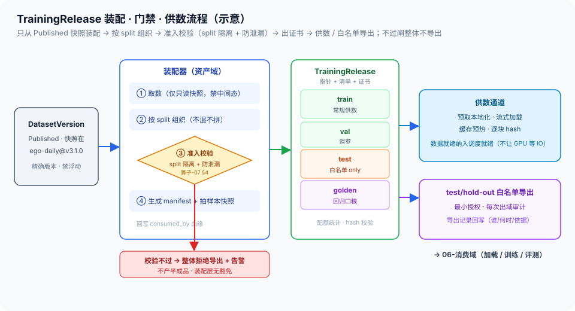

# 05 · TrainingRelease装配与导出（资产域唯一制品 / 准入校验 / 训练供数 / 白名单导出）

> 05-资产域第 5 篇（本域收尾篇）。定位：**资产域对外的唯一出口**——把 Published 的 DatasetVersion 装配成可直接开训的 TrainingRelease，校验通过才导出，供数通道保吞吐，test/hold-out 按白名单放行。边界：制品 schema = [总线 §4.1](../00-总体架构/README.md)（**SSOT，本篇不重写**）；资产→消费契约（split 隔离 + 防泄漏）= [总线 §4.2](../00-总体架构/README.md)；泄漏检测手段 = [算子设计-07 §4](../02-生产域/算子设计/算子设计-07-四层数据集分流与防泄漏.md)（**SSOT，只引用**）；split 权限 = [治理 06](../04-治理域/06-数据分流与防泄漏.md)；样本快照 = [03](03-不可变快照与训练样本快照.md)；加速层 = [04](04-冷热分层与TTL.md)；加载后的训练/评测 = [06-消费域](../06-消费域/README.md)。

## 核实状态（2026-10-18）

- ✅ 已核实：TrainingRelease 为总线 §4.1 六类制品之一、资产域所产，字段口径（split 指针/版本引用/配额统计）与总线一致；「导出前过 split 隔离 + 防泄漏检查」为总线 §4.2 资产→消费契约原文口径；训练样本快照在装配时拍摄与 [03 §5](03-不可变快照与训练样本快照.md) 一致
- ⚠️ 设计通识：装配器/准入校验器/导出网关的内部结构、release manifest 字段细节、供数通道（预取/流式）实现方式为本平台设计（**字段以实现为准**）
- ❓ 待补：装配时延基线（版本大小→导出就绪）、大版本流式加载吞吐、白名单审批流转时长——待团队标定

## 1. 定位与边界

- **本篇管**：装配流程（取数→按 split 组织→生成 manifest）、**准入校验的执行**（不过不导出）、**供数通道**（预取/本地化/流式/缓存预热）、导出授权的**执行**（白名单放行 + 审计留痕）
- **不管**：泄漏怎么检测（算子-07 §4 手段）、split 权限模型（治理 06）、训练怎么加载与训练（消费域）、数据物理在哪层（[01](01-湖仓统一存储与多模态布局.md)/[04](04-冷热分层与TTL.md)）
- **一句话**：资产域的前四篇把数据存好、找到、冻住、摆对位置，本篇把它**打包成一份带质检证书、按权限分发的训练口粮**——这是资产域唯一的「出品」

## 2. 核心概念与组件

| 组件 | 职责 | 要点 |
| --- | --- | --- |
| 装配器 | 从 Published 版本取数、按 split 组织 | 只从快照/版本取数（03），禁止拼凑中间态 |
| 准入校验器 | split 隔离 + 防泄漏检查（执行） | 手段引算子-07 §4；结果写入制品；**不过不导出** |
| Release Manifest | 装配产出的清单 | split 指针 + 文件清单 + 版本精确引用 + 配额统计 |
| 样本快照挂接 | 装配完成即拍样本快照 | 03 §5；「这次导出就是这批样本」 |
| 供数通道 | 预取/本地化/流式加载/缓存预热 | 与 04 加速层联动；保训练吞吐 |
| 导出网关 | test/hold-out 白名单放行 | 权限模型在治理 06；放行动作 + 审计在这里 |

> **与负载均衡/控制面同构**：TrainingRelease 就是**制品发布**——release manifest ≈ 发布清单（digest 锁内容、tag 锁版本）；准入校验 ≈ 发布门禁（镜像扫描不过不许推生产仓，这里泄漏检查不过不许导出）；白名单导出 ≈ 私仓的拉取权限（test/hold-out 是「生产标签」，只有登记在册的消费者能拉）；供数预热 ≈ 制品预分发到边缘节点——发布时就把热数据推近消费者。我在 XLB 发配置包：清单、校验、灰度白名单、预分发，四件事一件不多。

## 3. TrainingRelease：资产域唯一制品

- **为什么唯一**：资产域的产出里，只有 TrainingRelease 出现在总线 §4.1 六类制品清单里——目录、快照、分层都是**内部机制**，不对外承诺 schema；对消费域的稳定接口只有这一个（对齐总线「域间靠契约不靠实现」）
- **它解决什么**：消费域不应（也不被允许）自己到湖仓里拼训练数据——拼数逻辑各家写各家的，split 隔离与防泄漏就守不住了。**装配收敛到一处，契约才守得住**
- **形态**：不是数据拷贝，是**指针 + 清单 + 证书**——split 指向 01 的物理分区，文件清单指向 CAS blob（hash 校验），配额统计说明各 split 规模（混训配比依据，[02 profile](02-数据集目录与检索.md) 同源）

## 4. 装配流程（取数 → 组织 → 校验 → 出证）

```
消费域训练请求（dataset + version + splits + 配额要求）
        │ ① 版本合法性：必须 Published（治理 01）＋ 快照在（03）
        ▼
┌─────────────────────── 装配器（资产域）───────────────────────┐
│ ② 取数：按 [01 分区](01-湖仓统一存储与多模态布局.md) 读各 split 文件清单      │
│ ③ 组织：train/val/test/golden 各自成 split 指针（不混不拼）        │
│ ④ 准入校验：split 隔离 + 防泄漏检查（手段=算子-07 §4，此处只执行）    │
│    ├─ 通过 → ⑤ 生成 release manifest（版本精确引用+文件清单+hash）   │
│    │         ⑥ 拍训练样本快照（[03 §5](03-不可变快照与训练样本快照.md)）   │
│    │         ⑦ 回写血缘 consumed_by（治理 02）                    │
│    └─ 不通过 → 拒绝导出 + 告警（不产出半成品制品）                    │
└────────────────────────────────────────────────────────────┘
        ▼
TrainingRelease（就绪）──► 供数通道（§6）／白名单导出（§7）
```

- **只从冻结态取数**：装配输入必须是 Published 版本的快照（03）——从中间态装配等于把未定版数据喂给训练，可复现性从源头断掉
- **split 不混不拼**：装配器不做任何跨 split 的「顺手均衡」——配比是消费域在训练侧的职责，装配层动 split 就是泄漏源头
- **失败即整体失败**：任一 split 校验不过，整个 release 不导出——不存在「train 先用着、test 回头补」的形态



## 5. 准入校验：资产→消费契约的执行面

- **契约本体在总线 §4.2**：TrainingRelease 过 split 隔离 + 防泄漏检查才可被消费域使用——本篇是这条契约的**执行者**
- **检测手段引 SSOT**：跨集重复/近重复等检测手段见 [算子设计-07 §4](../02-生产域/算子设计/算子设计-07-四层数据集分流与防泄漏.md)（不重写）；本篇的增量是**把检测放在导出闸口上强制执行**，并把结果（含所用检测的版本/阈值集引用）写进制品
- **证书随制品走**：校验结果字段化（哪次检查、哪个规则版本、什么结论）——消费域拿到的每份 TrainingRelease 都自带「何时何规通过」的可追溯证书（对齐治理 03 gate_result 版本化精神）
- **不过不导出**：这是硬门，无豁免路径——豁免属于治理域工单机制管辖的发布决策，不在装配层开口子

## 6. 训练供数（通道保吞吐，训练归消费域）

- **预取/本地化**：训练任务入队即按 release 声明预取（触发 [04 §5](04-冷热分层与TTL.md) 预热）——数据就绪纳入调度就绪（[管控 02](../03-管控域/02-调度与多租户.md)），不让 GPU 等 IO
- **流式加载**：按 episode/chunk 流式读（对齐 01 大文件布局），消费域加载框架按清单拉取；随机采样强的阶段走缓存集群（04 两级加速）
- **hash 校验的完整性**：供数途中逐块按 manifest hash 校验——**到训练节点的是被证明过的字节**（对齐 01 §6 对账与 03 恢复演练精神）
- **边界（总线口径）**：资产域装配到 TrainingRelease 并保证供数通道；**加载后的训练/评测在 [06-消费域](../06-消费域/README.md)**——资产域不感知训练循环、不背训练指标

## 7. 导出最小授权（test/hold-out 的分发纪律）

- **默认不出**：train/val 是常规供数对象；**test/hold-out 只按白名单导出**——权限模型与 split RBAC 引 [治理 06](../04-治理域/06-数据分流与防泄漏.md)（SSOT）
- **放行动作在本篇**：导出网关按治理 06 的授权判定执行放行/拒绝，导出记录（谁、哪个 release、哪个 split、何时、依据）回写审计（对齐治理 07 §8 导出审计口径）
- **导出后的边界提示**：已导出到外部白名单的数据，其删除/留存统筹在治理 07 覆盖范围（[04 §6](04-冷热分层与TTL.md) 同口径）——本篇只保证「每次出域都有记录」

## 8. 关键字段示意

```yaml
training_release:                  # 设计通识（字段以实现为准；schema SSOT=总线 §4.1）
  release_id: rel-20261018-007
  dataset_version: ego-daily@v3.1.0        # 版本精确引用（禁止浮动）
  splits:
    train: {file_manifest_ref, n_samples, quota_ratio}
    val:    {file_manifest_ref, n_samples}
    test:   {file_manifest_ref, n_samples, export: whitelist_only}
    golden: {file_manifest_ref, n_samples} # 回归口粮（治理 05）
  quota_stats: {total_bytes, per_split_bytes, label_source_mix}   # 配额统计
  admission:
    split_isolation: pass
    leakage_check:   {result: pass, method_ref: "算子-07 §4",
                      rule_version: …, checked_at: …}             # 证书
  sample_snapshot_ref: tss-…               # 03 §5（装配即拍）
  lineage_backref: consumed_by(rel-…)      # 治理 02 回写
  export_audit: [ {split: test, grantee, basis, at} ]
```

## 9. 指标与质量门

| 指标 | 含义 | 目标 |
| --- | --- | --- |
| 装配成功率 / 拒因分布 | 导出请求通过准入比例与拒绝原因 | 拒因可归档（供上游整改） |
| 准入校验执行率 | 导出前校验覆盖 | **100%（跳过校验的导出=契约破洞）** |
| 装配时延（版本就绪→release 就绪） | 端到端装配时效 | 待标定（清单型应为分钟级） |
| 供数吞吐 / 数据就绪率 | 训练读吞吐 / 开跑前预取完成 | 不成训练瓶颈（04 联动） |
| 供数完整性 | 逐块 hash 校验通过率 | 100% |
| 白名单外导出拦截率 | 越权导出被拒比例 | **100%（0 次漏放）** |
| 样本快照挂接率 | release 带样本快照比例 | 100%（对齐 03 红线） |

## 10. 跨域衔接

- **上游**：治理 01 Published 版本（装配前提）；[03 快照](03-不可变快照与训练样本快照.md)（取数与样本快照）；[01 布局](01-湖仓统一存储与多模态布局.md)（split 物理分区）；[02 profile](02-数据集目录与检索.md)（配额统计同源）
- **下游**：[06-消费域](../06-消费域/README.md)（加载框架、训练、评测——按 release 取数）
- **治理域**：consumed_by 回写（治理 02）；test/hold-out RBAC（治理 06）；导出审计（治理 07 §8）；golden split 支撑回归（治理 05）
- **管控域**：数据就绪纳入调度就绪（[管控 02](../03-管控域/02-调度与多租户.md)）
- **总线**：§4.1 制品 schema、§4.2 资产→消费契约（双 SSOT，本篇执行不重写）

## 11. 红线与面试话术

**红线**：

1. **只从 Published 快照装配**：中间态数据不进 TrainingRelease——可复现从源头守起
2. **不过准入不导出**：split 隔离 + 防泄漏检查是导出硬门，装配层无豁免口子——半成品制品比没有制品更危险
3. **版本精确引用，禁止浮动指针**：release 绑死 dataset@version，"latest" 不出现在供数链路（对齐治理 01 红线）
4. **split 不混不拼**：装配层不做跨 split 调剂；配比是消费域训练侧的事——装配层动 split 就是制造泄漏
5. **test/hold-out 白名单外零放行**：每次出域带审计记录；「就拉一次」也不行
6. **供数到字节可证明**：逐块 hash 校验，到训练节点的字节与 manifest 一致——信任要随数据一起送达

**面试话术（30 秒）**：

> "TrainingRelease 是资产域唯一对外制品：把 Published 的 DatasetVersion 按 train/val/test/golden 四个 split 装配成指针加清单加证书——不是数据拷贝，manifest 指向 CAS blob，hash 锁字节，配额统计给混训配比。装配有硬门：导出前强制过 split 隔离加防泄漏检查，检测手段复用算子域 SSOT，结果连同规则版本写进制品当证书，不过就整体不导出。装配完成即拍训练样本快照、回写 consumed_by 血缘，这批数据被谁怎么吃全程可追。供数做预取本地化和流式加载，数据就绪纳入调度就绪条件，不让 GPU 等 IO；test/hold-out 只按白名单放行，每次出域留审计。这套就是制品发布的搬运：发布清单、发布门禁、私仓拉取权限、边缘预分发——被发布对象从镜像配置包换成训练数据。"
