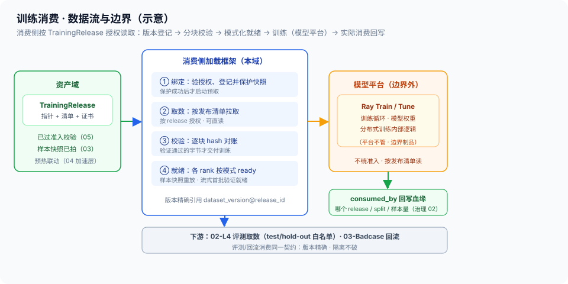

# 01 · 训练导出与模型平台衔接（消费侧供数契约 / 训练可复现 / 边界制品）

> 06-消费域第 1 篇。定位：**消费侧怎么把 TrainingRelease 接住、吃干净、留证据**——加载框架按清单取数、数据就绪入调度、hash 校验到字节、样本快照重放保证训练可复现、consumed_by 回写血缘；同时把「数据平台 vs 模型平台」的边界钉死。边界：TrainingRelease 的生成与准入 = [资产域 05](../05-资产域/05-TrainingRelease装配与导出.md)（**SSOT，本篇只消费**）；物理就绪/预热 = [资产域 04 §5](../05-资产域/04-冷热分层与TTL.md)；样本快照机制 = [资产域 03 §5](../05-资产域/03-不可变快照与训练样本快照.md)；血缘 consumed_by = [治理 02](../04-治理域/02-血缘制品与版本三锁.md)；精确版本红线 = [治理 01](../04-治理域/01-版本管理与不可变快照.md)（红线 2）；数据就绪纳入调度 = [管控 02 §5](../03-管控域/02-调度与多租户.md)。

## 核实状态（2026-10-18）

- ✅ 已核实：平台边界「止于 TrainingRelease、训练归模型平台」= [总线 §1.3](../00-总体架构/README.md) 原文口径；TrainingRelease 形态（指针+清单+证书）与供数通道（预取/流式/逐块 hash）=[资产域 05 §3/§6](../05-资产域/05-TrainingRelease装配与导出.md)；样本快照重放口径=[资产域 03 §5](../05-资产域/03-不可变快照与训练样本快照.md)；确定性算法栈 = [算子设计-02 §10](../02-生产域/算子设计/算子设计-02-算子接口规范与质量门体系.md)
- ⚠️ 设计通识：消费侧加载框架（DataLoader）与训练框架（Ray Train/Tune）的具体衔接方式、epoch shuffle 一致性语义、混训配比决策为本平台设计（**以实现为准**）
- ❓ 待补：消费侧加载吞吐基线、数据就绪到开跑的首字节时延、混训场景下多版本引用成本——待团队标定

## 1. 定位与边界

- **本篇管**：TrainingRelease 的**消费侧接数**（取数/校验/就绪）、**训练可复现**（样本快照重放 + shuffle 一致性语义）、**边界**（平台止于 TrainingRelease）、**回写**（consumed_by 血缘）
- **不管**：TrainingRelease 怎么装配校验（资产域 05）、数据物理怎么摆（资产域 01/04）、训练循环与模型权重（模型平台）、L4 评测怎么跑（本域 02）、badcase 怎么回流（本域 03）
- **一句话**：资产域把训练口粮打包出证，本篇回答消费侧**怎么拿、怎么验、怎么证明吃过**——并守住「数据平台不越界训练」这条线

## 2. 核心概念与组件

| 组件 | 职责 | 要点 |
| --- | --- | --- |
| 消费侧加载框架 | 按 release manifest 取数到训练进程 | DataLoader 层；按发布授权直读表/对象，不绕过 TrainingRelease 准入 |
| 供数通道（消费侧） | 预取/本地化/流式 | 与资产域 04 加速层联动；数据就绪入调度 |
| 样本快照重放 | 同 snapshot 复现同一批样本 | 资产域 03 §5；「就是这 30,412 条」 |
| shuffle/epoch 一致性 | 重跑时数据序的可复现语义 | §5 重点：确定性栈逐位一致，否则统计一致 |
| consumed_by 回写 | 每次消费登记血缘 | 治理 02；L4 归因与对账的消费侧证据 |
| 模型平台衔接点 | Ray Train/Tune 吃 release | 边界制品；平台不管训练内部 |

> **与负载均衡/控制面同构**：训练消费就是**配置消费者侧加载**——release manifest ≈ 下发的配置清单（digest 锁内容），hash 校验 ≈ 配置落盘校验，数据就绪 ≈ 配置加载完成才宣告就绪，consumed_by ≈ 版本使用登记（哪个实例在用哪个配置版本），平台边界 ≈ 配置平台下发、业务自己跑业务逻辑。我在 XLB 消费配置包：清单、校验、就绪、留痕，四件事一件不少。

## 3. 消费侧怎么「接住」TrainingRelease

```
资产域 05 产出 TrainingRelease（指针+清单+证书，已过准入）
        │
        ▼
消费侧加载框架（只消费 release 授权的版本/split）：
  ① 绑定：校验清单/权限/版本，登记意图并钉住快照/媒体；失败则不启动预取
  ② 取数：按 file_manifest_ref 拉取获准数据（经资产域 04 供数通道）
  ③ 校验：逐块 hash 与 manifest 对账，验证通过才交付（05 §6）
  ④ 就绪：离线完成计划预取；流式首批已验证可读，各 rank 满足所选模式
        │
        ▼
Ray Train/Tune（模型平台）：加载框架按 release 语义喂数据
        │
        ▼
训练结束或失败 → 追加 consumed_by 实际消费/状态，归档后转交留存或受控解除保护
```

- **消费域不绕过发布准入**：消费侧一切数据访问由 TrainingRelease 固定版本、样本范围和 split 权限；兼容引擎可用受限凭证直接读取授权的表/对象，不要求元数据服务代理全部字节。禁止利用共享物理文件、表扫描或凭证越权读取未获准的样本/字段。
- **2026-11-19 就绪增补（设计规范）**：流式就绪不要求整版下载，实际消费的块必须逐块验证；视频 range 读需要受信的分块校验清单或已完整验证的对象缓存，不能用整对象 hash 宣称单个 range 已验证。模式契约、失败处理和性能基准统一见[04-训练供数性能与DataLoader基准](04-训练供数性能与DataLoader基准.md)，保护引用见[资产06 §6](../05-资产域/06-样本宽表与增量物化.md)。
- **配比是消费侧的事**：quota_stats（资产域 05 §3）给混训配比依据，**配比决策在消费侧**（如跨版本混训、采样加权）——装配层不拼 split，消费侧也不能拼（拼的是"配比"，不是"数据"：每份数据仍精确引用原版本）



## 4. 边界：平台止于 TrainingRelease

- **数据平台管到**：release 生成、供数、校验、就绪、回写、评测取数、回流发起
- **模型平台管**：训练循环、模型结构、权重、Ray Train/Tune 编排、训练内部分布式逻辑
- **为什么这条线不能破**：① 可复现性——训练内部细节不属于数据契约，数据侧保证“给了什么、可证明”；② 治理隔离——模型平台不得绕过发布装配和最小授权，直读数据面仍受 release 约束；③ 职责单一——数据平台交付数据与收益证据，不承诺所有模型效果（总线 §1.3）

## 5. 训练可复现：样本快照重放 + shuffle 一致性语义

- **重放的起点**：每次训练装配时资产域已拍训练样本快照（资产域 03 §5）——`sample_manifest` 逐样本引用 + 采样率/过滤条件/seed
- **重放怎么落**：同 snapshot 重启训练 → 消费侧按 sample_manifest 精确取同一批样本；数据层面逐位一致
- **shuffle 一致性语义（要讲清可复现的边界）**：
  - **确定性算法栈**（[算子-02 §10](../02-生产域/算子设计/算子设计-02-算子接口规范与质量门体系.md)：`torch.use_deterministic_algorithms` + 固定 seed/硬件/cuDNN）→ 重跑**逐位一致**（数据 + 顺序全一致）
  - **非确定性环境** → **统计意义一致**（同一批样本、分布相同，但顺序/浮点可微差）——两者都要**声明清楚**，报告里不能混写
- **可复现 ≠ 逐位一致**：逐位一致是目标（成本高：固定硬件栈），统计一致是底线（成本低）——先保"样本集一致"，再争取"顺序一致"，这是消费侧的可复现分级

## 6. 混训与多版本引用

- **混训形态**：跨版本（v2.8 旧数据 + v3.1 新数据）或跨源（真机 + 仿真旁路）按配比组合——**每份数据各自精确引用版本**，禁止"整体混成一个新版本"（那是生产域的新版本流程，不是消费侧操作）
- **回写必须到分量**：consumed_by 登记到"哪个 release 的哪个 split、用了多少样本"，混训时逐分量登记——L4 消融归因（治理 04 §5）的数据侧证据从这里来
- **泄漏防线不因混训松动**：混训引用的各版本都已在资产装配处单独过 split 隔离 + 防泄漏（算子-07 §4）——消费侧不引入新数据，只做配比

## 7. 关键字段示意

```yaml
training_consumption:             # 设计通识（字段以实现为准）
  training_id: tr-042
  release_ref: rel-20261018-007   # 精确引用（禁 latest）
  splits_used: {train: {n_samples: 30412, quota_ratio: 0.9},
                val:  {n_samples: 3800, quota_ratio: 0.1}}
  data_ready: {mode: streaming, manifest_verified: true, first_batch_ready: true, ready_at}
  integrity: {policy: chunk_verified_before_use, chunk_manifest_ref: chunk-007}
  sample_snapshot_ref: tss-…      # 资产域 03（重放依据）
  shuffle_semantics: deterministic | statistical   # §5 声明
  consumed_by: {registered: true, lineage_backref: …}   # 治理 02
  protection_ref: pin-042       # 开跑前登记；结束/失败归档后按保留策略转交或解除
```

## 8. 指标与质量门

| 指标 | 含义 | 目标 |
| --- | --- | --- |
| 版本精确引用率 | 训练任务引用带版本 release 的比例 | **100%（latest 不出现）** |
| 供数完整性 | 逐块 hash 校验通过率 | 100%（对齐资产域 05 §6） |
| 数据就绪率 | 各 rank 满足所声明离线/流式模式的比例 | 100%；流式不等于全库预取，见 04 |
| 样本快照重放覆盖率 | 训练任务带样本快照重放的比例 | **100%（无快照不可复现）** |
| consumed_by 回写率 | 训练消费登记血缘比例 | **100%（无登记=假对账）** |
| 加载吞吐 / 首字节时延 | 消费侧取数时效 | 待标定（不成训练瓶颈） |

## 9. 跨域衔接

- **上游**：[资产域 05](../05-资产域/05-TrainingRelease装配与导出.md)（release 生成/供数）；[资产域 03](../05-资产域/03-不可变快照与训练样本快照.md)（样本快照）；[资产域 04](../05-资产域/04-冷热分层与TTL.md)（预热/加速层）
- **治理域**：consumed_by 回写与对账（治理 02）；精确版本红线（治理 01）；split 权限（治理 06 §5）
- **管控域**：数据就绪纳入调度（管控 02 §5）
- **下游**：本域 02（L4 评测取数）、03（badcase 回流）——训练消费是评测与回流的数据前提

## 10. 红线与速讲话术

**红线**：

1. **消费域不绕过发布准入**：按 TrainingRelease 的固定版本与最小授权读取，兼容引擎可直读授权表/对象；禁止客户端过滤替代服务端权限隔离
2. **版本精确引用，latest 不出现在供数链路**（对齐治理 01 红线）
3. **无样本快照不训练**：可复现从样本集粒度守起（对齐资产域 03 红线）
4. **数据就绪才开跑**：不让 GPU 等 IO（管控 02 gang 就绪）
5. **平台边界不破**：数据平台不写训练循环，模型平台不得绕过 TrainingRelease 准入与授权——边界制品是唯一交界面
6. **consumed_by 必回写**：吃没吃过、吃了多少，血缘图必须说清

**速讲话术（30 秒）**：

> "消费侧接数我把它定义成四件事：拿、验、就绪、留痕。拿——消费侧按 TrainingRelease 的固定版本和最小授权读取，兼容引擎可直读获准的表与对象，不能绕过发布准入；验——按 manifest 逐块 hash 校验，到训练节点的字节是被证明过的；就绪——各 rank 达到离线或流式模式的条件才统一开跑，流式不要求全库下载；留痕——开跑前登记引用并保护快照，结束或失败后回写实际 consumed_by，记清 release、split、样本及状态。训练可复现靠样本快照重放：资产域装配时拍了逐样本清单，重启训练精确重放同一批样本；可复现分两级，确定性算法栈下逐位一致，否则统计意义一致，两级都要声明。平台边界钉死：数据平台止于 TrainingRelease，训练循环归模型平台，被追问时收敛到边界制品。这套就是配置消费者侧加载的搬运：清单、校验、就绪、版本登记，把配置包换成训练数据。"
