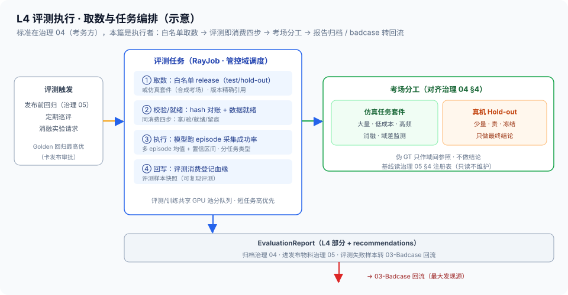

# 02 · 下游评测执行与L4收益（评测取数 / 任务编排 / 消融执行 / EvaluationReport 产出）

> 06-消费域第 2 篇。定位：**L4 下游评测的执行者**——[治理 04](../04-治理域/04-四层评测体系L1-L4.md) 定标准（指标/GT/频率/阻断性，**考务方不代考**），本篇去考：评测任务怎么编排、评测集怎么取数、benchmark 怎么选、成功率怎么采、消融怎么做、EvaluationReport 怎么产出。边界：L4 标准与 EvaluationReport 字段 = [治理 04](../04-治理域/04-四层评测体系L1-L4.md)（**SSOT，本篇只执行不重写**）；L1–L3 评测各在自域（L1 模型卡 / L2 算子-02 / L3 算子-06）；回归基线管理 = [治理 05 §4](../04-治理域/05-回归与发布.md)；训练消费与边界 = [本域 01](01-训练导出与模型平台衔接.md)；badcase 回流 = [本域 03](03-Badcase回流闭环.md)；评测取数通道 = [资产域 05](../05-资产域/05-TrainingRelease装配与导出.md)。

## 核实状态（2026-10-18）

- ✅ 已核实：四层评测总纲（L1 硬 / L2 硬 / L3 软预算告警 / **L4 不硬阻断、只作收益证据、报告必须归档**）= [总线 §6 #6](../00-总体架构/README.md)；L4 展开与 EvaluationReport 字段 = [治理 04 §5/§6](../04-治理域/04-四层评测体系L1-L4.md)；三套 GT 用法（仿真主力 / 伪 GT 不做最终结论 / Hold-out 冻结只做最终结论）= [总线 §5.3](../00-总体架构/README.md)、治理 04 §4；test/hold-out 白名单 = [资产域 05 §7](../05-资产域/05-TrainingRelease装配与导出.md)、[治理 06 §5](../04-治理域/06-数据分流与防泄漏.md)；消费→治理契约 = [总线 §4.2](../00-总体架构/README.md)
- ⚠️ 设计通识：评测任务编排形态（RayJob 模板）、benchmark 套件构成、消融实验设计模板、置信区间统计方法为本平台设计（**字段以实现为准**）
- ❓ 待补：评测成本预算（L4 占比）、Golden 回归报告时限（暂拟 ≤24h）、域间差距数据采集频率——待团队标定

## 1. 定位与边界

- **本篇管**：L4 评测的**执行全流程**——评测取数（白名单+隔离）、评测任务编排与调度、benchmark 选型、成功率采集、消融执行、EvaluationReport 的 L4 部分产出
- **不管**：L4 标准与报告归档（治理 04）、L1–L3 评测（各在自域）、回归基线怎么记怎么更（治理 05 §4）、训练消费（本域 01）、badcase 回流（本域 03）
- **一句话**：治理 04 出考卷定判卷标准，本篇组织考场、请考生、算分数、交答卷——**标准与执行分离**，考务方不代考

## 2. 核心概念与组件

| 组件 | 职责 | 要点 |
| --- | --- | --- |
| 评测取数器 | 按白名单取 test/hold-out/仿真套件 | 走资产域 05 通道；版本精确引用 + 评测样本快照 |
| 评测任务编排 | 评测即消费，RayJob 提交 | 复用本域 01 取数/校验/就绪纪律；管控 02 调度 |
| benchmark 套件 | 真机 / 仿真任务套件分工 | 选型对齐治理 04 §4 三套 GT 用法 |
| 成功率采集器 | 多 episode 统计与置信区间 | 域间差距数据上报（监测归治理 04 §7） |
| 消融执行器 | 加减数据子集 → Δ 收益 | 实验纪律：对照/重复/精确引用（治理 04 §5） |
| 报告产出器 | EvaluationReport 的 L4 部分 | 字段对齐治理 04 §6；报告进治理 05 发布物料 |

> **与负载均衡/控制面同构**：这套就是**拨测/主动探测系统**——监控平台定指标与告警规则（治理 04 = 考务方），拨测代理只负责按任务跑探测、回传数据（本篇 = 考生）；评测任务编排 ≈ 拨测任务调度（短任务、独立配额、定时+触发两类）；白名单取数 ≈ 生产配置的受控读取；置信区间 ≈ 拨测多次采样的均值±方差；EvaluationReport 归档 ≈ 拨测报告进监控库供趋势对比。被管对象从「服务拨测」换成「模型评测」，运行形态一字不差。

## 3. L4 执行面在四层里的位置

- **L1–L3 不在本篇**：L1 算子/模型质量（硬门，各 [模型卡](../02-生产域/模型卡/) §5 与 [算子-02 §9](../02-生产域/算子设计/算子设计-02-算子接口规范与质量门体系.md)）；L2 管线工程（硬门）；L3 性能成本（软门、预算告警，[算子-06](../02-生产域/算子设计/算子设计-06-算子成本模型.md) 口径）
- **L4 = 下游收益**：拿数据训出的模型，在下游任务上跑出成功率——回答「这批数据值不值」；**不硬阻断发布，只作收益证据，但报告必须归档**（总线 §6 #6：不归档的证据等于不存在）
- **为什么 L4 归消费域跑**：评测要真实训练/评测算力与消费链路，天然在消费侧；治理域定标准并归档报告，「考务方不代考」——既当标准又当考生，收益证据就失去公信力（治理 04 定位原文口径）

## 4. 评测取数（白名单与隔离）

- **取数对象**：L4 评测集 = test（常规下游评测）与 hold-out（最终结论，冻结）；Golden Set 服务回归（[治理 05](../04-治理域/05-回归与发布.md)）——**三者都只按白名单导出**（[资产域 05 §7](../05-资产域/05-TrainingRelease装配与导出.md)、[治理 06 §5](../04-治理域/06-数据分流与防泄漏.md)）
- **评测也是消费**：评测任务与训练同纪律——版本精确引用（禁 latest，治理 01 红线 2）、逐块 hash 校验、**评测样本快照**（可复现的评测：哪次评测吃了哪些样本，与训练快照同机制，[资产域 03 §5](../05-资产域/03-不可变快照与训练样本快照.md)）
- **隔离红线在评测侧的执行**：Golden/Hold-out **绝不进训练**（[治理 06](../04-治理域/06-数据分流与防泄漏.md)）——评测数据的去向受控：只进评测进程，产物是报告与 badcase 清单，**不产生新训练数据**；评测进程对评测集只读
- **发现坏样本走 03**：评测失败样本是 badcase 的最大来源，转 [本域 03](03-Badcase回流闭环.md) 回流——评测数据本身不外带

## 5. 评测任务编排（评测即消费）

```
触发：版本发布前回归（治理 05 §3）/ 定期巡评 / 消融实验请求
        │
        ▼
评测任务提交（RayJob，管控域调度）
  ① 取数：白名单 release（test/hold-out）或仿真套件（合成考场）
  ② 校验/就绪：hash 对账 + 数据就绪（同本域 01 四步：拿/验/就绪/留痕）
  ③ 执行：模型在任务套件上跑 episode，采集成功率
  ④ 回写：评测消费登记血缘 + EvaluationReport 产出（L4 部分）
        │
        ▼
报告归档（治理 04 §6）/ 发布物料（治理 05 §5）/ badcase 转 03
```

- **算力与配额**：评测与训练共享 GPU 池但分队列（[管控 07](../03-管控域/07-多租户与分池隔离.md) 分池配额）——评测占用要有预算感（L4 不硬阻断，评测算力失控会把训练挤兑）
- **优先级分层**（[管控 06](../03-管控域/06-优先级抢占与公平性.md)）：Golden 回归评测 = 发布链路一环，最高优（它卡着发布审批）；常规评测短任务次之；训练长任务低优先大配额——**短平快高优先、长吞吐低优先**，与在线服务 vs 离线任务的调度同款
- **评测短任务特性**：分钟~小时级、失败可重跑（幂等：同 release + 同快照 + 同 seed 重跑一致）——调度上按弹性队列处理，不占常驻



## 6. benchmark 选型与对比口径

| 考场 | 数据 | 特性 | 用途 |
| --- | --- | --- | --- |
| 真机评测 | 真实 Hold-out | 少量、贵、冻结 | **最终结论**（版本横向对比的最终裁判） |
| 仿真任务套件 | 仿真合成 GT 场景 | 大量、低成本、可批量生成 | 高频评测、消融、域差监测 |
| （参照）伪 GT | 真实域伪标注 | 不做最终结论 | 域间对比参照（治理 04 §4） |

- **分工口径**（对齐治理 04 §4）：仿真考场高频跑（每版本/每日），真机考场低频跑（里程碑/发布）；**最终结论只在真实 Hold-out 上做**——伪 GT 永远不做最终结论
- **对比基线从哪来**：[治理 05 §4 基线注册表](../04-治理域/05-回归与发布.md)（历史基准，随 Golden Set 受控更新）——本篇只读取不维护；对比给容忍度/显著性判定，不拍脑袋说「涨了」
- **套件本身是受管资产**：仿真套件版本化（场景组合与难度分布即试卷），试卷变更 = 基线全量重基准（治理 05 口径）——防止「换卷子刷分」

## 7. 成功率采集与消融执行

- **任务成功率采集**：多 episode 平均 + **置信区间**（单 episode 成败是伯努利样本，不做数）；上报口径含任务类型分层（抓取/放置/长程）——粗粒度总分掩盖结构退化
- **域间差距数据**：仿真考场 vs 真机考场同模型成绩差（Sim2Real gap）——**监测与阈值归治理 04 §7**，本篇负责把数据采准采全（同一模型、同一版本引用，两边可比）
- **消融执行**（设计标准在 [治理 04 §5](../04-治理域/04-四层评测体系L1-L4.md)，本篇是执行者）：
  - 设计纪律：对照组（基准数据集）、实验组（加减子集）、**重复次数**（覆盖训练随机性）、子集定义**精确引用版本 + 样本快照**——混训分量 consumed_by（本域 01 §6）是「到底吃了哪些数据」的证据源
  - 产出：Δ成功率 → 数据子集的**边际收益**（哪部分数据在起作用、哪部分是冗余）
  - **效力边界（要讲清）**：单次消融是**小样本证据**——训练本身有随机性、单一任务有偏；多版本交叉、多任务交叉验证后才可下「这批数据没用」的结论。消融结论进报告必须带实验次数与区间，禁裸均值

## 8. EvaluationReport 产出（消费→治理契约）

- **契约**：EvaluationReport + Badcase = 消费→治理制品（[总线 §4.2](../00-总体架构/README.md)），准入校验 = **回流标记 + 血缘定位**——报告必须带「哪个 release、哪次训练、哪些样本」的可追溯链，否则治理侧拒收（无定位的报告无法归因）
- **字段对齐治理 04 §6**：l1~l4 分层结果 / 回归基线对比 / 回流建议（recommendations）——本篇产出 **L4 部分与 recommendations**，L1–L3 部分由各域评测汇入
- **去向**：报告归档进治理域（治理 04 §6 归档口径）；发布触发的评测报告进 [治理 05 §5 发布物料](../04-治理域/05-回归与发布.md)——审批者看的「收益证据」就是这份

## 9. 关键字段示意

```yaml
eval_job:                         # 设计通识（字段以实现为准；schema SSOT=治理 04 §6）
  eval_id: ev-20261018-021
  kind: golden_regression | routine | ablation
  model_ref: {training_id: tr-042, checkpoint: …}     # 被评对象精确引用
  bench: {suite: sim-suite@v2.3 | holdout@v1.0-frozen, episodes: N}
  data_ref: {release_ref: …, whitelist_grant: …}      # 白名单凭证（资产域 05 §7）
  sample_snapshot_ref: tss-…                          # 评测样本快照（可复现评测）
  stats: {success_rate_mean: …, ci95: [lo, hi], by_task: {…},
          sim_real_gap: …}                             # 域间差距上报（治理 04 §7）
  ablation?: {arms: [{subset_ref, sample_snapshot_ref}], repeats: N}
  report_ref: EvaluationReport#l4 + recommendations
```

## 10. 指标与质量门

| 指标 | 含义 | 目标 |
| --- | --- | --- |
| 评测覆盖率 | 应评版本/任务实际评到比例 | 趋势 100%（发布链 100%） |
| 评测可复现率 | 评测带样本快照与 seed 的比例 | **100%（无快照的评测不可复现）** |
| 白名单越权次数 | 评测取数绕过白名单的次数 | **0（一次都是泄漏）** |
| 报告及时率 | 评测完成到报告归档时效 | 待标定（Golden 回归暂拟 ≤24h） |
| 消融实验完成率 | 登记的消融请求按纪律跑完比例 | 100%（半途的消融不出结论） |
| 域间差距数据上报率 | 仿真/真机配对评测的数据完整度 | 100%（缺一边即不可比） |

## 11. 跨域衔接

- **上游**：[资产域 05](../05-资产域/05-TrainingRelease装配与导出.md)（白名单取数通道）；[资产域 03](../05-资产域/03-不可变快照与训练样本快照.md)（评测样本快照）；[本域 01](01-训练导出与模型平台衔接.md)（被评模型的训练消费记录）
- **治理域**：L4 标准与报告归档（治理 04）；基线注册表与发布物料（治理 05 §4/§5）；评测集隔离与白名单（治理 06）
- **管控域**：评测 RayJob 调度（[管控 02](../03-管控域/02-调度与多租户.md)）、配额与分池（[管控 07](../03-管控域/07-多租户与分池隔离.md)）、优先级（[管控 06](../03-管控域/06-优先级抢占与公平性.md)）
- **下游**：[本域 03](03-Badcase回流闭环.md)（评测失败样本 → badcase 回流）；recommendations 反哺数据迭代（总线 §6 #8 飞轮）

## 12. 红线与速讲话术

**红线**：

1. **考务方不代考**：L4 标准与判读在治理 04，本篇只执行——既定标准又自己跑分，收益证据失去公信力
2. **评测取数只走白名单**：test/hold-out 越权取数一次都是泄漏（对齐资产域 05 §7 / 治理 06 §5）
3. **Golden/Hold-out 绝不进训练**：评测数据只读、只产报告与 badcase，不产生新训练数据
4. **评测必带样本快照与版本精确引用**：不可复现的评测分数 = 不可信的证据（对齐治理 01 红线 2、资产域 03）
5. **单次消融不下终论**：小样本证据必须标注次数与区间，多版本/多任务交叉后才可信
6. **L4 报告必须归档**：不硬阻断 ≠ 可以不交卷——不归档的收益证据等于不存在（总线 §6 #6）

**速讲话术（30 秒）**：

> "L4 下游评测我把它做成执行面和标准面分离：治理域定指标、GT、频率和阻断性，是考务方；消费域是考生，负责组织考场。评测也是消费——test 和 hold-out 走白名单取数，版本精确引用加评测样本快照，哪次评测吃了哪些样本可复现；Golden 和 Hold-out 绝不进训练，评测进程对数据只读。benchmark 分两个考场：仿真套件大量低成本高频跑，真机 Hold-out 少量贵、只做最终结论，伪 GT 永远不做结论；对比基线从治理域基线注册表读，给容忍度和显著性。成功率按多 episode 均值加置信区间，同时把仿真和真机的域间差距采给治理域监测。消融按对照组加重复次数设计，子集定义精确到版本和样本快照，但单次消融只是小样本证据，多版本多任务交叉才可信。产出的 EvaluationReport 走消费到治理契约，带回流标记和血缘定位，进发布物料当收益证据。这套就是 XLB 拨测系统的搬运，被管对象从服务探测换成模型评测。"
