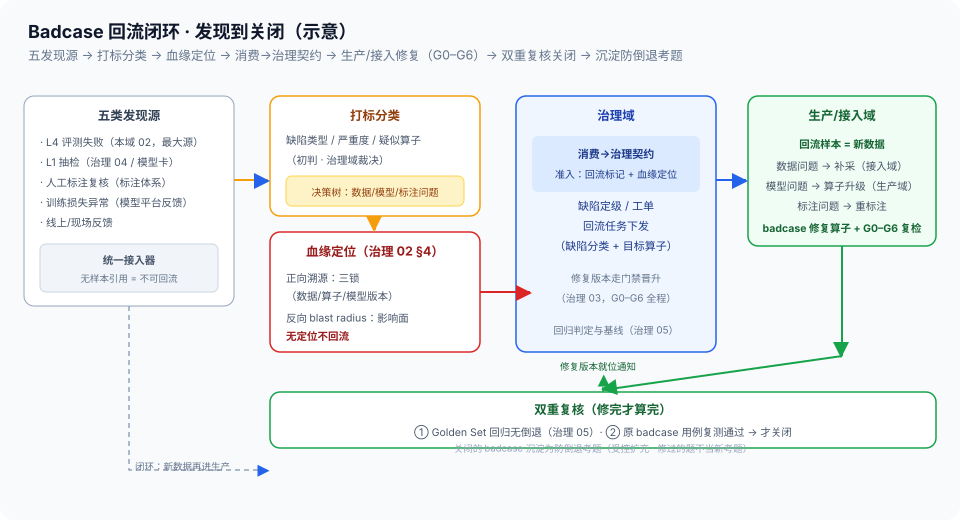

# 03 · Badcase回流闭环（发现源 / 打标分类 / 血缘定位 / 回流契约 / 回归关闭）

> 06-消费域第 3 篇（本域收尾篇）。定位：**数据飞轮的消费侧起点**——badcase 从发现到关闭的全生命周期：发现 → 打标分类 → 血缘定位 → 提交回流（消费→治理契约）→ 跟踪修复 → 回归验证关闭（总线 §6 #8、P4 智能闭环）。边界：血缘定位手段 = [治理 02 §4](../04-治理域/02-血缘制品与版本三锁.md)（**SSOT，本篇只调用**）；缺陷分类规则与工单机制 = 治理域；回归判定与基线 = [治理 05](../04-治理域/05-回归与发布.md)；补采与修复执行 = [接入/生产域](../02-生产域/README.md)；评测怎么跑出 badcase = [本域 02](02-下游评测执行与L4收益.md)。

## 核实状态（2026-10-18）

- ✅ 已核实：回流闭环链路（Badcase → 血缘定位 → 缺陷分类 → 重跑/补采/算子修复 → 回归验证）= [总线 §6 #8](../00-总体架构/README.md) 原文口径；消费→治理契约（EvaluationReport + Badcase，准入校验 = **回流标记 + 血缘定位**）= [总线 §4.2](../00-总体架构/README.md)；血缘两类查询（正向溯源/反向 blast radius）= [治理 02 §4](../04-治理域/02-血缘制品与版本三锁.md)；回归验证与 Golden 管理 = [治理 05](../04-治理域/05-回归与发布.md)；split 隔离与 Hold-out 冻结 = [治理 06](../04-治理域/06-数据分流与防泄漏.md)
- ⚠️ 设计通识：发现源接入器、打标分类器字段、回流任务跟踪器、badcase 回归用例库机制为本平台设计（**字段以实现为准**）
- ❓ 待补：回流周转时长基线、badcase 关闭率/复发率目标值、自动打标规则准确率——待团队标定

## 1. 定位与边界

- **本篇管**：badcase 的**发现源接入与打标**、**回流发起**（契约执行：回流标记 + 血缘定位）、**回流任务跟踪**、**复测验证与关闭申请**
- **不管**：血缘图怎么查（治理 02）、缺陷分类规则与工单流转机制（治理域）、回归判定标准与基线（治理 05）、补采/修复怎么执行（接入/生产域）
- **一句话**：消费域是 badcase 的**产生源与回流发起方**——治理域当裁判定位决策，生产/接入域当医生执行修复，本篇负责把病例收集齐、证据链带上、把球传出去并盯到关闭

## 2. 核心概念与组件

| 组件 | 职责 | 要点 |
| --- | --- | --- |
| 发现源接入器 | 各源 badcase 统一接入 | 五类发现源，形态各异（§3） |
| 打标分类器 | 缺陷类型/严重度/所属算子打标 | 规则在治理域；本篇打标给证据 |
| 血缘定位请求 | 调治理 02 查三锁与影响面 | 无定位不回流（红线） |
| 回流任务跟踪器 | 回流任务生命周期跟踪 | 提交→下发→修复→复测→关闭 |
| 复测验证器 | 原 badcase 用例复测 + 回归联动 | 关闭申请的证据生产者 |
| 回归用例库 | badcase 沉淀为防倒退考题 | 受控扩充（治理 05 §7 精神） |

> **与负载均衡/控制面同构**：这套就是**告警-工单-复盘闭环**——五类发现源 ≈ 告警源矩阵（拨测失败/指标异常/人工报障/日志异常/用户反馈）；打标分类 ≈ 告警分级路由（P1/P2 + 归属组件）；血缘定位 ≈ 依赖图根因定位，blast radius ≈ 影响面分析（哪个服务挂了会波及哪些上游——这里是哪个数据版本坏了会波及哪些下游）；回流下发 ≈ 工单派给责任团队；回归验证 + 用例库 ≈ 故障复盘后的复测与「故障考题」入库防复发。我在 XLB 值故障时走的就是这套流程，把被管对象从服务故障换成数据缺陷，闭环一步不少。

## 3. 定义与发现源矩阵

**badcase 定义**：被消费链路证明「数据/标注/算子产出有问题」的具体样本——评测失败样本、低置信产出、重建失败、语义错误等（广义：一切「这条数据错了」的可定位实例）。

| 发现源 | 产出形态 | 特点 |
| --- | --- | --- |
| L4 评测失败（本域 02） | 评测失败 episode + 任务类型 | **最大源**；成批出现、带模型上下文 |
| L1 抽检（治理 04 / 模型卡口径） | 质检不达标样本 | 生产侧质量缺口的消费侧印证 |
| 人工标注复核（标注体系） | 复核驳回样本 | 标注问题主源；带修正建议 |
| 训练损失异常（模型平台侧反馈） | 异常 batch 的数据引用 | 训练侧感知的数据异常（坏值/分布突变） |
| 线上/现场反馈 | 场景描述 + 时间段 | 最稀疏但最真实；需先定位到样本 |

- **统一接入**：各源形态不同，接入器归一为 badcase 记录（样本引用 + 发现上下文 + 初步标签）——**不带样本引用的反馈先进定位队列，不算 badcase**（定位不到样本 = 不可回流）
- **发现即留痕**：每个 badcase 带发现源与时间——复发率统计（§8）依赖发现源可追溯

## 4. 打标与分类（分类决定回流方向）

```
badcase 记录（样本引用 + 发现上下文）
        │ 打标：缺陷类型 / 严重度 / 所属算子（规则在治理域，本篇执行打标）
        ▼
┌─ 分类决策树（治理域规则路由，本篇提供证据包）─────────────┐
│ 数据问题（采集缺失/场景未覆盖/传感器坏值）→ 回流方向：补采/重跑  │
│ 模型问题（算子检出差/结构误差超阈）       → 回流方向：算子升级   │
│ 标注问题（标错/漏标/口径不一）           → 回流方向：重标注     │
└──────────────────────────────────────────────┘
        │ 分类结论 + 证据包（三锁定位 + 影响面）
        ▼
治理域定位决策（缺陷定级/工单机制）→ 回流任务下发（§6）
```

- **打标三要素**：缺陷类型（错在哪类环节）、严重度（阻断性/影响面加权）、所属算子（疑似责任算子——初判，最终以血缘定位为准）
- **分类是方向阀**：数据→补采（接入域）、模型→算子升级（生产域）、标注→重标注（标注体系）——分类错 = 修复方向错，所以分类结论必须带证据包并留治理域裁决，本篇不擅自定责
- **严重度决定优先级**：影响面大（波及 Published 版本）的 badcase 走加急（对齐治理 06 §6 事件响应的止损精神）

## 5. 血缘定位与影响面（无定位不回流）

- **正向溯源**：从 badcase 样本回溯**三锁**（数据版本 / 算子版本 / 模型版本，[治理 02 §4](../04-治理域/02-血缘制品与版本三锁.md) get_lineage / trace_badcase）——定位到「哪个版本的哪条数据、经过哪个版本算子、用的哪个模型」
- **反向 blast radius**：查坏样本波及哪些下游版本与训练（find_impact）——修复优先级与回归范围（哪些版本要重评）的依据（[治理 05 §6](../04-治理域/05-回归与发布.md) 回滚定位同源精神）
- **本篇只调用不实现**：血缘图与查询 API 在治理域元数据服务——消费域发起定位请求、拿回结果组装证据包
- **为什么无定位不回流**：没有三锁的 badcase，生产域不知道改哪个算子、不知道重跑哪个版本——回流任务不可执行，只能当反馈留言

## 6. 回流契约与流转（把球传出去）

```
消费域（本篇）                     治理域                      生产/接入域
──────────────                  ─────────                  ──────────
badcase + 证据包
（回流标记 + 血缘定位）
  │ 消费→治理契约（总线 §4.2）
  ▼ 准入校验：标记齐全？定位齐全？──不齐拒收
                                缺陷定级 / 工单创建
                                回流任务下发（缺陷分类 + 目标算子）
                                                            回流样本 = 新数据
                                                            走 badcase 修复算子
                                                            + G0–G6 全程复检
                                修复版本走门禁晋升（治理 03）
  ▲                                                            │
  └──────────── 修复版本就位通知（血缘联动）◄──────────────────┘
```



- **契约执行**：Badcase 制品的准入校验 = **回流标记 + 血缘定位**（[总线 §4.2](../00-总体架构/README.md)）——回流标记声明缺陷分类建议与发现上下文，血缘定位给三锁与影响面，两者齐备治理侧才受理
- **回流样本 = 新数据**：badcase 样本回到生产域就是一次新的数据生产——走 badcase 修复算子（重跑/清洗/重标注）并**全程过 G0–G6 门禁**（[治理 03](../04-治理域/03-质量门禁G0-G6.md)），不因为「它是修复」而走捷径（修复引入新缺陷 = 二次事故）
- **跟踪不甩手**：回流任务跟踪器盯全生命周期（提交→受理→下发→修复→复测→关闭），超时未动提醒——回流任务烂尾 = 飞轮空转

## 7. 回归验证与关闭（修完才算完）

- **双重复核**：① 修复版本上 **Golden Set 回归**（[治理 05 §3](../04-治理域/05-回归与发布.md)，无倒退）；② **原 badcase 用例复测**（这条修好了吗）——两关都过才申请关闭
- **badcase 进回归用例库**：已关闭的 badcase 沉淀为**防倒退考题**——未来版本回归时重跑，复发即拦截（故障考题机制；用例库受控扩充，对齐 [治理 05 §7](../04-治理域/05-回归与发布.md) Golden 管理精神）
- **关闭标准**：复测通过 + 回归无倒退 + 证据归档（复测报告挂 badcase 记录）——**没有回归验证的关闭 = 假关闭**
- **防假闭环（考场纪律）**：**badcase 样本本身不得进训练集复用为评测**——修过的题再考一遍必然高分，收益证据失真；badcase 要进考场只有一条路：走评审进 Golden Set **受控扩充**（治理 05 §7），与 Hold-out 冻结纪律一致（治理 06）

## 8. P4 智能闭环演进（飞轮的自动化梯度）

- **三级演进**（设计通识，以实现为准）：① 人工标记（当前基线：发现→人工打标分类）；② 规则自动标记（缺陷模式库：同类缺陷特征自动打标路由）；③ **评测驱动自动补采**（L4 消融/失败模式分析 → 自动生成补采需求 → 回流任务直达接入域——[本域 02](02-下游评测执行与L4收益.md) 的 recommendations 是燃料，总线 §6 #8 飞轮的自动挡）
- **闭环健康度指标**：回流周转（发现到关闭时长）、badcase 关闭率、**复发率**（同根因 badcase 再现——复发高说明修复质量或考题库失效）
- **边界提醒**：自动补采的需求仍走治理域审批（补什么、补多少是数据策略，不是消费域自决）——自动化加速传球，不改变裁判权

## 9. 关键字段示意

```yaml
badcase:                          # 设计通识（字段以实现为准）
  badcase_id: bc-20261018-117
  found: {source: l4_eval | l1_audit | human_review | training_anomaly | field,
          context: {eval_id? / task? / episode?}, at}
  sample_refs: [s_xxx, …]         # 定位到的样本（无引用=不可回流）
  labels: {defect_type, severity, suspect_operator}     # 初判，治理域裁决
  lineage: {data_version, operator_version, model_version,   # 三锁（治理 02 §4）
            impact: {affected_versions: […], affected_trainings: […]}}
  flow: {submitted_at, governance_ticket: …, dispatch: {target: 补采|算子升级|重标注},
         fix_version: …, retest: {result, report_ref}, closed_at}
  regression_entry: {in_case_library: true, last_guard_run}    # 防倒退考题
```

## 10. 指标与质量门

| 指标 | 含义 | 目标 |
| --- | --- | --- |
| 带血缘定位回流率 | 回流 badcase 三锁齐全比例 | **100%（无定位=不可执行，不受理）** |
| 回流任务烂尾率 | 提交后超时未关闭比例 | 趋势 0（跟踪器催办） |
| 回流周转 | 发现到关闭时长 | 待标定（按严重度分档） |
| badcase 关闭率 | 受理 badcase 走完双重复核关闭比例 | 趋势 100% |
| 复发率 | 同根因 badcase 再现比例 | 趋势 0（考题库失效告警） |
| 回归验证覆盖率 | 关闭前过 Golden 回归比例 | **100%（无回归不关闭）** |

## 11. 跨域衔接

- **上游**：[本域 02](02-下游评测执行与L4收益.md)（评测失败样本 = 最大发现源；recommendations 驱动自动补采）；[本域 01](01-训练导出与模型平台衔接.md)（训练消费记录 = 血缘定位的消费侧证据）
- **治理域**：血缘定位 API（治理 02 §4）；缺陷定级与工单（治理域机制）；门禁复检（治理 03）；回归判定与 Golden/用例库（治理 05）；Hold-out 冻结与事件响应（治理 06）
- **接入/生产域**：补采执行（接入域）；badcase 修复算子与重跑（[生产域](../02-生产域/README.md)，G0–G6 全程）
- **总线**：§4.2 消费→治理契约；§6 #8 回流闭环（数据飞轮）

## 12. 红线与速讲话术

**红线**：

1. **无血缘定位不回流**：不带三锁与影响面的 badcase 治理侧不受理——不可执行的回流是留言不是工单（总线 §4.2 准入校验）
2. **修复必须回归验证才关闭**：复测通过 + Golden 回归无倒退 + 证据归档——没有回归的关闭是假关闭
3. **修过的题不当新考题**：badcase 样本不得直接进训练集复用为评测（防假闭环）；进考场只走 Golden 受控扩充评审（治理 05 §7）
4. **回流样本 = 新数据，门禁全程**：修复不豁免 G0–G6——修复引入新缺陷是二次事故
5. **badcase 必须带样本引用与发现源**：定位不到样本的反馈不算 badcase——复发率与归因都以可追溯为前提
6. **闭环不烂尾**：回流任务跟踪到关闭，超时催办——飞轮空转比不转更隐蔽

**速讲话术（30 秒）**：

> "badcase 回流我按全生命周期做：五个发现源——评测失败、L1 抽检、人工复核、训练损失异常、线上反馈，统一接入成带样本引用的 badcase 记录。然后打标分类：缺陷类型、严重度、疑似算子，按决策树路由三个方向——数据问题补采、模型问题算子升级、标注问题重标注，分类结论带证据包留治理域裁决，我不擅自定责。关键一步是血缘定位：调治理域 API 回溯三锁——数据版本、算子版本、模型版本，再反向查 blast radius 看波及哪些下游，无定位不回流，因为不可执行。回流走消费到治理契约，准入校验就是回流标记加血缘定位；回流样本进生产域就是新数据，修复算子加 G0 到 G6 全程复检，不走捷径。修完双重复核：Golden 回归无倒退加原用例复测通过才关闭，关闭的 badcase 沉淀成防倒退考题；但修过的题不能当新考题进训练评测，进考场只走 Golden 受控评审。这套就是 XLB 告警-工单-复盘闭环的搬运，被管对象从服务故障换成数据缺陷。"
