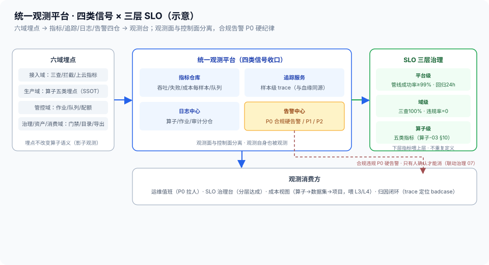

# 01 · 可观测性（指标 / 追踪 / 日志 / 告警 · 统一观测平台）

> 90-横切第 1 篇。定位：**六域共用的观测底座**——指标、追踪、日志、告警四类信号收口成统一平台，SLO 分层治理，成本可观测（成本每样本从算子级汇聚到数据集级）。横切不是第七域，是注入六域的服务：**观测面与控制面分离**（观测挂了不影响管线跑，但 SLO 违约必须暴露）。边界：算子级埋点清单（吞吐/时延/失败/成本/追踪五类）= [算子设计-03 §10](../02-生产域/算子设计/算子设计-03-算子执行与编排规范.md)（**执行层 SSOT**）；成本口径（GPU 秒/样本）= [算子设计-06](../02-生产域/算子设计/算子设计-06-算子成本模型.md)（**本篇只聚合展示，不重复定义**）；血缘 trace 链 = [算子设计-04](../02-生产域/算子设计/算子设计-04-算子血缘与版本三锁.md)（追踪与血缘同源）；合规类告警联动 = [治理 07](../04-治理域/07-合规引擎.md)。

## 核实状态（2026-10-18）

- ✅ 已核实：算子级五类指标与告警 SLO（吞吐/时延/失败/成本/追踪、月管道成功率 ≥99%、Golden Set 回归 24h）= [算子-03 §10](../02-生产域/算子设计/算子设计-03-算子执行与编排规范.md) 原文口径；成本每样本与规则前置省钱 = [算子-06](../02-生产域/算子设计/算子设计-06-算子成本模型.md)；样本血缘 trace = [算子-04](../02-生产域/算子设计/算子设计-04-算子血缘与版本三锁.md) `produced_by` 链；端到端 SLO 示例 = [总线 附录 A](../00-总体架构/README.md)（NFR 占位）；合规红线 = [治理 07](../04-治理域/07-合规引擎.md)
- ⚠️ 设计通识：观测平台组件选型（指标仓库/追踪/日志/告警）、告警分级规则、SLO 目标数值为本平台设计（**以真实规模校准**）
- ❓ 待补：各层 SLO 具体目标（除总线附录 A 示例外）、P0 响应时延 SLA、成本单价表——待团队标定

## 1. 定位与边界

- **本篇管**：**统一观测平台**（四类信号收口）、**SLO 分层治理**（平台→域→算子三层）、**成本可观测**（成本每样本的端到端归因视图）、**告警分级与值班纪律**
- **不管**：算子具体埋什么点（算子-03 §10 已定义，SSOT 在生产域）；成本怎么算（算子-06，SSOT）；血缘怎么治理（算子-04/治理 02）；合规规则怎么定（治理 07）
- **一句话**：六域各自跑得再快，没有统一观测就是盲飞——本篇把「每层在做什么、做得怎么样、花了多少钱」收口成一面屏，**SLO 违约有告警、成本异常有归因、每条样本能回放**

## 2. 核心概念与组件

| 组件 | 职责 | 要点 |
| --- | --- | --- |
| 指标仓库 | 四类信号收口 | 吞吐/失败率/成本每样本/队列深度（Prometheus 式，业界通识） |
| 追踪服务 | 样本级 trace 回放 | 一条样本从 RawDataPackage 到评测报告的算子链（与血缘同源） |
| 日志中心 | 算子/作业/审计日志分仓 | 日志分级留痕；审计日志 append-only（联动 [本域 02](02-安全合规.md)） |
| 告警中心 | 分级触达 | P0 合规/全停硬告警；P1 SLO 逼近；P2 趋势异常；值班纪律 |
| SLO 治理台 | 分层 SLO 定义与达成 | 平台→域→算子；下层指标喂上层 SLO |
| 成本视图 | 成本每样本归因 | 算子成本（算子-06）→ 数据集成本 → 项目成本；喂 L3/L4 |

> **与负载均衡/控制面同构**：这就是**控制面的监测面**——XLB 的监测面和控制面分离（监测挂了不影响转发，但 BFD/VRRP 状态、健康检查、流量水位必须有带外观测），本篇同理：观测面挂了不拦管线，但 SLO 违约必须有人知道。样本级 trace ≈ 一条流量的全链路 trace（入口→转发→出口逐跳时延）；SLO 分层 ≈ 网关 SLA 分解到每个转发节点；告警分级 ≈ 核心链路故障 P0 电话、容量逼近 P1 工单、趋势异常 P2 日报——被管对象从流量换成数据样本，观测语言一字不改。

## 3. 四类信号（观测什么）



| 信号 | 观测内容 | 典型问题它回答 |
| --- | --- | --- |
| **指标** | 吞吐（样本/小时）、失败率、重试率、队列深度、背压次数、成本每样本（[算子-03 §10](../02-生产域/算子设计/算子设计-03-算子执行与编排规范.md) 五类） | 管线堵在哪？哪层在亏钱？ |
| **追踪** | 样本级 trace：`produced_by` 链回放（[算子-04](../02-生产域/算子设计/算子设计-04-算子血缘与版本三锁.md)）——一条样本每过一层记录时延与状态 | 这条样本在哪层变慢/失败？badcase 的加工路径是什么？ |
| **日志** | 算子日志（排障）、作业日志（生命周期）、审计日志（谁在何时对哪个数据集做了什么，联动 [本域 02](02-安全合规.md)） | 报错上下文是什么？谁改过这个版本？ |
| **告警** | 分级触达：P0 硬告警（合规违规/管线全停/配额耗尽）→ P1（SLO 逼近阈值）→ P2（趋势异常） | 现在必须处理什么？ |

- **追踪与血缘同源**：样本级 trace 和资产血缘（治理 02）是**同一根链路**——工程排障回放的是它，资产治理追责的也是它，**不建两套 trace**（一套打两用：运维看性能、治理看来源）
- **合规信号 P0 硬告警**：违规率>0、未打标数据过河、脱敏漏网——这类告警不许静默、不许自动恢复（**合规红线只有人确认才能消**，联动治理 07）

## 4. SLO 分层（从平台到算子）

```
平台级 SLO（总线附录 A）
  ├─ 端到端管线成功率 ≥99%（示例）
  ├─ Golden Set 回归 24h 内完成（G6 门，治理 05）
  └─ 版本发布周期 / 数据时延（待标定）
域级 SLO（各域文档质量门收敛）
  ├─ 接入域：三查覆盖率 100% · 漏拦率趋势 0（01-接入域 03）
  ├─ 生产域：G 门违规率=0（算子-02 §9）· 算子 P95 时延目标
  ├─ 管控域：作业成功率 · 配额满足率（管控 02）
  ├─ 治理域：门禁审批时延 · 回归通过率（治理 04/05）
  ├─ 资产域：目录一致率 · 快照完整性（资产域 01）
  └─ 消费域：导出成功率 · 评测报告归档率（消费域 02）
算子级 SLO（算子-03 §10）
  └─ 每算子吞吐/时延/失败率/成本每样本目标
```

- **分层不重复**：同一指标只在一层定目标（成本每样本在算子-06，SLO 分层只引用）；**下层指标喂上层 SLO**——算子失败率汇聚成管线成功率，管线成功率再喂平台 SLO
- **SLO 违约不是事故是信号**：违约后走归因（SLO 差在哪层、哪层指标异常、trace 定位到样本）——**归因闭环**（对应 [本域 02](02-安全合规.md) 审计 + 治理回流）

## 5. 成本可观测（成本每样本的端到端归因）

- **口径不重复**：成本每样本（GPU 秒/样本 × 单价）只在 [算子-06](../02-生产域/算子设计/算子设计-06-算子成本模型.md) 定义，本篇**只聚合展示**——算子级成本 → 数据集成本 → 项目/租户成本（联动 [本域 03](03-多租户与计量计费.md) 计量）
- **贵在数据面**：模型算子（感知重建/语义标注）是成本大头——观测里要能一眼看到**哪类算子吃了多少 GPU 秒**（HaWoR/MegaSaM 逐算子成本视图）
- **省钱要可验证**：规则前置（源头拦截、G 门早拦）省了多少 GPU 秒要在成本视图里体现——**拦截率 → 省成本**是一根可量化的线（接入域 03 的拦截数据喂这里）
- **喂评测**：成本每样本是 L3 性能成本的输入（[治理 04](../04-治理域/04-四层评测体系L1-L4.md)）——可观测的成本视图让「这条数据值不值」有数字支撑

## 6. 告警分级与值班纪律

| 级别 | 触发 | 响应 | 消解 |
| --- | --- | --- | --- |
| P0 | 合规违规（违规率>0）/ 管线全停 / 配额耗尽 | 立即响应（电话/即时通道） | **合规类只有人确认才能消** |
| P1 | SLO 逼近阈值 / 关键算子性能劣化 | 工作时段内处理 | 归因后自动恢复或人工确认 |
| P2 | 趋势异常（队列增长/失败率缓升） | 日报跟踪 | 排入优化队列 |

- **告警不是越多越好**：告警收敛（同类合并、依赖项只告根因）——**告警疲劳 = 真告警被淹没**
- **值班纪律**：P0 必须有值班人（不是静默告警），合规类告警触发即拉人（治理 07 联动）

## 7. 关键字段示意

```yaml
observation_platform:            # 设计通识（字段以实现为准）
  metrics:  {storage: metrics_tsdb, retention: …}        # 指标仓库
  tracing:  {unit: sample_trace, link: lineage_trace_id} # 样本 trace 与血缘同源
  logs:     {split: [operator, job, audit]}               # 日志分仓
  alerts:
    - {level: P0, rule: compliance_violation>0, oncall: true, auto_resolve: false}
  slo_layers:
    platform: {pipeline_success_rate: 0.99, golden_regression_24h: true}
    domain:   {ingress_three_check_coverage: 1.0, gate_violation_rate: 0.0}
    operator: {ref: "算子-03 §10 五类指标"}
  cost_view:  {aggregate: [operator, dataset, project], source: "算子-06 口径"}
```

## 8. 指标与质量门（横切自身的）

| 指标 | 含义 | 目标 |
| --- | --- | --- |
| 埋点覆盖率 | 六域关键路径算子埋点比例 | **100%（未埋点 = 盲区）** |
| 样本 trace 完整率 | 样本算子链可回放比例 | 趋势 100%（断链要能归因） |
| SLO 达成率 | 分层 SLO 月度达成 | 按层验收（平台级红线） |
| P0 响应达标率 | P0 告警及时响应比例 | 100%（值班纪律） |
| 告警收敛率 | 合并/去重后有效告警比例 | 收敛（防告警疲劳） |
| 成本视图准确率 | 聚合成本与账单偏差 | 口径对账（算子-06 SSOT） |

## 9. 跨域衔接

- **生产域**：算子级埋点（[算子-03 §10](../02-生产域/算子设计/算子设计-03-算子执行与编排规范.md)）；成本口径（[算子-06](../02-生产域/算子设计/算子设计-06-算子成本模型.md)）；血缘 trace（[算子-04](../02-生产域/算子设计/算子设计-04-算子血缘与版本三锁.md)）
- **治理域**：合规告警联动（[治理 07](../04-治理域/07-合规引擎.md)）；SLO 回归门（[治理 05](../04-治理域/05-回归与发布.md)）；L3 成本评测输入（[治理 04](../04-治理域/04-四层评测体系L1-L4.md)）
- **管控域**：作业/队列观测联动（[管控 02](../03-管控域/02-调度与多租户.md) 配额耗尽告警）
- **本域**：审计日志分仓供 [02-安全合规](02-安全合规.md)；成本视图供 [03-多租户与计量计费](03-多租户与计量计费.md) 计量

## 10. 红线与面试话术

**红线**：

1. **观测面与控制面分离**：观测挂了不拦管线，但 SLO 违约必须暴露——观测平台自身可用性也是观测对象（观测观测者）
2. **追踪与血缘同源**：不建两套 trace——工程排障与资产治理共用一条样本链（一套打两用）
3. **合规告警 P0 硬纪律**：违规率>0 不许静默、不许自动消解——合规红线只有人确认才能消
4. **成本口径不重复**：成本每样本只在算子-06 定义，本篇只聚合——重复定义 = 口径漂移
5. **埋点不改变行为**：指标采集的侵入性不得改变算子语义（观测是影子，不是插件）
6. **告警收敛优先**：告警疲劳等于没有告警——同类合并、只告根因

**面试话术（30 秒）**：

> "可观测性我做成六域共用的统一观测平台，四类信号：指标收吞吐、失败率、成本每样本、队列深度——清单在算子执行规范里是 SSOT，我不重复定义；追踪是样本级的，一条样本从 RawDataPackage 到评测报告全链路回放，而且追踪和资产血缘是同一根链路，运维排障和治理追责共用一套 trace，不建两套；日志分三仓：算子日志排障、作业日志看生命周期、审计日志只增不改供合规取证；告警分级，合规类告警是 P0 硬告警，违规率大于零不许静默、只有人确认才能消。SLO 分三层：平台级管线成功率、域级各域质量门收敛、算子级五类指标，下层指标喂上层 SLO，同一指标只在一层定目标。成本可观测是特色：成本每样本从算子级汇聚到数据集级，一眼看到模型算子吃了多少 GPU 秒，而且源头拦截省了多少 GPU 秒要能算得出来，喂给 L3 成本评测。这套就是 XLB 控制面监测面的搬运：监测面和控制面分离、全链路 trace、告警分级值班——被管对象从流量换成数据样本，观测语言一字不改。"
