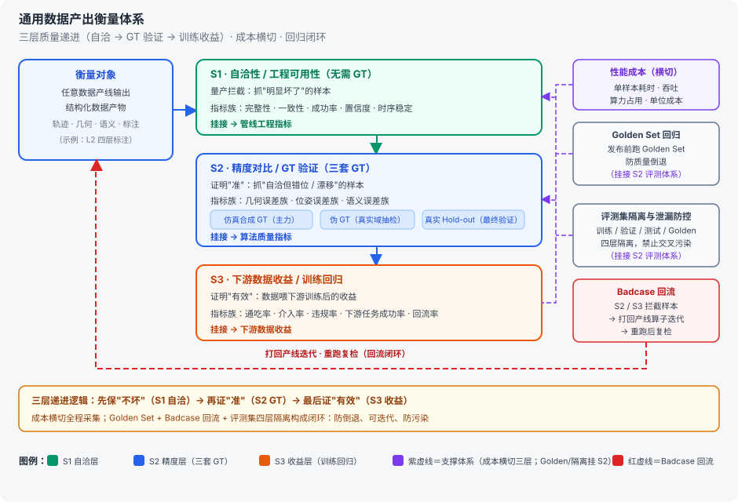

# 具身数据管线工程笔记：四层蓝图、感知层模型选型与产出衡量、RayCluster 与 RayJob 调度辨析、GeoPT 理解与迁移设想

> **记录日期**：2026-09-29 · 修订 2026-10-11（增补业界实证：选型佐证、显存预算、§2.4 执行形态辨析、§1.1 LeRobot v3.0 落盘样例、管线全景补数据仿真源、§1.3 图示改外链 SVG 修复 GitHub 渲染）· 修订 2026-10-12（新增 §1.1.1 入口数据源：数据金字塔，三层明细整合于图示；整合 LeRobot v3.0 出口格式至 §1.1.2 统一小节：字段定义、落盘样例与单帧示例合并去重，路径模板与 info.json 键名校正为源码口径）
> **背景**：围绕具身数据工程的三部分内容：一、具身数据管线四层蓝图与感知层模型选型、产出衡量；二、RayCluster 与 RayJob 调度辨析；三、GeoPT（*Lifted Geometric Pre-Training for Physics Simulation*，arXiv 2602.20399）理解与迁移设想。
> **关联**：三章各有调研底稿细化——[调研笔记-01 · 模型选型](调研笔记-01-具身数据处理模型-场景化选型与管线结合.md)、[调研笔记-02 · Ray 框架](调研笔记-02-Ray分布式框架调研与管线应用.md)、[调研笔记-03 · GeoPT](调研笔记-03-GeoPT理解与迁移设想.md)；[调研笔记-04 · 阿里云 EMR 实践](调研笔记-04-阿里云EMR-Serverless-Spark-Ray具身数据管线最佳实践拆解.md)跨第一、二章作业界实证底稿（选型佐证 + 执行形态对照）。

---

## 一、具身数据管线：四层蓝图、感知层模型选型、数据流与产出衡量

> 具身数据管线把第一视角视频加工成 VLA 可消费的训练数据：L1 预处理产出规范化帧流；L2 3D 感知与重建将其抬成带时间戳的世界系结构化轨迹；L3 切分动作并生成语言指令；L4 清洗、脱敏、封装为 LeRobotDataset。
> 重心在 L2：手部、相机、深度、分割、物体 6DoF 五类任务分场景选型，出口由几何一致性质检门拦截 badcase。
> 产出质量按 S1 自洽 / S2 精度 / S3 收益三层递进衡量，Golden Set 回归与 Badcase 回流闭环防倒退。

### 1.1 管线全景：通用 8 步蓝图

```text
输入源（数据金字塔全景见 1.1.1）
├─ 第一视角视频（AR 眼镜 / 头显 / 互联网 ego 视频）
└─ 数据仿真（Isaac Sim / MuJoCo 仿真器 · 渲染自带真值 GT · 域随机化 · Sim2Real 域差）
      └─ 仿真支路：真值自带 → 跳过 L2 感知重建，汇入 L4 统一封装；另作 S2 仿真 GT 主力（见 1.3）
   │
   ▼
━━━ L1 预处理层 ━━━
① 视频预处理：裁切（20s clips · 相邻重叠 2s）→ 重采样 30fps → 去畸变 → JPEG 帧
   ▼
━━━ L2 3D 感知与重建层 ━━━
②-⑥ 感知模型集群
   │ ②手部重建 · ③相机位姿【坐标系枢纽】 · ④单目深度【尺度源】 · ⑤分割&跟踪 · ⑥物体6DoF
   │ 出口：几何一致性质检门（超阈值 → Badcase 回流）
   ▼
━━━ L3 语义层 ━━━
⑦ 动作分割 + 语义标注：腕部速度曲线局部极小切分（300ms 平滑 · 最小间距 0.5s）→ 原子动作片段 → VLM 生成指令 JSON
   ▼
━━━ L4 工程层 ━━━
⑧ 清洗 / 脱敏 / 格式转换
   ├─ 清洗｜Data-Juicer 算子（去重 / 过滤 / 质检）
   ├─ 脱敏｜face-blur 类
   └─ 格式｜LeRobotDataset 封装
   ▼
LeRobotDataset v3.0
```

### 1.1.1 入口数据源：数据金字塔

> 行业共识是「数据金字塔」三层：顶层真机遥操作（精度最高、成本最高）、中层仿真合成（可扩展性最强）、底层人类行为 / 互联网视频（规模最大、成本最低）——三者组合使用才能同时满足**动作精度 × 场景多样性**的双重要求；本文管线处理的正是第三层「人类视频源」，经 L2 感知重建抬升为机器人可消费格式。


**开源数据集复用**（拿来即用层）：Open X-Embodiment、AgiBot World、RoboMIND、BridgeData V2、LeRobot Hub 数据集等可直接作训练 / 评测输入；注意各数据集**动作空间与文件格式不兼容**（LIBERO 仿真 vs RoboTwin 双臂 vs AgiBot World 真机），不能只看轨迹数决定能否混训——数据平台侧的经典归一化问题。

**2026 动向**：

- 「无本体」采集路线兴起：UMI、数据手套、头戴第一视角——解除数据生产与机器人本体的强绑定，降低设备门槛；
- 数据产业规模化：真机采集外包大军、专业数据服务商（「卖数据比卖机器人先赚钱」）——供给侧决定金字塔顶层的扩张速度。

### 1.1.2 出口数据格式：LeRobotDataset v3.0

> L4 出口的字段定义与落盘结构（口径 = LeRobot main 源码 + EMR 实践实际产出）。核心设计一句话：**时序数值进 Parquet、视频进 MP4、Parquet 只存视频引用（路径 + 帧时间戳）而不存图像像素**——分布式写数据时不会被图像 IO 拖垮；产出可直接被 LeRobot 框架加载，训练 ACT / Diffusion Policy / VLA 策略。

**字段级定义**：

- `state`（108 维）= `[left_hand(54), right_hand(54)]`，每手 54 = `wrist_pos(3) + wrist_rot_6d(6) + mano_joints(45)`
  - 腕位置 3 维 = (x, y, z)；腕旋转 6 维连续表示（回归比欧拉角/四元数稳定，见附录「旋转 6D」）；45 = MANO 15 个手指关节 × 3 维轴角，腕旋转已单列为 rot_6d、不重复计数
- `action` = 下一帧的 `state`（one-frame-ahead）
  - 模仿学习口径：动作标签无需人工定义，"下一帧手在哪"即动作；VLA 学的就是从当前观测预测下一帧 state
- 载体三件套：`meta/`（info / stats / tasks / episodes）+ `data/`（帧级 Parquet）+ `videos/`（H.264 MP4）
  - `meta/` 存数据集元信息，语言指令在 tasks.parquet 里编号成 task_index；`data/` 每帧一行（state / action / task_index / timestamp）；`videos/` 存压缩观测视频，帧与行靠 index 对齐

**目录结构**（多路相机示意：ego 第一视角 + wrist 腕部；本管线单 ego 相机时省略 wrist 分支）：

```text
embodied_lerobot_dataset/
├── meta/
│   ├── info.json                    # 数据集 schema、fps、版本、路径模板
│   ├── stats.json                   # 全特征均值/方差，训练归一化用
│   ├── tasks.parquet                # task_index ↔ 任务文本（VLA 语言条件）
│   └── episodes/chunk-000/file-000.parquet   # 每集一行：起始帧、任务 id、长度 + 定位列
├── data/
│   └── chunk-000/file-000.parquet   # 核心时序表，一行 = 一帧
└── videos/
    ├── observation.images.ego/chunk-000/file-000.mp4    # 第一视角相机视频，H.264 1280×720@30fps，多集连续编码
    └── observation.images.wrist/chunk-000/file-000.mp4  # 腕部相机视频
```

**meta/info.json 示例**（schema 定义；`observation.camera_pose` 为本管线扩展字段）：

```json
{
  "codebase_version": "v3.0",
  "robot_type": "human_egocentric",
  "fps": 30,
  "total_episodes": 200,
  "total_frames": 360000,
  "total_tasks": 2,
  "features": {
    "observation.images.ego": {
      "dtype": "video",
      "shape": [3, 720, 1280],
      "names": ["channel", "height", "width"]
    },
    "observation.state": {
      "dtype": "float32",
      "shape": [108],
      "names": ["left_hand(54)", "right_hand(54)"]
    },
    "observation.camera_pose": {
      "dtype": "float32",
      "shape": [7],
      "description": "MegaSAM 输出相机外参：x,y,z + 四元数(w,x,y,z)"
    },
    "action": { "dtype": "float32", "shape": [108] },
    "episode_index": { "dtype": "int64", "shape": [] },
    "frame_index": { "dtype": "int64", "shape": [] },
    "timestamp": { "dtype": "float32", "shape": [] },
    "next.done": { "dtype": "bool", "shape": [] }
  },
  "data_path": "data/chunk-{chunk_index:03d}/file-{file_index:03d}.parquet",
  "video_path": "videos/{video_key}/chunk-{chunk_index:03d}/file-{file_index:03d}.mp4"
}
```

> 要点：管线里 MegaSAM 算出的相机位姿（平移 3 维 + 四元数 4 维）以扩展字段 `observation.camera_pose` 塞进 LeRobot——原生格式允许扩展观测字段，VLA 策略可据此消费 3D 几何先验；108 维口径见上方字段级定义（wrist_pos 3 + wrist_rot_6d 6 + mano_joints 45，左右手各 54）。

**data/chunk-000/file-000.parquet 单行样例**（Parquet 列式存储，逻辑一行 = 一帧）：

| 字段 | 样例值 | 说明 |
| --- | --- | --- |
| index | 6005 | 全局帧号 |
| episode_index | 0 | 属于第 0 条 episode |
| frame_index | 5 | episode 内第 5 帧 |
| task_index | 0 | 关联 meta/tasks.parquet 的任务编号 |
| timestamp | 0.5 | episode 内时间（秒） |
| observation.images.ego | `{"path":"videos/observation.images.ego/chunk-000/file-000.mp4","timestamp":0.5}` | VideoFrame 结构体：视频路径 + 帧时间戳，**不存图片像素** |
| observation.state | `[0.01, 0.22, ...]`（108 维） | 手部 MANO 姿态：wrist_pos + wrist_rot_6d + mano_joints（左右各 54） |
| observation.camera_pose | `[0.42, 0.11, 0.73, 0.99, 0.01, 0.03, 0.02]` | MegaSAM 输出：世界系平移 3 维 + 四元数 4 维 |
| action | `[0.02, 0.23, ...]`（108 维） | 下一帧目标 state，VLA / Diffusion Policy 的监督信号 |
| next.done | false | 是否 episode 结束，末行 true |

**meta/ 各文件职责**：

- `info.json` / `stats.json`：数据集级 schema（见上示例）与全特征统计（训练归一化用）
- `tasks.parquet`：指令编号表，每行 `task_index ↔ task` 文本，内容示意见下
- `episodes/…/file-000.parquet`：每集一行 `episode_index · tasks · length` + 定位列——本集数据所在的 `data/chunk_index + file_index`、每个视频的 `chunk_index + file_index` 与集内时间段 `from_timestamp → to_timestamp`；多集合并的 data / video 文件靠它定位集边界，帧与数据行靠 `episode_index + frame_index` 对齐

**meta/tasks.parquet 内容示意**（v3 为 Parquet，此处按行示意；真指令由 L3 VLM 生成后回填，EMR 实践为占位指令「执行操作」）：

```text
{"task_index": 0, "task": "拿起红色杯子放到桌面右侧"}
{"task_index": 1, "task": "打开抽屉，取出螺丝刀"}
```

- **v3.0 相对 v2.1 的关键变化**：文件从「一集一文件」（`episode_000000.parquet` / `.mp4`）改为「多集合并、按大小滚动开新文件」（data ~100 MB / video ~200 MB 满即开 file-001，chunk 目录上限 1000 个文件）；meta 从 JSONL 三件套（episodes / tasks / episodes_stats）改为 Parquet。动因：海量集数下小文件爆炸（百万集 × 3 相机 ≈ 400 万+ 文件，对象存储 listing 与随机读 IO 都会被拖垮），合并文件 + Parquet meta 面向流式训练设计——对象存储小文件问题正是数据平台侧的经典工程约束。v3.0 不向后兼容 v2.1，官方提供 `convert_dataset_v21_to_v30` 迁移脚本。

### 1.2 感知层（L2）模型选型：分场景的模型与数据流

**分场景选型**


| 场景（模块·角色）             | 任务                         | 模型与分工                                                                                                                                 | 输入 → 输出                                            |
| -------------------------------- | ------------------------------ | -------------------------------------------------------------------------------------------------------------------------------------------- | --------------------------------------------------------- |
| 手部重建（②）                 | 把帧里的手抬成世界系运动轨迹 | WiLoR / YOLO（检测）；<br />MANO（参数化 β+θ）；<br />HaWoR（一体化：手部重建 ⊕ 相机轨迹联合优化）；<br />Masked-DROID-SLAM（遮挡平滑） | RGB 帧 → 腕位(3) + 旋转6D(6) + 关节(45) + scale_factor |
| 相机位姿估计（③·坐标系枢纽） | 估计 camera_to_world[T,4,4]  | MegaSaM（位姿估计主体，有内参）；<br />DROID-SLAM（SLAM 基座）；GeoCalib（无内参先补内参再 SLAM）                                          | 帧流 → camera_to_world[T,4,4]                          |
| 单目深度估计（④·尺度源）     | 逐帧深度 / 法线 / FoV        | MoGe(-2)（主产）；<br />DAv2（视差，互检用；MegaSaM 内部首步同样消费 Depth-Anything 视差）                                                                                               | RGB 帧 → 深度图 + 点云 + 法线 + FoV                    |
| 分割与跟踪（⑤）               | 手/物 mask 时序轨 + 接触边界 | EgoHOS / Grounded-SAM（首帧提示分割）；<br />SAM2（时序传播）；<br />TAPIR（点轨迹补接触边界）                                             | 帧流 → mask 时序轨 + 接触边界标注                      |
| 物体 6DoF 位姿（⑥）           | 物体位姿轨                   | FoundationPose（RGB-D 零样本；CAD 模型 / 少样本免模型两种模式）                                                                            | L1 RGB → obj_pose_cam                                  |

**数据流与回注**

```text
【L1输出】规范化RGB帧流 + 时间戳 + 内参元数据
       │
       ├───────────→②手部重建
       │              │ HaWoR 一体化直接出世界系；组合路线待③回注抬升
       │              └─► ⑤：手部mask（辅助分割）
       │
       ├───────────→③相机位姿估计【坐标系枢纽】
       │              └─► ②⑥：camera_to_world 抬世界系（仅后处理，不回灌优化）
       │
       ├───────────→④单目深度【尺度源】
       │              ├─► ③：深度先验注入
       │              ├─► ②：FoV（手部尺度）
       │              └─► ⑥：RGB-D 深度通道
       │
       └───────────→⑤分割&跟踪
                      ├─► ②：手部mask（遮挡屏蔽）
                      ├─► ③：动态区域屏蔽
                      └─► ⑥：物体ROI mask

【⑥物体6DoF · FoundationPose】
    输入：L1 RGB + ④深度 + ⑤物体mask → obj_pose_cam
    经③camera_to_world 抬升 obj_pose_world
```

**业界同款佐证**：阿里云 EMR Serverless Spark 官方实践《基于 EMR Serverless Spark Ray 打造具身智能数据管线》（微软 VITRA 思路，拆解见[调研笔记-04](调研笔记-04-阿里云EMR-Serverless-Spark-Ray具身数据管线最佳实践拆解.md)）与本表同款组合——HaWoR（内置 WiLoR 的 YOLO 检测器）+ MoGe-2 + MegaSAM + GeoCalib，覆盖 ②③④（未含 ⑤ 分割、⑥ 物体 6DoF）——上表选型由此获得业界交叉验证。其显存实测预算：

| 模型 | 显存 | 说明 |
| --- | --- | --- |
| HaWoR | ~10 GB | 手部重建一体化，全链路最重 |
| MoGe-2 | ~6 GB | 逐帧深度推理 |
| MegaSAM | ~4 GB | 内部链路：Depth-Anything 视差 → MoGe-2 深度转 UniDepth → DROID-SLAM |
| 合计 | ~20 GB | 单张 16 GB 卡跑法：同进程串行加载、加载下一个前卸载（形态取舍见 2.4） |

### 1.3 通用数据产出衡量体系



**指标口径速查**（上图指标族的一句话口径）：

| 层 | 指标 | 口径 |
| --- | --- | --- |
| S1 自洽（无需 GT） | 完整性 | 帧 / 字段 / 元数据无缺失（如双手轨迹补齐后 valid 帧占比） |
| | 一致性 | 几何自洽：过下方质检门规则 |
| | 重建成功率 | L2 几何有效（收敛 + 误差阈值内）帧 / 片段占比 |
| | 置信度 | 检测 / 分割 / 重建模型输出分低于门限即拦截 |
| | 时序稳定 | 腕速度、位姿无突刺跳变 |
| S2 精度（GT 对比） | 几何误差族 | 深度误差、重投影误差、顶点 / 关键点误差 |
| | 位姿误差族 | 相机轨迹 ATE、外参残差、6DoF 位姿误差 |
| | 语义误差族 | 指令-动作对齐；指令可用率 = VLM 输出无需改写即可用的比例 |
| | 分层准确率 | 各层标注与抽检 GT 一致比例（手 / 物 / 接触分列） |
| S3 收益（训练回归） | 通吃率 | 全自动产出且质检达标样本数 / 总样本数 |
| | 人工介入率 | 需人工修正 / 补标样本数 / 总样本数（越低越好） |
| | 违规率 | 抽检中仍含违规内容样本数 / 抽检样本数 |
| | 下游任务成功率 | VLA 用该版数据训练后的任务成功率（最终收益锚点） |
| | 回流率 | 拦截样本回流重跑后的复检通过率（衡量回流闭环有效性） |
| | 回归通过率 | Golden Set 评测达标版本 / 被测版本 |
| 成本横切 | 单小时数据成本 | 总 GPU/CPU 成本 / 产出有效数据小时数（即图中"单位成本"） |

**S1 质检门规则**（L2 出口"几何一致性质检门"的落地形式，超阈值 → Badcase 回流）：

- 重投影一致性：MANO 关键点回投到帧 vs 检测关键点，误差超门限拦截
- 尺度一致性：HaWoR scale_factor 与 MoGe-2 深度推得的手部尺度偏差
- 时序连续性：腕速度突刺检测（复用 ⑦ 切分用的速度信号，一套信号两用）
- 残差门限：SLAM 重投影残差 / 相机-IMU 外参残差（工程口径如 0.15°）
- valid 占比：valid=False 帧比例超阈值 → 整段降级，不进 L3

**三套 GT 与触发时机**：

- 三套 GT 不可互相替代：仿真 GT（主力，渲染自带真值、规模化）/ 伪 GT（强模型 + 人工校正，补真实域）/ 真实 Hold-out（少量精标，只进终验）
- 触发时机：S1 出口实时全量拦截（在线）→ S2 抽样复核 + 发布前 Golden Set 回归（周期 RayJob，见 2.3）→ S3 版本发布前训练回归
- 业界对照：EMR 官方实践仅有可视化三件套人工验证（深度伪彩 / 腕轨迹投影 / 相机轨迹俯视图，属 S1 辅助手段）——自动质检门 + GT 抽样 + 收益回归正是与教程级实践的分水岭（拆解见调研笔记-04）

---

## 二、RayCluster 与 RayJob 的工程辨析

> 管线各环节在 Ray 上有两种执行形态：常驻的 RayCluster 与按需提交的 RayJob。本章辨析两者的定义与对比维度，再看集群里常驻哪些角色，最后摊到 L1~L4 四层看各自的执行形态。

### 2.1 定义

RayCluster 是 Ray 集群的部署单元：一个 Head 节点跑 GCS（元数据与调度中枢）+ 调度器 + Driver，一组 Worker 池执行任务，节点上的分布式对象存储承载任务间数据传递，Worker 池可随负载自动扩缩容。

RayJob 是提交到已有集群或自带临时集群的一次性作业，适合无状态批处理。

### 2.2 对比维度：基础设施 vs 按需提交

两者按状态、资源、适用三个维度对比：


| 维度 | RayCluster                                   | RayJob                   |
| ------ | ---------------------------------------------- | -------------------------- |
| 状态 | 有状态：权重常驻显存、对象存储中间产物可复用 | 无状态：结果落盘即释放   |
| 资源 | 常驻占 GPU，靠复用率摊薄成本                 | 按需申请，即时释放       |
| 适用 | 高频、持续产数、低延迟拦截                   | 低频、批处理、结果可重算 |

### 2.3 集群角色与各层执行形态

一个 RayCluster 里通常常驻四类角色：仿真 Actor 池（持续产数据）、**L2 感知重建池（GPU 模型权重常驻 + 段间回注，对应第一章 ②-⑥）**、Ray Data 服务（流式加工）、RL 训练池（上下文常驻）。脱敏、清洗、标注、评测这类活儿则以 RayJob 的形式提交进来，不占常驻资源。

摊到 L1~L4 四层，各自的执行形态：

```text
第一视角视频
   │
   ▼
━━━ L1 预处理 ━━━━━━━━━━━━━━━━━━━━━━━ Ray Data：在线流式 / 离线批量
   ▼
━━━ L2 感知重建 ②-⑥ + 出口质检门 ━━━━ RayCluster GPU Actor（常驻）
   ▼
━━━ L3 语义 ━━━━━━━━━━━━━━━━━━━━━━━━━ RayJob
   ▼
━━━ L4 清洗封装 ━━━━━━━━━━━━━━━━━━━━━ RayJob
   ▼
LeRobotDataset v3.0
   ├─ 评测：Golden Set 回归 → 周期 RayJob；训练监控 → 常驻轻服务
   ├─ 训练：单次 → RayJob；RL → 训练池常驻
   └─ 横切：cost 标签 → Autoscaler 按吞吐-成本决策
```

> L2 的常驻池是平台级量产形态，不是唯一解——业界官方实证走了相反的起停形态，取舍见 2.4。

### 2.4 业界实证：起停形态与常驻池的取舍

阿里云 EMR Serverless Spark 官方实践（微软 VITRA 思路，拆解见[调研笔记-04](调研笔记-04-阿里云EMR-Serverless-Spark-Ray具身数据管线最佳实践拆解.md)）为 2.2 的维度表补上一组真实落位——L2 感知重建走与 2.3 常驻池**相反**的形态，且单张 16 GB 卡跑通合计 ~20 GB 的三模型：

| 执行形态 | 形态 | 代价 | 适用 |
| --- | --- | --- | --- |
| 常驻 Actor 池（本文 2.3） | RayCluster 内权重常驻显存、段间回注复用 | 显存常占，靠复用率摊薄 | 平台级量产：高频持续产数 |
| remote function 起停（EMR） | RayJob 内 `@ray.remote(num_gpus=1)`，每视频起停；三模型同进程串行加载、加载下一个前卸载（`del` + `torch.cuda.empty_cache()`） | 起停开销 + 三阶段无法流水线并行（吞吐换显存） | 链路打通 / 显存受限：20 G 模型挤进 16 G 卡 |

- **两级缓存弥合起停开销**：模型权重（~4.5 GB）与 CUDA 扩展编译产物做节点级持久缓存（`/tmp/vitra_cache/`，跨 Ray session 复用），OSS 做二级缓存兜底跨集群冷启动——命中节点缓存秒级恢复，把起停形态最痛的加载成本压到可接受。
- **教程级简化的极致**：该实践把 L3 等价阶段（动作分割）直接放在 CPU 头节点 driver 进程顺序执行——单视频粒度够用；多源并发产数时才需要 2.3 的分层形态。
- **形态随规模演进、不换技术栈**：两种形态在同一套 Ray API 下只是部署选择（Actor 常驻 vs remote function 起停、RayCluster vs RayJob）——形态可以随规模演进，这正是选 Ray 的理由之一。

---

## 三、GeoPT：总结、理解与迁移设想

> GeoPT（*Lifted Geometric Pre-Training for Physics Simulation*，arXiv 2602.20399）面向物理仿真标签稀缺的痛点：静态几何自监督会负迁移，它把合成速度场注入预训练监督——沿轨迹学几何特征演化、撞边界即停驻——微调时只需把随机速度换成任务条件编码的速度场；这一范式可延伸到具身场景泛化与 L2 感知管线的迁移设想。

### 3.1 痛点

如何在**真实物理仿真标签稀缺且昂贵**的前提下，高效训练神经仿真网络。

海量静态 3D 资产是现成的无标签数据，难点在怎么把它们变成可扩展的预训练数据。直接做静态几何自监督，只见几何、不见动力学，学到的东西和真实物理对不上，微调实测负迁移。GeoPT 的应对是换自监督信号、不换 backbone——让神经仿真器在极少真实物理标签下也能更稳更快地学到解场。

### 3.2 核心方法论与机制

```text
预训练（无物理标签）:
  输入: 几何 G + 采样点 x0 + 合成速度 v
  轨迹: x_{t+1} = x_t + v * 1_outside_G(x_t)   (碰到几何边界就"粘住")
  监督: h_G(x0:τ) = [h_G(x0), h_G(x1), ..., h_G(xτ)]  (沿轨迹的几何特征序列)
  学习: Fθ(x0; G, v) 预测上述序列

微调（有物理标签）:
  把 v 换成由任务条件 S 编码得到的速度场 V_S
  学习: Fθ(x; G, V_S) -> 真实物理场 u(x)
```

合成速度场为什么能教出物理直觉，拆开是三条结构：

- **耦合**：要预测整段几何特征序列，模型必须学到远距离点之间的动力学相关性，而不是逐点独立的形状记忆；
- **边界**：轨迹在几何边界自动停驻——自监督信号天然携带边界条件与几何约束，无需任何标注；
- **统一接口**：预训练与微调共用同一套 (G, V) 输入——预训练空间与下游空间同构，静态几何自监督那种"学在一处、用在另一处"的空间错配从接口上就消除了。

### 3.3 迁移设想：具身场景泛化与 L2 感知管线落地

> 这套提升式范式能泛化到具身动态场景：下面是三个迁移候选，以及落到本文 L2 感知管线（HaWoR / MegaSaM / MoGe / SAM2 / FoundationPose 五组模型）的设想。

**范式泛化面**：持续生成多角度、多类型数据扩充预训练；后续指向更通用的条件表示、更大规模几何库、跨物理家族统一。例如：

- **机器人导航**：障碍物几何形态各异，路径偏移绕行而非"粘住"；
- **人脸检测**：有限空间内人物经过，遇物体边界产生遮挡而非"粘住"；
- **机械臂抓取交互**：抓不同形状物体对应关节角度，力度控制还需引入材质信息。

**L2 感知管线落地（预训练 → 微调 → 评估）**：

1. **数据生成**：从单中心视角（ego）观测出发，映射到世界坐标系构建全局运动，生成多视角物体交互轨迹的合成数据集；
2. **边界约束**：物体几何边界之外，加上机械手 / 手指与物体交互的**接触边界**；
3. **自监督预训练**：让模型提前学**几何轮廓、边界接触、视角变化的空间规律**；
4. **有监督微调**：少量真实物理标签微调；
5. **验证评估**：拿**完全没参与训练**的高质量真实数据集验证各项能力。

---

## 附：专有名词注释

**② 手部重建**

- **WiLoR**（*End-to-end 3D Hand Localization and Reconstruction in-the-wild*）：端到端手部定位与重建，两级出检测框、2D 关键点、朝向初值
- **YOLO**（You Only Look Once）：单阶段目标检测家族，这里只出手部检测框
- **MANO**（hand Model with Articulated and Non-rigid defOrmations）：手部参数化网格模型，形状 β（10 维）+ 姿态 θ（45 维）低维参数生成手部网格
- **HaWoR**（*World-Space Hand Motion Reconstruction from Egocentric Videos*）：CVPR 2025，第一视角视频直接重建世界系手部运动，手部与相机轨迹联合优化；兼作全链路尺度锚（scale_factor）
- **Masked-DROID-SLAM**：DROID-SLAM（全称见 ③）的动态掩码变体，用手部 mask 屏蔽遮挡后做时序平滑

**③ 相机位姿**

- **MegaSaM**（*Accurate, Fast, and Robust Structure and Motion from Casual Dynamic Videos*）：CVPR 2025，动态 casual 视频的相机位姿与场景几何联合估计，位姿主体（有内参）
- **DROID-SLAM**（*Deep Visual SLAM for Monocular, Stereo, and RGB-D Cameras*）：深度学习视觉 SLAM 基座（Princeton），遮挡密集时兜底
- **GeoCalib**（*Learning Single-image Calibration with Geometric Optimization*）：单图预测焦距/主点/畸变恢复虚拟内参——无内参视频的前置分支，亦可作全管线默认内参来源（EMR 实践逐视频先估焦距）

**④ 单目深度**

- **MoGe / MoGe-2**（*Unlocking Accurate Monocular Geometry Estimation for Open-Domain Images*；MoGe-2 增 metric 尺度）：CVPR 2025 Oral，单目 metric 深度/点云/法线/FoV，主尺度基准
- **DAv2**（Depth Anything V2）：相对深度（视差），与 MoGe 互检；MegaSaM 内部首步的视差来源（Depth-Anything 家族）

**⑤ 分割与跟踪**

- **EgoHOS**（*Fine-Grained Egocentric Hand-Object Segmentation*）：第一视角手-交互物体分割，ego 场景冷启动
- **Grounded-SAM**（Grounding DINO + Segment Anything Model）：文本提示检测 + 分割组合，开域未知物体冷启动
- **SAM2**（Segment Anything Model 2）：可提示视频分割（Meta），首帧 mask 跨帧时序传播
- **TAPIR**（*Tracking Any Point with per-frame Initialization and temporal Refinement*）：任意点跟踪（Google DeepMind），出 2D 点轨迹补手-物接触边界

**⑥ 物体 6DoF**

- **FoundationPose**（*Unified 6D Pose Estimation and Tracking of Novel Objects*）：CVPR 2024，RGB-D 零样本新物体 6D 位姿估计与跟踪；CAD 模型 / 少样本免 CAD 两种模式

**管线与工程（Ch1）**

- **VLA**（Vision-Language-Action 模型）：视觉-语言-动作模型，管线产出的最终消费者
- **VLM**（Vision-Language Model）：视觉语言模型，L3 生成动作指令 JSON 用
- **ego**（egocentric）：第一视角（AR 眼镜 / 头显 / 互联网第一人称视频）
- **LeRobotDataset**：Hugging Face LeRobot 项目定义的机器人数据集格式，L4 封装出口（当前 v3.0）
- **Data-Juicer**：阿里开源的一站式数据处理框架，L4 用它的清洗算子（去重 / 过滤 / 质检）
- **VITRA**：微软研究院「第一视角视频 → VLA 训练数据」工作，阿里云 EMR 官方实践的技术思路来源（见 2.4）

**衡量（1.3）**

- **GT**（Ground Truth）：真值；伪 GT = 真实域抽检产出的替代真值
- **Golden Set**：固定基准评测集，发布前回归跑一遍防倒退
- **Hold-out**：留出集，完全不参与训练与调参的最终验证数据
- **Badcase**：问题样本，S2 / S3 拦下后打回流线迭代

**Ray（Ch2）**

- **GCS**（Global Control Service）：Ray 全局控制服务，跑在 Head 节点，存元数据、管调度
- **Ray Data**：Ray 的流式数据处理库，L1 预处理的执行形态
- **Actor**：Ray 常驻计算单元，L2 感知重建的 GPU 权重常驻就是 Actor 池
- **Autoscaler**：Ray 自动扩缩容组件，按吞吐-成本决策加减 Worker

**术语**

- **6DoF**：六自由度位姿 = 平移（3）+ 旋转（3）
- **旋转 6D**：旋转的 6 维连续表示，回归比欧拉角/四元数稳定
- **camera_to_world[T,4,4]**：相机系到世界系的外参矩阵序列，全链路坐标枢纽
- **RGB-D**：彩色图 + 深度图组成的输入对
- **FoV**（Field of View）：视场角，深度模块附属输出、手部尺度约束用
- **scale_factor**：手部重建输出的尺度因子，全链路尺度锚
- **内参**：相机内部参数（焦距 / 主点 / 畸变），与外参 camera_to_world 相对；GeoCalib 预测的就是它
- **负迁移**：预训练与下游任务冲突，微调效果反而变差
- **backbone**：主干网络，特征提取主体
