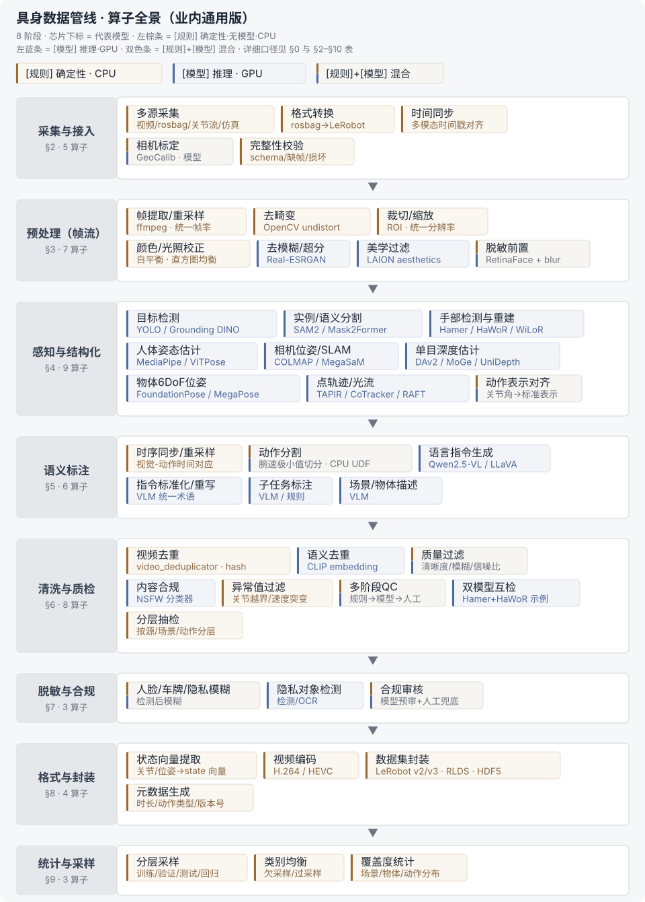

# 具身数据管线算子全集（业内通用版）

> 算子设计系列的初始概述。定位：业内通用口径的算子全景底稿。全景图见 §1。上位纲领 = [具身数据平台总体架构-总线](../具身数据平台总体架构-总线-六大域双流与门禁治理.md)（本文即其 ② 生产域的算子级细化）。续篇系列（本目录）：[02 接口规范与质量门](算子设计-02-算子接口规范与质量门体系.md) · [03 执行与编排](算子设计-03-算子执行与编排规范.md) · [04 血缘与版本三锁](算子设计-04-算子血缘与版本三锁.md) · [05 采集源差异矩阵](算子设计-05-采集源差异矩阵.md) · [06 成本模型](算子设计-06-算子成本模型.md) · [07 四集分流与防泄漏](算子设计-07-四层数据集分流与防泄漏.md)。

## 核实状态（2026-10-16）

- ✅ 已核实：
  - Data-Juicer `video_deduplicator` / `ray_video_deduplicator` 真实存在，MD5 文档级精确去重，`ray_` 前缀即 Ray 分布式版约定（官方 QuickStart v1.4.0 + GitHub Operators.md）
  - 华为云 CloudRobo 提供官方 rosbag→LeRobot 算子（支持 V2.1/V3 输出），平台另内置「LeRobot 数据集 V2.1 转 V3」算子（华为云支持中心用户手册）
  - GigaBrain-0.7（arXiv 2608.15875，GigaBrain Team / GigaAI，2026-08）论文 §3.2 与本文 §11 描述一致：LeRobot v3.0 格式转换 → 跨本体状态-动作归一化 → LLM 辅助指令重写与子任务标注 → 多阶段质量控制（q01/q99 极值过滤、静止段移除、训练 loss 异常回流）
  - 阿里云 EMR Serverless Spark+Ray / PAI Data-Juicer VLA 管线，与《调研笔记-04》《调研笔记-01》口径一致
  - §4 / §10 模型清单与既有调研全部吻合（静态 COLMAP / 动态 MegaSaM、FoundationPose 需 RGB-D+CAD、腕速局部极小值切分为工业主流等口径正确）
- ⚠️ 已修正：
  - GFPGAN 为人脸修复专用模型（通用超分是 Real-ESRGAN），§3 / §10 已加标注
  - Data-Juicer 算子体系除 §0 所列五类外还有 formatter / sampler / generator 等，§0 已补注（五类为与具身数据处理最相关的子集）
  - §6 双模型互检「Hamer + HaWoR」为示例性写法；主笔记实际互检案例为 MoGe↔DAv2 深度互检
- ❓ 待核：
  - Data-Juicer 视频美学算子名 `video_aesthetic_filter`：图像版 `aesthetic_filter`（LAION aesthetics）确认存在，视频版算子名未能独立核实
  - CloudRobo 多本体厂商名单（节卡/星海图）未在官方文档独立确认

## 0. 口径说明

- **算子（Operator）**：管线中可独立复用、可组合、可编排的处理单元——与 Data-Juicer 的算子体系同构（aggregator / deduplicator / filter / mapper / selector；Data-Juicer 另有 formatter / sampler / generator 等类别，此处取与具身数据处理最相关的五类）
- **两类算子**：
  - **[规则]** 确定性、无模型、CPU 可跑（ffmpeg / OpenCV / NumPy / 逻辑判断）
  - **[模型]** 涉及模型推理，**统一标注代表模型**，多为 GPU 资源
- **管线阶段口径**：采集接入 → 预处理 → 感知结构化 → 语义标注 → 清洗质检 → 脱敏合规 → 格式封装 → 统计采样，与业内综述（动作对齐 → 时序同步/轨迹重采样 → 语言标准化 → 多阶段过滤）一致

## 1. 算子全景

| 阶段 | 算子（节） | 主要类型 |
| --- | --- | --- |
| 采集与接入 | §2 | 规则为主，少量模型（标定） |
| 预处理（帧流） | §3 | 规则为主，少量模型（去模糊/美学） |
| 感知与结构化 | §4 | **模型为主**（检测/分割/重建/位姿） |
| 语义标注 | §5 | 模型为主（VLM）+ 规则（切分） |
| 清洗与质检 | §6 | 规则 + 模型（去重/合规/互检） |
| 脱敏与合规 | §7 | 模型 + 规则 |
| 格式与封装 | §8 | 规则（编码/打包） |
| 统计与采样 | §9 | 规则 |

**图例口径**（上图一眼读法）：芯片下标 = 该算子的代表模型，全量汇总见 §10；阶段左侧标签 = 章节号与算子数。

## 2. 采集与接入算子

| 算子 | 类型 | 说明 | 涉及模型 |
| --- | --- | --- | --- |
| 多源采集 | [规则] | 视频 / rosbag(.bag/.db3) / 遥操作关节流 / 仿真导出 | — |
| 格式转换（rosbag→LeRobot） | [规则] | 华为云 CloudRobo 提供，支持多本体（节卡/星海图等，名单待核） | — |
| 时间同步 | [规则] | 多模态（视觉/关节/IMU）时间戳对齐 | — |
| 相机标定 | [规则]/[模型] | 棋盘格（OpenCV）为规则；GeoCalib 可做单图轻量标定 | GeoCalib（模型） |
| 完整性校验 | [规则] | schema / 时长 / 缺帧 / 文件损坏检查，源头拦截 | — |

## 3. 预处理算子（帧流）

| 算子 | 类型 | 说明 | 涉及模型 |
| --- | --- | --- | --- |
| 帧提取 / 重采样 | [规则] | ffmpeg 抽帧、统一帧率 | — |
| 去畸变 | [规则] | 依赖相机内参，OpenCV undistort | — |
| 裁切 / 缩放 | [规则] | ROI、统一分辨率 | — |
| 颜色 / 光照校正 | [规则] | 白平衡、直方图均衡 | — |
| 去模糊 / 超分 | [模型] | 低质帧增强 | Real-ESRGAN（通用）、GFPGAN（人脸修复专用） |
| 美学过滤 | [模型] | Data-Juicer `video_aesthetic_filter`：抽帧后美学评分过滤（算子名待核，图像版 `aesthetic_filter` 已确认） | 美学评分模型（如 LAION aesthetics） |
| 脱敏前置（模糊） | [模型]+[规则] | 人脸检测后高斯/像素化模糊 | RetinaFace、YOLOv8-face |

## 4. 感知与结构化算子（模型为主）

| 算子 | 类型 | 代表模型 | 输入 → 输出 |
| --- | --- | --- | --- |
| 目标检测 | [模型] | YOLO 系列、DETR、Grounding DINO | 帧 → 检测框 + 类别 |
| 实例/语义分割 | [模型] | SAM / SAM2、Mask2Former | 帧+提示 → mask |
| 手部检测与重建 | [模型] | Hamer、HaWoR、WiLoR、FrankMocap | 帧 → MANO 参数（β/θ）+ 手部网格 |
| 人体姿态估计 | [模型] | MediaPipe、ViTPose、4D-Humans | 帧 → 2D/3D 关节点 |
| 相机位姿 / SLAM | [模型] | COLMAP（静态）、DROID-SLAM、MegaSaM（动态）、ORB-SLAM | 帧流 → camera pose 轨迹 |
| 单目深度估计 | [模型] | Depth Anything V2、MiDaS、MoGe、UniDepth | 帧 → 深度图 / 点云 / 法线 |
| 物体 6DoF 位姿 | [模型] | FoundationPose、MegaPose | RGB-D+CAD → 物体位姿轨 |
| 点轨迹跟踪 | [模型] | TAPIR、CoTracker | 帧流+查询点 → 点轨迹 |
| 光流估计 | [模型] | RAFT | 相邻帧 → 光流场 |
| 动作表示对齐 | [规则]/[模型] | 统一动作空间映射（关节角→标准表示） | 控制信号 → 标准动作向量 |

## 5. 语义标注算子

| 算子 | 类型 | 说明 | 涉及模型 |
| --- | --- | --- | --- |
| 时序同步 / 轨迹重采样 | [规则] | 视觉-动作时间对应、统一采样 | — |
| 动作分割 | [规则]+[模型] | 工业主流：腕部速度曲线平滑 → 局部极小值切分原子动作片段（CPU UDF）；也可用时序动作检测模型 | 时序动作检测（可选，模型） |
| 语言指令生成 | [模型] | 为原子片段生成结构化指令 | Qwen2.5-VL、LLaVA、GPT-4o 等 VLM |
| 语言语义标准化 / 指令重写 | [模型] | 消除不同来源指令表达差异，统一术语 | 同上 VLM |
| 子任务标注 | [模型]/[规则] | 长任务拆分子任务 | VLM 或规则 |
| 场景 / 物体描述 | [模型] | 生成场景文本、物体属性 | VLM |

## 6. 清洗与质检算子

| 算子 | 类型 | 说明 | 涉及模型 |
| --- | --- | --- | --- |
| 视频去重 | [规则] | Data-Juicer `video_deduplicator` / `ray_video_deduplicator`：视频流 hash 精确去重 | — |
| 语义去重 | [模型] | 视觉 Embedding 相似度去重（内容近重复） | CLIP 类视觉编码器 |
| 质量过滤 | [规则]/[模型] | 清晰度/模糊度/信噪比评分；关键帧缺失过滤 | 图像质量评估模型（可选） |
| 内容合规过滤 | [模型] | 违规/NSFW 内容检测 | NSFW 分类器 |
| 异常值过滤 | [规则] | 关节越界、速度突变、时间戳异常 | — |
| 多阶段质量控制（QC） | [规则]+[模型] | 工业界标准（如 GigaBrain 多阶段过滤）：规则校验 → 模型校验 → 人工抽检 | 各环节模型 |
| 双模型互检 | [模型] | 关键标注（手部/位姿）用两个模型交叉验证 | 如 Hamer + HaWoR（示例；主笔记实际案例为 MoGe↔DAv2 深度互检） |
| 分层抽检 | [规则] | 按源/场景/动作类型分层抽样人工复核 | — |

## 7. 脱敏与合规算子

| 算子 | 类型 | 说明 | 涉及模型 |
| --- | --- | --- | --- |
| 人脸 / 车牌 / 隐私模糊 | [模型]+[规则] | 检测后模糊（可前插帧产出阶段） | 检测模型 |
| 隐私对象检测 | [模型] | 敏感信息识别（人脸/车牌/屏幕内容） | 检测/OCR 模型 |
| 合规审核 | [模型]+[人工] | 自动预审 + 人工兜底 | 内容审核模型 |

## 8. 格式与封装算子

| 算子 | 类型 | 说明 | 涉及模型 |
| --- | --- | --- | --- |
| 状态向量提取 | [规则] | 关节角/位姿/手部参数 → 标准 state 向量 | — |
| 视频编码 | [规则] | H.264 / HEVC 压缩 | — |
| 数据集封装 | [规则] | LeRobotDataset v2/v3、RLDS、HDF5 | — |
| 元数据生成 | [规则] | 时长/分辨率/动作类型/指令/版本号 | — |

## 9. 统计与采样算子

| 算子 | 类型 | 说明 |
| --- | --- | --- |
| 分层采样 | [规则] | 训练/验证/测试/回归集按源与动作类型分层 |
| 类别均衡 | [规则] | 动作类别欠采样/过采样 |
| 覆盖度统计 | [规则] | 场景/物体/动作分布报告 |

## 10. 模型算子标注汇总表（核心交付）

| 算子类别 | 代表模型（业内主流） | 资源形态 | 备注 |
| --- | --- | --- | --- |
| 相机标定 | GeoCalib | GPU（轻量） | 单图标定，工业管线常用 |
| 去模糊/超分 | Real-ESRGAN、GFPGAN（人脸修复专用） | GPU | 质量增强，可选 |
| 美学过滤 | LAION aesthetics 类 | GPU | Data-Juicer 算子内置 |
| 人脸检测 | RetinaFace、YOLOv8-face | GPU/CPU | 脱敏前置 |
| 目标检测 | YOLO、DETR、Grounding DINO | GPU | 通用 |
| 分割 | SAM/SAM2、Mask2Former | GPU | SAM2 同时承担时序传播 |
| 手部重建 | Hamer、HaWoR、WiLoR | GPU | 手物操作核心 |
| 人体姿态 | MediaPipe、ViTPose | GPU/CPU | 全身/上肢 |
| 相机位姿/SLAM | COLMAP、DROID-SLAM、MegaSaM | GPU | 静态 COLMAP / 动态 MegaSaM |
| 单目深度 | Depth Anything V2、MoGe、UniDepth | GPU | 深度先验 |
| 物体 6DoF | FoundationPose、MegaPose | GPU | 物体位姿 |
| 点跟踪 | TAPIR、CoTracker | GPU | 接触/边界补充 |
| 光流 | RAFT | GPU | 运动信息 |
| 语言指令/标准化 | Qwen2.5-VL、LLaVA、GPT-4o | GPU/VLM API | L3 语义 |
| 语义去重 | CLIP 类编码器 | GPU | 近重复过滤 |
| 内容合规 | NSFW 分类器 | GPU/CPU | 合规 |

## 11. 业内参考案例（已核实的工业落地）

| 来源 | 管线要点 |
| --- | --- |
| 阿里云 EMR Serverless Spark + Ray（2026-08） | Ray GPU Actor 跑 HaWoR 双手 MANO + MoGe-2 深度 + MegaSaM 相机位姿 → CPU UDF 腕速极小值切分 → LeRobotDataset v3.0 |
| 阿里云 PAI（Data-Juicer VLA 流水线） | 内参估计 → 去畸变 → 深度 → 手部重建 → 位姿 → 动作计算 → 速度极小值切分 → 指令生成 → LeRobot v2.0 |
| 华为云 CloudRobo | rosbag→LeRobot 算子，支持 V2.1/V3，多本体接入 |
| GigaBrain-0.7（arXiv 2608.15875，GigaBrain Team / GigaAI） | 真实机器人数据 → LeRobot v3.0 → 统一表示 → 指令重写/子任务标注 → 多阶段质量过滤 |

## 12. 工程注意

1. **确定性**：规则算子必须有固定版本与参数，hash 可复现（数据血缘）
2. **算子 ↔ 执行框架**：规则算子映射 Ray Data `map_batches`（CPU）；模型算子映射 GPU Actor 池；批量语义作业映射 RayJob
3. **成本**：模型算子按 GPU 秒/样本计，去重/过滤等规则算子前置可大幅省推理成本
4. **版本联动**：算子版本 + 数据版本 + 模型版本三锁，Badcase 回流可定位
5. **红线**：评测集隔离在算子层强制（去重/切分在封装前完成，防泄漏）
