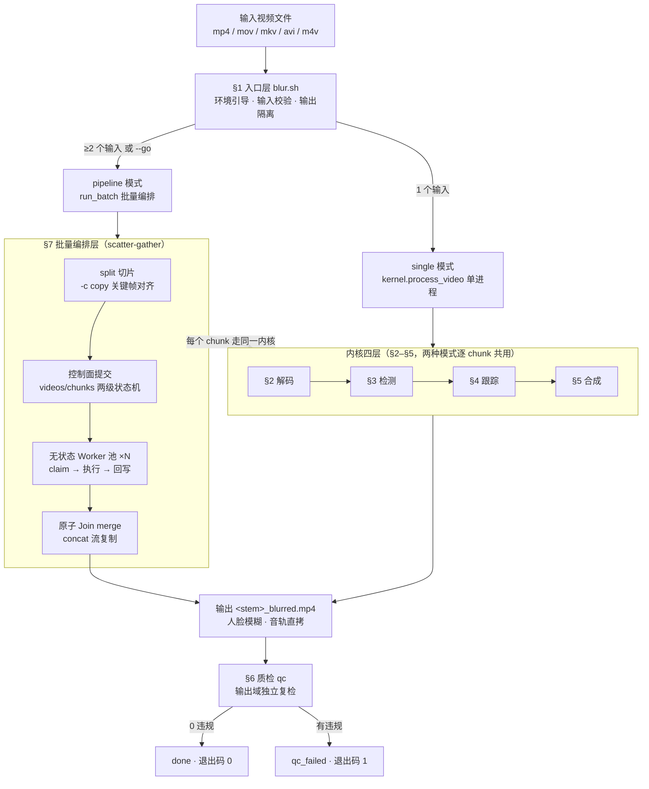
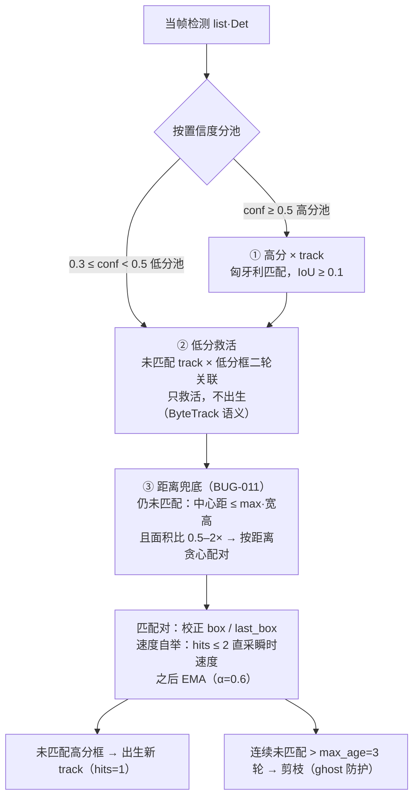
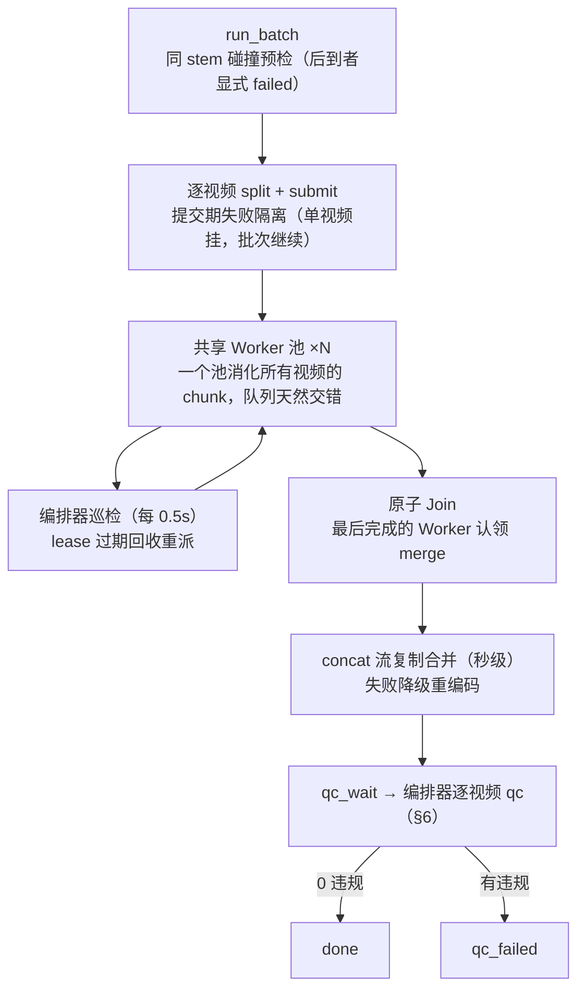
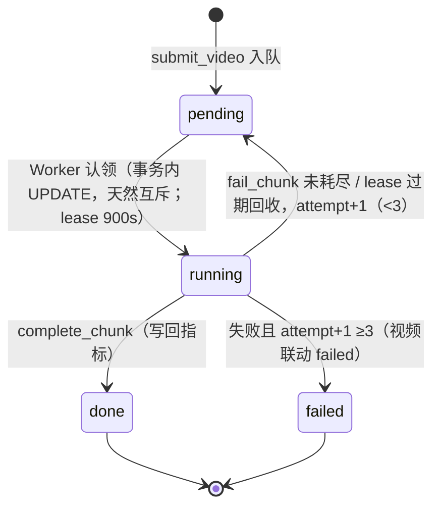
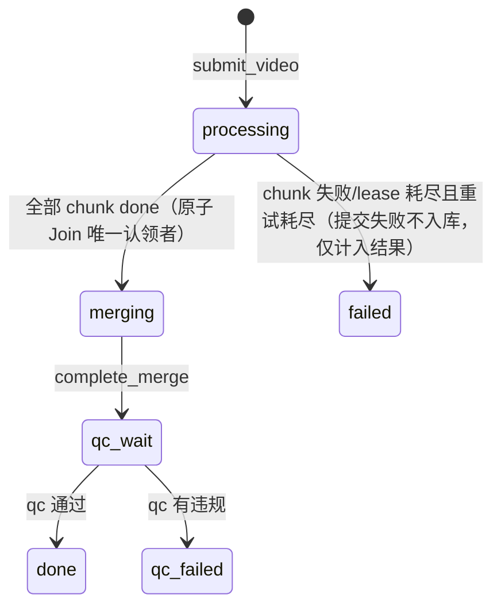

# 全链路管线指南：一帧视频的旅程

> **定位**：本文是"纵向跟拍"指南——从一段视频文件进入管线，到脱敏成品输出，逐层讲清三件事：**数据以什么格式流动、每层怎么处理、什么样的输入算异常以及如何处置**。架构决策与权衡看 [design.md](design.md)，运行速查看 [README](../README.md)，执行期 bug 根因库看 [bugs/](bugs/)。
>
> **读者**：新同学用 §0 建立全景再按需下钻；工程师直接查各层的 ▸实操入口（命令 + 代码位置）。全文数字除标注外均为本机实测（Intel i9-9880H / ffmpeg 8.1.2 / 2026-09-24）。
>
> **实例锚点**：全文以真实手机视频 `real_video.MP4`（现存 `inputs/real-video/`，源片与成品分目录存放）为 running example——720×1406 竖屏、30fps、70.6s、2121 帧、远距小脸（16–50px）、快速横移。它是 6 个 bug（009–014）的发现现场，每个机理都有实测数字背书。

---

## §0 全景：一页看懂

### 0.1 两种模式，一个内核



### 0.2 一帧的格式变换总表（"数据尺"总纲）

管线本质是一条格式变换链。以 real_video.MP4 为例，一帧在每一层的形态：

| # | 层 | 变换前 | 变换后 | 承载方式 |
|---|---|---|---|---|
| 0 | 文件 | — | H.264 视频 + AAC 音频的有损压缩容器（~KB/帧） | 磁盘文件 |
| 1 | §2 解码 | H.264 压缩帧 | rawvideo **BGR 字节流**，每帧 720×1406×3 = **2.90 MB** | ffmpeg stdout pipe |
| 2 | §2 重组 | W×H×3 字节 | **`(H,W,3)` BGR uint8 ndarray**（模型/糊/跟踪的通用货币） | numpy（零拷贝视图） |
| 3 | §3 检测 | BGR 帧 | `list[Det(x1,y1,x2,y2,conf)]`，坐标 float 像素 | ONNX 推理（YuNet） |
| 4 | §4 跟踪 | Det × Track 历史 | track 框 `xyxy` float（可能是预测外推值） | scipy 匈牙利匹配 |
| 5 | §5 外扩 | float 框 | **整数像素 ROI**（33px 框 + 8px 环带 → 49×50 宽×高） | numpy 切片 |
| 6 | §5 模糊 | crop `(50,49,3)`（H×W×C） | GaussianBlur(k=37) → 贴回原帧 | OpenCV |
| 7 | §5 编码 | rawvideo 帧 | H.264（libx264 crf20）+ **音轨字节级直拷** | ffmpeg stdin pipe → mp4 |

> 数字感受：2121 帧的 rawvideo 帧流总量 ≈ 6.4 GB（2121 × 2.90 MB，合 6.0 GiB），全程**不落盘、内存 O(1)**（任一时刻只有 1 帧 + pipe 缓冲），这是长视频（R3）的前提。

### 0.3 本文结构

§1–§6 沿 single 模式主链纵向跟拍（每层附**就地异常**小节：这一层把什么异常拦下、怎么处理）；§7 展开批量岔路；§8 把全链路异常收拢成五层全景矩阵（文件级 / 编解码级 / 模型级 / 批量级 / 质检级）。

---

## §1 入口层：blur.sh——守门人

[blur.sh](../scripts/blur.sh) **不做任何视频处理**，只干三件事：引导环境、校验输入、隔离输出。它存在的意义是让"一条命令跑通"不以牺牲健壮性为代价。

### 1.1 校验链（按执行顺序）

1. **`set -euo pipefail`** + 仓库根定位（`pwd -P` 堵符号链接绕过）。
2. **`ensure_env`**：系统侧查 `ffmpeg`/`ffprobe`（缺 → 退出码 2 + `brew install` 提示）；仓库侧查 venv（缺失则 `pick_python` 选 **≥3.10** 的解释器——候选序 python3→python3.13→…→python3.10，BUG-008：默认 python3 曾是 3.8.5 且 pip 20.1.1 不支持 PEP 660 可编辑安装——然后 `pip install -e ".[dev]"`）；再查模型 `models/face_detection_yunet_2023mar.onnx` + 测试图 `assets/lena.jpg`（缺则调 `download_assets.sh`）。
3. **输出隔离（硬保证，先于输入校验）**：`--outdir` 是仓库根 → 直接拒绝（退出码 2）；是仓库内子目录且未被 gitignore → **自动追加到 .gitignore**。生成结果永不进 git。
4. **输入展开**：文件直收；目录按 `mp4 mov mkv avi m4v` 五扩展名 `maxdepth 1` 展开；不存在的路径 / 无视频的目录 → 列清单退出（退出码 2）。
5. **同 stem 碰撞预检**：两个输入最终输出同名（如相机卡两目录各一张 `DSC_0001.MP4`）→ 显式拒绝 + 分批建议（退出码 2），**不静默重命名**。
6. **参数与模式裁决**：`--go` 与 `--mode single` 的矛盾在**参数解析阶段**即拒绝（退出码 2）——先于上述全部校验；`--mode auto`（默认）下，展开后 ≥2 个输入或 `--go` → pipeline，否则 single。

### 1.2 退出码语义（shell 层的异常总纲）

| 码 | 含义 | 触发者 |
|---|---|---|
| 0 | 全部 done 且 qc 全过 | — |
| 1 | 存在 failed / qc_failed | 内核/管线/qc |
| 2 | 环境 / 输入 / 参数错误 | blur.sh 自身 |

### 1.3 就地异常

| 异常输入 | 处置 |
|---|---|
| 缺 ffmpeg/ffprobe | 退出码 2 + 安装提示（管仓库内状态，不管系统状态） |
| 默认 python <3.10 | 候选序逐个探测，全不合格才报错 |
| `--outdir` = 仓库根 | 拒绝（输出会污染仓库） |
| 路径不存在 / 目录无视频 | 列出全部问题输入，一次报清 |
| 同 stem 碰撞 | 拒绝并列出冲突组，建议分批或改名 |
| single 模式收到 `--workers/--segment` | 提示忽略（不算错误） |

> **▸ 实操入口**
> ```bash
> scripts/blur.sh run video.mp4                     # 单输入 → single
> scripts/blur.sh run dir/ --outdir outputs         # 目录展开（按展开后数量定引擎：≥2 个视频才批量）
> scripts/blur.sh run a.mp4 b.mp4 --go              # Go 控制面批量
> ```
> 代码：[scripts/blur.sh](../scripts/blur.sh)（`ensure_env`/`expand_inputs`/`check_collisions`）

---

## §2 解码层：视频文件 → 模型能吃的帧

**一句话**：磁盘上的压缩容器，经 ffmpeg 解成无压缩 BGR 字节流，在 Python 侧重组为 ndarray——解码归 ffmpeg，检测归 ONNX，中间只有 numpy（R4 链路的头半段）。

### 2.1 探测：probe() → VideoMeta

处理任何帧之前，先 `ffprobe -show_streams -show_format -of json` 拿元数据：

| 字段 | 来源 | 用途 | 例（real_video） |
|---|---|---|---|
| `width/height` | 视频流 | ndarray 形状、出画剪枝、ROI 钳制 | 720 / 1406（竖屏：宽 720、高 1406） |
| `fps` | `r_frame_rate` 分数解析 | 时间戳换算、segments | 30.0 |
| `fps_str` | 原样保留（如 `"30000/1001"`） | 编码端 `-r` 用**精确分数**，防累计漂移 | `"30/1"` |
| `nb_frames` | 可选字段，缺失容错为 None | 仅参考 | 2121 |
| `has_audio` | 任一 audio 流 | 决定编码端是否挂音轨直拷 | true |
| `duration_s` | format 段 | 切片快路径判据（≤30s 不切） | 70.6 |

### 2.2 逐帧流：FFmpegReader

```
[数据尺·解码层]  real_video.MP4 → 帧序列

 文件侧   │ MP4 容器：H.264 视频 + AAC 音频，有损压缩（每帧平均仅数 KB，
         │ 相对 2.90MB 原始帧约 3 个数量级压缩）
         ▼  ffmpeg -v error -i in -f rawvideo -pix_fmt bgr24 -   （stdout pipe）
 字节流   │ 每帧定长 720×1406×3 = 3,036,960 B ≈ 2.90 MB，无压缩
         │ 30fps → 约 87 MiB/s；流式消费，不落盘
         ▼  stdout.read(W*H*3) → np.frombuffer(uint8).reshape(1406, 720, 3)
 ndarray │ (H=1406, W=720, 3) BGR uint8 —— §3/§4/§5 的唯一通用货币
```

三个设计点：

- **pipe 流式**：`subprocess.Popen` 起 ffmpeg，`__iter__` 每次精确读 `W*H*3` 字节重组一帧。内存 O(1)，70.6s 或 5min 视频占用相同。
- **`bgr24` 而非 rgb**：OpenCV 生态（YuNet/高斯糊）都以 BGR 为母语，省一次通道翻转。
- **`np.frombuffer` 零拷贝**：字节缓冲直接视为 ndarray，无复制。

### 2.3 就地异常

| 异常 | 机理 | 处置 |
|---|---|---|
| **无视频流**（纯音频文件、损坏文件） | probe 的 `next(s for s in streams if ...)` 抛 StopIteration | single：进程失败 → blur.sh 打印 rc + stderr 尾 5 行，退出码 1；pipeline：提交期 try/except 捕获 → 该视频记 failed，**批次继续**（失败隔离） |
| **流中断/截断文件** | `read()` 返回不足 W×H×3 字节 | 循环终止：已解码帧正常输出，尾部残帧放弃（短读即断，不猜不补） |
| **VFR 可变帧率** | `r_frame_rate` 取容器标称帧率 | 时间戳按标称帧率×帧号换算（CFR 近似成立）；极端 VFR 未特判，属已知边界 |
| **超长视频** | 原始帧流远大于内存 | 流式 O(1) 撑住单进程；更大规模走 §7 分片（每 chunk 独立走本层） |

> **▸ 实操入口**
> ```bash
> ./venv/bin/python -c "from faceblur_lite.ffmpeg_io import probe; print(probe('demo.mp4'))"
> ```
> 代码：[ffmpeg_io.py](../src/faceblur_lite/ffmpeg_io.py)（`probe` / `FFmpegReader`）；回归：`tests/test_ffmpeg_io.py`

---

## §3 检测层：帧 → 人脸框列表

**一句话**：YuNet 吃 `(H,W,3)` BGR uint8 帧，吐 float 像素坐标框列表——**模型从不接触视频文件，只接触帧 ndarray**（R4 链路的后半段）。

### 2 → 3 的交接

```
[数据尺·检测层]  ndarray → 框列表

 输入   │ (1406, 720, 3) BGR uint8，值域 0–255，未归一化
       │ YuNet 内部完成缩放/归一化（setInputSize 按帧原分辨率设置）
       ▼  cv2.FaceDetectorYN.detect(img)
 输出   │ list[Det(x1, y1, x2, y2, conf)]，坐标 float 像素（原图坐标系）
       │ 例：Det(812.2, 402.1, 845.9, 435.3, 0.37)   ← 33px 小脸
       │ 无人脸 → 空列表（合法结果，不是异常）
```

### 3.1 模型与推理成本

- **模型**：opencv_zoo YuNet 2023-03 版 ONNX，实测 232,589 B（约 230KB），CPU 友好。部署在 `models/`（gitignore，由 `download_assets.sh` 下载）；`FACEBLUR_MODEL` 环境变量可覆盖路径。藏在 `Detector` 协议后（R5），SCRFD 是预留升级位（§8 模型级）。
- **成本实测**（720×1406，本机）：`upscale=1×` **52ms/帧**、`1.5×` 131ms、`2×` 226ms——推理耗时约随线性放大倍率的**平方**增长。

### 3.2 隔帧检测：det_every=3

推理是全管线最贵的环节。默认 `det_every=3`：**帧号 i%3==0（0,3,6,…）才检测**——2121 帧中 707 帧检测（实测出 1049 框、88 条 track），其余 1414 帧的框由 §4 跟踪器外推补位。省 2/3 推理量的代价由跟踪层兜住。

### 3.3 检测放大（upscale，能力位，默认关）

`upscale=2.0` 时检测前 `cv2.resize` 放大 2 倍推理、框坐标 ÷2 映射回原图。实测只救 **40–50px 档**小脸（48px 人脸：1× 完全检不出 → 2× conf 0.54）；**16–32px 超出 YuNet 能力包络，放大也检不出**。且高密度小脸场景下放大反而有害（§4.3）。故 `KernelParams.det_upscale=1.0` 默认关，按需开启。

### 3.4 就地异常

| 异常 | 处置 |
|---|---|
| 无人脸帧 | 返回空列表，正常流转（§4 无 update 输入，§5 无框可糊） |
| `detect` 返回 None（OpenCV 无检出接口语义） | 归一为空列表 |
| 置信度塌落 0.3–0.5（遮挡/侧脸/域移） | 源域阈值 `det_conf=0.3` 尽量收下（宁可多糊）；低分框进 §4 二轮救活池 + §5 并集糊（BUG-013） |
| 极小脸 <32px | **检不出是能力边界，不是管线 bug**（BUG-014 探针实测）；缓解=upscale（40–50px 档）或换 SCRFD |
| 模型文件缺失 | 启动即 `FileNotFoundError`，提示 download_assets.sh / FACEBLUR_MODEL |

> **▸ 实操入口**
> ```bash
> ./venv/bin/faceblur-lite single in.mp4 out.mp4 --det-every 1 --det-conf 0.3
> ```
> 代码：[detector.py](../src/faceblur_lite/detector.py)（`YuNetDetector`/`Det`/`Detector` 协议）；回归：`tests/test_detector.py`

---

## §4 跟踪层：框列表 → 连续轨迹

**一句话**：mini-SORT 把逐检测轮的离散框缝成连续轨迹，并用恒速模型**预测下一帧坐标**——det_every=3 省下的 2/3 推理量，靠这一层还回来。

### 4.1 数据结构与核心循环

`Track = {id, box(当前/可能预测值), last_box(上次检测校正值), vel(px/帧), hits, misses}`。

- **检测帧**（i%3==0）：`tracker.update(dets, gap=3)` —— 关联 + 校正；
- **非检测帧**：`tracker.predict()` —— 每条 track `box += vel` 外推一帧。

### 4.2 三轮关联（update 内部）



各轮的"为什么"：

- **① 匈牙利 + IoU**：标准 SORT 关联，全局最优分配而非贪心。
- **② 低分救活**：遮挡期置信度塌落是常态，低分框只允许**接续老 track**（救活），不允许出生新 track（防噪声 ghost）。
- **③ 距离兜底**：快运动下预测框与检测框错开约一个框宽，IoU 必然归零（见下）。兜底用**中心距 ≤ max(宽,高) 且面积比 0.5–2×**做距离贪心。取舍原则：**宁并勿重生**——错并只是 track 提前挪位（同一张脸的概率极高），重生则让预测永久滞后。

### 4.3 BUG-011 现场：快运动如何击穿 IoU（real_video 实录）

真实视频全密度复检 621/2121 帧（29%）违规，且违规帧按 i%3 残差**均匀分布**（202/206/213）——先证伪了"预测帧独漏"假设，再重放内核链路定位：

1. 人脸运动 ~10px/帧，det_every=3 → 每检测轮位移 **30px ≈ 1 个框宽**（小脸 33px）；
2. 新生 track `vel=0`：预测帧框原地不动 → 2 帧后人脸移出模糊区（15% margin ≈5px < 位移 20px）→ i%3==1 帧系统性脱靶；
3. 下轮检测：预测框 vs 检测框错开 1 框宽 → **IoU≈0.05 < 0.1 失配** → 高分未匹配框**重生新 track**（又 vel=0），老 track 滞留成幽灵；
4. 循环 2–3：track 永远活不过一轮，EMA 速度永远从 0 爬坡，预测永远滞后——跟踪退化成"糊在上一次检测位置"。

修复 = 三轮距离兜底 + 速度自举（hits≤2 直采）。效果：track 总数 88（重生消除，track_count 恢复"≈人脸出现次数"语义），违规 621→584。附随教训：旧单测用 40px 框 + 30px 位移（IoU=0.14 恰好过线）从未暴露此洞——**边界用例要从真实数据形状里来**。

### 4.4 就地异常

| 异常 | 机理 | 处置 |
|---|---|---|
| **快运动**（≥1 框宽/检测轮） | IoU 归零 | 三轮距离兜底 + 速度自举（上节） |
| **遮挡**（手臂挡脸、转头） | 检测置信度塌落或消失 | 低分二轮救活 + max_age=3 检测轮（@det3 = 9 帧）外推维持，超时剪枝 |
| **出画**（人脸离开画面） | 恒速外推无界 | predict() 后**完全出画 track 立即剪除**（BUG-009；否则 segments 虚假延长 ~9 帧）；半出画保留（画内还有脸） |
| **高密度小脸** | 距离兜底互相串位 | 已知边界：放大 2× 实验中检出 1049→1550 但 track 88→188、框被邻脸拖走、违规反升（BUG-014）；根治=更强的逐帧关联或 SCRFD（开放项） |
| **ghost 轨迹** | 预测框无匹配存活 | max_age 剪枝；track 永不无限期存活 |

> **▸ 实操入口**
> 代码：[tracker.py](../src/faceblur_lite/tracker.py)（`Tracker.update`/`predict`/`associate`）；回归：`tests/test_tracker.py`（快运动/尺度守门/出画剪枝各有用例）

---

## §5 合成层：框 → 糊帧 → 编码回文件

**一句话**：拿 §3/§4 汇总的框，外扩成整数像素 ROI，裁剪→大核高斯糊→贴回，逐帧 pipe 给 ffmpeg 编码；音轨从原片**字节级直拷**。

### 5.1 糊框的来源：track 框 ∪ 当帧检测框（BUG-013）

检测帧上要糊的框 = `track 框 ∪ 当帧全部检测框`（`blur_all_dets=True` 默认开）。为什么并集：ByteTrack"低分只救活不出生"对**跟踪**是对的，但置信度长期落在 0.3–0.5 的人脸因此永远成不了 track → 永远不被糊——真实视频里出现过 66 帧连续裸奔。根因是让跟踪器的出生策略（防噪声）同时充当了脱敏门禁（要宁可多糊），两个职责目标相反；并集糊让跟踪器回归本职。非检测帧只有 track 框（没有新检测可并）。

### 5.2 外扩与模糊

```
[数据尺·合成层]  float 框 → 糊帧

 track 框  │ Det(402.1, 812.2, 435.3, 845.9)   float 像素，33px 小脸
          ▼  expand_box：m = max(0.15 × max·宽高, 8px) = 8px（比例只算出 5px，取下限）
          │   四边外扩 + 钳制到帧内 → 整数像素
 ROI      │ (394, 804)–(443, 854)，宽 49 × 高 50；与画面无交 → None 跳过
          ▼  crop → GaussianBlur → 贴回
 糊帧      │ 核 k = max(3, int(min·crop边 × 0.75)//2×2+1) = 37（奇数，σ 由核推导）
```

> **大核快路径**（BUG-015）：k > 201（crop 短边 >269px，特写大脸）时不再直接
> 做大核高斯，而是降采样到短边 ≈268px → 按同比例糊小图 → 放回——σ 视觉等效
> （比例不变），成本从 O(k×像素) 降为 O(像素)。实测 celebv 特写（440–530px 大脸）
> 20s 片：直接大核 ~2.1s/帧（外推全片 ≈17.5min）→ 快路径 116s（≈9×）。
> 小/中脸路径逐位不变。

两个数字的来历：

- **margin_px=8 像素下限**（BUG-012）：小脸的比例外扩只有 2–4px，盖不住检测框帧间抖动（±30–50% 尺寸），脸缘裸露——真实视频 93% 违规是"半糊"。像素下限给小脸 ±8px 环带，大脸仍由 15% 比例主导。
- **核比例 0.75×短边**（BUG-005，执行期调参）：核必须与人脸低频结构尺度相当，原 0.15 只抹高频细节，std 验收不降——糊了等于没糊。比例无上限时大脸成本平方级爆炸，故 k>201 走降采样快路径保 σ 等效（BUG-015，见上方注记）。

### 5.3 编码：FFmpegWriter

写端与读端镜像对称——帧从 stdin pipe 进 ffmpeg：

- 输入侧：`-f rawvideo -pix_fmt bgr24 -s 720x1406 -r 30/1`（**fps_str 精确分数**，防时间基累计漂移）；
- 音轨：`-i 原片 -map 0:v:0 -map 1:a:0? -c:a copy`——音频**从不重编**，demux 后原样 remux（`?` 容忍无音轨流）；无音轨则 `-an`；
- 视频编码：`libx264 -preset veryfast -crf 20 -pix_fmt yuv420p -movflags +faststart`（参数**全局钉死**——这是 §7 concat 秒级合并的前提）；
- `gop` 可选强制关键帧间隔（分片场景让每个 chunk 起始对齐关键帧）。

帧循环结束后统计 `face_frames`（每帧是否有框）→ `_segments()` 折叠成 `[(起秒, 止秒), …]` 人脸段清单，随 KernelReport 输出。

### 5.4 就地异常

| 异常 | 机理 | 处置 |
|---|---|---|
| **完全出画的框** | BUG-009 崩溃链：出画框 → 越界切片**静默返回空数组**（numpy 越界切片不报错）→ GaussianBlur 空图断言崩溃 | expand_box 完整钳制，与画面无交返回 None；blur_regions 跳过 None 框（双层设防：生产端 §4 已剪 + 消费端兜底） |
| 多框互相重叠 | 独立 ROI 各自糊 | 不合并——重叠区糊两次无害（宁可多糊），实现保持简单 |
| 编码失败（磁盘满等） | Writer close 时 ffmpeg rc≠0 | 抛 RuntimeError；single 模式 blur.sh 打印 rc + stderr 尾 5 行（修复前 stderr 曾被吞——全角字符后的 shell 变量须 `${rc}` 写法） |
| 无音轨 | has_audio=False | 走 `-an` 分支，产物纯视频 |

> **▸ 实操入口**
> 代码：[blur.py](../src/faceblur_lite/blur.py)（`expand_box`/`blur_regions`）、[ffmpeg_io.py](../src/faceblur_lite/ffmpeg_io.py)（`FFmpegWriter`）、[kernel.py](../src/faceblur_lite/kernel.py)（主循环与并集糊）；回归：`tests/test_blur.py`/`tests/test_kernel.py`

---

## §6 质检层：怎么证明没漏（R9）

**一句话**：生产端说"都糊了"不算数——qc 用**独立的检测器**在**输出域**复检成品，违规即 qc_failed。这一层自己就踩过足以写进方法论的坑（BUG-010）。

### 6.1 阈值分域（硬约束）

| 阈值 | 值 | 作用域 | 为什么不可复用 |
|---|---|---|---|
| `det_conf`（源域） | 0.3 | 原始视频信号 | 宁可多糊，尽量收框 |
| `pass_conf`（输出域） | 0.5 | **重编码后**的成品 | 有损重编码会漂移置信度（实测源域 0.10 的框重编码后可到 0.75）——置信度不跨编码域守恒 |

### 6.2 违规判定

`qc_video(path, sample_fps=1.0, pass_conf=0.5)`：抽帧 → YuNet(0.5) 在输出域检测 → 同时满足以下两条才算违规：

1. `conf ≥ 0.5`（输出域仍有清晰人脸结构）；
2. 框面积在 `[8×8, 0.4×W×H]`——微框/巨框多为**糊纹理被误检出的噪声**，豁免不算违规。

### 6.3 抽样相位：BUG-010 的完整故事

旧实现给 ffmpeg 加 `-vf fps=1` 抽帧。真实视频脱敏后 qc 报 34/71 违规，追查违规帧内容时发现两个问题（像素级 MSE 定谳）：

- **时间戳失真**：fps=1 输出的第 k 帧 == 原始第 **30k+14** 帧（MSE=0 精确匹配，偏移恒定），qc 标注 t=k 的违规实际发生在 t=k+0.467s——人工复核按标签找不到帧；
- **相位锁相**：30k+14 ≡ 2 (mod 3)，恰好全部落在内核（det_every=3）的**纯预测帧**上——qc 看到的违规分布是滤镜相位的产物，不是真实漏糊分布；换容器相位就变，结果不可复现。

**修复**：抛弃滤镜，全帧解码 + Python 帧号跨步抽样——步长 `N = round(fps/sample_fps)`，取每窗口中点帧（`i % N == N//2`），时间戳 `t = (i×N + N//2)/fps` 精确还原。10fps 视频 1fps 抽样 → 抽中帧 5,15,25… → t = 0.5,1.5,2.5…（回归测试钉死：t_sec 必须落在 x.5 上）。

**两条方法论**：抽样工具必须自己掌控相位与时间戳，委托给滤镜就是让滤镜实现细节成为质检结果的一部分；**抽检通过 ≠ 没漏**（stride 与 det_every 锁相会系统性偏向某类帧），最终验收用 `sample_fps=None` **全密度逐帧复检**。

### 6.4 真实视频取证：从 29% 到 14.5%

real_video 全密度复检的完整取证链（每步都有独立证据，详见 [bugs/](bugs/)）：

| 推进 | 违规帧/2121 | 依据 |
|---|---|---|
| 全密度首测 | 621（29%） | BUG-011 现场；i%3 残差 202/206/213 均匀 → 推翻"预测帧独漏" |
| + BUG-011（距离兜底+速度自举） | 584 | track 重生消除 |
| + 参数：det_every=1 | 566 | 只降 18 帧 → 预测层已不是主因 |
| + margin_px=8（BUG-012） | 487 | 像素下限优于更大比例（比例放大 0.25 对大脸过度糊，定性见 bug 文档） |
| + 并集糊（BUG-013） | **308（14.5%）** | det1+px8+并集，最优组合，133s |
| **默认配置** det3+px8+并集 | 492（23.2%） | 54s——速度/覆盖的折中（用户决策：保 det3） |
| + 检测放大 2×（BUG-014） | 549 | 反直觉恶化：高密度小脸串位（dets 1049→1550，tracks 88→188） |

**残余定性**（探针实测）：16–32px 小脸超出 YuNet 能力包络（1×、2× 均检不出）+ 域移（源域 <0.3 而输出域 ≥0.5）。结论：这是检测器能力边界，不是管线缺陷；根治 = SCRFD 升级（协议已留位）。取证方法：对违规框在**源域**深检（同一张脸源域是否检出、IoU 多少）+ 比较违规区域与邻域的纹理方差（std 比值）区分已糊/半糊/未糊——把"漏糊"拆成未出生/半糊/能力外三种可命名的原因。

### 6.5 就地异常

| 异常 | 处置 |
|---|---|
| qc 有违规 | 该视频终态 qc_failed（退出码 1）；**不自动重跑**——确定性系统原参数重试必然同样结果，人工复核违规清单（t_sec 精确可回放）后调参或升级检测器 |
| 完全未脱敏（如检测器被强制失明） | 全帧违规，qc 必须兜住（回归：`det_conf>1` 强制零检测 → qc 判不过） |
| 糊纹理误检（微框/巨框） | 面积双阈值豁免 |
| 抽检漏检风险 | 最终验收 sample_fps=None 全密度 |

> **▸ 实操入口**
> ```bash
> ./venv/bin/faceblur-lite qc out.mp4              # 1fps 抽检（日常）
> # 全密度逐帧（最终验收）——全密度语义是 sample_fps=None，目前仅库接口可达：
> ./venv/bin/python -c "from faceblur_lite.qc import qc_video; \
>   r = qc_video('out.mp4', sample_fps=None); print(r.passed, len(r.violations))"
> ```
> 注意：CLI 的 `--sample-fps` 只接受正数（传 0 会在步长计算处除零）。代码：[qc.py](../src/faceblur_lite/qc.py)；回归：`tests/test_qc.py`

---

## §7 岔路：批量管线篇（pipeline 模式）

**一句话**：≥2 个输入自动进入批量形态——同一个内核（§2–§5）外面套一层 scatter-gather：切片、控制面状态机、共享 Worker 池、原子 Join 合并、逐视频质检。控制面/数据面分离是第一架构决策：**迁移时换的是调度层，保留的是算子层**。

### 7.1 全景与两级状态机







### 7.2 各环节机理

- **split（数据面）**：时长 ≤ segment_s（默认 30s）走**快路径不切**（短视频没有分片收益）；否则 `ffmpeg -c copy -map 0 -f segment`——流复制按关键帧对齐切，**不解码不重编**，秒级完成；`-reset_timestamps 1` 让每 chunk 时间基从 0 起。重跑同目录先清旧 chunk（防残留混入），列表按**数字感知排序**（`%03d` 在超 1000 片后字典序乱序）。
- **控制面（双形态）**：默认 `SqliteControlPlane`——SQLite WAL + `BEGIN IMMEDIATE` 短事务，每方法独立连接，零额外进程；`--cp-url` 切到 gocp（Go 单二进制服务，stdlib net/http + 纯 Go SQLite），`HttpControlPlane` 适配。两实现过**同一份契约测试**（契约先行）。
- **claim 互斥**：事务内 `UPDATE ... WHERE status='pending'`——抢到即改 running 并写 `lease_until = now + 900s`，无需分布式锁。
- **原子 Join**：`complete_chunk` 在同一事务内置 done 并数剩余；归零者同事务把视频 processing→merging，`rowcount==1` 保证**恰好一个** Worker 认领合并——scatter-gather 的 fan-in 门控。
- **merge（数据面）**：concat demuxer + `-c copy` **秒级**合并（前提：所有 chunk 由同一套钉死参数编码，见 §5.3）；流复制失败降级 libx264 重编码。concat 列表写**绝对路径**（BUG-007）并按 concat 引语法转义撇号（终审修复波）。
- **容错闭环**：Worker 对 chunk 异常 `fail_chunk`（attempt+1，<3 次回 pending 重派，≥3 次视频 failed）；Worker 进程被 kill -9 → lease 900s 过期 → 编排器巡检回收重派。**终态不可逆**：done/failed 不受理迟到回写（BUG-007 场景：merge 崩溃后迟到的 fail 不得把 done 翻回 pending）。
- **观测出口（stats）**：只读旁路（`mode=ro`）直读控制面库——排队 P50/P95、处理 P50/P95、吞吐 chunks/min、失败率、retried。不进 ControlPlane 契约（观测读不污染任务状态）。
- **运行进度与日志（spec 2026-09-25）**：运行期 stderr 打粗粒度进度——`[pipeline +Ns]` 前缀，提交汇总、聚合行（`x/y · 视频 x/y`，≥5s 且有变化才打）、↻ 重试、qc 前后、✖ 终态、收尾汇总；全量细粒度事件追加 `workdir/pipeline.log`（ISO 毫秒时间 + `key=value`：run_start / video_submit / chunk_start / chunk_done / lease_reclaim / video_status / qc_result / run_end，`=== run start/end ===` 头尾分隔，跨轮追加）。数据源 = 父进程巡检 0.5s 只读快照 diff（stats 同款旁路，不进契约，按本轮 video_id 过滤）；快照与写失败一律静默——进度绝不反噬主流程。
- **收尾（blur.sh）**：跑完批量打 stats + 逐输出 qc_one；`--go` 模式下 gocp 的构建/端口/健康检查/trap 清理全由 blur.sh 管理。

### 7.3 批量级异常（就地）

| 异常 | 处置 |
|---|---|
| 单视频提交失败（坏文件、无视频流） | 提交期 try/except → 该视频 failed，**批次继续**（失败隔离，R10） |
| chunk 执行失败 | fail_chunk：attempt+1 重派，3 次耗尽 → 视频 failed |
| Worker 被 kill -9 | lease 900s 过期 → 巡检回收 → pending 重派（attempt 继续累计） |
| 迟到 ack（chunk 已被重派或终态） | complete_chunk 仅 running 态受理，`rowcount==0` → 返回 False 不认账 |
| 迟到 fail 冲击终态 | 终态不可逆守卫：done/failed 不受理任何回写 |
| 同 stem 输出碰撞 | 先到者正常处理，后到者显式 failed 并写明冲突对（不静默重命名） |
| merge 中途崩溃 | 已知限制：merge 无 lease（演进项）；done 终态守卫保证重跑不翻回 |
| 全部输入碰撞 | 不起 Worker 池，直接返回失败清单 |

> **▸ 实操入口**
> ```bash
> ./venv/bin/faceblur-lite pipeline a.mp4 b.mp4 --outdir outputs --workdir work --workers 3 --segment 30
> ./venv/bin/faceblur-lite worker --db work/pipeline.db --idle-exit-s 0   # 独立常驻 Worker（扩容单元）
> ./venv/bin/faceblur-lite stats work/pipeline.db
> ./venv/bin/faceblur-lite status work/pipeline.db
> ```
> 代码：[orchestrator.py](../src/faceblur_lite/orchestrator.py)、[state.py](../src/faceblur_lite/state.py)、[worker.py](../src/faceblur_lite/worker.py)、[splitter.py](../src/faceblur_lite/splitter.py)、[merger.py](../src/faceblur_lite/merger.py)、[stats.py](../src/faceblur_lite/stats.py)
>
> 运行期控制台（stderr）长这样：
> ```
> [pipeline +0s] 提交 2 视频 → 4 chunks（workers ×2，segment 2s）
> [pipeline +5s] 2/4 · move 2/3 · short 0/1
> [pipeline +8s] qc move …
> [pipeline +9s] qc move ✅ 0 违规（抽 3 帧）
> [pipeline +12s] 收尾：2 done · 0 qc_failed · 0 failed · 总耗时 12s
> ```

---

## §8 异常五层全景矩阵

全链路的异常处置收拢成一张表——每层拦什么、怎么拦、代码在哪。**层层设防**（同一异常往往有生产端+消费端双保险）、**失败显式**（绝不静默吞掉或静默重命名）、**失败隔离**（单点失败不拖批次）、**可取证**（每个 bug 有根因文档）。

| 层 | 异常 | 症状/机理 | 处置 | 代码入口 |
|---|---|---|---|---|
| **文件级**（§1） | 路径不存在/目录无视频 | 展开时即发现 | 列清单，退出码 2 | blur.sh `expand_inputs` |
| | 同 stem 碰撞 | 两输入输出同名 | 显式拒绝 + 分批建议 | blur.sh `check_collisions` |
| | outdir=仓库根 | 输出污染仓库 | 拒绝；子目录自动 gitignore | blur.sh `ensure_outdir_ignored` |
| | 环境缺失 | ffmpeg/python<3.10/模型/go 工具链（--go） | 引导安装或明确报错 | blur.sh `ensure_env`/`start_gocp`（BUG-008） |
| | 参数错误（选项缺值/未知选项/未知子命令/无输入/--go×single） | 参数解析阶段 die2 | 退出码 2 | blur.sh 参数解析 |
| **编解码级**（§2/§5） | 无视频流 | probe 找不到 video 流 | single：失败+stderr 尾部；pipeline：failed 隔离 | ffmpeg_io `probe` |
| | 截断/断流 | 短读 | 已解码帧输出，尾部放弃 | FFmpegReader `__iter__` |
| | VFR | 标称帧率近似 | 已知边界（CFR 假设） | probe `r_frame_rate` |
| | 编码失败（磁盘满等） | ffmpeg rc≠0 | 抛 RuntimeError；single：rc+stderr 尾 5 行；pipeline：chunk 重试 | FFmpegWriter `close` |
| | 超长视频 | 帧流远超内存 | 流式 O(1) + §7 分片 | FFmpegReader / splitter |
| **模型级**（§3-4） | 置信度塌落 0.3–0.5 | 遮挡/侧脸 | 低分救活 + 并集糊 | tracker 二轮 / kernel（BUG-013） |
| | 遮挡 | 检测消失 | max_age=3 轮外推维持 | tracker `misses` |
| | 快运动 | IoU 归零、track 重生 | 距离兜底 + 速度自举 | tracker 三轮（BUG-011） |
| | 小脸 16–32px | 检不出（能力包络） | upscale 只救 40–50px 档；根治 SCRFD | detector（BUG-014） |
| | 人脸出画 | 外推无界曾致崩溃 | 出画剪枝 + expand None 双保险 | tracker/blur（BUG-009） |
| **批量级**（§7） | 坏输入视频 | 提交即失败 | 该视频 failed，批次继续 | orchestrator 失败隔离 |
| | chunk 失败/Worker 死亡 | 执行异常 / kill -9 | 第 1、2 次失败重派（attempt+1<3），第 3 次终态 failed；lease 900s 回收 | state `fail_chunk`/`reclaim_expired` |
| | 迟到 ack/fail | 竞态回写 | 终态不可逆，仅 running 受理 | state `complete_chunk`（BUG-007） |
| | merge 崩溃 | 合并中断 | 已知限制（无 lease），演进项 | merger |
| **质检级**（§6） | 漏糊残留 | 输出域 conf≥0.5 检出 | qc_failed + 精确 t_sec 清单，人工复核 | qc（不自动重跑） |
| | 抽样相位失真 | 滤镜偏移 +0.467s、与 det 锁相 | Python 跨步中点抽样，时间戳可还原 | FFmpegReader（BUG-010） |
| | 糊纹理误检 | 微框/巨框 | 面积双阈值豁免 | qc 面积过滤 |

### 收束：一帧的旅程（完整版）

```
real_video.MP4
 └─ §1 blur.sh：ffmpeg✓ python≥3.10✓ 模型✓ 输入✓ 无碰撞✓ → single/pipeline
     └─ §2 ffmpeg 解码：H.264 → pipe(2.90MB/帧 BGR) → ndarray(1406,720,3)uint8
         └─ §3 YuNet（i%3==0 帧，52ms/帧）：ndarray → [Det(x1,y1,x2,y2,conf)]
             └─ §4 mini-SORT：三轮关联缝轨迹；非检测帧 box+=vel 外推
                 └─ §5 track∪det 框 → 外扩(≥8px) → GaussianBlur(k=37) → 贴回
                     └─ §5 ffmpeg 编码：pipe → libx264 crf20 + 音轨直拷 → _blurred.mp4
                         └─ §6 qc：输出域 0.5 复检（抽检 1fps / 验收全密度）
                             └─ done（exit 0）或 qc_failed（exit 1，带 t_sec 违规清单）
```

---

## 附：文档地图

| 想知道 | 看 |
|---|---|
| 一条命令跑起来 | [README](../README.md) 快速开始 |
| 每层数据格式与机理（本文） | docs/pipeline-guide.md |
| 架构决策、四大视图、ADR、容错矩阵 | [design.md](design.md) |
| 为什么长成这样：逐 bug 根因 | [bugs/](bugs/)（001–015） |
| 业界平台映射（百舸/火山 LAS/胜算） | [platform-mapping.md](platform-mapping.md) |
| 业内对标锐评与迭代 backlog | [industry-benchmark.md](industry-benchmark.md) |
