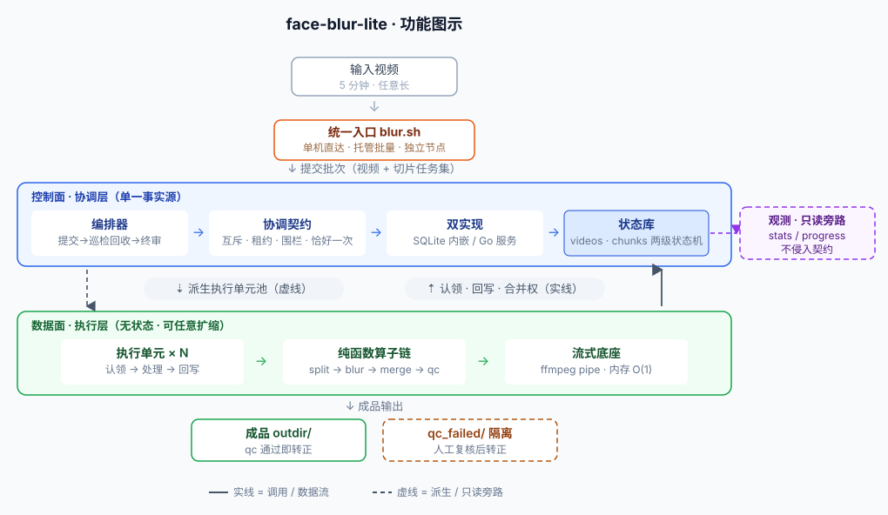
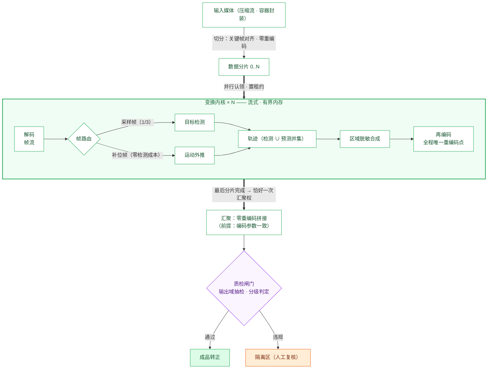
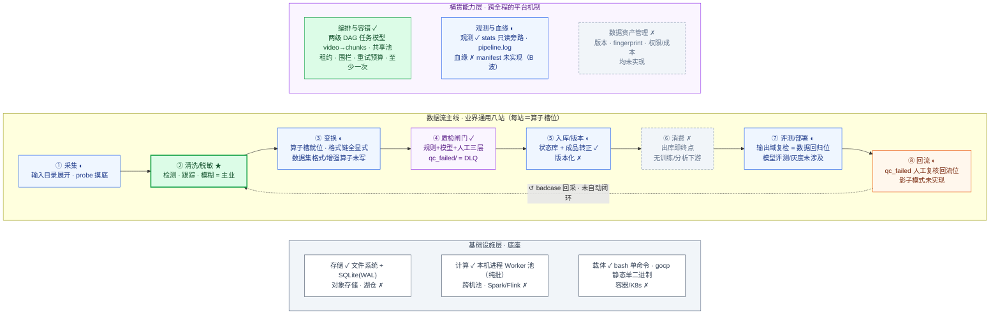
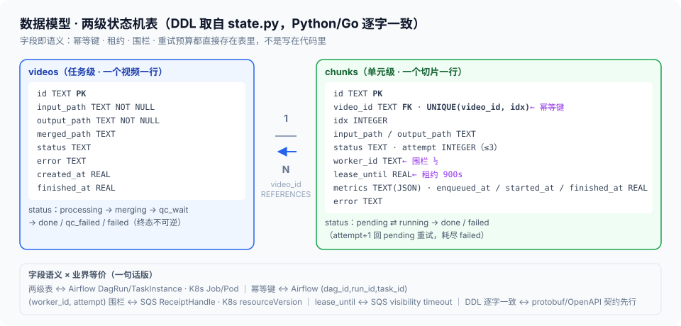
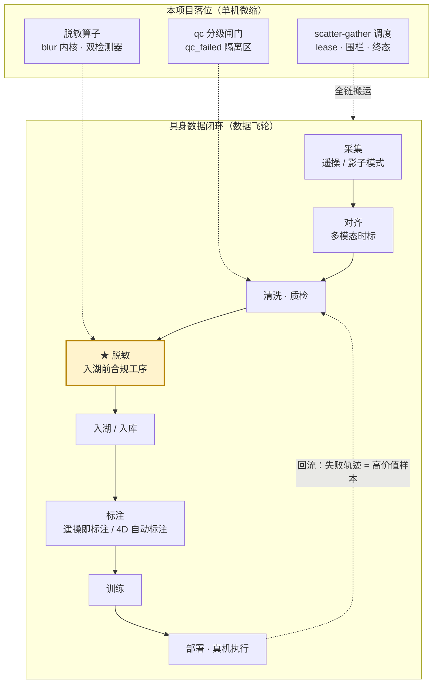

# face-blur-lite 项目汇报：一条管线的平台能力辐射

> **定位**：面向具身数据平台岗位的汇报——以项目本体为轴心，第 2 章对界业界通识，第 3/4 章对称迁移到具身与工业两个领域，收束为可迁移能力矩阵。交付主张：**这个项目交付的不是"人脸脱敏"，是一套经过 139 项测试实证的数据平台错误模型**。
>
> **事实源纪律**：机制与数字以 [handbook/](../handbook/README.md)（代码为唯一事实源重推）为权威底盘；数字双标——⟨RE⟩ = 2026-09-27 本轮复测口径，⟨fa65f90⟩ = 历史继承口径，两者条件不同时各自标注，不混用。

---

## 0｜三十秒版本

**是什么**：视频人脸脱敏管线（Python 数据面 + 双形态控制面），单条命令 `bash scripts/blur.sh run <视频>` 从手机直拍视频到脱敏成品 + 质检报告。

**两个突出设计**：① 控制面/数据面分离 + **契约先行**——12 方法 `ControlPlane` 协议，SQLite 内嵌（默认）与 gocp（Go 服务）双实现过同一份契约测试（14 场景 ×2）；② **scatter-gather 批量**——切处分治、共享 Worker 池、失败隔离、原子 Join 合并。

**三个能讲深的地方**：两级状态机的六个调度语义（§1.3）；端到端格式变换链（§1.1）；输出域双阈值分级质检闸门（§2.1）。

**辐射两个领域**：六调度语义与三份契约在具身数据闭环（§3）与工业数据链路（§4）中逐站同构，换算子不换错误模型。



---

## 1｜项目本体：管线 · 模型选型 · 工作流 · 数据建模

总纲一句话：**控制面是状态的唯一拥有者，数据面零状态、可任意 kill/扩容，算子全部是纯函数（文件→文件）**。本章按四个设计维度展开项目本体——数据面两节（管线 · 模型选型）、控制面两节（工作流 · 数据建模），第二章以同样的四维对界业界通识。

### 1.1 管线：scatter-gather 与端到端格式链

批量模式的数据管线总览（架构视角：形态变迁 · 分治汇聚 · 质检分流；实现级逐格放大见 [handbook/explanation/dataflow.md](../handbook/explanation/dataflow.md)）：



端到端格式变换链（每一跳显式、无隐式转换）：


| 站   | 形态      | 载体与格式                                                     | 谁负责          | 关键约束                         |
| ------ | ----------- | ---------------------------------------------------------------- | ----------------- | ---------------------------------- |
| 输入 | **V**     | mp4/mov/mkv/avi/m4v 容器，h264/hevc 视频 + aac 音轨            | ffmpeg probe    | 只探测不转码                     |
| 解码 | **V→S**  | rawvideo**BGR24** pipe → numpy `(H,W,3)` uint8                | FFmpegReader    | 流式，内存 O(1)                  |
| 检测 | **S→D**  | 检测帧（每 3 帧一检）→ 框坐标 + conf；ONNX 640 输入 letterbox | YuNet / SCRFD   | 源域阈值 0.3（宁可多糊）         |
| 跟踪 | **D→D'** | 中间帧恒速预测补位（mini-SORT：三轮关联 + EMA 速度）           | tracker.predict | 遮挡容忍 max_age=3               |
| 合成 | **S'**    | 框外扩 + 高斯模糊（大脸降采样快路径）                          | blur.py         | 检测框与 track 框并集糊          |
| 编码 | **S'→M** | libx264 / veryfast / crf 20 / yuv420p / +faststart             | FFmpegWriter    | **参数钉死不可配**               |
| 合并 | **M→V'** | concat`-c copy` 流复制                                         | merger          | 失败才降级重编码；音轨从不重编码 |

两个值得讲的点：① 全程**只有 blur 一格重编码**，split/merge 均流复制零损失；② 编码参数钉死不是偷懒——同批次所有 chunk 同参数，concat 流复制合并才成立，这是数据面设计对一致性的贡献。

### 1.2 模型选型：算子插槽上的检测器

**检测器是协议后的可替换算子——"选型"被架构化为插槽决策**：

- **YuNet 起步（默认）**：~230KB 单文件 ONNX、CPU 实时——最小可用基线，先跑通再谈升级；
- **插槽就位**：`Detector` 协议 + 工厂注入，内核 / qc / 编排器三处注入点——换检测器零控制面改动；
- **SCRFD 升级位（opt-in）**：A/B 同闸门实测**未胜出**——同数值 conf 下 SCRFD 出框仅 YuNet 的 1/3，违规反升，默认诚实维持 YuNet（数字与口径见 §2.4）；
- **qc 检测器独立可配**：交叉验收位（second opinion），闸门不与内核同源；
- **跟踪器选经典不选学习**：恒速运动模型 + 三轮关联——显式、可单测、零训练成本，漏检风险由并集糊兜底。

### 1.3 工作流：两级任务模型与六调度语义

以业界通用数据处理工作流为骨架逐站对照——**三层一闭环**：数据流主线（八站，每站＝算子槽位，换算子不换结构）× 横贯能力层 × 基础设施，外加 badcase 回流。已实现填实（✓ 绿）、关联/部分实现半开（◐ 蓝）、未实现置灰（✗ 灰虚线）；两级任务模型（video → chunks）与共享池调度的细节由图后的状态机与六语义表承载：



读图：**编排与容错槽位就是本项目两级任务模型的本体**——依赖形状是固定的**两级 DAG**（split fan-out → chunks 并行 → merge fan-in，scatter-gather 菱形；任意拓扑的通用 DAG 引擎是 Airflow/Argo 位，关键词对照见 §2.2），认领 → 处理 → 回写/重派的分片循环、drain 巡检、原子 Join 全落在下方状态机与六语义表里。两处整格灰（数据资产管理、消费）与各 ◐ 盒内的 ✗ 行，即 §2 诚实差距与 B 波计划的图形化。具身八站的领域内容见 §3.2，工业链路逐站对照见 §4.2。

全部合法状态迁移（终态不可逆）：

```
videos:  processing ──(最后 chunk done 者认领)──▶ merging ──▶ qc_wait ──▶ done | qc_failed
              │                                        │
              └──(chunk 耗尽 / lease 耗尽)──▶ failed ◀──┘（终态三者不可逆）

chunks:  pending ◀──(fail 未耗尽，attempt+1)── running ──▶ done
            │                                    │
            └──(claim，置 lease)────────────────▶ failed（attempt 耗尽）
```

六个调度语义（每个都是可讲五分钟的深水区）：


| # | 语义          | 本项目实现                                                         | 业界等价物                                        |
| --- | --------------- | -------------------------------------------------------------------- | --------------------------------------------------- |
| 1 | 互斥认领      | `claim_chunk` + `BEGIN IMMEDIATE` 单写者串行化                     | 队列的 visibility timeout                         |
| 2 | 租约          | lease 900s，编排器巡检回收重派                                     | SQS visibility timeout / K8s node 心跳            |
| 3 | **围栏**      | complete/fail 需`(worker_id, attempt)` 复合匹配，僵尸迟到 ack 被拒 | **SQS receipt handle** / K8s UID·resourceVersion |
| 4 | 终态不可逆    | done/failed/qc_failed 迟到回写不受理                               | completed Pod 不重启                              |
| 5 | **原子 Join** | 最后一个 complete 在同一事务置 merging，恰好一个调用者拿到合并权   | DAG fan-in 汇聚边                                 |
| 6 | 重试预算      | attempt ≤ 3（fail 与 lease 回收共用）                             | backoffLimit                                      |

### 1.4 数据建模：schema 即契约

存储就两张表，承载 §1.3 的两级状态机——**字段即语义**：幂等键、租约、围栏、重试预算都直接存在表里，不是写在代码里（DDL 取自 `state.py`，与 gocp `main.go` 逐字一致）：


| 表       | 承载         | 关键列                                                                |
| ---------- | -------------- | ----------------------------------------------------------------------- |
| `videos` | 视频级状态机 | 状态 · 输入/输出路径 · qc 结论                                      |
| `chunks` | 分片级状态机 | 状态 · attempt · lease 到期 · worker 纪元；`UNIQUE(video_id, idx)` |



字段语义 × 业界等价物（与 §1.3 六语义表同源，此处按字段维度收拢）：


| 本项目字段 / 表                 | 承担语义                  | 业界等价物                                                                               |
| --------------------------------- | --------------------------- | ------------------------------------------------------------------------------------------ |
| videos → chunks 两级表         | 任务级 + 单元级状态       | Airflow DagRun→TaskInstance · K8s Job→Pod · Temporal WorkflowExecution→ActivityTask |
| `UNIQUE(video_id, idx)`         | 幂等键                    | Airflow task instance key (dag_id, run_id, task_id) · K8s (namespace, name)             |
| `(worker_id, attempt)` 复合匹配 | 围栏（僵尸迟到 ack 被拒） | SQS ReceiptHandle · K8s resourceVersion/metadata.uid · Temporal taskToken              |
| `lease_until`                   | 租约（900s 巡检回收）     | SQS visibility timeout · K8s Lease / 心跳                                               |
| `attempt ≤ 3`                  | 重试预算                  | K8s backoffLimit · Airflow max_retries                                                  |
| DDL 在 Python/Go 逐字一致       | schema-as-contract        | protobuf/OpenAPI schema 双端生成 + 契约测试（SQL 世界的契约先行）                        |
| status 枚举 + 终态不可逆        | 状态机                    | K8s status 子资源 · Airflow state 枚举                                                  |

四个可讲深的设计点：

- **幂等键**：`UNIQUE(video_id, idx)`——分片身份由位置唯一决定，重复提交 / 重派不产生重复行；
- **schema 即契约**：DDL 在 Python/Go 双实现**逐字一致**——不是文档约定，是两份代码里相同的字符串；契约测试参数化双跑（14 场景 ×2）让漂移立刻红灯；
- **单写者 + WAL**：写事务走 `BEGIN IMMEDIATE` 串行化（互斥认领的地基）；WAL 允许观测并发只读；
- **两条铁律（import 关系直接可验）**：数据面只 import `ControlPlane` 协议（12 方法，实现经依赖注入——换 SQLite/HTTP 控制面 worker.py 零改动）；观测（stats/progress）以 `mode=ro` 只读旁路直读库，**不进契约**——任务状态契约与观测读取互不污染。

业界对照（schema-as-contract / 两阶段状态 / 单写者 / WAL）与已知弱项见 §2.3。

### 1.5 关键信息速览


| 维度     | 事实                                                                                       |
| ---------- | -------------------------------------------------------------------------------------------- |
| 规模     | 17 个 Python 模块 + gocp 单文件 Go 服务 ≈ 3000 行；gocp 16MB 静态单二进制（纯 Go 无 CGO） |
| 测试     | **139 绿**（含契约 14 场景 ×2 双实现、互素步长穷举、同名碰撞隔离、kill -9 恢复）          |
| 退出码梯 | `0` 全过 ｜ `1` 边缘违规/有 failed ｜ `2` 环境/输入错误（优先级最高）｜ `3` qc 致命违规    |
| 观测出口 | stderr 粗粒度进度 + pipeline.log 全量事件 + stats 只读分位（p50/p95）                      |
| 质检隔离 | qc ❌ 成品移入`qc_failed/`，通过层永不见未验收件，转正=人工 mv                             |

---

## 2｜设计四维 × 业界通识对照

每维三栏：本项目做法 → **业界通识关键词** → 对照评注（同构点在前，差距诚实标注在后）。

### 2.1 管线设计

**做法**：scatter-gather——关键帧对齐切片（≤30s 快路径不切）、共享 Worker 池消化全部视频的 chunk、流复制合并、输出域复检收尾。
**关键词**：`scatter-gather`、`fan-out/fan-in`、`分治+汇聚`、`zero-copy`、`幂等合并`。
**对照**：与 MapReduce 家族的 scatter-gather 同构，差异在数据形态（文件级 chunk 而非 KV 分片）与汇聚方式（数据库事务计数而非 sort-merge——文件世界的原子 Join 用事务实现更简单可靠）。**诚实差距**：本机进程级分片无净加速（57.6s vs 54.9s 单进程，⟨fa65f90⟩ ≈5% 编排开销）——加速位在容器 CPU 配额与跨机 Worker 池，这负结果本身是平台认知。质检双域阈值是本项目特有深水区：源域 0.3 / 输出域 0.5 不可互用（有损重编码改变置信度），`T_FATAL=0.7` 分致命/边缘两档定退出码。

### 2.2 工作流设计

**做法**：两级任务模型（video→chunks）；共享池 + FIFO 出队；lease 巡检回收；提交期 try/except 隔离 + 巡检不 fast-fail；qc_failed 隔离区。
**关键词**：`DAG 任务模型`、`队列调度`、`DLQ（死信队列）`、`失败隔离`、`至少一次执行`、`公平调度`。
**对照**：调度语义与 Airflow/Argo 同构（见 §1.3 表的 K8s 等价物列）；qc_failed 就是 DLQ 的文件世界形态。**诚实差距**：FIFO 无公平性——小视频 chunk 排在长视频之后（queue p95 9.3s 即其等待，⟨RE⟩），公平调度记为演进项。

### 2.3 数据建模

**做法**：`videos` + `chunks` 两级状态机表；`UNIQUE(video_id, idx)` 幂等键；DDL 在 Python/Go 双实现**逐字一致**（schema 即契约）；SQLite WAL + busy_timeout 并发读。
**关键词**：`schema-as-contract`、`幂等键`、`两阶段状态`、`单写者原则`、`WAL`。
**对照**：DDL 逐字一致是最强的契约形态——不是文档约定，是两份代码里相同的字符串；契约测试参数化双跑（14 场景 ×2）让漂移立刻红灯。**诚实差距**：数据版本管理是已知弱项——无逐输出 manifest/血缘/集合作 fingerprint（对标 OpenLineage 最小子集），已列入下一波计划。

### 2.4 模型选型

**做法**：YuNet 起步（小模型、单文件 ONNX、CPU 实时）；SCRFD 升级位预留（`Detector` 协议 + 工厂注入，三注入点）；A/B 同闸门实测未胜出 → **默认维持 YuNet，SCRFD opt-in**；qc 检测器独立可配（交叉验收位）。
**关键词**：`buy vs build`、`模型即可替换算子`、`A/B 验收`、`交叉验收（second opinion）`、`baseline 先行`。
**对照**：检测器是协议后的可替换件——升级零控制面改动，这是"模型选型"被架构化为"算子插槽"的实例。A/B 的教训值得讲：同数值 conf 下 SCRFD 出框仅 YuNet 的 1/3，**同闸门直接对比得出"未胜出"并诚实维持默认**，比"新模型一定好"的直觉工程得多。延迟口径：YuNet 8.38ms / SCRFD 17.58ms @640×480 合成帧（⟨RE⟩；历史 12.73/15.52ms 为 720×1406 真实帧口径，比值不可横比）。

---

## 3｜延伸一：具身数据处理（近场迁移）

### 3.1 具身数据长什么样

- **三路采集**：遥操作（真人示教，废片率 30-40%、单条成本 >8 元、日产千条级）｜头显 Ego 自由视角（SLAM 重建 + IK 反解，成本约遥操 1/2~1/3）｜仿真合成（NVIDIA GR00T Blueprint：11 小时生成 78 万条轨迹）
- **轨迹四轨**：视觉（多相机 RGB-D）· 本体状态（关节角/夹爪）· 动作序列 · 语言指令
- **格式三件**：LeRobot（HF 生态事实标准）/ RLDS（TensorFlow 系）/ HDF5（传统深度学习栈）
- 与本项目的共同底座：**视频流 + 结构化元数据 + 批量文件形态**——具身轨迹的"视觉轨"就是一批待管线处理的视频

### 3.2 链路同构映射：八站闭环 ↔ 本项目机制

具身数据闭环八站，逐站对应本项目已实证机制（图源 [handbook/explanation/embodied.md](../handbook/explanation/embodied.md) 链路定位图）：




| 闭环站        | 具身领域内容                | 本项目同构机制                                        |
| --------------- | ----------------------------- | ------------------------------------------------------- |
| ① 采集       | 遥操/Ego/仿真三路进料       | 多源输入目录展开（mp4/mov/mkv/avi/m4v）               |
| ② 入库       | 轨迹注册、episode 索引      | `submit_video` 原子入库（video+chunks 单事务）        |
| ③ 清洗·脱敏 | 人脸/车牌/环境敏感信息脱敏  | **本项目主业**：检测→跟踪→模糊全链                  |
| ④ 筛选       | 废片过滤（30-40% 遥操废片） | 提交期 try/except 失败隔离 + 边界探测                 |
| ⑤ 标注       | 人工/半自动分段标注         | qc 双阈值分级（fatal/marginal 分流人工复核位）        |
| ⑥ 训练       | VLA/VLM 数据配比与混采      | 共享 Worker 池批量吞吐（chunks/min 可观测）           |
| ⑦ 评测       | 成功率/鲁棒性回归           | 输出域全密度复检（回归测试位）                        |
| ⑧ 部署回流   | 失败轨迹回流采集            | qc_failed 隔离区：失败轨迹=高价值样本，人工复核后回流 |

### 3.3 本项目所处位置与对比

**位置**：具身数据平台的**数据智能平台层**——闭环八站中 ③④⑤⑦ 四站的核心工序，不碰模型层（⑥ 的训练框架）与采集硬件（①）。

**对比主张**：换算子不换错误模型。把"人脸检测模糊"换成"多模态清洗 / LeRobot 格式转换 / 动作重定向"，§1.3 的六调度语义、§2.3 的建模方式、失败隔离与质检闸门**全数保留**——因为它们处理的是"批量文件的分治、调度、质检"这个抽象问题，不是人脸。

**差距（诚实）**：具身领域的版本管理（数据集 fingerprint/血缘/resume）与格式生态（LeRobot 的 episode/帧索引结构）是本项目未覆盖面——前者已列 B 波计划，后者属算子层扩展。

### 3.4 扩展学习路径（按离本项目机制的距离排序）

1. **最近**：LeRobot 数据集结构与转换器（把"格式转换"做成本项目算子插槽上的一个纯函数算子）
2. **次近**：具身质检三层规则（规则/物理/仿真语义——本项目 qc 是"规则层"，物理一致性检查是新增算子位）
3. **中场**：GR00T Blueprint 类仿真数据管线（合成数据的"采集站"替代方案）
4. **远场**：VLA 训练数据配比与课程（数据平台的下游消费者视角）

---

## 4｜延伸二：工业数据工作流（跨界迁移）

> 与第 3 章对称同框架。工业数据与具身/视频差异更大，恰好用来检验错误模型的**跨域不变性**。

### 4.1 工业数据长什么样

- **四类形态**：高频时序（传感器毫秒级流）· 事件流（报警/工单/开关量）· 文件批（质检图像、日志、批次报告）· 元数据（设备台账、产线拓扑、工艺参数版本）
- **三个特点**：体积大而价值密度低（需筛选/聚合前置）；实时性分层（边缘毫秒级 → 车间分钟级 → 云端小时级批分析）；质量要求 SPC 化（统计过程控制，超限即停线，容错语义比互联网业务更硬）
- 典型链路：**设备/PLC → 边缘网关采集（OPC-UA/MQTT）→ 时序库/数据湖 → 清洗治理 ETL → 分析·质检 → 反馈控制/MES**

### 4.2 链路同构映射：工业数据链 ↔ 本项目机制


| 工业链路站   | 业界关键词                                 | 本项目同构机制                                            |
| -------------- | -------------------------------------------- | ----------------------------------------------------------- |
| 设备接入     | `OPC-UA` / `MQTT` / 边缘协议适配           | 多格式输入探测（probe 只探测不转码）                      |
| 边缘采集缓冲 | `断点续传` / `边缘存储转发`                | workdir 一次性工件 + 失败隔离（坏输入不砸批次）           |
| 入库         | 时序库（TDengine/InfluxDB）/ 数据湖        | 控制面状态库：**唯一状态拥有者**，单写者串行化            |
| 清洗治理     | `ETL 算子` / 数据质量规则                  | 纯函数算子槽（文件→文件，换算子不换调度）                |
| 质量控制     | `SPC 控制图` / `检出率` / `GxP 数据完整性` | qc 双域阈值 + T_FATAL 分级 + qc_failed 隔离区             |
| 批次追溯     | `MES 批次谱系` / `数据血缘`                | manifest/血缘（**计划中**，已知弱项诚实标注）             |
| 任务调度     | 工业调度批处理 / 容器化                    | lease + 围栏 + 原子 Join（语义不变，见 §1.3 K8s 等价列） |
| 资源受限边端 | 边缘计算低内存约束                         | rawvideo pipe 流式 O(1) 内存                              |

### 4.3 对比与差距（差距即学习点）

**同构不变量**：唯一状态拥有者 + 零状态执行单元 + 纯函数算子 + 失败隔离 + 分级质检——这套错误模型在三个域（视频脱敏/具身/工业）逐站成立。

**真实差距**（不回避）：

1. **批 vs 流**：本项目是纯批处理；工业时序是无限流，需要窗口语义与 Exactly-Once 投递（Kafka/Flink 批流一体是补课方向）
2. **实时性量级**：lease 15 分钟 vs 工业停线控制毫秒级——但分层架构恰好允许"边缘快环 + 云端慢环"，本项目机制落在慢环（批分析/质检/追溯）完全成立
3. **数据形态**：文件级 chunk vs 记录级流——切分粒度从"秒级视频段"换成"时间窗口"，scatter-gather 骨架不变

### 4.4 扩展学习路径

1. **最近**：OpenLineage 血缘最小子集 + 逐输出 manifest（B 波计划，工业追溯的同一底座）
2. **次近**：Kafka + Flink 批流一体（把"批的至少一次"升级为"流的 Exactly-Once"）
3. **中场**：OPC-UA / UNS（Unified Namespace）信息建模——工业版的"契约先行"
4. **远场**：SPC 与 GxP 数据完整性规范（质检闸门的合规化版本）

---

## 5｜收束：可迁移能力矩阵


| 能力（本项目实证）                | 具身领域对应                | 工业领域对应   | 迁移成本                   |
| ----------------------------------- | ----------------------------- | ---------------- | ---------------------------- |
| 六调度语义（§1.3，139 测试锁死） | 轨迹批处理调度              | 工业批任务调度 | **零**（K8s/引擎语义等价） |
| 失败隔离 + qc_failed 死信区       | 废片过滤/失败轨迹回流       | 坏批次隔离     | **零**                     |
| 双域分级质检闸门                  | 三层质检的规则层            | SPC 控制图     | 低（阈值体系域内重校）     |
| 契约先行 + 双实现                 | 平台多引擎适配              | 多供应商集成   | **零**                     |
| 算子插槽（协议+工厂注入）         | 换脱敏→换清洗/格式转换算子 | 换 ETL 算子    | 低（写新算子）             |
| 观测只读旁路                      | 训练数据平台监控            | 产线监控大盘   | **零**                     |
| 数据版本/血缘/manifest            | 数据集版本管理              | 批次谱系       | 中（**本弱项，B 波计划**） |

结尾主张：**一套错误模型，三个数据域**。调度语义、失败隔离、分级质检、契约先行这些"平台能力"与具体算子解耦后，从视频脱敏到具身轨迹再到工业时序，变的是数据形态与算子内容，不变的是"怎么可靠地处理一大批会失败的数据单元"——这份数据平台工程的核心判断力，正是这个项目用可复现的机制与数字交付的东西。

---

## 附：深入阅读地图（机制细节的唯一权威源）


| 想深入               | 去                                                                                     |
| ---------------------- | ---------------------------------------------------------------------------------------- |
| 结构全景与导航       | [handbook/README.md](../handbook/README.md)                                            |
| 逐命令/逐参数/逐模块 | handbook/reference/（cli · contract · config · modules）                            |
| 一帧的旅程全链       | [handbook/explanation/dataflow.md](../handbook/explanation/dataflow.md)                |
| 批量跑法实操         | [handbook/how-to/run-batch.md](../handbook/how-to/run-batch.md)                        |
| 业界对照深讲         | [docs/report.md](report.md)（五层体系） · [docs/overview.md](overview.md)（总装坐标） |
| 具身全景             | [handbook/explanation/embodied.md](../handbook/explanation/embodied.md)                |
| 数字对账与口径       | [handbook/drift-audit.md](../handbook/drift-audit.md)                                  |
