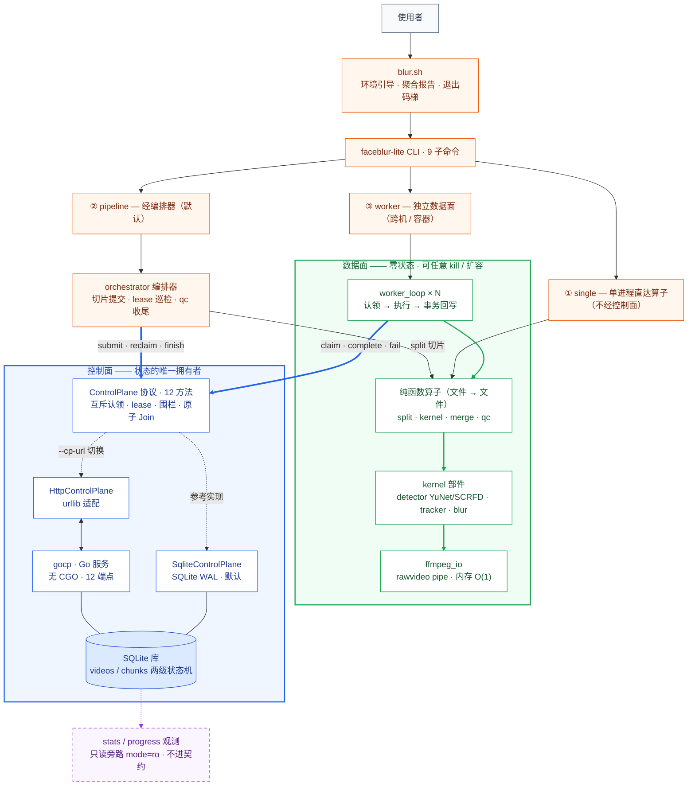

# face-blur-lite handbook

视频人脸脱敏管线的**体系文档集**，以当前代码实现为唯一事实源重推（Diátaxis 四象限组织）。

> **两套文档的分工**：本集（`handbook/`）= 机制与参考，矛盾时以本集为准；`docs/` = 深度叙事、设计决策过程、bug 取证史、波次过程记录。每篇尾部附事实源锚点（file:line）。

## 结构全景图

一图看全：**控制面是状态的唯一拥有者，数据面零状态、可任意 kill/扩容**；算子全部是纯函数（文件→文件）。



**scatter-gather 一行版**（批量模式的数据旅程）：

```
视频 ─split（流复制）→ [chunk 0..N] ─blur × N 并行→ merge（concat 流复制）→ qc（输出域复检）
                                                              ├─ ✅ 0 违规 → 成品 outdir/
                                                              └─ ❌ 有违规 → qc_failed/ 隔离（人工复核）
```

## 四象限导航

| 象限 | 篇目 | 状态 | 回答什么 |
|---|---|---|---|
| **intro** | [overview](intro/overview.md) · [quickstart](intro/quickstart.md) | ✅ 已落地 | 这是什么 / 怎么跑起来 |
| **how-to** | [run-batch](how-to/run-batch.md) · [switch-gocp](how-to/switch-gocp.md) · [extend](how-to/extend.md) | ✅ 已落地 | 怎么批量跑 / 切 Go 控制面 / 加检测器·算子·上 K8s |
| **reference** | [cli](reference/cli.md) · [contract](reference/contract.md) · [config](reference/config.md) · [modules](reference/modules.md) | ✅ 已落地 | 逐命令 / 逐方法 / 逐参数 / 逐模块的权威表 |
| **explanation** | [architecture](explanation/architecture.md) · [dataflow](explanation/dataflow.md) · [industry](explanation/industry.md) · [embodied](explanation/embodied.md) | ✅ 已落地 | 为什么这样设计 / 一帧的旅程 / 业界坐标 / 具身定位 |

另有 [drift-audit.md](drift-audit.md)（与旧 docs/ 的对账清单，内部件，外部读者可跳过）——收口波产出。
