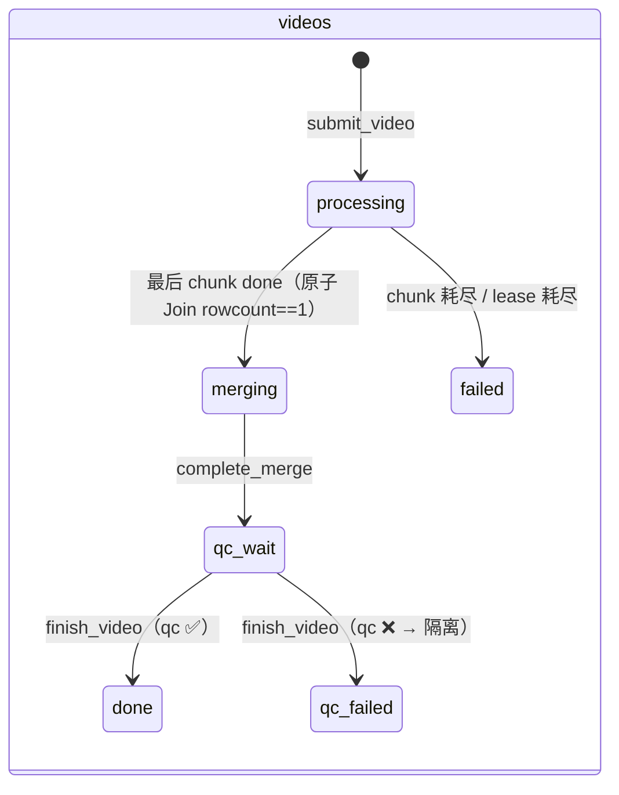
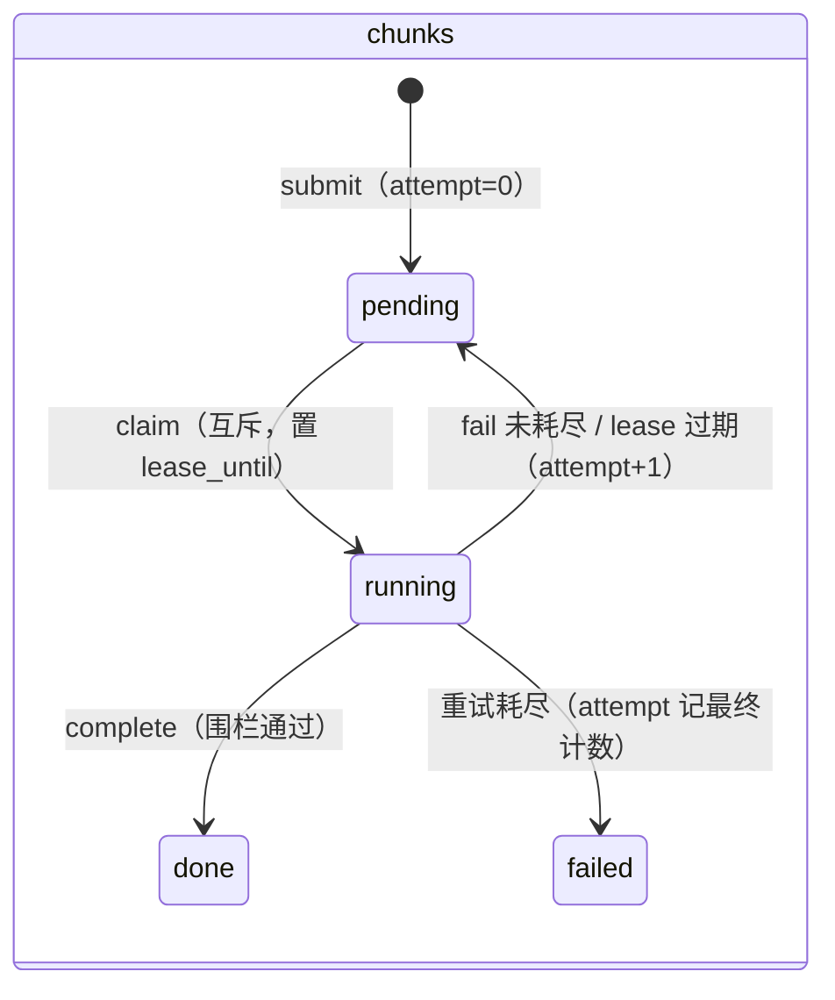

# 架构：控制面/数据面分离与容错语义

**主张：控制面是状态的唯一拥有者，数据面零状态、可任意 kill/扩容——所有容错语义（互斥/租约/围栏/终态/Join/重试预算）都由这一条分离派生。**

> 系统级全景图见 [../README.md](../README.md)。本文讲"为什么这样分"与"坏了会发生什么"。

## 为什么这样分离

| 设计选择 | 得到什么 |
|---|---|
| 状态只在控制面（SQLite 两张表） | 数据面 Worker 随时可 kill：死亡由 lease 回收兜底，扩容=再起一个 Worker |
| 控制面=协议（`ControlPlane`）不是实现 | 数据面只 import 29 行协议；SQLite 内嵌与 gocp Go 服务互换，Worker/编排器零改动 |
| 算子=纯函数（文件→文件） | 可独立 CLI 调用、幂等覆盖写（at-least-once 的数据面答法）、可直接上 DAG 引擎 |

## 三份契约（架构纵切）

横向分层之外，跨层流转由三份契约承担——状态、配置流入、证据流出各一份：

| 契约 | 定义处 | 承担 |
|---|---|---|
| **ControlPlane**（状态） | [control.py](../../src/faceblur_lite/control.py) | videos/chunks 两级状态机的全部迁移；12 方法语义见 [contract.md](../reference/contract.md) |
| **KernelParams**（配置流入） | [kernel.py:14-25](../../src/faceblur_lite/kernel.py#L14-L25) | 单一配置对象贯穿 CLI → 编排器 → Worker → 内核；qc 复用检测器注入点 |
| **QCReport**（证据流出） | [qc.py:34-49](../../src/faceblur_lite/qc.py#L34-L49) | 质检证据 → 编排器 verdict（done/qc_failed）→ CLI 退出码梯 0/1/3 |

## 两级状态机





终态（done / failed / qc_failed）**不可逆**：迟到回写一律不受理。一个如实声明的边界：`merging` 态没有失败出口——merge 本身无租约，合并中 Worker 死亡则 video 停在 merging（已知限制，见 README）。

## 批处理生命周期（orchestrator）

```
1 提交期   逐视频 split + submit —— 单视频失败记结果，批次继续（失败隔离）
2 共享池   一个 Worker 池消化所有视频的 chunk（队列天然交错，不按视频分桶）
3 巡检     每 0.5s：reclaim_expired（lease 回收）+ 只读快照 diff 出进度事件
4 收尾     池 drain 后逐视频 qc：❌ → 移入 outdir/qc_failed/（同名 _1 递增，保复核证据）
5 汇总     done · qc_failed · failed 三计数 + 总耗时
```

## 容错矩阵（坏了会发生什么）

| 故障场景 | 系统行为 | 语义 |
|---|---|---|
| Worker 执行中被 kill -9 | lease 900s 过期 → 巡检回收 → pending 重派 attempt+1；耗尽 → chunk+video 双 failed | 租约回收（≈ SQS visibility timeout） |
| Worker 抛异常 | `fail_chunk` 同事务 attempt+1；未耗尽回 pending（worker_id/lease 清空） | 重试预算 |
| 僵尸迟到 ack/fail（lease 已被重派） | `(worker_id, attempt)` 围栏不匹配 → complete 返回 False / fail 静默 no-op | 持有者围栏（≈ SQS receipt handle） |
| 对已 done chunk 的迟到 fail | 终态不可逆，静默不受理 | 状态一致性 |
| 并发 complete 同视频最后两 chunk | 同一事务内置 `merging`，恰好一个调用者 rowcount==1 | 原子 Join（fan-in 恰好一次） |
| 单视频提交失败（损坏/切不了片） | 提交期 try/except 记结果，批次继续 | 失败隔离 |
| 两个输入同 stem 输出碰撞 | 后到者显式 failed，先到者正常处理，不静默重命名 | 显式优于隐式 |
| workdir 跨轮复用（sqlite 模式） | 显式拒绝 rc 2；`--cp-url` 共享队列语义豁免 | 一次性工件目录 |
| qc 有违规 | 成品移 `qc_failed/` 隔离；隔离失败（OSError）不砸批次、文件留原位 | 通过层永不见未验收件 |
| Worker 池退出边缘任务未完成 | 收尾按 failed 记结果 | 收敛保证 |

## 控制面双形态

- **SqliteControlPlane**（默认）：SQLite WAL（Write-Ahead Logging，预写日志）+ `BEGIN IMMEDIATE` 单写者串行化，零额外进程
- **gocp**（`--cp-url`）：Go 服务，纯 Go 无 CGO（Go 调用 C 的互编译层），DDL（Data Definition Language，建表语句）与事务语义与 Python 端**逐字一致**；业界分工复刻——平台控制面 Go + 算法数据面 Python
- **契约测试**：14 场景 ×2 实现 = 28 用例双跑（`tests/test_contract.py`），含终态守卫、同名转世僵尸、原子 Join 竞态——两实现行为漂移立刻红灯

## 观测（只读旁路，不进契约）

- **进度双出口**：stderr 粗粒度（即时事件行 + 5s 节流聚合行）+ `workdir/pipeline.log` 全量事件（ISO 毫秒时间戳 key=value）；三层事件源——父进程自有知识直打 / 巡检快照 diff（0.5s 轮询）/ `mode=ro` 旁路直读库
- **stats**：`mode=ro` 只读聚合（排队/处理 P50·P95〔分位耗时〕、吞吐、失败率、重试计数）——WAL 并发读安全，gocp 模式同样直读其库文件
- 设计纪律：观测读**不往 ControlPlane 契约加方法**；进度双出口尽力而为（写失败静默吞），**绝不反噬主流程**

## 实测基线（2026-09-27 重测）

| 维度 | 数字 | 口径 |
|---|---|---|
| 测试 | **139 passed / 133.11s**（含契约 14 场景×2=28 双跑） | pytest 全量 ⟨RE⟩ |
| 批量冒烟 | 3 视频（30s/20s/45s）→ 4 chunks 全 done、qc 3/3、零重试，总 19.9s | workers=3，segment=30 ⟨RE⟩ |
| 观测 | queue p50 0.9s / p95 9.3s；proc p50 10.3s / p95 12.2s；吞吐 16.76 chunks/min；fail_rate 0 | stats ⟨RE⟩ |
| 单进程 | 300 帧（30s）wall 4.38s：67 检测 / 2 轨迹 / 200 预测帧 | ⟨RE⟩ |
| 检测器 | YuNet 232,589 B / 8.38ms·帧⁻¹；SCRFD 2,524,817 B / 17.58ms·帧⁻¹（SCRFD≈2.1×；640×480 合成帧） | ⟨RE⟩ |
| 真实视频（720×1406 · 2121 帧） | single 默认 wall 48.7s；全密度复检残留 **589/2121 = 27.8%**（fatal 117 / marginal 472） | ⟨RE⟩ |
| 真实视频取证阶梯（历史） | 违规 621→308（最优 14.5%，默认口径 23.2%）；批量 57.6s vs 串行 54.9s ≈5% 编排开销 | ⟨fa65f90⟩ 继承；旧 qc 闸门口径——灵敏度已演进（面积过滤等），绝对值不可直接复现（bugs/014 注记），本轮同口径复测见上行 |

复跑方式：`pytest -q`；冒烟与观测见 [../how-to/run-batch.md](../how-to/run-batch.md)（波 3 落地）。

---

**事实源锚点**：协议 [control.py](../../src/faceblur_lite/control.py)｜租约回收 [state.py:171-196](../../src/faceblur_lite/state.py#L171-L196)｜围栏+原子 Join [state.py:102-131](../../src/faceblur_lite/state.py#L102-L131)｜终态不可逆 [state.py:139-169](../../src/faceblur_lite/state.py#L139-L169)｜生命周期与失败隔离 [orchestrator.py:107-124](../../src/faceblur_lite/orchestrator.py#L107-L124)｜碰撞隔离 [orchestrator.py:239-251](../../src/faceblur_lite/orchestrator.py#L239-L251)｜隔离区 [orchestrator.py:48-62](../../src/faceblur_lite/orchestrator.py#L48-L62)｜进度双出口 [progress.py:104-180](../../src/faceblur_lite/progress.py#L104-L180)｜观测旁路纪律 [stats.py:1-7](../../src/faceblur_lite/stats.py#L1-L7)
