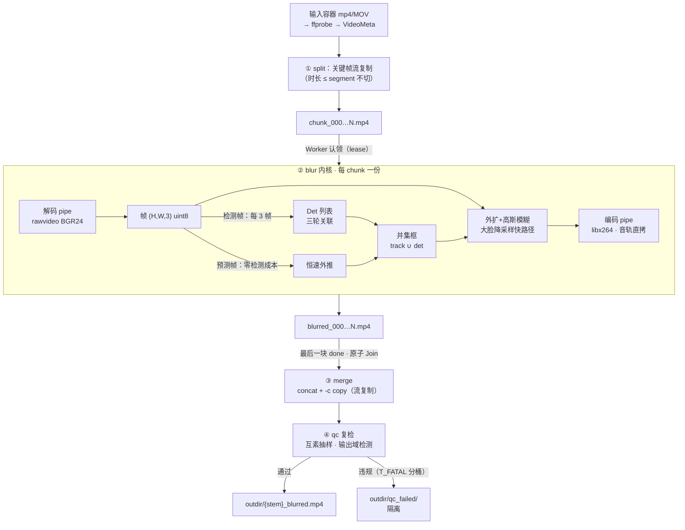
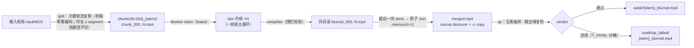

# 一帧的旅程：数据流与格式链

**主张：解码归 ffmpeg，检测归 ONNX（Open Neural Network Exchange，开放神经网络交换格式），中间只有 numpy——每个交接面的数据形态都有明确定义；全程 pipe 流式，内存 O(1)，任意长视频占用恒定。**

## 全程一图



single 模式 = 摘掉 split/merge 外壳，内核直跑整片；qc 是独立子命令，可复检任意成品。后文各节即此图逐格放大：格式链与帧级主循环 → §1-§2，跟踪与模糊 → §3-§4，qc 抽样 → §5，切片合并外壳 → §6。

## 格式变换链（7 层 8 形态）

| # | 形态 | 载体/类型 | 边界处 |
|---|---|---|---|
| 1 | 容器文件（H.264 + AAC〔Advanced Audio Coding〕） | 磁盘 mp4/MOV | 输入 |
| 2 | ffprobe 元数据 JSON | 内存 dict | `probe()` → `VideoMeta`（W/H/fps/fps_str/has_audio） |
| 3 | rawvideo BGR24 字节流 | **pipe** | `ffmpeg -f rawvideo -pix_fmt bgr24 -` |
| 4 | `(H,W,3)` uint8 BGR 帧 | numpy | `np.frombuffer(buf).reshape(H,W,3)` |
| 5 | `Det(x1,y1,x2,y2,conf)` 列表 | dataclass | `detector.detect(frame)` |
| 6 | `Track.box`（xyxy）+ 速度 | numpy | `tracker.update()/predict()` |
| 7 | 模糊后新帧 → 字节 | numpy → pipe | `blur_regions()` → `tobytes()` → 编码 ffmpeg |
| 8 | 成品容器 | 磁盘 mp4 | libx264 编码 + 音轨流复制 |

一帧字节数 = `W×H×3`（720×1406 例 ≈ 2.90MB ⟨fa65f90⟩）。**中间任何时刻内存里只有当前帧**——2121 帧 ≈6.4GB 的帧流从头到尾不进内存 ⟨fa65f90⟩：帧处理完即弃，内核累计的只有 `face_frames: list[bool]`（每帧 1 字节）与跟踪器状态（O(track 数)）。

## 帧级主循环（kernel.process_video）

```python
for i, frame in enumerate(rd):            # rd = FFmpegReader（pipe）
    if i % det_every == 0:                # 检测帧（默认每 3 帧一次）
        dets = detector.detect(frame)
        active = tracker.update(dets, gap=det_every)
    else:                                 # 预测帧：零检测成本
        active = tracker.predict()
    boxes = [t.box for t in active]       # 跟踪框（含遮挡期预测补位）
    if blur_all_dets:                     # 并集糊：低分框也当场糊
        boxes += [d.xyxy() for d in dets]
    wr.write(blur_regions(frame, boxes, margin, margin_px))
```

两个设计点直接写在循环里：

- **检测节奏与跟踪补位**：`det_every=3` 时 2/3 的帧零检测成本，位置由跟踪器恒速外推——这是"漏检风险换吞吐"的显式旋钮
- **并集糊**：检测帧上跟踪框 ∪ 检测框——跟踪器管帧间连续性，不该在检测帧上过滤检测（源域 conf 0.3-0.5 的低分框也当场糊掉：脱敏代价不对称，宁可多糊）


## 跟踪器：三轮关联（mini-SORT）

预测帧的位置来自 `predict()`：`box += vel`（恒速模型），完全出画的 track 剪枝（半出画保留）。检测帧走 `update()` 三轮关联：

1. **高分轮**：conf ≥ 0.5 的框与现有 track 匈牙利匹配（IoU〔Intersection over Union，交并比〕≥ 0.1）
2. **低分救活轮**：conf ∈ [0.3, 0.5) 的框只救活未匹配 track（ByteTrack 思路：遮挡期置信度塌落时不断链），**不出生新 track**
3. **距离兜底轮**：快运动下 IoU 必然失配（1 框宽位移 → IoU≈0.05），对未匹配对按"中心距 ≤ max(宽,高) 且面积比 0.5-2×"贪心配对——宁并勿重生：错并只是 track 提前挪位，重生则预测框永久滞后

速度估计按 gap 归一（`det_every>1` 时仍正确）；**自举**：前 2 次命中直接采纳瞬时速度，第 3 次起 EMA（Exponential Moving Average，指数移动平均；α=0.6）——新生 track 若从 0 速度走 EMA 会爬坡滞后。`misses > max_age(3)` 的 track 淘汰（ghost 剪枝：预测框不能无限存活）。

## 模糊几何

- **外扩**：`margin=0.15` 按框宽高较大者比例外扩，与 `margin_px=8` 取 max（小脸比例外扩只有 2-4px，盖不住检测框抖动露出的脸缘），clip 到帧内；与画面无交返回 None 跳过
- **核大小**：奇数核 = crop 短边 × 0.75（σ 须与人脸低频结构尺度相当，太小只抹高频细节、验收 std 不降）
- **大脸快路径**：k > 201 时走"INTER_AREA 降采样（短边 ≈268px）→ 同比例小核糊 → 放回"，成本从 O(k×像素) 降到 O(像素)，σ 视觉等效（σ_eff/σ_direct ∈ [0.995, 1.01]，代码注释实测口径）——大特写无此路径会到秒级/帧

## 抽样与时间戳（qc 侧数据流）

qc 在**输出域**复检成品：`FFmpegReader(path, sample_fps)` 按帧号跨步抽样——步长 = `round(fps/sample_fps)` 向上取整到**与 840=lcm(2..8) 互素**，首窗取中点帧。两个不变量：

1. 抽样帧必然是原始帧序列的逐帧成员（不是滤镜合成帧）→ 时间戳 `t = (i×stride+offset)/fps` **精确可还原**（`-vf fps` 滤镜在部分容器上有恒定相位偏移且输出帧与原始帧不一一对应，时间标签不可信——本仓实测 +14 帧，docs/bugs/010）
2. 步长与 840 互素 ⇒ 抽中帧号 mod d 对一切 d ∈ 2..8 均匀扫遍全部残差类——否则固定步长会与 `det_every` 检测节奏**锁相**（如 30fps@1fps 步长 30 与 det_every=3 锁相，2/3 的帧零覆盖），docs/bugs/016

违规判定：输出域检测（`pass_conf=0.5`）→ 面积过滤 `[8×8, 0.4×W×H]`（微框/巨框多为糊纹理噪声）→ `Violation(t_sec, conf, box, severity)`，severity 按 `T_FATAL_CONF=0.7` 分桶。`--sample-fps none` 全密度逐帧 = 最终验收档。

## 切片与合并（批量模式的数据旅程）

- **split**：`-c copy -map 0 -f segment` 关键帧流复制（秒级、零重编码）；时长 ≤ segment 的视频快路径**不切**（直接整片一个 chunk）；重跑同目录先清旧 chunk
- **blur×N**：每个 chunk 独立走上面的帧级主循环（同参数编码 → concat 成立的前提）
- **merge**：concat demuxer + `-c copy` 秒级合并；列表条目写**绝对路径**（concat demuxer 按列表文件所在目录解析相对条目）+ 撇号转义；流复制失败降级重编码
- **音轨**：从头到尾 `-c:a copy` 字节级直拷，从不重编码

一个视频在批量模式下的**完整工件旅程**（与上文帧级图互为放大/缩小镜——blur 内核一格即帧级图的全部）：



全程只有 blur 一格重编码（V→S 与 D→M 均流复制），成品帧参数一致是 concat `-c copy` 成立的前提——这也是"编码参数钉死不可配"（见 [../reference/config.md](../reference/config.md)）的数据面理由。

---

**事实源锚点**：格式链 [ffmpeg_io.py:63-144](../../src/faceblur_lite/ffmpeg_io.py#L63-L144)｜帧级主循环 [kernel.py:55-79](../../src/faceblur_lite/kernel.py#L55-L79)｜三轮关联 [tracker.py:87-150](../../src/faceblur_lite/tracker.py#L87-L150)｜速度自举 [tracker.py:131-140](../../src/faceblur_lite/tracker.py#L131-L140)｜模糊几何与大脸快路径 [blur.py:11-59](../../src/faceblur_lite/blur.py#L11-L59)｜互素抽样 [ffmpeg_io.py:48-78](../../src/faceblur_lite/ffmpeg_io.py#L48-L78)｜qc 判定 [qc.py:52-73](../../src/faceblur_lite/qc.py#L52-L73)｜切片 [splitter.py:11-30](../../src/faceblur_lite/splitter.py#L11-L30)｜合并 [merger.py:8-36](../../src/faceblur_lite/merger.py#L8-L36)｜⟨fa65f90⟩ = 继承自 fa65f90 基线档的实测数字
