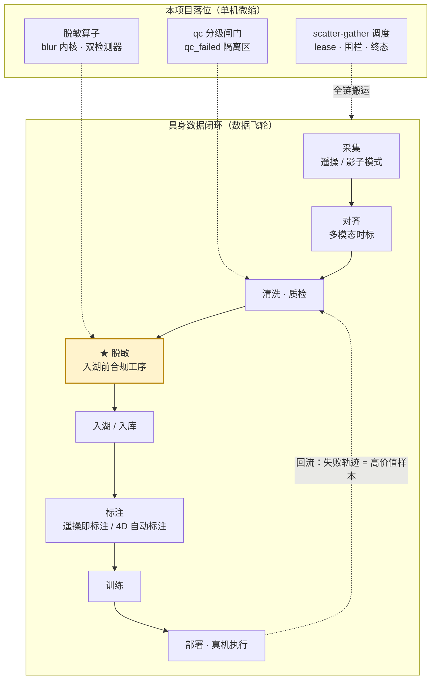
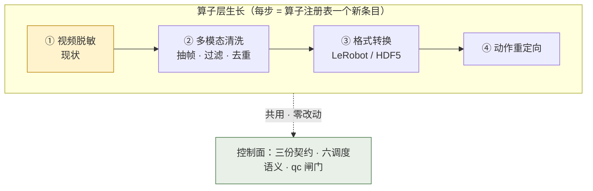

# 具身数据处理：本项目的落地方向

**主张：算子是"人脸脱敏"，但平台的错误模型（互斥/租约/终态/围栏/幂等/取证）与具身数据处理是同一套——换算子，不换错误模型。这是"平台研发"与"应用开发"的区别：交付的是那套错误模型。**

> 本文属 explanation 象限的 Tier 2（行业梳理是研究产物）。源：[docs/overview.md](../../docs/overview.md) §6-§7、[docs/report.md](../../docs/report.md)；行业数字为公开分享口径（技术报告/厂商分享，按名称可检索），量级供定位不供考核。

## 链路定位

读法：主干 = 闭环八站（虚线回边 = 真机执行回流，重进质检闸门）；右侧子图 = 本项目三个已实做语义的落位——脱敏站是算子本体，质检站是闸门与隔离，调度语义服务全链。采集/标注两格的**双写法即具身/智驾两条泳道的全部差异**（见下文泳道节）。

脱敏是链路**入湖前的合规工序**（国内 7 号令 / GDPR〔General Data Protection Regulation，欧盟《通用数据保护条例》〕匿名化出口）——量大利不出实时价值，决定其批处理工作流形态与"数据层工作流第一个算子节点"的平台化归宿。业界先例：百度百舸把 Meta EgoBlur（开源人脸/车牌脱敏模型）封装成平台算子——本管线就是那个位置的微缩完整实现（含质检闸门与隔离区）。

## 具身数据长什么样

**三大模型范式与数据需求**：

| 范式 | 代表 | 数据需求 |
|---|---|---|
| VLA（Vision-Language-Action，视觉-语言-动作） | π0、GR00T、RDT-1B、Helix | 大规模遥操轨迹 + 互联网视觉-语言数据（π0 ≈1 万小时遥操 + OXE〔Open X-Embodiment〕） |
| 世界模型 | Cosmos（≈2000 万小时视频，NVIDIA 官方口径） | 海量无标注视频 |
| 小脑/分层 | 快慢双系统 | 高频时序控制数据，采集端硬实时对齐 |

三条关系线决定供给结构：VLM（Vision-Language Model，视觉-语言模型）→VLA（语言接口）、世界模型↔VLA（预训练与仿真供给）、快慢分层（架构组织）——数据平台因此是**轨迹 + 视频 + 仿真三路进料**。

**一条轨迹的解剖**（episode = 一次演示，LeRobot 按轨组织）：

| 轨 | 内容 |
|---|---|
| 视频 | RGB 时序流；单条 30s 双臂轨迹原始 GB 级 → 编码后 10-25MB |
| 动作 | 关节角（演示/控制信号） |
| 状态 | 力矩等本体状态 |
| 语言 | 任务指令（VLA 的语言接口） |

多轨各自采样 → 多模态时序数据的"脏"**主要脏在时间戳**：时序对齐是第一道工程约束——硬触发 <1ms / PTP（Precision Time Protocol，精确时间协议）亚毫秒，33ms（=30fps 一帧）错位不可修复，对齐容忍窗口 ≤5ms。

**格式路由（模型↔格式强绑定）**：

| 格式 | 主要用户 | 特点 |
|---|---|---|
| LeRobot | π0、GR00T 开源栈 | episode 组织，社区事实标准（Hugging Face 生态） |
| RLDS（Reinforcement Learning Datasets） | Google 系（RT-X/OXE） | 流式 dataset 抽象，TensorFlow 生态 |
| HDF5（Hierarchical Data Format） | RDT-1B（Robotics Diffusion Transformer）等传统机器人栈 | 单文件大对象，随机访问弱 |

模型↔格式强绑定（RDT→HDF5、π0/GR00T→LeRobot）意味着平台必须做格式路由；同等样本量下具身 IO 强度比 LLM 高 1-2 个数量级（150-300GB 级 vs GB 级）。遥操与 Ego 的产出正是**视频主导的时序流**——本管线的输入形态、格式链与批处理调度对这一形态直接成立。

**三条采集路线**（量级为公开分享口径）：

| 路线 | 机制 | 量级口径 |
|---|---|---|
| 真机遥操 | 人操本体演示 | 废片率 30-40%；有效数据 >8 元/条；单机日产约千条 |
| Ego 无本体（第一人称采集） | 头戴 RGB→SLAM（Simultaneous Localization and Mapping，同时定位与建图）→手部姿态→IK（Inverse Kinematics，逆运动学）→重定向 | 成本收敛到真机 1/2~1/3（头戴千元级 vs 本体数十万级） |
| 仿真生成 | Isaac / ManiSkill | GR00T Blueprint 官方口径：11 小时生成 78 万条合成轨迹 ≈ 9 个月连续人类演示 |

采集后先过**三层质检**：规则（最短帧数/位移/角速度）→ 物理（自碰撞/逆解失败）→ 语义（任务成败，VLM 辅助）——原始素材约 **30% 可进训练**（8h 素材 → 2-3h 可用）。

**具身 vs LLM 数据平台五维差异**：

| 维度 | LLM | 具身 | 平台设计含义 |
|---|---|---|---|
| 数据形态 | 文本 token | 多模态时序（视频+关节+力矩+语言） | 编解码/对齐/存储分层全变 |
| 单样本 | KB 级 | 30s 轨迹 GB 级（编码后 10-25MB） | **IO 主导**而非算力主导 |
| 标注 | 人工/偏好反馈 | 遥操即标注+事后结构化 | 标注前移到采集端 |
| 质检 | 规则+评测集 | 规则/物理/语义三层 | 物理仿真介入质检 |
| 回流 | 数据→训练→评测 | 再加真机执行回流（**失败轨迹=高价值样本**） | 回流语义更重 |

一句话：LLM 数据平台的核心稀缺是算力调度，具身数据平台的核心稀缺是**把多模态时序数据合格地搬进训练**——本项目练的正是这条搬运链的错误模型。

## 逐项对照（本项目 ↔ 具身数据工程）

| 具身侧要点 | 本项目对应（代码事实） |
|---|---|
| 时序对齐是第一道约束（硬触发 <1ms；33ms=30fps 差一帧不可修复） | 全链时间戳精确可还原：抽样帧是原始帧序列的逐帧成员（互素步长+中点偏移，[ffmpeg_io.py:48-78](../../src/faceblur_lite/ffmpeg_io.py#L48-L78)） |
| 格式路由是平台必备 | 算子=纯函数文件→文件 + 工厂注入检测器（[detector.py:174-184](../../src/faceblur_lite/detector.py#L174-L184)）；加格式转换算子=注册新条目，控制面零改动 |
| 三层质检（规则/物理/语义）；原始素材约 30% 可进训练 | qc 分级闸门 = 规则层微缩：T_FATAL 分级 + 面积过滤 + 取证清单（[qc.py](../../src/faceblur_lite/qc.py)） |
| badcase 隔离回流 | qc_failed 隔离区：通过层永不见未验收件，转正=人工复核移出（[orchestrator.py:48-62](../../src/faceblur_lite/orchestrator.py#L48-L62)） |
| IO 强度高 1-2 个数量级 | ffmpeg pipe 流式不物化、内存 O(1)——单机对 IO 压力的答法（见 dataflow.md） |
| 批处理调度（量大、非实时） | scatter-gather + 共享 Worker 池 + lease 容错（见 architecture.md） |

## 智驾泳道同构（一段话版）

同一条闭环骨架，智驾把采集端换成影子模式（shadow mode）+触发器筛选、标注端换成 4D 自动标注——这正是链路定位总览图里采集/标注两格双写法的含义，其余六站两条泳道逐格相同。脱敏在智驾链路里是车外视频**入湖前的法定第一道工序**（"云端批量脱敏"形态）——与具身泳道共享本项目全部调度/容错/质检语义。双泳道细节见 [docs/overview.md](../../docs/overview.md) §7。

## 具身化演进路径（换算子，不换控制面）

视频脱敏 → 多模态清洗（抽帧/过滤/去重）→ LeRobot/HDF5 格式转换算子 → 动作重定向——每一步 = 算子注册表新条目 + 配置对象新参数，**控制面契约、容错语义、质检闸门零改动**。这就是"换算子，不换错误模型"的工程含义：六个调度语义与三份契约（ControlPlane/KernelParams/QCReport）不随业务算子变。

---

**事实源锚点（Tier 1 复核点）**：三份契约 [control.py](../../src/faceblur_lite/control.py) / [kernel.py:14-25](../../src/faceblur_lite/kernel.py#L14-L25) / [qc.py:26-49](../../src/faceblur_lite/qc.py#L26-L49)｜抽样时间戳 [ffmpeg_io.py:63-78](../../src/faceblur_lite/ffmpeg_io.py#L63-L78)｜隔离区 [orchestrator.py:48-62](../../src/faceblur_lite/orchestrator.py#L48-L62)｜Tier 2 内容源：overview.md §6-§7 / report.md
