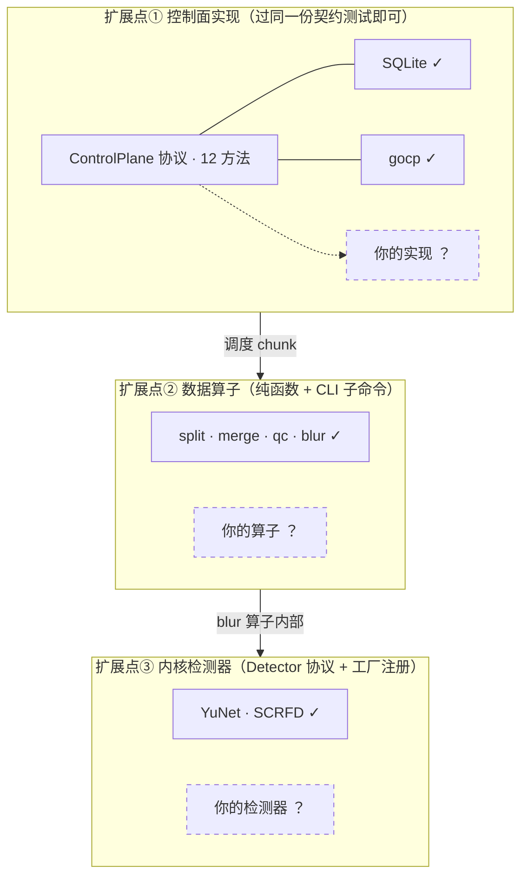

# 怎么扩展：加检测器 / 加算子 / 上 K8s

**共同前提：控制面契约与容错语义零改动——所有扩展都发生在数据面或配置对象层。**

三个扩展插槽在架构里的位置（虚线框 = 你要加的东西）：



## 一、加一个人脸检测器

协议只有一个方法（[detector.py:49-50](../../src/faceblur_lite/detector.py#L49-L50)）：

```python
class Detector(Protocol):
    def detect(self, frame_bgr: np.ndarray) -> list[Det]: ...
```

四步（以 SCRFD 的加入为模板，共 ~60 行）：

1. **实现类**：新文件写 `class XxxDetector`，`__init__` 里 `cv2.dnn.readNetFromONNX`，`detect` 返回 `list[Det]`（输入 BGR 帧原分辨率，letterbox/解码坐标你自己负责）
2. **模型路径**：[resolve_model_path](../../src/faceblur_lite/detector.py#L16-L34) 加分支 + 专属环境变量（YuNet=`FACEBLUR_MODEL`，SCRFD=`FACEBLUR_SCRFD_MODEL`，各自回落 `models/` 默认件）
3. **工厂注册**：[make_detector](../../src/faceblur_lite/detector.py#L174-L184) 加一个 `if kind == "xxx"` 分支，未知 kind 抛 ValueError
4. **CLI 放行**：cli.py 里 `choices=["yunet", "scrfd"]` 出现在 4 处（single/pipeline/worker/qc）——质检臂也要放行才能做交叉验收（`--qc-detector` 两臂不同）

验收纪律：升级前先画**能力包络**（各尺寸人脸的检出边界）；A/B 判据预注册、两臂质检检测器一致、**未胜出不翻默认**；源域阈值（`det_conf`）与输出域阈值（qc `pass_conf`）分域声明，不可复用。

## 二、加一个数据算子

算子 = 纯函数（`str 路径 → str 路径`），文件进文件出。split/merge 就是模板：

```python
def my_operator(input_path: str, output_path: str) -> str:
    ...   # 幂等覆盖写：同输入重跑产生同输出（at-least-once 的数据面答法）
```

- **CLI 子命令化**（[cli.py:70-77](../../src/faceblur_lite/cli.py#L70-L77)）：argparse 加 parser + 分发分支——四算子已是 DAG 引擎的节点模板
- **配置贯穿**：新参数加进 `KernelParams`（[kernel.py:14-25](../../src/faceblur_lite/kernel.py#L14-L25)），CLI → 编排器 → Worker → 内核单一对象直达
- **控制面零改动**：算子由 Worker 在 chunk 上调用，claim/complete/fail 语义不变；格式转换、多模态清洗等具身化算子同路（演进路径见 [../explanation/embodied.md](../explanation/embodied.md)）

## 三、跨机 / K8s 部署形态

本地三终端（控制面 / 编排器 / Worker ×N）各一条命令；上 K8s 只是换皮：

| 本项目组件 | K8s 形态 | 要点 |
|---|---|---|
| gocp | Deployment（1 副本）+ Service | **库文件唯一写者**：gocp.db 挂 RWO 卷，不可多副本 |
| worker | Deployment，`--cp-url <svc>` `--idle-exit-s 0` | 无状态可任意扩缩/被驱逐——lease 回收兜底 |
| orchestrator | Job / CronJob | `pipeline ... --cp-url` 跑完即退 |
| 文件可见性 | 共享卷 / 对象存储 | input/output 路径须对控制面与 Worker 双方可见（跨机前提） |

语义映射（调度语义 → K8s 原生对应物，详表见 [../explanation/industry.md](../explanation/industry.md) L1 节）：claim→调度器绑定、lease 回收→node 心跳丢失驱逐、attempt≤3→backoffLimit、终态不可逆→completed pod 不重启、围栏→UID/resourceVersion、原子 Join→无原生（引擎收编后由依赖边承担）。

## 四、（进阶）加第三种控制面实现

`ControlPlane` 协议 12 方法（[control.py](../../src/faceblur_lite/control.py)）任选存储实现（如 Redis/Postgres），**验收标准是过同一份契约测试**：`pytest tests/test_contract.py` 参数化两实现 14 场景——新实现加进参数列表即可继承全部守卫（终态不可逆、同名转世僵尸、原子 Join 竞态等）。

---

**事实源锚点**：Detector 协议与工厂 [detector.py:49-50](../../src/faceblur_lite/detector.py#L49-L50)·[174-184](../../src/faceblur_lite/detector.py#L174-L184)｜模型路径 env [detector.py:16-34](../../src/faceblur_lite/detector.py#L16-L34)｜算子 CLI 化 [cli.py:70-77](../../src/faceblur_lite/cli.py#L70-L77)｜KernelParams [kernel.py:14-25](../../src/faceblur_lite/kernel.py#L14-L25)｜Worker 常驻 [worker.py:15-29](../../src/faceblur_lite/worker.py#L15-L29)｜契约测试 [tests/test_contract.py](../../tests/test_contract.py)
