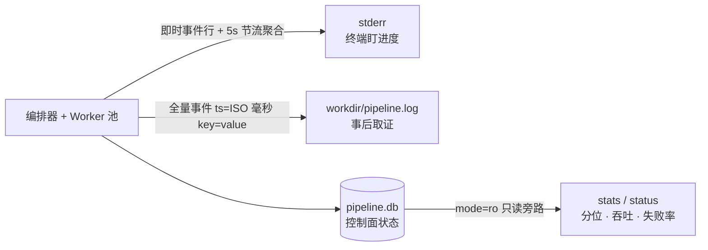

# 怎么批量跑（并看懂发生了什么）

**场景：一批真实视频要脱敏入库，要求失败可恢复、质检不过的成品不混进通过层。**

## 选模式

| 输入 | 模式 | 理由 |
|---|---|---|
| 1 个视频 | `single` | 无调度开销，直跑内核 |
| ≥2 个视频 | `pipeline` | 切片并行 + 共享 Worker 池 + 自动 qc/隔离 |

日常入口 `scripts/blur.sh run`（auto 规则同上）；下文用裸 CLI 讲机制。

## 命令解剖

```bash
./venv/bin/faceblur-lite pipeline 输入1.mp4 输入2.mp4 \
  --outdir    outputs/20261008-批次名   # 成品目录（{stem}_blurred.mp4）
  --workdir   outputs/20261008-批次名/work  # 一次性工件目录（库/日志/chunks）
  --workers   3                          # Worker 池大小
  --segment   30                         # 切片秒数（时长 ≤ 此值不切）
  --detector  yunet                      # yunet | scrfd
  --qc-detector yunet                    # 缺省跟随 --detector（交叉验收：两臂不同）
```

## 产物布局

```
outdir/
  {stem}_blurred.mp4          # 成品（qc 通过）
  qc_failed/{stem}_blurred.mp4  # 隔离区（复核后人工移出=转正；同名 _1 递增）
workdir/
  pipeline.db                 # 控制面库（videos/chunks 两级状态机）
  pipeline.log                # 全量事件日志（ISO 毫秒时间戳 key=value）
  chunks/{k:02d}_{stem}/      # 每视频一个子目录：chunk_000.mp4（切片）
                              #   + blurred_000.mp4（脱敏后切片）
```

## 进度双出口（跑批时怎么看）

- **stderr（粗粒度）**：即时事件行 + 5s 节流聚合行——终端盯进度用这个
- **`workdir/pipeline.log`（全量）**：每个状态迁移一行 `ts=... key=value`，事后取证用这个；观测读是 `mode=ro` 只读旁路，绝不反噬主流程



## 跑完看 stats

```bash
./venv/bin/faceblur-lite stats workdir/pipeline.db        # 人读
./venv/bin/faceblur-lite stats workdir/pipeline.db --json # 机读
```

| 指标 | 含义 | 健康参照（冒烟口径 ⟨RE⟩） |
|---|---|---|
| queue p50/p95 | chunk 从提交到被认领 | 0.9s / 9.3s |
| proc p50/p95 | chunk 处理耗时 | 10.3s / 12.2s |
| 吞吐 | chunks/min | 16.76 |
| fail_rate / retried | 失败率 / 重试计数 | 0 / 0 |

## qc_failed 流转（隔离 → 复核 → 转正）

1. 收尾 qc 复检违规 → 成品自动移入 `outdir/qc_failed/`（通过层永不见未验收件）
2. 人工复核：`faceblur-lite qc qc_failed/xxx.mp4 --sample-fps none`（全密度逐帧，最终验收档）；可换 `--detector` 交叉复核
3. 确认可用 → `mv` 移回 outdir 即转正；确认废片 → 删除。同名已存在自动 `_1` 递增，保上一轮证据

## 排障表（按退出码）

| rc | 现象 | 原因 → 处置 |
|---|---|---|
| 2 | `workdir 复用被拒绝` | 一次性工件目录不给二次跑 → 换新 workdir 或删旧 |
| 2 | 同 stem 碰撞清单 | 两输入同名：blur.sh 预检直接 rc 2；裸 CLI 不预检——先到者 done、后到者显式 failed（rc 1）→ 分批跑或重命名 |
| 2 | 输入不存在/目录无视频 | blur.sh 预检报清单 → 修路径 |
| 1 | `failed` 计数 >0 | 单视频提交失败（损坏/切不了片）被隔离，批次其余继续 → 看 JSON 的 error 字段 |
| 1 | qc 边缘违规 | 非 T_FATAL 桶 → 走 qc_failed 复核流程 |
| 3 | qc 致命违规 | violations 里 conf≥0.7 的漏糊 → 先查 `--detector` 是否适配该画质，复核用 `--sample-fps none` |

## 容错演练（可选）

跑批中另开终端 `kill -9` 一个 worker 进程：lease 900s 过期 → 巡检回收 → chunk 回 pending 重派 attempt+1；attempt 耗尽（>3）chunk+video 双 failed。日志全程可见——这就是"数据面可任意 kill"的实证。

已知边界：merge 阶段无租约，合并中 Worker 死亡则该 video 停在 `merging`（见 [../explanation/architecture.md](../explanation/architecture.md) 状态机一节）。

---

**事实源锚点**：命令与默认值 [cli.py:43-57](../../src/faceblur_lite/cli.py#L43-L57)｜产物布局 [orchestrator.py:107-124](../../src/faceblur_lite/orchestrator.py#L107-L124)｜进度双出口 [progress.py:104-180](../../src/faceblur_lite/progress.py#L104-L180)｜stats [stats.py](../../src/faceblur_lite/stats.py)｜隔离区 [orchestrator.py:48-62](../../src/faceblur_lite/orchestrator.py#L48-L62)｜workdir 复用拒绝 [cli.py:121-123](../../src/faceblur_lite/cli.py#L121-L123)
