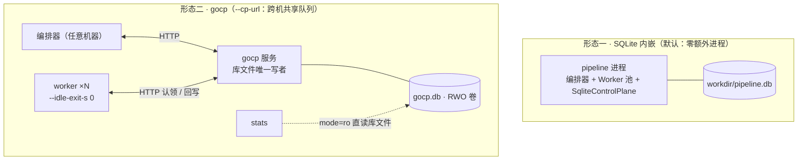

# 怎么切到 Go 控制面（gocp）

**目的：把控制面从 SQLite 内嵌换成独立 Go 服务——业界分工形态（平台控制面 Go + 算法数据面 Python），同时获得跨机 Worker 的共享队列。数据面与编排器零改动。**



方式 B 的"三个终端"就是右下图的三个方框。

## 方式 A：一条命令（blur.sh 代办）

```bash
scripts/blur.sh run inputs/real-video/ --go --outdir outputs/20261008-gocp批
```

自动：构建 gocp（缓存至 `/tmp/gocp-blur-sh`，源码更新自动重建）→ 随机空闲端口启动 → 探活 `GET /videos` 就绪 → `pipeline --cp-url ...` → 退出清理。需 go ≥1.25。

## 方式 B：手动分步（看清拓扑）

```bash
# 1. 构建并启动控制面（用法：gocp <db_path> <listen_addr>，默认 pipeline.db 127.0.0.1:8080）
cd gocp && go build -o /tmp/gocp . && cd ..
mkdir -p outputs/go-demo/work
/tmp/gocp outputs/go-demo/work/gocp.db 127.0.0.1:8080 &

# 2. 批量跑（编排器 + Worker 池全走 HTTP）
./venv/bin/faceblur-lite pipeline inputs/demo/move.mp4 inputs/demo/occlude.mp4 \
  --outdir outputs/go-demo --workdir outputs/go-demo/work --cp-url http://127.0.0.1:8080

# 3. （可选）另开终端加 Worker——这就是跨机扩容的本地形态
./venv/bin/faceblur-lite worker --cp-url http://127.0.0.1:8080 --idle-exit-s 0
```

`worker --idle-exit-s 0` 常驻不退出（容器/多终端部署形态）；`--db` 走 SQLite 库文件直连（WAL 跨进程安全），`--cp-url` 走 HTTP，二选一。

## curl 验证（契约即接口）

```bash
curl -s http://127.0.0.1:8080/videos
# []            ← 空库：video 总览

# 提交一个视频（两切片；chunk_inputs 项 = [idx, input, output] 三元组）
# 响应 {"video_id": "..."}
curl -s -X POST http://127.0.0.1:8080/videos -d '{
  "input_path": "in.mp4", "final_output": "out.mp4",
  "chunk_inputs": [[0, "c0.mp4", "b0.mp4"], [1, "c1.mp4", "b1.mp4"]]}'

# Worker 认领（互斥：恰一个调用者拿到任务；队列空返回 null）
curl -s -X POST http://127.0.0.1:8080/chunks/claim -d '{"worker_id": "w-1", "ttl_s": 900}'

# 完成（缺 worker_id/attempt 直接 400——持有者围栏字段强制）
curl -s -X POST http://127.0.0.1:8080/chunks/{id}/complete -d '{
  "metrics": {"frames": 300}, "worker_id": "w-1", "attempt": 0}'
```

错误口径：未知 id → 404 `{"error": ...}`（对齐 Python 端 KeyError）；围栏字段缺失 → 400。

## 为什么敢换（等价性保证）

- DDL 与事务语义与 Python 端**逐字一致**；DSN 上 `_txlock=immediate` + WAL + busy_timeout(10000) 对应 Python 端 `BEGIN IMMEDIATE` 单写者串行化
- 同一份契约测试 14 场景 ×2 实现双跑（`./venv/bin/python -m pytest tests/test_contract.py -q`），行为漂移立刻红灯
- `stats` 直读 `gocp.db` 文件（`mode=ro` 只读，WAL 并发读安全）——观测出口不因换控制面而变

注意：gocp 是库文件的唯一写者——同一 `gocp.db` 不要再被 `pipeline`（SQLite 模式）或第二个 gocp 实例打开。

---

**事实源锚点**：启动参数与 DSN [gocp/main.go:579-598](../../gocp/main.go#L579-L598)｜12 端点注册 [gocp/main.go:601-614](../../gocp/main.go#L601-L614)｜请求体字段 [gocp/main.go:140-148](../../gocp/main.go#L140-L148)·[188-196](../../gocp/main.go#L188-L196)·[232-240](../../gocp/main.go#L232-L240)｜blur.sh --go [scripts/blur.sh:205-236](../../scripts/blur.sh#L205-L236)｜worker 双形态 [cli.py:59-68](../../src/faceblur_lite/cli.py#L59-L68)｜契约测试 [tests/test_contract.py](../../tests/test_contract.py)
