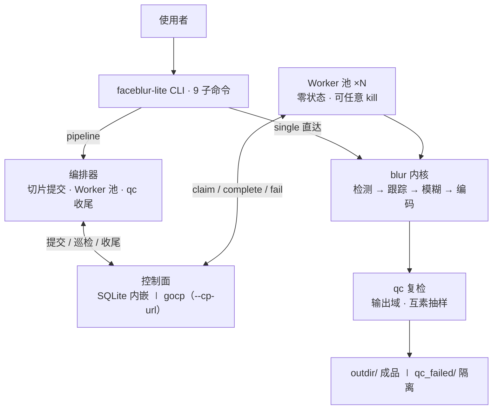

# face-blur-lite 是什么

**一句话：视频人脸脱敏管线——控制面/数据面分离的批处理系统，scatter-gather 切片并行，质检闸门保证通过层永不见未验收件。**

## 三十秒版架构

- **控制面**：状态的唯一拥有者。29 行 `ControlPlane` 协议 + 双实现（SQLite 内嵌 / gocp Go 服务），互斥认领、lease 900s、`(worker_id, attempt)` 围栏、终态不可逆、原子 Join、attempt≤3 重试预算
- **数据面**：零状态、可任意 kill/扩容。Worker 池消化全部切片；算子全是纯函数（文件→文件）
- **内核**：ffmpeg 解码 pipe → ONNX 检测（YuNet/SCRFD 可切换）→ mini-SORT 跟踪补位 → 高斯模糊 → libx264 编码；全程流式内存 O(1)
- **质检**：输出域复检（互素抽样、阈值分域），违规成品自动隔离进 `qc_failed/`

完整组件地图见 [../README.md](../README.md) 结构全景图；为什么这样设计 → [../explanation/architecture.md](../explanation/architecture.md)；一帧的旅程 → [../explanation/dataflow.md](../explanation/dataflow.md)。

## 能力清单

| 能力 | 入口 |
|---|---|
| 单视频脱敏 | `faceblur-lite single in.mp4 out.mp4` |
| 批量分片并行（自动 qc + 隔离） | `faceblur-lite pipeline in1.mp4 in2.mp4 --outdir out/` |
| 跨机/容器 Worker 扩容 | `faceblur-lite worker --cp-url http://... --idle-exit-s 0` |
| 独立算子（DAG 节点模板） | `split` / `merge` / `qc` 子命令 |
| Go 控制面（业界分工形态） | `pipeline --cp-url` 或 `scripts/blur.sh run --go` |
| 观测 | `stats`（分位/吞吐/失败率）· `status` · `workdir/pipeline.log` |

跑起来 → [quickstart.md](quickstart.md)。

## 成果速览（2026-09-27 重测）

| 维度 | 数字 | 口径 |
|---|---|---|
| 测试 | **139 passed**（契约 14 场景 ×2 实现双跑） | pytest 全量 ⟨RE⟩ |
| 批量冒烟 | 3 视频 → 4 chunks 全 done、qc 3/3、零重试，总 19.9s；吞吐 16.76 chunks/min | workers=3 ⟨RE⟩ |
| 单进程 | 30s 合成视频 wall 4.38s | 300 帧 ⟨RE⟩ |
| 检测器 | YuNet 232,589 B / 8.38ms·帧⁻¹；SCRFD 2,524,817 B / 17.58ms·帧⁻¹ | 640×480 合成帧 ⟨RE⟩ |
| 真实视频 | single 默认 wall 48.7s；全密度复检残留 27.8%（历史阶梯 621→308 为旧闸门口径，见 architecture.md 基线注记） | 720×1406 · 2121 帧 ⟨RE⟩ |

复跑方式与更多数字见 [../explanation/architecture.md](../explanation/architecture.md) 实测基线节。

## 这个项目练什么

算子是"人脸脱敏"，交付的是**错误模型**：互斥/租约/围栏/终态/Join/幂等六个调度语义 + 三份契约（ControlPlane/KernelParams/QCReport）。换算子（多模态清洗、LeRobot 格式转换、动作重定向）不换控制面——具身数据平台的落地方向见 [../explanation/embodied.md](../explanation/embodied.md)，业界坐标见 [../explanation/industry.md](../explanation/industry.md)。
